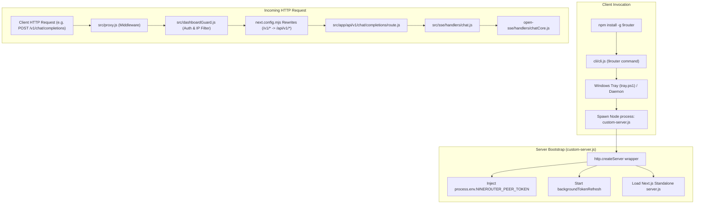

# 01-INITIAL RECONNAISSANCE: 9ROUTER REVERSE ENGINEERING
**Project:** Hime Assistant — AI Model Routing Layer Research  
**Target:** 9Router (`9router-app` / `9router` CLI)  
**Developer:** `decolua`  
**Upstream Repository:** `https://github.com/decolua/9router`  
**Documentation:** `https://docs.9router.com/`  
**Investigated Version:** `v0.5.112` (Commit: `1fe586bb`)  
**Branch:** `master`  
**Author:** Senior Reverse Engineer, AI Infrastructure Architect, Backend Engineer & Security Researcher  
**Date:** November 2026  
**Status:** Completed  

---

## 1. Executive Summary

Laporan ini menyajikan hasil inspeksi awal (*initial reconnaissance*) terhadap repositori biner dan kode sumber **9Router** yang dikembangkan oleh `decolua`. 9Router adalah gerbang perutean kecerdasan buatan (*local multi-provider AI routing gateway*) dan dashboard manajemen berbasis Next.js. 

Tujuan fundamental 9Router adalah menyediakan satu titik akhir (*endpoint*) tunggal yang sepenuhnya kompatibel dengan standar OpenAI API (`/v1/*`), namun secara transparan mampu mengalihkan lalu lintas (*routing*) ke lebih dari 140 provider upstream (termasuk OpenAI, Anthropic Claude, Google Gemini, DeepSeek, OpenRouter, Qwen, Nous Research, Grok, Kiro, Cursor, dll.) dengan penerjemahan format dua arah secara instan, perutean multi-akun (*account-level fallback*), rangkaian kegagalan model (*model combo fallback*), pengelolaan token OAuth otomatis, dan kompresi token (*RTK / token savers*).

Penyelidikan biner dan kode sumber mengonfirmasi bahwa 9Router dibangun di atas arsitektur monorepo ganda yang memisahkan antara **Next.js Server & Engine** (`9router-app`) dan **CLI Launcher Package** (`9router`).

---

## 2. Scope of Investigation

Penyelidikan tahap awal ini mencakup:
1. Verifikasi integritas repositori git, branch, tag rilis, dan hash commit.
2. Identifikasi runtime, bahasa pemrograman, framework, dan pustaka dependensi.
3. Pemetaan struktur direktori tingkat atas dan batasan arsitektural (*architectural boundaries*).
4. Analisis titik masuk (*entry points*) untuk server, antarmuka dashboard, dan CLI launcher.
5. Pemeriksaan mekanisme konfigurasi lingkungan (*environment variables*) dan default runtime.
6. Penentuan lapisan persistensi awal dan dependensi eksternal.

---

## 3. Actual Implementation Findings

### 3.1. Repository Metadata & Version Identity `[CONFIRMED]`
- **Upstream Git URL:** `https://github.com/decolua/9router.git`
- **Current Branch:** `master` (up to date with `origin/master`)
- **Release Tag:** `v0.5.112` (Commit hash: `1fe586bb`, tanggal rilis: 2026-10-28)
- **Lisensi:** MIT License ([`LICENSE`](file:///x:/folder_ai/Hime/RE/9ROUTER/00-source-materials/9router/LICENSE))
- **Author/Organization:** `decolua`
- **Recent Git Log Signatures:**
  - `1fe586bb` `# v0.5.112 (2026-10-28)`
  - `85d73bd6` `feat(minimax-code): lease auth mode via desktop app named-pipe broker`
  - `d7bb71ce` `fix(deepseek): use noble-hashes port for DeepSeek PoW hash`
  - `3b7acf72` `fix(docker): bundle lazy runtime deps so OpenCode Free resolves`
  - `56dbf466` `fix(chat): reject SSE errors in non-streaming responses`

### 3.2. Project Technology Stack & Runtimes `[CONFIRMED]`
Pemeriksaan terhadap [`package.json`](file:///x:/folder_ai/Hime/RE/9ROUTER/00-source-materials/9router/package.json) dan [`cli/package.json`](file:///x:/folder_ai/Hime/RE/9ROUTER/00-source-materials/9router/cli/package.json) memastikan spesifikasi teknologi berikut:
- **Language:** JavaScript murni (ECMAScript Modules / ESM). Tidak menggunakan TypeScript untuk kompilasi runtime gateway, meminimalkan build step overhead.
- **Web & Backend Framework:** **Next.js 16.4.2** (`output: "standalone"`), **React 19.2.4**, Tailwind CSS v4.
- **Node Engine Compatibility:** Node.js `>=18.0.0` (juga menyediakan kompatibilitas native untuk Bun runtime via script `dev:bun` / `start:bun`).
- **HTTP Engine:** Node.js native `http` module yang dibungkus oleh [`custom-server.js`](file:///x:/folder_ai/Hime/RE/9ROUTER/00-source-materials/9router/custom-server.js) bersama klien HTTP performa tinggi **`undici` v7.30.1**.
- **Database Engine:** Lapisan SQLite hibrida multi-driver dengan urutan fallback: `bun:sqlite` → `better-sqlite3` (v12.6.2, optional) → `node:sqlite` (Node.js >= 22.5) → `sql.js` (v1.14.1, pure WebAssembly fallback yang selalu berhasil berjalan tanpa compiler C++).
- **Authentication & Security Cryptography:** `jose` v6.1.3 (JWT verification), `bcryptjs` v3.0.3, `node-forge` v1.3.3, `@node-saml/node-saml` v5.1.0, `node-machine-id` v1.1.12.
- **UI & Visualization:** `@xyflow/react` v12.10.1 (node visual routing), `@dnd-kit/core` v6.3.1 (drag-and-drop model priority), `recharts` v3.7.0 (analisis kuota dan biaya), `@monaco-editor/react` (editor konfigurasi JSON).

### 3.3. Dual-Artifact Monorepo Boundary `[CONFIRMED]`
Repositori 9Router mempublikasikan 2 artefak mandiri:
1. **The Routing Gateway & Dashboard (`9router-app`):**
   - Berlokasi di direktori root.
   - Mengontrol seluruh routing logika, proxying, translasi format SSE, database SQLite, dan web UI.
   - Dijalankan via `node custom-server.js --port 20127` (atau port default `20128`).
2. **The CLI Launcher (`9router`):**
   - Berlokasi di [`cli/`](file:///x:/folder_ai/Hime/RE/9ROUTER/00-source-materials/9router/cli/).
   - Dipublikasikan ke npm registry publik sebagai package `9router`.
   - Mengelola instalasi runtime background, startup system tray Windows/macOS/Linux, automasi konfigurasi CLI tools pihak ketiga (Claude Code, Cline, Cursor, Roo Code), dan manajemen proses latar belakang.

---

## 4. Top-Level Directory and Module Structure

```
9router/
│
├── package.json                       <- Root manifest: 9router-app v0.5.112
├── custom-server.js                   <- HTTP wrapper server: IP sanitization, h2c replay, token refresh
├── next.config.mjs                    <- Next.js standalone config, API path rewrites (/v1/* -> /api/v1/*)
├── CLAUDE.md                          <- Panduan pengembangan internal resmi
├── CHANGELOG.md                       <- Riwayat versi dari 0.1.0 hingga 0.5.112
│
├── src/                               <- Next.js Application & Dashboard Layer
│   ├── app/                           <- Next.js App Router
│   │   ├── (dashboard)/               <- Route group dashboard (/dashboard/*)
│   │   ├── api/                       <- API routes internal (/api/*) & compatibility (/api/v1/*)
│   │   ├── login/                     <- Antarmuka autentikasi pengguna
│   │   └── callback/                  <- Endpoint penanganan OAuth callback
│   ├── sse/                           <- SSE Application Glue Layer (chat, model resolution, token refresh)
│   ├── lib/                           <- Lapisan database (SQLite repos, driver, migrations) & auth
│   ├── shared/                        <- Utilitas lintas komponen (machineId, apiKey, constants)
│   ├── proxy.js                       <- Next.js root middleware: session proxy & auth guard
│   └── dashboardGuard.js              <- Pengaman rute dashboard & filter IP localhost
│
├── open-sse/                          <- The Core Engine (Provider-agnostic routing & translation)
│   ├── AGENTS.md                      <- Panduan teknis arsitektur engine open-sse
│   ├── handlers/                      <- Core handlers (chatCore, image, embedding, tts, stt, search)
│   ├── translator/                    <- Penerjemah format (OpenAI <-> Claude <-> Gemini <-> Codex)
│   ├── executors/                     <- Adapter koneksi upstream (OpenAI, Vertex, Bedrock, Web, dll.)
│   ├── providers/                     <- Registri 140+ provider AI dan kapabilitas model
│   ├── rtk/                           <- Request Token-Killer (kompresi in-place context/tool_result)
│   ├── services/                      <- Logika combo, accountFallback, tokenRefresh, model parse
│   ├── config/                        <- Konstanta provider, timeout, error rules, dan models
│   └── utils/                         <- StreamHandler, SSE parsing, sessionManager, clientDetector
│
├── cli/                               <- The Standalone CLI Launcher
│   ├── cli.js                         <- CLI executable (npm bin: 9router)
│   ├── hooks/                         <- Runtime installer (postinstall, sqliteRuntime, trayRuntime)
│   └── src/cli/                       <- Terminal UI, System Tray (Windows PowerShell tray.ps1), Menus
│
├── docs/                              <- Dokumentasi teknis sistem (ARCHITECTURE.md)
└── tests/                             <- Test suite mandiri berbasis Vitest (~1000 unit & translator tests)
```

---

## 5. Execution Entry Points & Runtime Boundary



### Penjelasan Titik Masuk Kunci:
1. **CLI Entry Point (`cli/cli.js`):** Titik masuk saat pengguna mengeksekusi perintah terminal `9router`. Memeriksa ketersediaan modul SQLite lokal di `~/.9router/runtime/node_modules`, mendeteksi apakah instance server sudah aktif di port `20128`, dan menampilkan antarmuka terminal interaktif atau meminimalkan ke system tray Windows melalui script PowerShell `cli/src/cli/tray/tray.ps1`.
2. **Server Entry Point (`custom-server.js`):** Pembungkus (*wrapper*) HTTP server Next.js. Mencegah manipulasi header `X-Forwarded-For` dari penyerang dengan mengekstrak IP klien langsung dari soket TCP mentah (`req.socket.remoteAddress`), menginisialisasi rahasia internal `NINEROUTER_PEER_TOKEN`, menurunkan koneksi `h2c` ke HTTP/1.1 secara aman, dan mengaktifkan scheduler penyegaran token background (`startBackgroundTokenRefresh`).
3. **API Routing Entry Point (`next.config.mjs`):** Menyediakan aturan rewrite transparan di tingkat engine Next.js. Permintaan klien eksternal ke `/v1/*` secara otomatis diarahkan ke rute internal `/api/v1/*`, dan rute Gemini `/v1beta/*` diarahkan ke `/api/v1beta/*`.

---

## 6. Environment Variables and Runtime Configuration

Pemeriksaan terhadap [`.env.example`](file:///x:/folder_ai/Hime/RE/9ROUTER/00-source-materials/9router/.env.example) dan [`src/lib/db/paths.js`](file:///x:/folder_ai/Hime/RE/9ROUTER/00-source-materials/9router/src/lib/db/paths.js) mengungkap kontrak variabel lingkungan berikut:

| Nama Variabel Lingkungan | Nilai Default | Klasifikasi Keamanan | Deskripsi dan Dampak Operasional |
| :--- | :--- | :--- | :--- |
| `PORT` | `20128` | Networking | Port TCP tempat 9Router mendengarkan koneksi masuk. |
| `HOSTNAME` | `127.0.0.1` | Networking / Exposure | Host binding. Penggunaan `0.0.0.0` membuka akses ke seluruh antarmuka jaringan LAN. |
| `DATA_DIR` | `~/.9router` | File Storage | Direktori root penyimpanan database `9router.db`, runtime dependensi, dan backup. |
| `JWT_SECRET` | Auto-generated random | **CRITICAL SECRET** | Kunci kriptografi penandatanganan cookie sesi dashboard (`dashboardSession.js`). |
| `INITIAL_PASSWORD` | `123456` | **CRITICAL SECURITY RISK** | Kata sandi default akun admin saat instalasi baru. Wajib diubah oleh pengguna. |
| `API_KEY_SECRET` | Machine ID hash | Security Secret | Garam enkripsi hashing API Key lokal. |
| `NINEROUTER_PROXY_CLIENT_MAX_BODY_SIZE` | `128mb` | Performance / Memory | Batas payload maksimum request LLM (mendukung input gambar/dokumen base64 masif). |
| `NEXT_PUBLIC_CLOUD_URL` | Kosong | External Service | Endpoint opsional untuk sinkronisasi konfigurasi multi-perangkat via cloud. |

---

## 7. Storage and Database Foundations `[CONFIRMED]`

Arsitektur penyimpanan 9Router telah mengalami evolusi penting:
- **Dokumentasi Lama Stale:** File dokumentasi lama (`ARCHITECTURE.md`) mencatat penggunaan `db.json`.
- **Implementasi Aktual Terkini:** Menggunakan basis data **SQLite** di bawah [`src/lib/db/`](file:///x:/folder_ai/Hime/RE/9ROUTER/00-source-materials/9router/src/lib/db/) dengan file fisik `9router.db` di direktori `$DATA_DIR` (`~/.9router/`).
- **Pragma Konfigurasi:** Mengaktifkan mode performa tinggi:
  `PRAGMA journal_mode = WAL; PRAGMA synchronous = NORMAL; PRAGMA busy_timeout = 5000;`
- **Pemisahan File Log:** Data penggunaan harian dan log jejak mentah disimpan terpisah di `~/.9router/usage.json` dan `~/.9router/log.txt` via [`src/lib/usageDb.js`](file:///x:/folder_ai/Hime/RE/9ROUTER/00-source-materials/9router/src/lib/usageDb.js).

---

## 8. Limitations & Unresolved Questions

### Limitations
1. **Plain ESM Runtime:** Tidak ada build-time static type checking (seperti `tsc`) di runtime, bergantung pada pengujian unit Vitest yang komprehensif di folder `tests/`.
2. **Ketergantungan pada Standalone Node:** Untuk performa terbaik di Windows, 9Router memerlukan dependensi native `better-sqlite3` yang dikompilasi ke direktori runtime lokal pengguna, atau menggunakan fallback WebAssembly `sql.js` dengan performa I/O sedikit lebih lambat.

### Unresolved Questions
- Bagaimana performa konkurensi streaming WebAssembly `sql.js` di bawah beban tinggi (50+ request/detik) jika `better-sqlite3` tidak tersedia pada sistem Windows minimal?
- Sejauh mana skema enkripsi credentials `providerConnections` melindungi token OAuth saat file database `9router.db` diakses oleh proses Windows lokal lainnya?

---

*Laporan ini menjadi landasan teknis untuk penyelidikan mendalam arsitektur perutean pada Laporan 02 hingga 14.*
