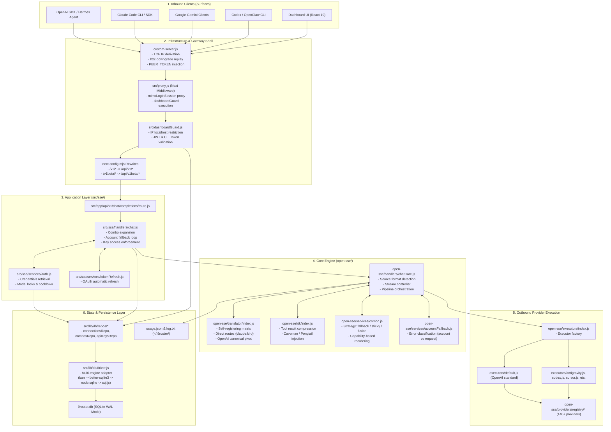
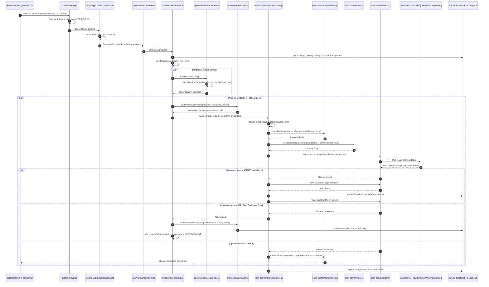

# 02-SOURCE CODE ARCHITECTURE: 9ROUTER
**Project:** Hime Assistant — AI Model Routing Layer Research  
**Target:** 9Router (`9router-app` / `open-sse`)  
**Repository:** `https://github.com/decolua/9router`  
**Commit Reference:** `1fe586bb` (`v0.5.112`)  
**Author:** Senior Reverse Engineer, AI Infrastructure Architect, Backend Engineer & Security Researcher  
**Date:** November 2026  
**Status:** Completed  

---

## 1. Executive Summary

Laporan ini menyajikan pembedahan mendalam terhadap **arsitektur kode sumber** 9Router. Investigasi memetakan batas-batas struktural antara antarmuka frontend, runtime Next.js, gateway adaptasi API, mesin penerjemah inti (`open-sse`), dan lapisan persistensi database SQLite. 

Penelitian membuktikan bahwa 9Router menerapkan pola arsitektur **Clean Hexagonal Architecture / Port & Adapter**:
1. **Driving Adapters (Inbound):** Menyediakan titik kontak kompatibilitas multi-format (`/v1/*` untuk OpenAI, `/v1/messages` untuk Claude, `/v1beta/*` untuk Gemini, `/codex/*` untuk Codex Responses).
2. **Core Domain (Engine):** Mesin otonom `open-sse/` yang agnostik terhadap Next.js; mampu mendeteksi format sumber, memetakan ke format perantara (*canonical intermediate format*), menerapkan penghemat token (*RTK*), dan mengoordinasikan eksekusi.
3. **Driven Adapters (Outbound):** Lebih dari 140 adapter provider di `open-sse/providers/` dan puluhan eksekutor di `open-sse/executors/` yang berbicara langsung dengan API eksternal.
4. **Secondary Infrastructure:** Lapisan persistensi data SQLite terabstraksi di `src/lib/db/` yang tahan terhadap berbagai lingkungan komputasi.

---

## 2. High-Level Component Architecture Diagram

---

## 3. Detailed Component Breakdown & Responsibilities

### 3.1. Server Shell Layer `[CONFIRMED]`

| File Path | Baris Kunci | Tanggung Jawab Utama |
| :--- | :--- | :--- |
| [`custom-server.js`](file:///x:/folder_ai/Hime\RE\9ROUTER\00-source-materials\9router\custom-server.js) | L52–L75, L80–L125 | Membungkus `http.createServer`. Menghapus header manipulatif `x-forwarded-for`, menetapkan IP asli dari raw socket TCP (`req.socket.remoteAddress`), menyematkan rahasia unik `process.env.NINEROUTER_PEER_TOKEN`, menurunkan permintaan upgrade `h2c` ke HTTP/1.1 untuk mencegah socket drop, dan memicu `backgroundTokenRefresh`. |
| [`next.config.mjs`](file:///x:/folder_ai/Hime\RE\9ROUTER\00-source-materials\9router\next.config.mjs) | L28, L42, L65–L107 | Mendefinisikan `serverExternalPackages` (`better-sqlite3`, `sql.js`, `@aws-sdk/credential-providers`, `wreq-js`, `open`). Mengonfigurasi batas payload klien `128mb` untuk input multimodal besar, serta memetakan rewrite rute kompatibilitas OpenAI, Gemini, dan Codex. |
| [`src/proxy.js`](file:///x:/folder_ai\Hime\RE\9ROUTER\00-source-materials\9router\src\proxy.js) | L13–L69 | Middleware tingkat atas Next.js. Menangani proxy sesi login Xiaomi Mimo terisolasi dan mendelegasikan pengecekan akses ke `dashboardGuard`. |
| [`src/dashboardGuard.js`](file:///x:/folder_ai\Hime\RE\9ROUTER\00-source-materials\9router\src\dashboardGuard.js) | L23–L51, L74–L95 | Menjaga rute dashboard dari akses publik. Menerapkan daftar pengecualian untuk endpoint AI publik (`/v1/*`, `/api/v1/*`), memvalidasi JWT cookie, memvalidasi CLI Token berbasis machine ID (`x-9r-cli-token`), dan memblokir rute berbahaya (`LOCAL_ONLY_PATHS`) jika diakses dari luar `localhost`/`127.0.0.1`. |

### 3.2. Application Glue Layer (`src/sse/`) `[CONFIRMED]`

| File Path | Baris Kunci | Tanggung Jawab Utama |
| :--- | :--- | :--- |
| [`src/sse/handlers/chat.js`](file:///x:/folder_ai\Hime\RE\9ROUTER\00-source-materials\9router\src\sse\handlers\chat.js) | L37–L188, L279–L390 | Titik masuk utama untuk chat completion. Melakukan validasi schema, stripping model context marker (e.g. `[1m]`), verifikasi API Key lokal, ekspansi model combo (`handleComboChat` / `handleFusionChat`), resolusi kapabilitas (vision/audio/search), serta loop rotasi multi-akun pada provider yang sama saat terjadi error rate-limit atau kegagalan kuota. |
| [`src/sse/services/auth.js`](file:///x:/folder_ai\Hime\RE\9ROUTER\00-source-materials\9router\src\sse\services\auth.js) | L45–L130 | Mengambil kredensial aktif dari repositori database (`getProviderCredentials`). Mengelola status ketersediaan akun, memeriksa kunci model (`modelLock_*`), dan menerapkan masa tenang (*cooldown*). |
| [`src/sse/services/model.js`](file:///x:/folder_ai\Hime\RE\9ROUTER\00-source-materials\9router\src\sse\services\model.js) | L20–L95 | Mengurai string model klien (seperti `openai/gpt-4o`, `anthropic/claude-3-5-sonnet`, atau nama combo kustom) menjadi metadata provider dan model upstream. Mengelola alias model kustom yang didefinisikan pengguna. |
| [`src/sse/services/tokenRefresh.js`](file:///x:/folder_ai\Hime\RE\9ROUTER\00-source-materials\9router\src\sse\services\tokenRefresh.js) | L30–L110 | Menangani penyegaran token OAuth secara proaktif maupun reaktif saat menerima status HTTP 401/403. Mendukung penyimpanan token baru kembali ke basis data secara asinkron tanpa memblokir stream. |

### 3.3. Core Engine Layer (`open-sse/`) `[CONFIRMED]`

| File Path | Baris Kunci | Tanggung Jawab Utama |
| :--- | :--- | :--- |
| [`open-sse/handlers/chatCore.js`](file:///x:/folder_ai\Hime\RE\9ROUTER\00-source-materials\9router\open-sse\handlers\chatCore.js) | L64–L145, L196–L230, L396–L460 | Orkestrator pemrosesan permintaan inti. Mendeteksi format sumber (`sourceFormat`), menentukan format target (`targetFormat`), memanggil translasi request, menerapkan penghemat token (RTK, Caveman, Ponytail), mengeksekusi request melalui eksekutor provider, menangani penyegaran token otomatis, dan memfasilitasi streaming respons SSE kembali ke klien. |
| [`open-sse/translator/index.js`](file:///x:/folder_ai\Hime\RE\9ROUTER\00-source-materials\9router\open-sse\translator\index.js) | L22–L32, L69–L180, L182–L220 | Registri penerjemah format dua arah. Mendukung *direct route* tanpa kehilangan informasi (misalnya `claude:kiro`), atau pivoting melalui format kanonikal OpenAI (`source -> openai -> target`). Menangani sanitasi tool call ID, deklarasi tipe tool Claude, dan rekonsiliasi konteks. |
| [`open-sse/services/accountFallback.js`](file:///x:/folder_ai\Hime\RE\9ROUTER\00-source-materials\9router\open-sse\services\accountFallback.js) | L29–L71, L130–L160 | Mesin klasifikasi error. Memisahkan apakah kesalahan berasal dari akun/kredensial (`shouldFallback: true`, misal status 401, 403, 429) atau berasal dari permintaan itu sendiri (`requestScoped: true`, misal 400 context overflow), sehingga mencegah pemblokiran akun sehat dari rotasi. Mengkalkulasi *exponential backoff cooldown*. |
| [`open-sse/services/combo.js`](file:///x:/folder_ai\Hime\RE\9ROUTER\00-source-materials\9router\open-sse\services\combo.js) | L86–L105, L128–L180, L320–L480 | Mengatur perutean model virtual (combos). Mendukung strategi `fallback` (berurutan), `roundrobin`, `sticky` (mengunci model hingga batas penggunaan atau sesi selesai), `smart` (analisis kecocokan prompt), dan `fusion` (penggabungan output multi-model via panel evaluasi). Mendeteksi modalitas input (gambar/audio/dokumen) dan mengurutkan model berdasarkan kecocokan kapabilitas. |
| [`open-sse/rtk/index.js`](file:///x:/folder_ai\Hime\RE\9ROUTER\00-source-materials\9router\open-sse\rtk\index.js) | L15–L85 | Request Token-Killer (RTK). Mengompresi payload `tool_result` berukuran raksasa langsung di memori (*in-place*) sebelum dikirim ke upstream. Didesain *fail-open* (jika kompresi gagal, payload asli tetap dikirim tanpa memutus eksekusi). |

### 3.4. Outbound Provider Adapters & Executors `[CONFIRMED]`

| File Path | Baris Kunci | Tanggung Jawab Utama |
| :--- | :--- | :--- |
| [`open-sse/executors/base.js`](file:///x:/folder_ai\Hime\RE\9ROUTER\00-source-materials\9router\open-sse\executors\base.js) | L15–L90 | Kelas dasar `BaseExecutor`. Menyediakan template method untuk pembentukan header HTTP, URL, manajemen timeout, proxy transport, dan eksekusi jaringan via `fetch`/`undici`. |
| [`open-sse/executors/default.js`](file:///x:/folder_ai\Hime\RE\9ROUTER\00-source-materials\9router\open-sse\executors\default.js) | L10–L65 | Eksekutor standar untuk semua provider upstream yang mematuhi format OpenAI Chat Completions. Menghilangkan kebutuhan membuat file eksekutor terpisah untuk puluhan provider OpenAI-compatible. |
| [`open-sse/executors/index.js`](file:///x:/folder_ai\Hime\RE\9ROUTER\00-source-materials\9router\open-sse\executors\index.js) | L15–L55 | Factory eksekutor. Memetakan ID provider ke kelas eksekutor khusus (seperti `antigravity`, `bedrock`, `codex`, `cursor`, `gemini-cli`, `kiro`, `vertex`), atau jatuh kembali (*fallback*) ke `DefaultExecutor`. |
| [`open-sse/providers/registry/index.js`](file:///x:/folder_ai\Hime\RE\9ROUTER\00-source-materials\9router\open-sse\providers\registry\index.js) | L1–L140 | Indeks statis dari 140+ definisi provider AI yang terdaftar di sistem. |

### 3.5. Persistence Layer (`src/lib/db/`) `[CONFIRMED]`

| File Path | Baris Kunci | Tanggung Jawab Utama |
| :--- | :--- | :--- |
| [`src/lib/db/driver.js`](file:///x:/folder_ai\Hime\RE\9ROUTER\00-source-materials\9router\src\lib\db\driver.js) | L20–L85 | Abstraksi koneksi SQLite universal. Mendeteksi driver yang tersedia di lingkungan runtime: Bun native `bun:sqlite` → Node C++ `better-sqlite3` → Node.js standard `node:sqlite` → WebAssembly `sql.js`. Menjamin 9Router dapat dijalankan di Windows tanpa build tools C++. |
| [`src/lib/db/schema.js`](file:///x:/folder_ai\Hime\RE\9ROUTER\00-source-materials\9router\src\lib\db\schema.js) | L8–L16, L21–L160 | Definisi skema basis data `9router.db`. Mengonfigurasi WAL mode, tabel `providerConnections`, `providerNodes`, `proxyPools`, `apiKeys`, `combos`, `kv`, `usageHistory`, `usageDaily`, dan `requestDetails`. |
| [`src/lib/db/repos/*`](file:///x:/folder_ai\Hime\RE\9ROUTER\00-source-materials\9router\src\lib\db\repos) | Modular | Data Access Object (DAO) per-entitas: `connectionsRepo.js`, `combosRepo.js`, `apiKeysRepo.js`, `settingsRepo.js`, `usageRepo.js`. |

---

## 4. Execution Trace: The End-to-End Request Journey

Diagram alir eksekusi berikut melacak perjalanan sebuah permintaan API dari saat diterima hingga respons selesai:

---

## 5. Architectural Evaluation for Hime Assistant

1. **Pemisahan Logika yang Bersih:**  
   Pemisahan antara `src/sse/` dan `open-sse/` memungkinkan Hime Assistant memanggil atau mengevaluasi logika perutean dan translasi format tanpa harus terikat penuh dengan antarmuka web Next.js jika suatu saat Hime menginginkan implementasi embedded.
2. **Kemandirian Driver Database:**  
   Arsitektur database multi-driver (`driver.js`) menjamin portabilitas instalasi lokal di sistem operasi Windows tanpa kendala kompilasi `node-gyp`.
3. **Kesiapan Ekosistem Nous Research:**  
   Ditemukannya adapter provider resmi untuk **Nous Research** ([`open-sse/providers/registry/nous.js`](file:///x:/folder_ai\Hime\RE\9ROUTER\00-source-materials\9router\open-sse\providers\registry\nous.js)) membuktikan keselarasan alami antara 9Router dan ekosistem Hermes Agent.
