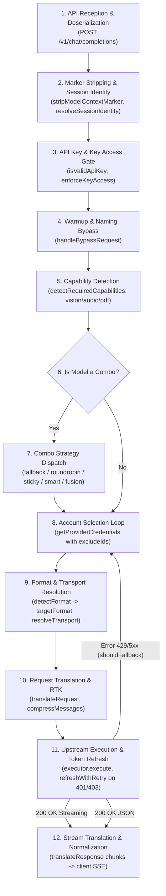

# 03-CORE ROUTING ENGINE: 9ROUTER
**Project:** Hime Assistant — AI Model Routing Layer Research  
**Target:** 9Router Internal Routing Pipeline  
**Core Components:** `src/sse/handlers/chat.js`, `open-sse/handlers/chatCore.js`, `open-sse/translator/index.js`  
**Author:** Senior Reverse Engineer, AI Infrastructure Architect, Backend Engineer & Security Researcher  
**Date:** November 2026  
**Status:** Completed  

---

## 1. Executive Summary

Laporan ini membedah arsitektur internal **mesin perutean utama (*Core Routing Engine*)** 9Router. Investigasi menelusuri alur eksekusi presisi dari saat sebuah klien API mengirimkan permintaan ke titik akhir kompatibel hingga paket respons streaming (*Server-Sent Events / SSE*) atau respons JSON utuh kembali ke klien.

Hasil analisis membuktikan bahwa mesin perutean 9Router diimplementasikan melalui kombinasi **Registry-based Architecture** dan **Format Pivot Pipeline**:
1. **Model Parsing & Normalization:** Mengurai string model klien, menghapus penanda konteks Claude (`[1m]`), dan memverifikasi batasan akses per-kunci (*Key Access Control*).
2. **Dynamic Strategy Combos:** Jika model yang diminta adalah model virtual (*combo*), mesin mengevaluasi strategi fallback, round-robin, sticky session, atau panel fusion.
3. **Account Fallback Loop:** Menyeleksi kredensial akun aktif dengan filter lock model independen.
4. **Intermediate Canonical Pivot:** Translasi format pesan berpijak pada skema **OpenAI Chat Completions** sebagai format kanonikal perantara (`source -> openai -> target`), dengan jalur pintas (*direct route*) untuk pasangan format berisiko tinggi.
5. **Pre- & Post-Translate Optimizers:** Injeksi penghemat token RTK, Headroom, Caveman, dan Ponytail.
6. **Streaming Pipe Controller:** Mentranslasikan potongan chunk SSE upstream ke format native yang diharapkan klien secara real-time.

---

## 2. Request Lifecycle & Routing State Machine

Diagram alir berikut memetakan 12 tahapan diskrit pemrosesan permintaan pada mesin perutean 9Router:



---

## 3. Step-by-Step Investigation of Routing Phases

### Fase 1: Penerimaan Permintaan & Deserialisasi `[CONFIRMED]`
- **Lokasi Kode:** [`src/sse/handlers/chat.js:37-44`](file:///x:/folder_ai\Hime\RE\9ROUTER\00-source-materials\9router\src\sse\handlers\chat.js#L37-L44)
- **Mekanisme:** Permintaan HTTP diekstrak melalui `await request.json()`. Jika body bukan JSON yang valid, handler segera menghentikan eksekusi dan mengembalikan respons error HTTP 400 (`errorResponse(HTTP_STATUS.BAD_REQUEST, "Invalid JSON body")`).

### Fase 2: Penanganan Marker Konteks & Identitas Sesi `[CONFIRMED]`
- **Lokasi Kode:** [`src/sse/handlers/chat.js:55-63`](file:///x:/folder_ai\Hime\RE\9ROUTER\00-source-materials\9router\src\sse\handlers\chat.js#L55-L63)
- **Pembersihan Marker:** Klien Claude Code sering menambahkan sufiks konteks `[1m]` pada nama model (misalnya `claude-3-5-sonnet[1m]`). Fungsi `stripModelContextMarker` memotong penanda ini agar nama model dapat dicocokkan dengan katalog provider atau nama combo yang sebenarnya. Penanda diteruskan ke upstream melalui header `anthropic-beta`.
- **Session Identity:** Fungsi `resolveSessionIdentity` membaca header klien atau body untuk mengidentifikasi ID percakapan stabil (`sessionId`), yang nantinya digunakan untuk mengunci sesi (*session stickiness*).

### Fase 3: Autentikasi Kunci API & Kontrol Akses Per-Kunci `[CONFIRMED]`
- **Lokasi Kode:** [`src/sse/handlers/chat.js:68-100`](file:///x:/folder_ai\Hime\RE\9ROUTER\00-source-materials\9router\src\sse\handlers\chat.js#L68-L100)
- **Validasi Kunci:** Jika opsi `requireApiKey` diaktifkan pada pengaturan sistem (`settings.requireApiKey === true`), kunci API diekstraksi dari header `Authorization: Bearer <key>` dan divalidasi terhadap tabel `apiKeys` di SQLite.
- **Per-Key Model Access Enforcement:** [`enforceKeyAccess(keyAccess, modelStr)`](file:///x:/folder_ai\Hime\RE\9ROUTER\00-source-materials\9router\src\sse\services\keyAccess.js): Kunci API dapat dibatasi hak aksesnya (`accessRestricted = 1`) sehingga hanya diizinkan memanggil model atau combo tertentu yang tercantum dalam kolom `accessAllow`. Percobaan mengakses model di luar izin menghasilkan penolakan HTTP 403 Forbidden.

### Fase 4: Bypass Permintaan Warmup & Naming `[CONFIRMED]`
- **Lokasi Kode:** [`src/sse/handlers/chat.js:103-105`](file:///x:/folder_ai\Hime\RE\9ROUTER\00-source-materials\9router\src\sse\handlers\chat.js#L103-L105)
- **Mekanisme:** Beberapa alat CLI (seperti Claude Code) mengirimkan permintaan prapemanasan (*warmup ping*) atau permintaan penamaan sesi (*naming request*) yang tidak memerlukan inferensi model berbiaya penuh. Fungsi `handleBypassRequest` mencegat pola permintaan ini untuk mencegah perputaran slot rotasi combo model berharga.

### Fase 5: Deteksi Modalitas & Kapabilitas yang Dibutuhkan `[CONFIRMED]`
- **Lokasi Kode:** [`src/sse/handlers/chat.js:107`](file:///x:/folder_ai\Hime\RE\9ROUTER\00-source-materials\9router\src\sse\handlers\chat.js#L107), [`open-sse/services/combo.js:128-155`](file:///x:/folder_ai\Hime\RE\9ROUTER\00-source-materials\9router\open-sse\services\combo.js#L128-L155)
- **Mekanisme:** Fungsi `detectRequiredCapabilities(body)` memindai pesan percakapan giliran terakhir (*trailing user turn*) untuk mendeteksi apakah permintaan memerlukan:
  - `vision`: Terdeteksi dari blok tipe `image_url`, `input_image`, atau MIME `image/*`.
  - `pdf`: Terdeteksi dari blok tipe `document` atau MIME `application/pdf`.
  - `audioInput`: Terdeteksi dari MIME `audio/*`.
  - `videoInput`: Terdeteksi dari MIME `video/*`.
  - `search`: Terdeteksi dari deklarasi fungsi web search di dalam daftar `tools`.

### Fase 6 & 7: Perutean Model Virtual (Combos) `[CONFIRMED]`
- **Lokasi Kode:** [`src/sse/handlers/chat.js:110-166`](file:///x:/folder_ai\Hime\RE\9ROUTER\00-source-materials\9router\src\sse\handlers\chat.js#L110-L166)
- **Resolusi Combo:** Jika nama model terdaftar di tabel `combos`, fungsi `getComboModels(modelStr)` memuat daftar model anggotanya.
- **Capacity Adapter:** Jika model target tidak memiliki kapabilitas yang dibutuhkan (misalnya model teks diminta menganalisis gambar), fungsi `augmentModelsWithCapacityAdapter` menyisipkan model berkemampuan visual secara otomatis ke urutan pertama rotasi.
- **Strategi Eksekusi:**
  - `fallback`: Mencoba model pertama; jika gagal atau kehabisan kuota, otomatis berpindah ke model kedua.
  - `roundrobin`: Berputar secara merata di antara seluruh model anggota combo.
  - `sticky`: Mengunci request ke model tertentu hingga mencapai batas `comboStickyRoundRobinLimit` berturut-turut.
  - `smart`: Menggunakan router classifier ringan untuk memilih model paling optimal sesuai kompleksitas prompt.
  - `fusion`: Menjalankan query ke beberapa model sekaligus dan menyatukan respon terbaik.

### Fase 8: Loop Seleksi Akun Multi-Account `[CONFIRMED]`
- **Lokasi Kode:** [`src/sse/handlers/chat.js:279-389`](file:///x:/folder_ai\Hime\RE\9ROUTER\00-source-materials\9router\src\sse\handlers\chat.js#L279-L389)
- **Mekanisme Rotasi:** Sebuah blok `while (true)` dijalankan dengan himpunan `excludeConnectionIds`:
  1. Memanggil `getProviderCredentials(provider, excludeConnectionIds, model)`.
  2. Memeriksa apakah semua akun sedang terkena limit (`credentials.allRateLimited`). Jika ya, kembalikan respons HTTP 503 dengan header `Retry-After`.
  3. Memeriksa dan memperbarui token OAuth jika mendekati masa kedaluwarsa (`checkAndRefreshToken`).
  4. Meneruskan ke `handleChatCore`.
  5. Jika permintaan gagal dan error diklasifikasikan sebagai kegagalan akun oleh `markAccountUnavailable`, ID koneksi dimasukkan ke `excludeConnectionIds`, dan loop berulang secara transparan ke akun berikutnya tanpa memutuskan koneksi klien!

### Fase 9: Deteksi Format Sumber & Target `[CONFIRMED]`
- **Lokasi Kode:** [`open-sse/handlers/chatCore.js:77-114`](file:///x:/folder_ai\Hime\RE\9ROUTER\00-source-materials\9router\open-sse\handlers\chatCore.js#L77-L114)
- **Deteksi Sumber:** `detectFormat(body)` memeriksa apakah payload masuk menggunakan format:
  - `openai`: Memiliki array `messages` dengan objek standar `{role, content}`.
  - `claude`: Memiliki array `messages`, field `system`, atau header `x-api-key`.
  - `gemini`: Memiliki array `contents` dengan field `parts`.
  - `openai-responses`: Format Codex dengan array `input`.
- **Penentuan Target:** Berdasarkan metadata di `open-sse/config/providerModels.js` dan endpoint target provider (`resolveTransport`). Jika provider mendukung beberapa endpoint (misalnya MiniMax yang mendukung format OpenAI dan Claude), 9Router memilih rute yang sama dengan format klien untuk mencegah overhead translasi (*zero translation path*).

### Fase 10: Translasi Format Pesan & Optimasi Token `[CONFIRMED]`
- **Lokasi Kode:** [`open-sse/handlers/chatCore.js:217-238`](file:///x:/folder_ai\Hime\RE\9ROUTER\00-source-materials\9router\open-sse\handlers\chatCore.js#L217-L238), [`open-sse/translator/index.js`](file:///x:/folder_ai\Hime\RE\9ROUTER\00-source-materials\9router\open-sse\translator\index.js)
- **Format Pivot:** Permintaan diterjemahkan melalui matriks terdaftar:
  - Jalur Langsung (*Direct Route*): Jika ada fungsi untuk pasangan spesifik (misal `claude:kiro`), translasi dilakukan 1 langkah.
  - Jalur Perantara (*Canonical Route*): `sourceFormat -> OpenAI Format -> targetFormat`.
- **Normalisasi Tools:** `ensureToolCallIds` menjamin semua ID pemanggilan fungsi mematuhi regex Anthropic `^[a-zA-Z0-9_-]+$`. Duplikasi nama tools dibersihkan via `dedupeTools`.
- **Token Savers Pipeline:**
  1. **RTK ([`open-sse/rtk/index.js`](file:///x:/folder_ai\Hime\RE\9ROUTER\00-source-materials\9router\open-sse\rtk\index.js)):** Memangkas output tool terminal/file yang berlebihan.
  2. **Headroom ([`open-sse/rtk/headroom.js`](file:///x:/folder_ai\Hime\RE\9ROUTER\00-source-materials\9router\open-sse\rtk\headroom.js)):** Kompresi semantik konteks via proxy eksternal.
  3. **Caveman / Ponytail ([`open-sse/rtk/caveman.js`](file:///x:/folder_ai\Hime\RE\9ROUTER\00-source-materials\9router\open-sse\rtk\caveman.js)):** Injeksi prompt sistem untuk menginstruksikan model memberikan respon padat dan efisien.

### Fase 11: Eksekusi Upstream & Retry Token `[CONFIRMED]`
- **Lokasi Kode:** [`open-sse/handlers/chatCore.js:396-460`](file:///x:/folder_ai\Hime\RE\9ROUTER\00-source-materials\9router\open-sse\handlers\chatCore.js#L396-L460)
- **Eksekutor:** Pustaka `getExecutor(provider)` memilih eksekutor yang relevan (misalnya `DefaultExecutor` untuk OpenAI compatible).
- **Penanganan 401/403:** Jika provider merespon dengan status 401 Unauthorized atau 403 Forbidden, 9Router memanggil `executor.refreshCredentials()` hingga 3 kali percobaan. Jika token baru berhasil didapatkan, permintaan langsung diulang kembali secara otomatis.

### Fase 12: Normalisasi Respons & Streaming SSE `[CONFIRMED]`
- **Lokasi Kode:** [`open-sse/handlers/chatCore.js:465-530`](file:///x:/folder_ai\Hime\RE\9ROUTER\00-source-materials\9router\open-sse\handlers\chatCore.js#L465-L530), [`open-sse/handlers/chatCore/streamingHandler.js`](file:///x:/folder_ai\Hime\RE\9ROUTER\00-source-materials\9router\open-sse\handlers\chatCore\streamingHandler.js)
- **Stream Controller:** Kelas `createStreamController` menghubungkan pembacaan upstream stream dengan `TransformStream` respons Next.js.
- **Translasi Respon Chunk:** Setiap blok teks `data: {...}` dari provider diuraikan, dialirkan ke `translateResponse(targetFormat, sourceFormat, chunk)`, dan dipancarkan kembali ke klien dalam format yang persis diharapkan klien.
- **Pencatatan Riwayat & Metrik:** Pada akhir stream (`onStreamComplete`), penggunaan token prompt dan completion diekstraksi dan dicatat ke `usageHistory` dan `requestDetails`.

---

## 4. Architectural Analysis: Routing Topology

Apakah perutean 9Router bersifat terpusat atau terdistribusi?

```
+=======================================================================================+
|                            9ROUTER TOPOLOGY ARCHITECTURE                              |
+=======================================================================================+
|  KOMPONEN             | TIPE IMPLEMENTASI           | STATUS / KETERANGAN             |
+-----------------------+-----------------------------+---------------------------------+
|  Dispatcher           | Centralized Gateway         | Terpusat di `chat.js`           |
|  Combo Engine         | Deterministic State Machine | `open-sse/services/combo.js`    |
|  Account Rotator      | Reactive Retry Loop         | `while(true)` di `chat.js`      |
|  Format Translator    | In-Memory Registry Matrix   | Map `${from}:${to}` di `index.js`|
|  Provider Adapters    | Pluggable Strategy Pattern  | `open-sse/executors/*`          |
|  Token Savers         | Chain of Responsibility     | RTK -> Headroom -> SystemInject |
+=======================================================================================+
```

Implementasi ini membuktikan bahwa 9Router **bukan sekadar reverse proxy sederhana**, melainkan sebuah **kompiler protokol AI dinamis** yang menerjemahkan struktur semantik percakapan antar berbagai ekosistem model.

---

## 5. Potential Reliability Concerns `[ISSUE]`

1. **In-Memory Streaming Buffers:**  
   Ketika peeking SSE stream dilakukan pada model combo ([`peekComboResponse`](file:///x:/folder_ai\Hime\RE\9ROUTER\00-source-materials\9router\open-sse\services\combo.js#L21)) untuk mendeteksi apakah respons kosong, potongan chunk awal ditampung di memori. Jika klien memiliki ribuan koneksi paralel bersamaan, ini berpotensi meningkatkan tekanan memori (*RAM pressure*).
2. **Lossy Conversions pada Double-Hop:**  
   Meskipun pivoting format melalui OpenAI bekerja untuk sebagian besar kasus umum, translasi fitur-fitur kompleks non-standar (seperti *Anthropic Thinking Blocks* `<thinking>` atau format raw byte cache control) berisiko terdegradasi jika tidak melalui jalur *direct route*.
