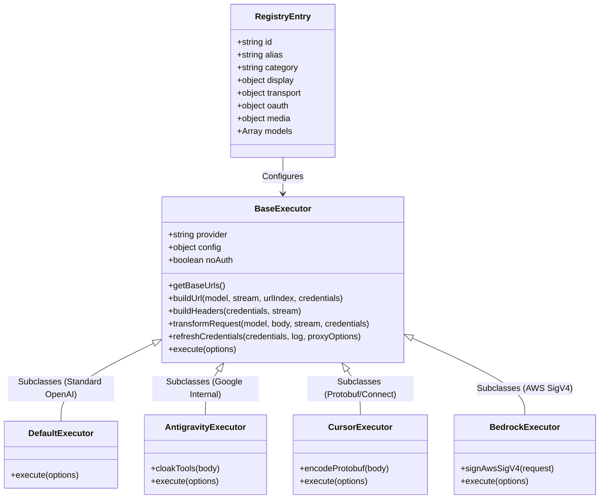

# 04-PROVIDER ADAPTER ARCHITECTURE: 9ROUTER
**Project:** Hime Assistant — AI Model Routing Layer Research  
**Target:** 9Router Provider Adapters & Execution System  
**Core Components:** `open-sse/executors/`, `open-sse/providers/registry/`, `open-sse/providers/capabilities.js`  
**Author:** Senior Reverse Engineer, AI Infrastructure Architect, Backend Engineer & Security Researcher  
**Date:** November 2026  
**Status:** Completed  

---

## 1. Executive Summary

Laporan ini membedah arsitektur **Adapter Provider (*Provider Adapter Architecture*)** pada 9Router. 9Router tidak memperlakukan seluruh penyedia AI secara seragam atau memaksakan satu kontrak HTTP kaku. Sebaliknya, 9Router menerapkan pola arsitektur **Extensible Strategy Pattern** yang memisahkan antara:
1. **Metadata & Definisi Provider (*Registry Entries*):** Berisi konfigurasi deklaratif transportasi, URL endpoint, skema autentikasi, serta kapabilitas model ([`open-sse/providers/registry/*`](file:///x:/folder_ai/Hime/RE/9ROUTER/00-source-materials/9router/open-sse/providers/registry)).
2. **Eksekutor Eksekusi Runtime (*Executors*):** Mengatur pembangunan header HTTP, transformasi body khusus, manajemen socket, dan siklus penyegaran token OAuth ([`open-sse/executors/*`](file:///x:/folder_ai/Hime/RE/9ROUTER/00-source-materials/9router/open-sse/executors)).
3. **Node Kompatibel Dinamis (*Custom Provider Nodes*):** Mendukung pendaftaran provider OpenAI-compatible atau Anthropic-compatible secara dinamis melalui antarmuka dashboard atau database SQLite tanpa perlu mengubah kode sumber.

Investigasi memastikan tersedianya dukungan out-of-the-box untuk lebih dari **140 provider**, mencakup ekosistem komersial besar, layanan agregator, model open-weight, hingga provider khusus seperti **Nous Research** (`nous.js`).

---

## 2. Abstraction Framework: BaseExecutor & Registry Contracts



### 2.1. Kelas Abstrak `BaseExecutor` `[CONFIRMED]`
- **Lokasi Kode:** [`open-sse/executors/base.js:11-192`](file:///x:/folder_ai/Hime/RE/9ROUTER/00-source-materials/9router/open-sse/executors/base.js#L11-L192)
- **Fungsi Utama:** Menyediakan fondasi eksekusi HTTP yang menggunakan pustaka `undici` via utilitas `proxyAwareFetch`.
- **Metode Template Kunci:**
  - `buildUrl(model, stream, urlIndex, credentials)`: Menyusun URL tujuan upstream. Mendukung node custom dinamis (`openai-compatible-*` diarahkan ke `/chat/completions` atau `/responses`, `anthropic-compatible-*` diarahkan ke `/messages`).
  - `buildHeaders(credentials, stream)`: Menyematkan `Content-Type: application/json`, otentikasi `Authorization: Bearer <token>` atau `x-api-key: <key>`, dan header streaming `Accept: text/event-stream`.
  - `execute({ model, body, stream, credentials, signal, log, proxyOptions })`: Mengelola timeout koneksi (`FETCH_CONNECT_TIMEOUT_MS = 15000`), proxy HTTP/SOCKS5, dan sinyal pembatalan abort.

### 2.2. Eksekutor Universal `DefaultExecutor` `[CONFIRMED]`
- **Lokasi Kode:** [`open-sse/executors/default.js`](file:///x:/folder_ai/Hime/RE/9ROUTER/00-source-materials/9router/open-sse/executors/default.js)
- Jika provider upstream mematuhi protokol OpenAI Chat Completions standar, 9Router tidak memerlukan kode eksekutor khusus. `DefaultExecutor` langsung menangani streaming SSE, akumulasi token usage, dan parsing error secara transparan.

---

## 3. Deep Analysis of Representative Providers

### 3.1. OpenAI (`openai.js`) `[CONFIRMED]`
- **Registri:** [`open-sse/providers/registry/openai.js`](file:///x:/folder_ai/Hime/RE/9ROUTER/00-source-materials/9router/open-sse/providers/registry/openai.js)
- **Autentikasi:** API Key (`authType: "apikey"`), dikirim sebagai header `Authorization: Bearer <key>`.
- **Endpoint:** `https://api.openai.com/v1/chat/completions` (Chat), `https://api.openai.com/v1/audio/speech` (TTS), `https://api.openai.com/v1/audio/transcriptions` (STT), `https://api.openai.com/v1/embeddings` (Embeddings), `https://api.openai.com/v1/images/generations` (DALL-E).
- **Thinking Configuration:** Mendukung parameter native `reasoning_effort` (`auto`, `none`, `low`, `medium`, `high`) untuk model O1, O3, O4.
- **Tool Calling:** Mendukung format standard `tools` dengan skema JSON function calling dan `parallel_tool_calls: true`.

### 3.2. Anthropic Claude (`claude.js` & `anthropic.js`) `[CONFIRMED]`
- **Registri:** [`open-sse/providers/registry/claude.js`](file:///x:/folder_ai/Hime/RE/9ROUTER/00-source-materials/9router/open-sse/providers/registry/claude.js)
- **Autentikasi:** API Key (`x-api-key: <key>`) atau OAuth token (`Authorization: Bearer <sk-ant-oat...>`).
- **Endpoint:** `https://api.anthropic.com/v1/messages`.
- **Header Khusus:** `anthropic-version: 2023-06-01`, `anthropic-beta: prompt-caching-2024-07-25,thinking-2024-11-25`.
- **Thinking Blocks:** Mendukung translasi dua arah `<thinking>` block. Jika klien OpenAI meminta `reasoning_effort`, 9Router mengonversinya menjadi objek `{ type: "enabled", budget_tokens: 10000 }` pada format Claude Messages.
- **Cache Anchoring:** [`anchorClaudeCache`](file:///x:/folder_ai/Hime/RE/9ROUTER/00-source-materials/9router/open-sse/translator/formats/claude.js) menyematkan breakpoint cache pada giliran pesan terakhir guna memaksimalkan hit prompt caching upstream.
- **OAuth Cloaking:** [`cloakClaudeTools`](file:///x:/folder_ai/Hime/RE/9ROUTER/00-source-materials/9router/open-sse/utils/claudeCloaking.js) menambahkan sufiks acak pada nama tool pihak ketiga untuk menghindari deteksi pemblokiran saat menggunakan token OAuth pribadi.

### 3.3. Google Gemini (`gemini.js`, `antigravity.js`, `gemini-cli.js`) `[CONFIRMED]`
- **Registri:** [`open-sse/providers/registry/gemini.js`](file:///x:/folder_ai/Hime/RE/9ROUTER/00-source-materials/9router/open-sse/providers/registry/gemini.js), [`antigravity.js`](file:///x:/folder_ai/Hime/RE/9ROUTER/00-source-materials/9router/open-sse/providers/registry/antigravity.js)
- **Eksekutor Khusus:** [`open-sse/executors/antigravity.js`](file:///x:/folder_ai/Hime/RE/9ROUTER/00-source-materials/9router/open-sse/executors/antigravity.js)
- **Autentikasi:** Google OAuth 2.0 PKCE / Service Account Token.
- **Dynamic Project ID:** Memerlukan penyematan Google Cloud Project ID (`projectId`). Jika koneksi mengalami *cold miss*, fungsi `getProjectIdForConnection` memanggil Google API secara otomatis untuk mengambil ID proyek yang valid.
- **Format:** Mentranslasikan `messages` menjadi `contents` dengan `parts: [{ text }]`. Translasi `functionCall` dan `functionResponse` dipetakan sempurna ke/dari format OpenAI tool calls.
- **Quota Breaker:** [`handleAntigravityQuotaError`](file:///x:/folder_ai/Hime/RE/9ROUTER/00-source-materials/9router/src/sse/services/antigravityQuota.js) menangani error kuota 409/429 secara spesifik dengan mengunci model hanya di RAM cache hingga timestamp `resetAt` upstream tercapai.

### 3.4. DeepSeek (`deepseek.js` & `deepseek-web.js`) `[CONFIRMED]`
- **Registri:** [`open-sse/providers/registry/deepseek.js`](file:///x:/folder_ai/Hime/RE/9ROUTER/00-source-materials/9router/open-sse/providers/registry/deepseek.js)
- **Autentikasi:** API Key standar atau Web Session Token dengan Proof-of-Work (PoW) hash solver (`noble-hashes`).
- **Tool Normalization:** Server upstream DeepSeek sangat ketat terhadap duplikasi nama alat. 9Router menyematkan filter [`dedupeTools`](file:///x:/folder_ai/Hime/RE/9ROUTER/00-source-materials/9router/open-sse/utils/toolDeduper.js) yang secara otomatis membersihkan definisi tool ganda sebelum request diteruskan.

### 3.5. OpenRouter (`openrouter.js`) `[CONFIRMED]`
- **Registri:** [`open-sse/providers/registry/openrouter.js`](file:///x:/folder_ai/Hime/RE/9ROUTER/00-source-materials/9router/open-sse/providers/registry/openrouter.js)
- **Autentikasi:** Bearer Token.
- **Model Upstream Routing:** Mendukung pemanggilan model berformat `provider/model-name` secara langsung. Header `HTTP-Referer` dan `X-Title` disematkan untuk identifikasi reputasi klien.

### 3.6. Nous Research (`nous.js`) — Mitra Kunci Hermes Agent `[CONFIRMED]`
- **Registri:** [`open-sse/providers/registry/nous.js`](file:///x:/folder_ai/Hime/RE/9ROUTER/00-source-materials/9router/open-sse/providers/registry/nous.js)
- **Autentikasi:** OAuth Device Code (`NOUS_DEVICE_CODE_URL`) atau Nous Portal API Key (`portal.nousresearch.com`).
- **Kategori:** Free Tier / Commercial.
- **Katalog Model:** Model open-source unggulan seperti `meituan/longcat-2.0:free`, `stepfun/step-3.7-flash:free`, `poolside/laguna-s-2.1:free`, dan model penalaran Hermes.
- **Format:** OpenAI Compatible murni (`format: "openai"`), menjadikannya plug-and-play langsung dengan Hermes Agent tanpa overhead translasi.

### 3.7. Kiro & Cursor (`kiro.js`, `cursor.js`) `[CONFIRMED]`
- **Eksekutor Khusus:** [`open-sse/executors/kiro.js`](file:///x:/folder_ai/Hime/RE/9ROUTER/00-source-materials/9router/open-sse/executors/kiro.js), [`open-sse/executors/cursor.js`](file:///x:/folder_ai/Hime/RE/9ROUTER/00-source-materials/9router/open-sse/executors/cursor.js)
- **Tantangan Teknis:** Cursor dan Kiro menggunakan protokol biner (*Protobuf over HTTP/2* atau AWS EventStream).
- **Solusi 9Router:** Tidak melalui pipeline translator teks OpenAI biasa. Eksekutor khusus mendecode stream Protobuf upstream secara langsung di dalam eksekutor menjadi paket chunk OpenAI-compatible sebelum dilepas ke streaming handler.

---

## 4. Matriks Perbandingan Adapter Provider Representatif

| Provider ID | Kategori Autentikasi | Format Upstream | Dukungan Streaming | Dukungan Tool Calling | Dukungan Vision | Mekanisme Refresh Token |
| :--- | :--- | :--- | :--- | :--- | :--- | :--- |
| **`openai`** | API Key (Bearer) | `openai` | Ya (SSE) | Ya (Native Function) | Ya (image_url) | N/A (Static Key) |
| **`anthropic`** | API Key / OAuth | `claude` | Ya (SSE) | Ya (tool_use / tool_result) | Ya (base64 image) | OAuth Auto-Refresh |
| **`antigravity`** | Google OAuth PKCE | `gemini` | Ya (v1internal) | Ya (functionCall) | Ya (inlineData) | OAuth Google Refresh |
| **`deepseek`** | API Key / Web PoW | `openai` | Ya (SSE) | Ya (Deduplicated) | Tergantung Model | PoW Solver Re-challenge |
| **`openrouter`** | API Key (Bearer) | `openai` | Ya (SSE) | Ya (Native) | Ya (Multimodal pass) | N/A (Static Key) |
| **`nous`** | OAuth Device / API Key | `openai` | Ya (SSE) | Ya (Native) | Ya (Multimodal pass) | OAuth Device Code |
| **`cursor`** | OAuth / Session | `cursor` (Protobuf) | Ya (Chunked Decode) | Ya (Custom tool format) | Ya (In-line base64) | Workos / Session Refresh |
| **`custom-node`**| API Key Kustom | `openai` / `claude` | Ya (SSE) | Sesuai Upstream | Sesuai Upstream | Sesuai Konfigurasi |

---

## 5. Dynamic Provider Registration (Custom Provider Nodes)

Selain 140+ provider statis di repositori, 9Router mendukung **registrasi provider dinamis** saat aplikasi berjalan melalui tabel SQLite `providerNodes`:

```json
{
  "id": "node_local_vllm",
  "type": "openai-compatible",
  "name": "Local vLLM Server",
  "data": {
    "baseUrl": "http://127.0.0.1:8000/v1",
    "apiKey": "sk-local-dev",
    "models": [
      { "id": "hermes-3-llama-3.1-8b", "name": "Hermes 3 Local" }
    ]
  }
}
```

Ketika permintaan ditujukan ke `node_local_vllm`, `BaseExecutor:buildUrl` secara dinamis mengekstrak `baseUrl` dari kolom `data` dan mengalirkan permintaan tanpa perlu melakukan restart server.

---

## 6. Limitations & Architectural Findings

1. **Protobuf Fragility:**  
   Adapter binary upstream (seperti Cursor dan Kiro) sangat rentan terhadap perubahan skema *proto* dari sisi penyedia layanan. Jika upstream mengubah urutan *field tag* Protobuf, eksekutor akan gagal mendekode stream.
2. **Ketergantungan OAuth Callback Lokal:**  
   Penyedia yang menggunakan OAuth Code Flow memerlukan pembukaan port loopback sementara di mesin lokal (misalnya port `1455` pada Kiro) untuk menangkap kode otentikasi browser.

