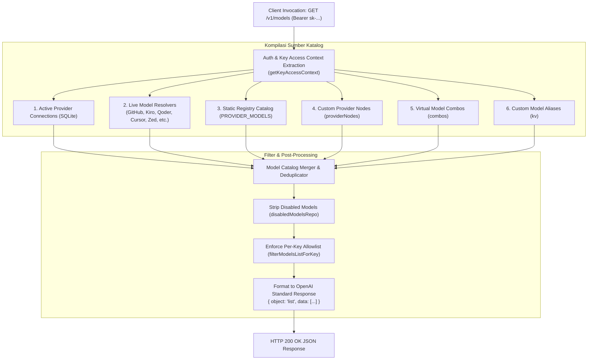

# 05-MODEL DISCOVERY AND MODEL MANAGEMENT: 9ROUTER
**Project:** Hime Assistant — AI Model Routing Layer Research  
**Target:** 9Router Model Catalog, Discovery, and Synchronization Engine  
**Core Components:** `src/app/api/v1/models/route.js`, `src/app/api/v1/models/info/route.js`, `open-sse/providers/capabilities.js`, `open-sse/config/providerModels.js`  
**Author:** Senior Reverse Engineer, AI Infrastructure Architect, Backend Engineer & Security Researcher  
**Date:** November 2026  
**Status:** Completed  

---

## 1. Executive Summary

Laporan ini membedah mekanisme **penemuan model (*Model Discovery*)** dan **manajemen katalog model (*Model Management*)** pada 9Router. Bagi antarmuka eksternal seperti Hermes Agent atau Hime Assistant, titik akhir `/v1/models` adalah gerbang tunggal untuk mengetahui model apa saja yang dapat dipanggil.

Penyelidikan mendalam membuktikan bahwa 9Router tidak sekadar menyajikan daftar teks statis, melainkan menerapkan sistem penemuan model bertingkat (*multi-layered discovery engine*):
1. **Dynamic Active Connection Binding:** Menampilkan model yang hanya didukung oleh koneksi akun aktif di basis data SQLite lokal.
2. **Live Catalog Resolvers:** Mampu menanyakan katalog langsung secara asinkron ke server penyedia (seperti GitHub Copilot, Kiro, Qoder, Grok-CLI, Cursor, Zed) untuk mendeteksi rilis model terbaru tanpa perlu memperbarui kode aplikasi.
3. **Comprehensive Capability Database:** Mengintegrasikan basis data kapabilitas granular (`capabilities.js`) yang memetakan batas jendela konteks (*context window*), batas output token (*max output*), modalitas (teks, gambar, audio, PDF, video), fitur pencarian web (*search*), dan format pemikiran (*thinking format*).
4. **Combos & Custom Aliases Integration:** Memaparkan model virtual (*combos*) dan alias kustom berdampingan dengan model fisik.
5. **Per-Key Model Access Filtering:** Menyaring daftar model yang dikembalikan sesuai hak akses kunci API klien yang sedang aktif.

---

## 2. Model Catalog Architecture & Discovery Pipeline



---

## 3. Implementation of Model Endpoints

### 3.1. The Primary Discovery Endpoint: `GET /v1/models` `[CONFIRMED]`
- **Lokasi Kode:** [`src/app/api/v1/models/route.js:1-681`](file:///x:/folder_ai/Hime/RE/9ROUTER/00-source-materials/9router/src/app/api/v1/models/route.js)
- **Format Respons:** Sepenuhnya mematuhi spesifikasi OpenAI:
  ```json
  {
    "object": "list",
    "data": [
      {
        "id": "openai/gpt-4o",
        "object": "model",
        "created": 1730000000,
        "owned_by": "openai"
      },
      {
        "id": "anthropic/claude-3-5-sonnet",
        "object": "model",
        "created": 1730000000,
        "owned_by": "anthropic"
      },
      {
        "id": "my-smart-combo",
        "object": "model",
        "created": 1730000000,
        "owned_by": "combo"
      }
    ]
  }
  ```

### 3.2. Live Model Resolvers (`LIVE_MODEL_RESOLVERS`) `[CONFIRMED]`
- **Lokasi Kode:** [`src/app/api/v1/models/route.js:65-155`](file:///x:/folder_ai/Hime/RE/9ROUTER/00-source-materials/9router/src/app/api/v1/models/route.js#L65-L155)
- Beberapa penyedia layanan menambahkan model baru secara dinamis di sisi cloud mereka. Alih-alih menunggu rilis versi baru 9Router, 9Router menjalankan resolver live asinkron:
  - `github`: Memanggil API Copilot live menggunakan token Copilot aktif untuk mengambil model yang diizinkan untuk akun pengguna (misalnya Claude 3.5 Sonnet, GPT-4o, o1).
  - `kiro` & `qoder`: Menanyakan endpoint katalog live masing-masing ekosistem IDE.
  - `cursor`: Mengambil daftar model yang aktif di sesi editor Cursor.
  - `grok-cli`: Mengambil daftar model reasoning live dari server xAI.

### 3.3. Deep Metadata Endpoint: `GET /v1/models/info` `[CONFIRMED]`
- **Lokasi Kode:** [`src/app/api/v1/models/info/route.js:1-104`](file:///x:/folder_ai/Hime/RE/9ROUTER/00-source-materials/9router/src/app/api/v1/models/info/route.js)
- **Tujuan:** Menyediakan informasi teknis yang lebih dalam daripada skema OpenAI minimal, memungkinkan klien desktop (seperti Hime Assistant) membangun UI selektor model yang kaya informasi:
  - **Query:** `GET /v1/models/info?id=openai/gpt-4o`
  - **Respons Struktur:**
    ```json
    {
      "id": "openai/gpt-4o",
      "name": "GPT-4o",
      "kind": "llm",
      "owned_by": "openai",
      "endpoint": "/v1/chat/completions",
      "capabilities": ["vision", "tools", "reasoning"],
      "contextWindow": 128000,
      "maxOutput": 16384
    }
    ```
  - **Dukungan Non-LLM Services:**
    - `tts`: Menampilkan `voicesUrl: "/v1/audio/voices?provider=elevenlabs"`.
    - `embedding`: Menampilkan `dimensions: 1536` atau `3072`.
    - `webSearch`: Menampilkan opsi parameter `searchTypes`, `maxResults`, dll.

### 3.4. Google Gemini Compatibility: `GET /v1beta/models` `[CONFIRMED]`
- **Lokasi Kode:** [`src/app/api/v1beta/models/route.js`](file:///x:/folder_ai/Hime/RE/9ROUTER/00-source-materials/9router/src/app/api/v1beta/models/route.js)
- Mendukung aplikasi yang menggunakan Google GenAI SDK (yang menanyakan format native Gemini `{ models: [{ name: "models/gemini-1.5-pro", ... }] }`), memastikan kompatibilitas ganda lintas ekosistem.

---

## 4. Model Capabilities Specification (`capabilities.js`)

Modul [`open-sse/providers/capabilities.js`](file:///x:/folder_ai/Hime/RE/9ROUTER/00-source-materials/9router/open-sse/providers/capabilities.js) mengelola ground-truth teknis kapabilitas setiap model.

### 4.1. The 4-Tier Fallback Order `[CONFIRMED]`
Saat resolusi kapabilitas dipanggil (`getCapabilitiesForModel(provider, model)`):
1. **Tier 1 (`PROVIDER_CAPABILITIES`):** Override spesifik per provider (misalnya batasan khusus GitHub Copilot terhadap output Claude 3.5 Sonnet).
2. **Tier 2 (`MODEL_CAPABILITIES`):** Pencocokan ID kanonikal eksak (menangani model khusus seperti `sensenova-6.8-flash-lite`, `claude-fable-5-1`).
3. **Tier 3 (`PATTERN_CAPABILITIES`):** Pencocokan pola regex/glob terurut (misalnya model dengan nama `*vision*`, `*gpt-4o*`, `*claude-3*`).
4. **Tier 4 (`DEFAULT_CAPABILITIES`):** Nilai dasar aman (`vision: false`, `tools: true`, `contextWindow: 200000`, `maxOutput: 64000`).

### 4.2. Definisi Kapabilitas Standar
```javascript
export const DEFAULT_CAPABILITIES = {
  vision: false,        // Kemampuan membaca gambar (JPEG, PNG, WEBP)
  pdf: false,           // Kemampuan memproses dokumen PDF
  audioInput: false,    // Kemampuan menerima input audio suara
  videoInput: false,    // Kemampuan memproses input video
  imageOutput: false,   // Model text-to-image
  audioOutput: false,   // Model text-to-speech
  search: false,        // Alat pencarian web bawaan
  tools: true,          // Dukungan function / tool calling
  reasoning: false,     // Dukungan chain-of-thought / thinking
  thinkingFormat: null, // Format framing wire: openai, claude-adaptive, gemini-budget, dll.
  contextWindow: 200000,
  maxOutput: 64000
};
```

---

## 5. Model Conventions & Naming Hierarchy

9Router menerapkan konvensi penamaan model yang fleksibel:

1. **Full Scoped ID (Direkomendasikan):**  
   `<alias_provider>/<model_id>`  
   *Contoh:* `openai/gpt-4o`, `anthropic/claude-3-5-sonnet-20241022`, `deepseek/deepseek-chat`, `nous/meituan/longcat-2.0:free`.
2. **Bare Model ID (Resolusi Otomatis):**  
   `<model_id>`  
   Jika pemanggilan tidak mencantumkan nama provider di depan, 9Router mencari model di katalog static `PROVIDER_MODELS` untuk menentukan provider default mana yang memiliki model tersebut.
3. **Virtual Combo ID:**  
   `<combo_name>`  
   *Contoh:* `auto-code`, `free-models`, `fallback-chat`. Sesi dialihkan ke urutan model anggota combo.
4. **Context Marker Suffix:**  
   `<model>[1m]`  
   Dipotong secara otomatis di `stripModelContextMarker` sebelum resolusi katalog.

---

## 6. Model Synchronization & External Catalog

9Router mendukung sinkronisasi metadata model otomatis dengan basis data publik **`https://models.dev/api.json`** yang mencakup lebih dari 145 provider dan 4000+ model AI.
- File cache lokal disimpan untuk mencegah panggilan jaringan berulang saat inisialisasi server.
- Dashboard 9Router menyediakan tombol sinkronisasi manual untuk memperbarui batas konteks dan harga token terkini.

---

## 7. Implications for Hermes Agent & Hime Assistant

1. **Model Discovery Tanpa Konfigurasi Manual:**  
   Hermes Agent dapat langsung memanggil `client.models.list()` ke 9Router (`http://localhost:20128/v1`). Daftar yang diterima sudah mencakup model dari seluruh provider yang aktif, termasuk akun gratis, akun OAuth, dan model combo.
2. **Dynamic Capability Awareness di Hime UI:**  
   Hime Assistant dapat menanyakan `GET /v1/models/info` untuk menentukan apakah tombol upload gambar atau dokumen PDF harus diaktifkan pada Dynamic Island berdasarkan model yang sedang dipilih pengguna.
3. **Penyembunyian Model Tanpa Kuota:**  
   Jika akun provider kehabisan kuota atau dinonaktifkan di dashboard 9Router, model tersebut otomatis hilang dari `/v1/models`, mencegah Hermes mengirimkan prompt ke model yang pasti gagal.

