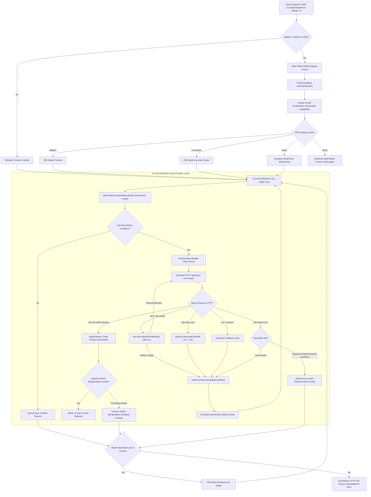

# 06-SMART ROUTING, COMBOS, AND FALLBACK ENGINE: 9ROUTER
**Project:** Hime Assistant — AI Model Routing Layer Research  
**Target:** 9Router Fallback, Multi-Account, & Combo Subsystem  
**Core Components:** `open-sse/services/combo.js`, `open-sse/services/accountFallback.js`, `open-sse/services/emptyFailover.js`, `open-sse/config/errorConfig.js`  
**Author:** Senior Reverse Engineer, AI Infrastructure Architect, Backend Engineer & Security Researcher  
**Date:** November 2026  
**Status:** Completed  

---

## 1. Executive Summary

Laporan ini membedah subsistem paling krusial pada 9Router: **Smart Combos, Automatic Fallback, dan Multi-Account Management**. 

Sistem ini memecahkan masalah mendasar dalam infrastruktur AI produksi: **ketidakandalan penyedia tunggal (*single provider fragility*)**. Ketika sebuah model mengalami lonjakan latensi (*spike*), kehabisan kuota (*rate limited 429*), kegagalan autentikasi (*token expired 401/403*), kegagalan server (*500/502/503*), atau menghasilkan respons kosong (*empty stream* akibat abort internal model), 9Router menangani insiden tersebut di tingkat gateway secara instan tanpa mengembalikan error ke aplikasi pemanggil (seperti Hermes Agent).

Penyelidikan membuktikan bahwa 9Router menerapkan **Two-Tier Resilient Routing**:
- **Tier 1 (Account-Level Fallback):** Rotasi otomatis di antara banyak akun dalam provider yang sama.
- **Tier 2 (Combo-Level Fallback):** Pengalihan otomatis ke model alternatif dalam daftar urutan virtual combo jika seluruh akun provider primer gagal.

---

## 2. Comprehensive Routing & Fallback Decision Flow



---

## 3. Deep Dive: The Three Core Subsystems

### 3.1. Smart Combos Subsystem `[CONFIRMED]`

Model combo didefinisikan dalam tabel basis data SQLite `combos`. Pengguna dapat mengelompokkan model berbeda ke dalam satu nama virtual:
```json
{
  "id": "combo_coding",
  "name": "smart-coding",
  "kind": "llm",
  "models": [
    "anthropic/claude-3-5-sonnet",
    "deepseek/deepseek-coder",
    "openai/gpt-4o",
    "nous/meituan/longcat-2.0:free"
  ]
}
```

#### A. Strategi Perutean Combo:
1. **`fallback` (Default):** Memproses model secara berurutan sesuai prioritas array. Model pertama selalu dicoba terlebih dahulu; model berikutnya hanya dipanggil jika model sebelumnya gagal.
2. **`roundrobin`:** Memutar giliran pemanggilan model secara seimbang menggunakan state in-memory `comboRotationState` (`open-sse/services/combo.js:108-111`).
3. **`sticky`:** Menjaga agar permintaan dalam satu sesi percakapan (`sessionId`) tetap diarahkan ke model yang sama hingga batas `comboStickyRoundRobinLimit` terlampaui atau terjadi error.
4. **`fusion` ([`handleFusionChat`](file:///x:/folder_ai/Hime/RE/9ROUTER/00-source-materials/9router/open-sse/services/combo.js#L119-L137)):** Menjalankan kueri paralel ke beberapa model, meratakan riwayat percakapan (`flattenToolHistory`), dan menggunakan model juri (*judge model*) untuk mengevaluasi atau menggabungkan sintesis jawaban terbaik.

#### B. Dynamic Capability-Based Reordering:
Fungsi [`reorderByCapabilities`](file:///x:/folder_ai/Hime/RE/9ROUTER/00-source-materials/9router/open-sse/services/combo.js#L86-L105) membagi model ke dalam 3 tier:
- **Tier 0:** Memenuhi semua kapabilitas *hard* (vision, pdf, audioInput, videoInput) dan *soft* (search).
- **Tier 1:** Memenuhi semua kapabilitas *hard*.
- **Tier 2:** Model lainnya.  
Jika permintaan pengguna menyertakan gambar, combo secara otomatis menempatkan model vision ke posisi pertama urutan tanpa menghapus model non-vision dari rantai fallback!

---

### 3.2. Automatic Fallback Subsystem `[CONFIRMED]`

Fallback dipicu oleh aturan deklaratif pada [`open-sse/config/errorConfig.js`](file:///x:/folder_ai/Hime/RE/9ROUTER/00-source-materials/9router/open-sse/config/errorConfig.js) dan dievaluasi oleh [`checkFallbackError`](file:///x:/folder_ai/Hime/RE/9ROUTER/00-source-materials/9router/open-sse/services/accountFallback.js#L29-L71).

#### A. Aturan Deteksi Kegagalan:
1. **Rate Limit (HTTP 429 / Kuota Habis):**
   - Mendeteksi teks: `"insufficient_quota"`, `"rate_limit_exceeded"`, `"resource_exhausted"`, `"too many requests"`.
   - Mengaktifkan **Exponential Backoff**: Level 1 (1 detik), Level 2 (2 detik), Level 3 (4 detik) ... hingga maksimum 4 menit (`BACKOFF_CONFIG.max = 240000`).
2. **Authentication / Token Kedaluwarsa (HTTP 401 & 403):**
   - Memanggil fungsi penyegaran token otomatis hingga 3 kali. Jika token tetap ditolak, akun ditandai tidak valid (*invalid credentials*).
3. **Transient Server Errors (HTTP 500, 502, 503, 504, Timeout):**
   - Diberi masa tenang sementara (*transient cooldown*) selama 15 detik (`TRANSIENT_COOLDOWN_MS = 15000`).
4. **Request-Scoped 400 Protection `[P0 CRITICAL FIX]`:**
   - Error 400 akibat *context window overflow* atau validasi parameter adalah kesalahan konten *request*, bukan kerusakan akun.
   - 9Router memberi flag `requestScoped: true` sehingga akun **tidak dikunci**, melainkan combo melanjutkan mencoba model lain yang memiliki kapasitas konteks lebih besar (misal model 1M token).

#### B. Empty Stream Failover (`emptyFailover.js`) `[CONFIRMED]`
- Sering kali Google Gemini atau model lainnya mengalami abort saat generasi tool call (`MALFORMED_FUNCTION_CALL`) namun tetap mengirimkan status HTTP 200 dengan SSE stream kosong.
- 9Router membaca dan menampung buffer awal stream (*stream peeking*). Jika stream berakhir tanpa pernah menghasilkan chunk konten yang dapat dikonsumsi klien (`deltaHasClientContent` mengembalikan `false`), 9Router mengabaikan stream tersebut dan langsung melakukan failover ke model berikutnya di dalam combo!

---

### 3.3. Multi-Account Management Subsystem `[CONFIRMED]`

Pengguna dapat menyimpan puluhan akun/koneksi untuk penyedia yang sama (misalnya 5 akun OpenAI, 10 akun Antigravity Google, 3 akun Claude) di tabel `providerConnections`.

#### A. Model-Specific Lock vs. Account-Wide Lock:
- **`modelLock_${model}`:** Jika sebuah akun OpenAI terkena rate limit pada `gpt-4o`, 9Router hanya mengunci `modelLock_gpt-4o` pada akun tersebut. Permintaan berikutnya yang meminta `gpt-4o-mini` dari akun yang sama tetap dapat dilayani!
- **`modelLock___all`:** Diterapkan jika seluruh akun terkena suspensi atau kehabisan total saldo tagihan (*billing exhaustion*).

#### B. Seleksi Akun Berbasis Prioritas:
Koneksi akun memiliki atribut integer `priority` dan status `isActive`. 9Router selalu memprioritaskan akun aktif dengan prioritas tertinggi yang tidak sedang dalam masa cooldown.

---

## 4. Edge Cases & Potential Reliability Concerns `[ISSUE]`

1. **Infinite Loop Prevention:**  
   Loop `while (true)` di dalam `src/sse/handlers/chat.js` dilindungi oleh penambahan ID ke himpunan `excludeConnectionIds`. Begitu seluruh akun yang tersedia telah dicoba dan masuk ke dalam `excludeConnectionIds`, loop segera berhenti dan mengembalikan status HTTP 503 Service Unavailable lengkap dengan estimasi waktu `Retry-After`.
2. **Partial Streaming Fallback Impossibility:**  
   Jika upstream provider sudah mulai mengalirkan token teks ke klien selama beberapa detik lalu koneksi TCP putus di tengah jalan, 9Router **tidak dapat** melakukan fallback ke provider lain secara transparan, karena header HTTP 200 dan sebagian token sudah terlanjur diterima oleh klien. Dalam kondisi ini, stream terputus dengan event error.

---

## 5. Kesimpulan untuk Hime Assistant & Hermes Agent

Mekanisme Smart Routing dan Fallback 9Router memberikan keuntungan infrastruktur masif bagi Hime Assistant:
- **Zero-Downtime Coding Sessions:** Hermes Agent tidak akan berhenti di tengah jalan saat menyelesaikan instruksi panjang hanya karena salah satu API key kehabisan saldo atau terkena rate limit.
- **Biaya Optimal (Cost Minimization):** Hime dapat mengonfigurasi combo yang mencoba model gratis terlebih dahulu (seperti Nous Research Free Tier atau Gemini Free), dan hanya jatuh kembali ke model berbayar mahal (GPT-4o / Claude 3.5 Sonnet) saat model gratis sibuk.

