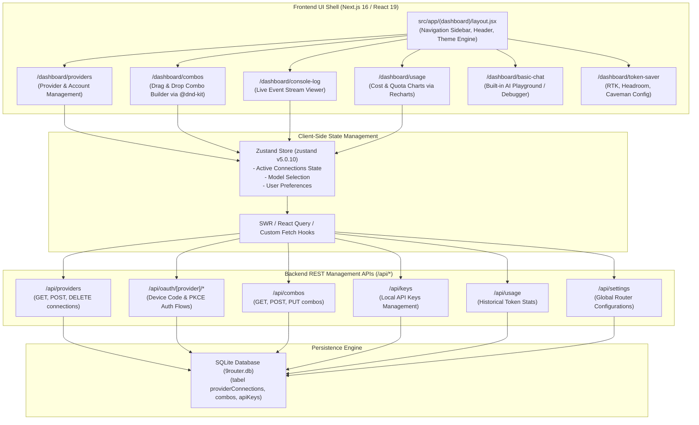

# 08-DASHBOARD AND UI ARCHITECTURE: 9ROUTER
**Project:** Hime Assistant — AI Model Routing Layer Research  
**Target:** 9Router Web Dashboard, Component System, & Internal Management APIs  
**Core Components:** `src/app/(dashboard)/`, `src/app/api/providers/`, `src/app/api/combos/`, `src/app/api/usage/`  
**Author:** Senior Reverse Engineer, AI Infrastructure Architect, Backend Engineer & Security Researcher  
**Date:** November 2026  
**Status:** Completed  

---

## 1. Executive Summary

Laporan ini membedah arsitektur **Dashboard Antarmuka Pengguna (*Dashboard & UI Architecture*)** 9Router. Dashboard 9Router adalah antarmuka Single Page Application (SPA) modern yang dibangun di atas Next.js 16 App Router dan React 19, yang bertindak sebagai pusat kendali (*command center*) visual bagi pengguna untuk mengelola akun provider, mengonfigurasi rantai model virtual (*combos*), memantau log streaming real-time, mengaudit biaya token, dan menyetel parameter penghemat token (*RTK*).

Penyelidikan membuktikan bahwa **seluruh aksi antarmuka dashboard berkomunikasi dengan backend melalui REST API internal terstandarisasi di `/api/*`**. Pola desain ini memberikan keuntungan strategis luar biasa bagi **Hime Assistant**:
Hime tidak wajib menampilkan webview dashboard 9Router secara penuh, melainkan Hime Native Core (Rust/Tauri) dapat memanggil endpoint REST internal `/api/*` ini secara langsung untuk membangun antarmuka pengaturan native di dalam aplikasi Hime.

---

## 2. Frontend Component & State Architecture



---

## 3. Technology Stack Breakdown

Pemeriksaan terhadap [`package.json`](file:///x:/folder_ai/Hime/RE/9ROUTER/00-source-materials/9router/package.json) mengonfirmasi pustaka-pustaka UI utama:
1. **Core Framework:** Next.js 16.4.2 (App Router dengan Server & Client Components) + React 19.2.4.
2. **Styling & Icons:** Tailwind CSS v4 + Google Material Symbols (`material-symbols`).
3. **State Management:** **Zustand v5.0.10** untuk store global yang reaktif dan ringan.
4. **Drag and Drop Engine:** `@dnd-kit/core`, `@dnd-kit/sortable`, `@dnd-kit/utilities` digunakan pada antarmuka Combo Builder untuk mengatur prioritas urutan fallback model secara intuitif.
5. **Data Visualization:** **Recharts v3.7.0** untuk merender grafik garis, batang, dan pie chart konsumsi token harian serta pembagian biaya per provider.
6. **Diagram Alir Visual:** `@xyflow/react` v12.10.1 (React Flow) untuk visualisasi graf jalur perutean model.
7. **In-Browser Code Editor:** `@monaco-editor/react` (VS Code editor engine) untuk pengeditan konfigurasi custom prompts, JSON quirks, dan proxy pools.

---

## 4. Key Dashboard Management APIs (Reusable by Hime) `[CONFIRMED]`

Semua fungsionalitas dashboard diekspos melalui endpoint REST yang aman:

### 4.1. Manajemen Akun & Koneksi (`/api/providers`)
- **`GET /api/providers`:** Mengembalikan daftar seluruh akun yang tersimpan. Kunci rahasia otomatis disanitasi oleh [`toProviderConnectionResponse`](file:///x:/folder_ai/Hime/RE/9ROUTER/00-source-materials/9router/src/lib/providerConnectionResponse.js) (misalnya API key hanya ditampilkan sebagai `sk-...abcd`).
- **`POST /api/providers`:** Menambahkan koneksi baru (API Key atau kredensial kustom).
- **`DELETE /api/providers/[id]`:** Menghapus akun.
- **`POST /api/providers/[id]/test`:** Menguji validitas koneksi secara langsung dengan mengirimkan permintaan ping ke provider upstream.

### 4.2. Manajemen Model Combos (`/api/combos`)
- **`GET /api/combos`:** Mengambil daftar semua combo yang terdefinisi.
- **`POST /api/combos`:** Membuat virtual combo baru:
  ```json
  {
    "name": "hime-fast",
    "kind": "llm",
    "models": ["nous/meituan/longcat-2.0:free", "openai/gpt-4o-mini"]
  }
  ```
- **`PUT /api/combos/[id]`:** Memperbarui urutan model anggota combo atau strategi fallback.

### 4.3. Manajemen API Key Lokal (`/api/keys`)
- **`GET /api/keys`:** Menampilkan daftar API Key lokal 9Router.
- **`POST /api/keys`:** Membuat API Key baru dengan opsi pembatasan akses model:
  ```json
  {
    "name": "Hermes-Agent-Key",
    "accessRestricted": 1,
    "accessAllow": ["smart-coding", "openai/gpt-4o"]
  }
  ```

### 4.4. Pemantauan Penggunaan & Biaya (`/api/usage`)
- **`GET /api/usage/summary`:** Mengambil total token prompt, completion, dan akumulasi estimasi biaya dalam dolar ($ USD).
- **`GET /api/usage/daily`:** Mengambil agregasi pemakaian per hari untuk visualisasi tren.

---

## 5. Real-Time Logging & Console Architecture

Salah satu fitur paling impresif pada dashboard 9Router adalah halaman `/dashboard/console-log`:
- **Arsitektur:** Menggunakan koneksi Server-Sent Events (SSE) internal atau streaming fetch ke backend.
- **Visualisasi Correlated Request:** Setiap request diberi tag sesi berkode warna stabil (`reqTag` via `log.tagForSession`). Baris log menampilkan tanda:
  - `▶`: Ringkasan masuk (FMT sumber → target, jumlah pesan, estimasi thinking, akun yang dipilih).
  - `⚙`: Optimasi token (RTK hits, Caveman level, Pxpipe images).
  - `🔑`: Status token refresh saat terjadi rotasi kredensial.
  - `⇄`: Event fallback akun atau combo model.
  - `✔` / `✗`: Status akhir dan latensi total dalam milidetik.

---

## 6. Integrasi Arsitektur untuk Hime Assistant

Keberadaan API REST `/api/*` yang lengkap memberikan dua opsi integrasi bagi Hime:

| Pilihan Arsitektur UI | Deskripsi | Kelebihan | Kekurangan |
| :--- | :--- | :--- | :--- |
| **Opsi 1: Embedded WebView Dashboard** | Membuka URL `http://localhost:20128/dashboard` di jendela pop-up WebView2 milik Hime. | Tidak memerlukan penulisan ulang UI; seluruh fitur 9Router langsung dapat digunakan. | Memori lebih berat (~80-100 MB tambahan untuk WebView tab), desain visual tidak seragam dengan estetika Dynamic Island Hime. |
| **Opsi 2: Native Tauri Dynamic Island UI (Direkomendasikan)** | Hime Native Core (Rust) memanggil endpoint `/api/providers`, `/api/combos`, dan `/api/models` di background. | Sangat ringan (~5 MB), tampilan menyatu sempurna dengan Dynamic Island (glassmorphic / acrylic), kontrol penuh shortcut. | Memerlukan pembuatan komponen form pengaturan akun di React/Tauri Hime. |

**Rekomendasi:**  
Gunakan **Opsi 2** untuk interaksi harian (pemilihan model, monitoring kuota di Dynamic Island) dan sediakan tombol shortcut *"Buka Dashboard Lengkap"* yang membuka browser default ke `http://localhost:20128/dashboard` untuk konfigurasi tingkat lanjut (seperti OAuth login kompleks atau drag-and-drop node graph).

