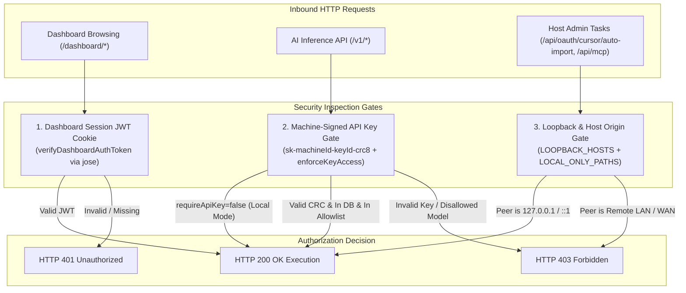

# 09-AUTHENTICATION AND SECURITY ARCHITECTURE: 9ROUTER
**Project:** Hime Assistant — AI Model Routing Layer Research  
**Target:** 9Router Security Boundary, Credential Management & Attack Surface  
**Core Components:** `src/custom-server.js`, `src/dashboardGuard.js`, `src/shared/utils/apiKey.js`, `src/lib/auth/`, `src/lib/db/repos/connectionsRepo.js`  
**Author:** Senior Reverse Engineer, AI Infrastructure Architect, Backend Engineer & Security Researcher  
**Date:** November 2026  
**Status:** Completed  

---

## 1. Executive Summary

Laporan ini menyajikan audit dan analisis **Keamanan Sistem & Manajemen Kredensial (*Authentication, Credentials & Security Analysis*)** 9Router. 

Investigasi menemukan bahwa arsitektur keamanan 9Router menerapkan pertahanan berlapis (*defense-in-depth*) yang sangat baik pada lapisan jaringan dan HTTP, seperti perlindungan pemalsuan IP (*IP-spoofing countermeasures*), proteksi degradasi HTTP/2, pembatasan akses loopback localhost untuk rute-rute sensitif, serta verifikasi kriptografis HMAC pada API key lokal. 

Namun demikian, investigasi juga mengungkap **vektor risiko keamanan kritis pada lapisan penyimpanan lokal (*at-rest storage vulnerability*)**: kredensial pihak ketiga (seperti API key OpenAI/Anthropic dan token OAuth refresh Google/GitHub) disimpan dalam bentuk **teks biasa (*plaintext JSON*)** di dalam basis data SQLite `9router.db`. Temuan ini menjadi peringatan arsitektural krusial bagi Hime Assistant untuk menerapkan lapisan enkripsi tambahan (*credential protection layer*) pada mesin desktop Windows.

---

## 2. Authentication Surfaces & Access Controls

9Router memisahkan 3 permukaan autentikasi yang berbeda:

### 2.1. Dashboard Web Session Authentication `[CONFIRMED]`
- **Mekanisme:** Menggunakan cookie HTTP-Only bertanda tangan kriptografis (`jose` v6.1.3).
- **Kunci Rahasia:** Ditandatangani menggunakan `JWT_SECRET`. Jika tidak dideklarasikan di `.env`, nilai rahasia di-generate secara acak saat startup.
- **Kata Sandi Awal `[ISSUE CRITICAL]`:**
  File [`.env.example`](file:///x:/folder_ai/Hime/RE/9ROUTER/00-source-materials/9router/.env.example) mendefinisikan `INITIAL_PASSWORD="123456"`. Jika pengguna memasang 9Router di server dengan binding `0.0.0.0` dan lupa mengganti kata sandi, penyerang di jaringan LAN dapat masuk ke dashboard dan mengekstraksi seluruh kredensial provider.

### 2.2. Local Machine-Bound API Keys `[CONFIRMED]`
- **Lokasi Kode:** [`src/shared/utils/apiKey.js:28-40`](file:///x:/folder_ai/Hime/RE/9ROUTER/00-source-materials/9router/src/shared/utils/apiKey.js#L28-L40)
- **Format Struktur:**
  $$\texttt{sk-}\{\text{machineId}_{16}\}\texttt{-}\{\text{keyId}_{6}\}\texttt{-}\{\text{crc}_{8}\}$$
- **HMAC CRC Validation:** Bagian `crc8` adalah HMAC-SHA256 dari gabungan `machineId` dan `keyId` menggunakan `API_KEY_SECRET`. Ini memungkinkan 9Router memvalidasi keaslian kunci secara statis sebelum mengakses SQLite, mencegah serangan *timing attack* atau *database flooding*.
- **Per-Key Model Access Control:** Setiap kunci API dapat dibatasi hak aksesnya via kolom `accessRestricted: 1` dan `accessAllow: ["combo-coding", "openai/gpt-4o"]`.

### 2.3. Loopback & Local-Only Path Guard (`dashboardGuard.js`) `[CONFIRMED]`
- **Lokasi Kode:** [`src/dashboardGuard.js:74-95`](file:///x:/folder_ai/Hime/RE/9ROUTER/00-source-materials/9router/src/dashboardGuard.js#L74-L95)
- **Daftar Rute Terlindungi (`LOCAL_ONLY_PATHS`):**
  Rute-rute yang memicu proses eksekusi anak (*child processes*), modifikasi tunnel Tailscale, atau pembacaan rahasia host lokal (seperti `/api/oauth/cursor/auto-import`, `/api/headroom/start`, `/api/tunnel/*`) secara mutlak dibatasi hanya dapat dipanggil oleh klien dari alamat loopback (`127.0.0.1`, `::1`, `localhost`). Permintaan dari remote IP langsung ditolak dengan status HTTP 403 Forbidden.

---

## 3. Network Hardening & Anti-Spoofing in `custom-server.js`

9Router menerapkan rekayasa jaringan defensif pada [`custom-server.js:49-75`](file:///x:/folder_ai/Hime/RE/9ROUTER/00-source-materials/9router/custom-server.js#L49-L75):

1. **Unspoofable IP Extraction:**  
   Banyak gateway AI rentan terhadap manipulasi header `X-Forwarded-For` atau `X-Real-IP`, di mana penyerang memasukkan `X-Forwarded-For: 127.0.0.1` untuk melewati proteksi localhost.  
   **Mitigasi 9Router:** `custom-server.js` membaca IP asli langsung dari soket TCP mentah (`req.socket.remoteAddress`). Header `X-Forwarded-For` klien dihapus dan diganti dengan header internal bertanda tangan `x-9r-peer-token: <PEER_TOKEN>`. Header `X-Forwarded-For` hanya dipercaya jika koneksi terbukti berasal dari reverse proxy loopback lokal (`127.0.0.1`).
2. **HTTP/2 Cleartext (h2c) Downgrade Replay:**  
   Klien IDE tertentu (seperti JetBrains Runtime 25) mengirimkan upgrade `h2c` yang sering menggantungkan koneksi HTTP/1.1. `custom-server.js` secara otomatis membedah frame `h2c`, mengekstrak payload, dan memutarnya kembali (*replay*) melalui pipeline HTTP/1.1 standar.

---

## 4. Credential Storage & Secret Vulnerability Analysis `[ISSUE / CAUTION]`

### Temuan Penyimpanan Data Sensitif (At-Rest Security):
Pemeriksaan terhadap [`src/lib/db/repos/connectionsRepo.js`](file:///x:/folder_ai/Hime/RE/9ROUTER/00-source-materials/9router/src/lib/db/repos/connectionsRepo.js) dan [`schema.js`](file:///x:/folder_ai/Hime/RE/9ROUTER/00-source-materials/9router/src/lib/db/schema.js) memastikan:
- Kredensial akun (API keys upstream, OAuth Access Tokens, OAuth Refresh Tokens, ID Token) disimpan di tabel `providerConnections` dalam kolom `data` sebagai **string JSON biasa tanpa enkripsi AES/DPAPI**.
- File database fisik terletak di:
  `%USERPROFILE%\.9router\9router.db` (Windows)
- **Implikasi Keamanan:**
  Setiap proses atau skrip tidak tepercaya yang berjalan di bawah izin pengguna Windows yang sama dapat membuka file `9router.db` dan membaca seluruh token OAuth OpenAI, Anthropic, Google, dan GitHub dalam bentuk plaintext.

---

## 5. Security Recommendations for Hime Assistant Integration

Untuk menjaga standar keamanan tertinggi pada Hime Assistant:
1. **Host Binding Isolasi:**  
   Konfigurasikan 9Router agar selalu mengikat (*bind*) hanya pada `HOSTNAME=127.0.0.1` dan **jangan pernah** mengeksposnya ke `0.0.0.0` pada instalasi desktop pengguna.
2. **DPAPI / Windows Credential Vault Wrapper:**  
   Jika Hime Assistant mengelola kredensial pengguna, Hime harus menyimpan master key terenkripsi menggunakan Windows Data Protection API (DPAPI) via pustaka Rust `windows-rs`, dan menginjeksikannya ke 9Router hanya saat proses aktif.
3. **Randomized Admin Password Initialization:**  
   Saat Hime pertama kali menginisialisasi 9Router di latar belakang, Hime harus menghasilkan string acak berkekuatan tinggi (32 karakter acak) untuk `INITIAL_PASSWORD` dan `JWT_SECRET` alih-alih membiarkan nilai default `123456`.
4. **Per-Key Model Scoping:**  
   Saat mengonfigurasi Hermes Agent, buat API key khusus dengan hak akses terbatas hanya ke model-model yang diizinkan untuk tugas agen.

