# 10-DATA STORAGE AND STATE MANAGEMENT: 9ROUTER
**Project:** Hime Assistant — AI Model Routing Layer Research  
**Target:** 9Router Storage Layer, Database Schema, & State Lifecycles  
**Core Components:** `src/lib/db/driver.js`, `src/lib/db/schema.js`, `src/lib/db/paths.js`, `src/lib/db/repos/*`, `src/lib/usageDb.js`  
**Author:** Senior Reverse Engineer, AI Infrastructure Architect, Backend Engineer & Security Researcher  
**Date:** November 2026  
**Status:** Completed  

---

## 1. Executive Summary

Laporan ini menganalisis **arsitektur penyimpanan data dan manajemen status (*Data Storage & State Management*)** 9Router. Investigasi meneliti bagaimana 9Router menyimpan konfigurasi penyedia, kunci API, definisi rantai model virtual (*combos*), metrik konsumsi token, serta jejak log permintaan.

Penyelidikan memastikan bahwa 9Router telah meninggalkan format file JSON lama (`db.json`) dan sepenuhnya beralih ke basis data relasional **SQLite berkinerja tinggi** yang beroperasi dalam mode **Write-Ahead Logging (WAL)**. Sistem persistensi ini didukung oleh lapisan driver multi-engine yang mampu memilih adapter database terbaik sesuai runtime yang aktif (`bun:sqlite`, `better-sqlite3`, `node:sqlite`, atau WebAssembly `sql.js`), memastikan data persisten secara konsisten di Windows tanpa ketergantungan pada pustaka native kompilasi C++.

---

## 2. Entity-Relationship Diagram (ERD)

Struktur tabel relasional di dalam file basis data `9router.db`:

```mermaid
erDiagram
    settings ||--|| _meta : references
    providerConnections ||--o{ usageHistory : "logs requests"
    providerConnections ||--o{ requestDetails : "traces details"
    apiKeys ||--o{ usageHistory : "attributes usage"
    combos ||--o{ usageHistory : "routes requests"
    
    _meta {
        string key PK
        string value
    }

    settings {
        integer id PK "CHECK (id = 1)"
        text data "JSON blob: requireLogin, requireApiKey, comboStrategy, etc."
    }

    providerConnections {
        string id PK "UUIDv4"
        string provider "openai, anthropic, antigravity, etc."
        string authType "apikey, oauth, etc."
        string name "User label"
        string email "OAuth email account"
        integer priority "Selection weight"
        integer isActive "1 = active, 0 = disabled"
        text data "JSON: accessToken, refreshToken, modelLock_*, etc."
        string createdAt "ISO timestamp"
        string updatedAt "ISO timestamp"
    }

    providerNodes {
        string id PK "Custom Node ID"
        string type "openai-compatible, anthropic-compatible"
        string name "Node display name"
        text data "JSON: baseUrl, apiKey, models list"
        string createdAt "ISO timestamp"
        string updatedAt "ISO timestamp"
    }

    apiKeys {
        string id PK "Key ID"
        string key UK "sk-machineId-keyId-crc8"
        string name "User description"
        string machineId "Host identity"
        integer isActive "1 = active"
        integer accessRestricted "0 = all, 1 = restricted"
        text accessAllow "JSON array of allowed models/combos"
        string createdAt "ISO timestamp"
    }

    combos {
        string id PK "Combo ID"
        string name UK "Virtual model name (e.g. smart-coding)"
        string kind "llm, image, tts, etc."
        text models "JSON array of model members"
        string createdAt "ISO timestamp"
        string updatedAt "ISO timestamp"
    }

    kv {
        string scope PK "aliases, disabledModels, pricing, etc."
        string key PK "Identifier"
        string value "JSON value string"
    }

    usageHistory {
        integer id PK "AUTOINCREMENT"
        string timestamp "ISO timestamp"
        string provider
        string model
        string connectionId
        string apiKey
        string endpoint
        integer promptTokens
        integer completionTokens
        real cost "USD price estimate"
        string status "200, 429, etc."
        text tokens "JSON breakdown: cache, reasoning, etc."
        text meta "Extra diagnostic data"
    }

    usageDaily {
        string dateKey PK "YYYY-MM-DD"
        text data "JSON: aggregated daily totals"
    }

    requestDetails {
        string id PK "UUID / Request Tag"
        string timestamp "ISO timestamp"
        string provider
        string model
        string connectionId
        string status "success, error"
        text data "JSON: full request/response payloads"
    }
```



---

## 3. Storage Locations and Environment Paths `[CONFIRMED]`

Lokasi fisik file di sistem ditentukan oleh modul [`src/lib/db/paths.js`](file:///x:/folder_ai/Hime/RE/9ROUTER/00-source-materials/9router/src/lib/db/paths.js):

1. **File Basis Data Utama (`9router.db`):**
   - Jalur Default: `%USERPROFILE%\.9router\9router.db` (Windows) atau `~/.9router/9router.db` (Linux/macOS).
   - Override Lingkungan: Jika variabel `DATA_DIR` didefinisikan, database ditempatkan di `${DATA_DIR}/9router.db`.
2. **File Jurnal WAL & SHM:**
   - `9router.db-wal` (Write-Ahead Log)
   - `9router.db-shm` (Shared Memory Index)
3. **Penyimpanan Metrik & Log Streaming Terpisah:**
   - `%USERPROFILE%\.9router\usage.json`
   - `%USERPROFILE%\.9router\log.txt`  
   *Catatan:* File ini dikelola oleh [`src/lib/usageDb.js`](file:///x:/folder_ai/Hime/RE/9ROUTER/00-source-materials/9router/src/lib/usageDb.js) dan secara sengaja dipertahankan di luar `DATA_DIR` untuk menjaga persistensi riwayat konsumsi global lintas kontainer.

---

## 4. Multi-Driver Database Architecture (`driver.js`) `[CONFIRMED]`

Modul [`src/lib/db/driver.js`](file:///x:/folder_ai/Hime/RE/9ROUTER/00-source-materials/9router/src/lib/db/driver.js) mengimplementasikan rantai fallback 4 tingkat untuk menghubungkan aplikasi ke mesin SQLite:

```
[ Inisialisasi Database ]
         |
         v
1. Apakah runtime adalah Bun? ─────────> Ya ───> Gunakan `bun:sqlite`
         | Tidak
         v
2. Apakah `better-sqlite3` terpasang? ─> Ya ───> Gunakan `better-sqlite3` (C++ Addon)
         | Tidak
         v
3. Apakah Node.js >= 22.5? ────────────> Ya ───> Gunakan `node:sqlite` (Native Node)
         | Tidak
         v
4. Fallback Universal: Selalu Tersedia ────────> Gunakan `sql.js` (WebAssembly)
```

### Karakteristik Performa Pragma SQLite:
```sql
PRAGMA journal_mode = WAL;
PRAGMA synchronous = NORMAL;
PRAGMA temp_store = MEMORY;
PRAGMA mmap_size = 30000000;
PRAGMA cache_size = -64000;
PRAGMA foreign_keys = ON;
PRAGMA busy_timeout = 5000;
```
- **`WAL` Mode:** Mengizinkan pembacaan paralel oleh banyak thread/proses bersamaan tanpa pernah terblokir oleh operasi penulisan (*concurrent reads without lock contention*).
- **`busy_timeout = 5000`:** Memberikan toleransi tunggu hingga 5 detik jika terjadi *write lock* sesaat sebelum melempar error `SQLITE_BUSY`.

---

## 5. State Lifecycles: In-Memory vs. Persistent State

Tabel berikut merangkum apa yang bertahan (*survives*) dan apa yang hilang (*resets*) saat proses 9Router dimatikan atau di-restart:

| Entitas Data / Status | Lokasi Penyimpanan | Bertahan saat Restart? | Keterangan & Mekanisme Pemulihan |
| :--- | :--- | :--- | :--- |
| **Koneksi Akun & API Keys** | Tabel SQLite `providerConnections` | **YA (Persisten)** | Seluruh token, email, dan prioritas tersimpan utuh di disk. |
| **Model Combos & Aliases** | Tabel SQLite `combos`, `kv` | **YA (Persisten)** | Seluruh rantai model virtual tetap ada. |
| **Pengaturan Global Router** | Tabel SQLite `settings` (ID: 1) | **YA (Persisten)** | Opsi keamanan, prompt kustom, dan timeout tersimpan. |
| **Riwayat Penggunaan & Biaya** | Tabel SQLite `usageHistory`, `usageDaily` | **YA (Persisten)** | Data statistik historis token dan biaya tersimpan. |
| **Kunci Model Akun (`modelLock_*`)**| Kolom `data` di `providerConnections` | **YA (Persisten)** | Akun yang terkena rate limit tetap dalam masa cooldown setelah restart. |
| **Round-Robin Index Combo** | In-Memory `comboRotationState` Map | **TIDAK (Reset)** | Rotasi round-robin kembali ke indeks 0 saat server restart. |
| **Kunci Kuota Ram Antigravity** | In-Memory RAM Breaker Cache | **TIDAK (Reset)** | Kuota live diperiksa ulang saat request pertama setelah restart. |
| **Active Sockets & Streams** | Node.js TCP Sockets | **TIDAK (Diputus)** | Semua request streaming yang sedang aktif terputus saat restart. |

---

## 6. Rekomendasi Integrasi untuk Hime Assistant

1. **Shared Database Access Safety:**  
   Karena 9Router mengaktifkan `PRAGMA journal_mode = WAL`, Hime Assistant (melalui driver SQLite di Rust seperti `rusqlite` atau `sqlx`) dapat membaca file `9router.db` secara langsung dalam mode *read-only* untuk menampilkan daftar akun dan combo secara instan tanpa perlu melakukan HTTP round-trip ke 9Router.
2. **Database Backup Hook:**  
   Modul [`src/lib/db/backup.js`](file:///x:/folder_ai/Hime/RE/9ROUTER/00-source-materials/9router/src/lib/db/backup.js) secara otomatis membuat cadangan ringan sebelum migrasi skema diterapkan. Hime dapat memanfaatkan backup ini jika pengguna ingin mencadangkan seluruh konfigurasi asisten mereka.

