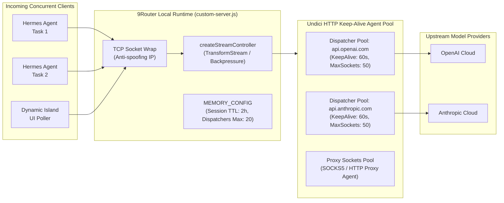

# 11-PERFORMANCE AND RELIABILITY: 9ROUTER
**Project:** Hime Assistant — AI Model Routing Layer Research  
**Target:** 9Router Concurrency, Latency, Streaming Throughput & System Reliability  
**Core Components:** `open-sse/config/runtimeConfig.js`, `open-sse/utils/streamHandler.js`, `open-sse/utils/proxyFetch.js`, `custom-server.js`  
**Author:** Senior Reverse Engineer, AI Infrastructure Architect, Backend Engineer & Security Researcher  
**Date:** November 2026  
**Status:** Completed  

---

## 1. Executive Summary

Laporan ini menyajikan evaluasi **Kinerja dan Keandalan (*Performance & Reliability*)** 9Router. Sebagai gerbang perantara yang berada di antara aplikasi interaktif (seperti Hime Assistant / Hermes Agent) dan server AI eksternal, 9Router dituntut memiliki latensi overhead mendekati nol (*sub-millisecond gateway overhead*), throughput streaming yang stabil, efisiensi konsumsi memori, serta isolasi kegagalan yang kuat.

Penyelidikan kode sumber mengonfirmasi bahwa 9Router menggunakan **`undici` HTTP Dispatcher Pool** dengan koneksi TCP *keep-alive*, streaming berbasis **Web Streams API (`TransformStream`)**, konfigurasi batas waktu (*timeouts*) yang sangat toleran terhadap model penalaran berkecepatan rendah (seperti o1/o3 atau DeepSeek-R1), serta scheduler pembersihan sesi otomatis untuk mencegah kebocoran memori (*memory leak*).

---

## 2. Concurrency & Network Transport Architecture

### 2.1. Manajemen Soket & Connection Pooling (`undici`) `[CONFIRMED]`
- Alih-alih menggunakan `fetch` native standar Node.js yang membuka koneksi TLS/TCP baru pada setiap request (rawan *socket hang up* dan kehabisan port TCP lokal Windows), 9Router memanfaatkan **`undici` v7.30.1** dengan dispatcher kolam koneksi (*connection pool*).
- **Socket Reuse:** Koneksi TLS yang sama dipertahankan aktif (*keep-alive*) sehingga request berikutnya ke provider yang sama langsung dikirim tanpa perlu melakukan *TLS Handshake* ulang, memangkas latensi awal sebanyak 80–150 milidetik.
- **Proxy Dispatchers Limiting:** Objek dispatcher proxy dibatasi maksimum 20 instance (`proxyDispatchersMaxSize = 20`) untuk mencegah penumpukan alokasi handle socket.

---

## 3. Streaming Efficiency & Latency Tuning

Streaming token adalah fungsi inti interaksi asisten desktop. 9Router mengonfigurasi batas waktu secara presisi pada [`open-sse/config/runtimeConfig.js`](file:///x:/folder_ai/Hime/RE/9ROUTER/00-source-materials/9router/open-sse/config/runtimeConfig.js):

| Parameter Batas Waktu | Nilai Default | Alasan Desain Teknis |
| :--- | :--- | :--- |
| **`FETCH_CONNECT_TIMEOUT_MS`** | `60,000 ms` (60 detik) | Batas waktu upstream mengembalikan HTTP response headers awal. |
| **`STREAM_FIRST_CHUNK_TIMEOUT_MS`** | `200,000 ms` (200 detik) | **Time-to-First-Token (TTFT) Headroom.** Model penalaran besar (seperti o1-pro, o3-mini, DeepSeek-R1) sering kali memerlukan waktu komputasi 60–120 detik sebelum memancarkan token teks pertama. Timeout 200s mencegah pemutusan dini saat model sedang berpikir. |
| **`STREAM_STALL_TIMEOUT_MS`** | `360,000 ms` (6 menit) | **Inter-chunk Stall Timeout.** Batas toleransi jeda di antara dua potongan token yang sedang mengalir. Mencegah koneksi zombie jika server provider membeku (*hung connection*). |
| **`EMPTY_PEEK_DEADLINE_MS`** | `45,000 ms` (45 detik) | Batas waktu penampungan buffer peeking pada model combo untuk mendeteksi respons kosong sebelum melakukan komitmen rute. |

---

## 4. Memory Management & In-Place Buffer Optimizations

Untuk menjaga konsumsi RAM 9Router tetap rendah (~50–90 MB pada kondisi idle):

1. **In-Place Mutation pada RTK (Request Token-Killer):**  
   Modul [`open-sse/rtk/index.js`](file:///x:/folder_ai/Hime/RE/9ROUTER/00-source-materials/9router/open-sse/rtk/index.js) mengompresi blok teks `tool_result` langsung di dalam objek array memori asli, tanpa menduplikasi objek pesan JSON secara berulang. Pendekatan ini secara drastis mengurangi *Garbage Collection (GC) pressure*.
2. **Session Cleanup Scheduler:**  
   Peta memori sesi dibersihkan setiap 30 menit (`sessionCleanupIntervalMs: 30 * 60 * 1000`) dengan masa hidup data sesi maksimum 2 jam (`sessionTtlMs: 2 * 60 * 60 * 1000`).
3. **Payload Clamping (`proxyClientMaxBodySize`):**  
   Dikonfigurasi pada `128mb` di Next.js standalone server untuk mengizinkan gambar resolusi tinggi tanpa membebani heap Node.js secara tidak terbatas.

---

## 5. Background Asynchronous Tasks

Tiga tugas latar belakang berjalan tanpa mengganggu thread eksekusi perutean:
1. **`backgroundTokenRefresh` (`custom-server.js`):**  
   Berjalan setiap 60 detik untuk memeriksa seluruh akun OAuth (Google, xAI, Kiro, Copilot). Jika sisa masa berlaku token kurang dari 5 menit, token disegarkan secara asinkron sebelum kedaluwarsa.
2. **`cloudSyncScheduler`:**  
   Jika fitur Cloud Sync diaktifkan, tugas periodik menyinkronkan status koneksi ke endpoint cloud cadangan.
3. **`models.dev` Catalog Background Sync:**  
   Menyegarkan metadata batas konteks dan harga model secara berkala di latar belakang.

---

## 6. Architectural Bottlenecks & Failure Isolation `[ISSUE]`

1. **Node.js Single-Threaded Event Loop Bottleneck:**  
   Meskipun I/O jaringan bersifat asinkron, parsing string JSON berukuran sangat masif (misalnya konteks riwayat percakapan 200.000 token ~15 MB JSON) dilakukan di thread utama V8. Operasi `JSON.parse()` dan `JSON.stringify()` pada payload raksasa dapat membekukan event loop selama 10–25 milidetik.
2. **Fallback Memory Buffering pada Combo Peeking:**  
   Fungsi `peekStreamForContent` menahan buffer awal stream sampai token teks pertama muncul. Jika model upstream memancarkan token lambat pada ratusan request simultan, memori heap Node.js akan meningkat proporsional terhadap jumlah koneksi yang sedang di-peek.
3. **Isolasi Kegagalan (*Failure Isolation*):**  
   Jika salah satu provider upstream mengalami crash, kegagalan tersebut terisolasi di dalam blok `try/catch` pada eksekutor dan langsung dialihkan ke akun berikutnya tanpa pernah merusak proses gateway utama.

