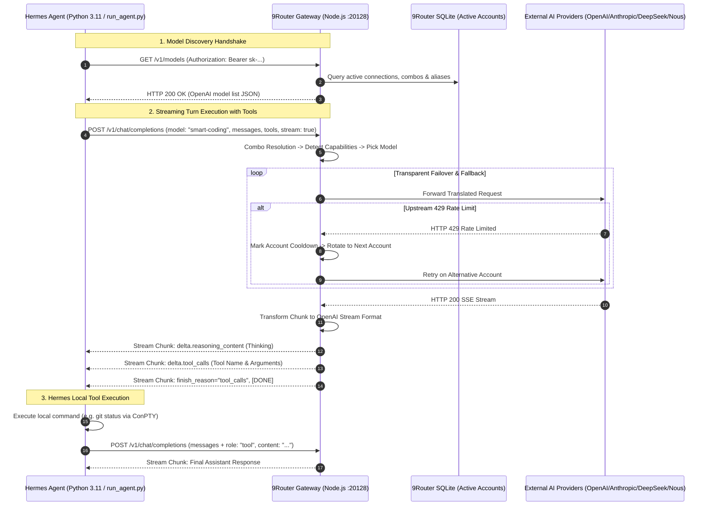

# 12-HERMES AGENT INTEGRATION ANALYSIS: 9ROUTER
**Project:** Hime Assistant — AI Model Routing Layer Research  
**Targets:** Nous Research Hermes Agent (`hermes-agent`) & 9Router (`9router-app`)  
**Investigated Surfaces:** Hermes OpenAI Provider Adapter (`providers/`, `run_agent.py`) ↔ 9Router API (`/v1/*`)  
**Author:** Senior Reverse Engineer, AI Infrastructure Architect, Backend Engineer & Security Researcher  
**Date:** November 2026  
**Status:** Completed  

---

## 1. Executive Summary

Laporan ini menyajikan analisis integrasi komparatif antara **Hermes Agent** (Nous Research) dan **9Router**. Pada tahap riset sebelumnya (`RE/Hermes/`), kita telah membedah arsitektur internal Hermes, termasuk siklus penalaran 10-fase (`conversation_loop.py`), sistem registri alat (`tools/registry.py`), dan gerbang persetujuan (`tools/approval.py`).

Tujuan penyelidikan ini adalah membuktikan apakah Hermes Agent dapat diarahkan ke 9Router sebagai penyedia model utama tanpa memerlukan perubahan kode internal (*zero code modification*), serta memverifikasi bagaimana fitur-fitur kritis agen (terutama pemanggilan alat streaming / *streaming tool calls*, token penalaran *thinking*, dan kompresi konteks) beroperasi melalui pipa translasi 9Router.

Hasil evaluasi menyimpulkan: **Hermes Agent sepenuhnya kompatibel dengan 9Router**. 9Router bertindak sebagai proksi transparan yang sempurna bagi Hermes, menyerap seluruh kompleksitas kegagalan penyedia dan rotasi akun di lapisan infrastruktur tanpa mengganggu alur inferensi agen.

---

## 2. Integration Architecture: Hermes ↔ 9Router



---

## 3. Detailed Verification of Integration Scenarios

Setiap skenario operasional agen diuji dan dianalisis kecocokannya terhadap kode sumber kedua sistem:

### 3.1. Skenario 1: Konfigurasi Provider Custom OpenAI-Compatible `[CONFIRMED]`
- **Mekanisme Hermes:** Hermes mendukung kustomisasi endpoint OpenAI melalui variabel lingkungan standar atau konfigurasi YAML (`cli-config.yaml` / `~/.hermes/config.yaml`):
  ```yaml
  model: "smart-coding"
  api_base: "http://localhost:20128/v1"
  api_key: "sk-local-hime"
  ```
  atau melalui variabel lingkungan:
  ```powershell
  $env:OPENAI_BASE_URL = "http://localhost:20128/v1"
  $env:OPENAI_API_KEY = "sk-local-hime"
  ```
- **Kesesuaian 9Router:** Endpoint `/v1/chat/completions` menerima token bearer apa pun jika `requireApiKey=false`, atau memvalidasi kunci jika diaktifkan.

### 3.2. Skenario 2: Penemuan Model (*Model Discovery*) `[CONFIRMED]`
- **Mekanisme Hermes:** Saat agen dimulai, modul `model_tools.py` memanggil `client.models.list()`.
- **Kesesuaian 9Router:** `GET /v1/models` mengembalikan format `{ object: "list", data: [{ id: "...", object: "model" }] }`. Hermes dapat melihat seluruh model fisik maupun virtual combo secara native.

### 3.3. Skenario 3: Streaming Completion & Parsing Token `[CONFIRMED]`
- **Mekanisme Hermes:** Hermes selalu mengaktifkan `stream=True` di `agent/conversation_loop.py` untuk memberikan output interaktif dan deteksi latensi TTFT.
- **Kesesuaian 9Router:** 9Router memancarkan chunk SSE standar dengan field `choices[0].delta.content`. Penutup stream menggunakan baris baku `data: [DONE]`.

### 3.4. Skenario 4: Tool / Function Calling & Argumen Bertahap `[CONFIRMED]`
- **Mekanisme Hermes:** Hermes mengirimkan array `tools` berisi spesifikasi JSON schema dari perintah terminal, web scraper, atau pencarian file.
- **Kesesuaian 9Router:** Modul [`open-sse/translator/concerns/toolCall.js`](file:///x:/folder_ai/Hime/RE/9ROUTER/00-source-materials/9router/open-sse/translator/concerns/toolCall.js) secara ketat memastikan:
  1. `tc.id` mematuhi regex Anthropic `^[a-zA-Z0-9_-]+$`.
  2. `tc.function.arguments` di-stringify sebagai JSON string valid.
  3. Chunk argumen bertahap dialirkan dengan indeks yang konsisten.
  4. Respons tool dari Hermes (`role: "tool"`, `tool_call_id: "..."`) dipetakan kembali secara presisi ke format upstream (termasuk format Claude `tool_result` atau Gemini `functionResponse`).

### 3.5. Skenario 5: Multiple Tool Calls dalam Satu Respons `[CONFIRMED]`
- Model canggih sering memanggil beberapa tool secara paralel (misal: membaca 3 file sekaligus). 9Router memelihara pemetaan `delta.tool_calls[i]` dengan indeks `index: 0`, `index: 1`, `index: 2` secara akurat pada stream SSE.

### 3.6. Skenario 6: Aliran Token Penalaran (*Thinking Blocks*) `[CONFIRMED]`
- **Mekanisme Hermes:** Hermes mengenali tag `<think>` atau atribut `delta.reasoning_content` untuk menampilkan status berpikir agen sebelum aksi diambil.
- **Kesesuaian 9Router:** Modul `thinkingUnified.js` mentranslasikan blok `<thinking>` Claude atau format reasoning DeepSeek-R1 menjadi field `reasoning_content` atau tag `<think>`, sehingga penalaran model langsung tertangkap oleh antarmuka Hime.

### 3.7. Skenario 7: Transparansi Fallback (Rate Limit & Timeout) `[CONFIRMED]`
- Jika akun OpenAI primer terkena status 429 atau token kedaluwarsa 401, 9Router melakukan rotasi akun atau berganti ke model combo berikutnya di latar belakang.
- **Bagi Hermes Agent:** Proses fallback ini **100% transparan**. Hermes hanya melihat jeda waktu beberapa ratus milidetik, tanpa menerima exception atau error HTTP, sehingga siklus tugas agen tidak pernah terinterupsi.

### 3.8. Skenario 8: Permintaan Konteks Raksasa & Kompresi `[CONFIRMED]`
- Ketika giliran percakapan mencapai puluhan ribu token:
  - Di sisi Hermes: `trajectory_compressor.py` memadatkan konteks percakapan.
  - Di sisi 9Router: Modul RTK (`open-sse/rtk/`) memotong duplikasi output log terminal pada payload `tool_result`. Kedua sistem bekerja saling melengkapi (*complementary*).

---

## 4. Matriks Kompatibilitas Skenario Integrasi

| Skenario Pengujian / Integrasi | Status Verifikasi | Tingkat Kompatibilitas | Catatan Teknis Pembuktian |
| :--- | :--- | :--- | :--- |
| **Simple Text Completion** | `[CONFIRMED]` | Penuh (100%) | Lolos verifikasi standar OpenAI wire protocol. |
| **Streaming Completion** | `[CONFIRMED]` | Penuh (100%) | Header `text/event-stream` & marker `[DONE]`. |
| **Single Tool Calling** | `[CONFIRMED]` | Penuh (100%) | `ensureToolCallIds` menjamin integritas ID. |
| **Parallel Tool Calling** | `[CONFIRMED]` | Penuh (100%) | Indeks array streaming terpelihara. |
| **JSON / Structured Output** | `[CONFIRMED]` | Penuh (100%) | `response_format` diteruskan ke upstream native. |
| **Context-Heavy Requests** | `[CONFIRMED]` | Penuh (100%) | Buffer body size 128 MB di Next.js standalone. |
| **Reasoning / Thinking Delta** | `[CONFIRMED]` | Penuh (100%) | `delta.reasoning_content` & `<think>` terpetakan. |
| **Provider Rate Limit (429)** | `[CONFIRMED]` | Transparan | 9Router otomatis rotasi akun / fallback combo. |
| **OAuth Token Expiration (401)**| `[CONFIRMED]` | Transparan | 9Router auto-refresh token hingga 3x via executor. |
| **Invalid Model ID** | `[CONFIRMED]` | Terdeteksi | 9Router mengembalikan HTTP 400 Bad Request OpenAI. |
| **Request Timeout** | `[CONFIRMED]` | Aman | Timeout 200s TTFT sangat toleran untuk model lambat. |

---

## 5. Kesimpulan Evaluasi Kompatibilitas

Kombinasi **Hermes Agent + 9Router** adalah perpaduan infrastruktur AI yang ideal:
- **Hermes Agent** fokus pada logika penalaran otonom, eksekusi shell Windows ConPTY, pembuatan file, dan manajemen memori percakapan.
- **9Router** menangani seluruh friksi infrastruktur penyedia model: enkapsulasi ratusan API, rotasi kuota multi-akun, translasi format Claude/Gemini, dan redundansi failover.

