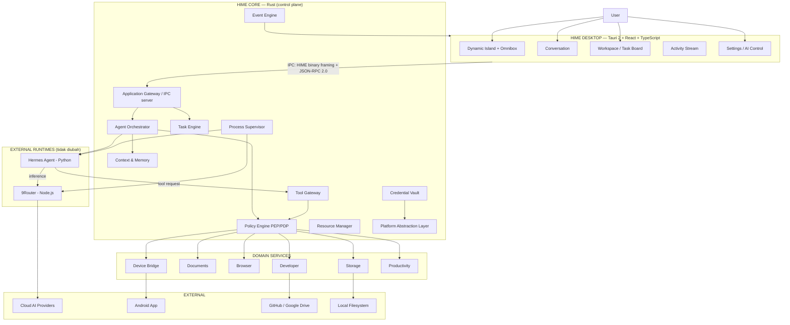
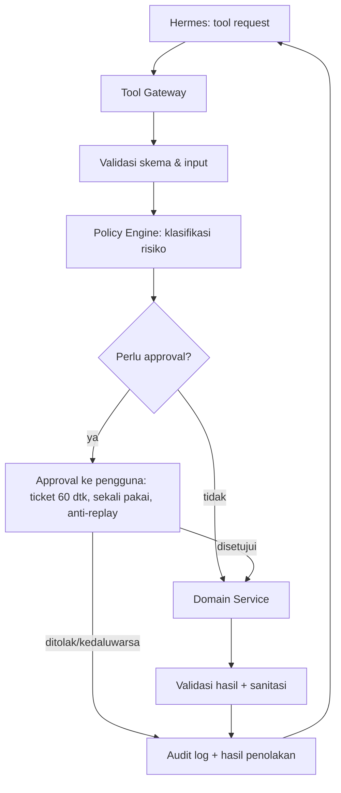

# 03 — SYSTEM ARCHITECTURE

> **Aturan prioritas:** Keputusan yang sudah ada di repository (`project-management/system-architecture/`, 12 ADR, `HIME-IMPLEMENTATION-CONSTRAINTS.md`) adalah acuan. Dokumen ini memuat desain induk dari perancangan dan **keputusan baru untuk fase 08–15**. Jika repository dan dokumen ini berbeda, catat selisih di audit, ikuti repository untuk yang sudah diimplementasikan, dan buat ADR bila perlu mengubah.

## 1. Gaya arsitektur

**Modular Monolith** untuk Hime Core, dengan batas domain jelas, **Ports & Adapters**, dan runtime eksternal independen. Bukan microservices (kompleksitas deployment dan debugging tidak sebanding untuk satu pengguna).

### Empat lapisan
1. **Presentation** — Hime Desktop (dan Hime Mobile). Tidak mengakses database/domain langsung.
2. **Application** — Hime Core: orkestrasi, kebijakan, task, event, konteks.
3. **Runtime & Integration** — adapter ke Hermes, 9Router, browser, GitHub, Drive, perangkat.
4. **Domain** — Storage, Documents, Developer, Productivity, Device, Notification, Translation.

**Aturan dependensi:** UI → Core → Domain/Adapters. Domain tidak mengenal UI. Hermes tidak punya jalur langsung ke OS. Tidak ada modul yang membaca tabel milik modul lain (akses lewat antarmuka domain).

## 2. Teknologi (keputusan)

| Area | Pilihan | Catatan |
|---|---|---|
| Desktop shell | **Tauri 2** | sudah terpasang di Fase 06 |
| UI | React + TypeScript + Tailwind + Motion | design system obsidian dark, spring motion (Fase 07) |
| State UI | store ringan (mis. Zustand) + query cache bila ada server state | ikuti yang sudah ada di repo |
| Core | **Rust** (workspace multi-crate, tokio) | crate bernama menurut tanggung jawab (hime-core, hime-ipc, hime-pal, hime-security, hime-storage, desktop shell; **jangan menambah crate tanpa alasan**) |
| IPC | Windows Named Pipe (Linux: Unix Domain Socket via PAL) | framing biner + JSON-RPC 2.0 |
| DB | **SQLite** (WAL) | migrasi eksplisit dan berversi |
| Secret | **Windows DPAPI** (Linux: Secret Service/libsecret via PAL) | |
| Supervisor | **Windows Job Objects** (`CREATE_SUSPENDED` → assign → resume) | Linux: process group/PDEATHSIG/cgroups bila tersedia |
| Agent runtime | **Hermes Agent** (Python, venv terpisah) | versi dicatat di compatibility manifest |
| Gateway model | **9Router** (Node.js) | akses via adapter; **tanpa** tulis langsung ke DB-nya |
| Mobile | **Kotlin + Jetpack Compose** (native Android) | alasan: SAF, MediaStore, Foreground Service, UsageStats memerlukan integrasi native yang andal |
| Transport perangkat | WebSocket over **TLS dengan mutual auth (rustls)**, pairing QR, JSON-RPC 2.0 | LAN dulu; akses di luar LAN lewat relay milik pengguna atau jaringan privat (mis. mesh VPN) — **tanpa port forwarding terbuka** |
| Dokumen | python-docx/docx, openpyxl, python-pptx, LibreOffice headless (konversi), qpdf/pikepdf (PDF), Tesseract/OCRmyPDF (OCR), Ghostscript (kompresi; cek lisensi AGPL sebelum didistribusikan) | dipasang sebagai tool terkelola, bukan di-bundle sembarangan |
| Browser | **Playwright** (Chromium/Chrome via CDP) dengan profil terpisah milik Hime sebagai default | evaluasi alternatif didokumentasikan di ADR (Fase 13) |
| File watch/hash | `notify`, `walkdir`/`ignore`, **BLAKE3** | |
| Pencarian | SQLite **FTS5** | |
| Logging | `tracing` + JSON terstruktur + redaksi berlapis | |
| Test | `cargo test`, `cargo nextest` bila tersedia, Vitest + Testing Library, Playwright untuk E2E UI, contract tests | |

> **Verifikasi wajib:** versi Hermes dan 9Router yang **benar-benar terpasang** menentukan kemampuan nyata. Dokumentasi/versi terbaru bukan bukti. Kamu harus memeriksa entry point, konfigurasi, API, autentikasi, streaming, dan mekanisme tool di instalasi aktual (Fase 08, Task 08.1).

## 3. Hime Core — modul

| Modul | Tanggung jawab inti |
|---|---|
| Application Gateway | Terima request UI, validasi input, session, event ke UI |
| Agent Orchestrator | Instruksi → task → rencana → kirim ke Hermes → pantau → laporkan |
| Policy Engine (PEP/PDP) | Klasifikasi risiko, izin, approval, deny rules, audit keputusan. **Deterministik, di luar model** |
| Tool Gateway | Registry tool, skema, validasi input, cek izin, timeout, validasi hasil, sanitasi output |
| Task Engine | Lifecycle, antrean, prioritas, retry, cancel, pause/resume, jadwal |
| Event Engine | Dispatch event internal, notifikasi, event file/agent/perangkat |
| Context & Memory | Preferensi, konteks proyek/task, retrieval, provenance, retensi |
| Process Supervisor | Start/health/restart/shutdown Hermes dan 9Router; versi; diagnostik |
| Resource Manager | Batas CPU/RAM/konkurensi, mode Efficiency/Balanced/Performance, backpressure |
| Credential Vault | Simpan/ambil secret via PAL, zeroization, umur plaintext minimal |
| PAL | Semua akses khusus OS (Win32, DPAPI, jendela, notifikasi, IPC transport) |

### Prinsip Tool Gateway

Tool dikelompokkan per domain (contoh nama: `storage.search_files`, `storage.propose_move`, `storage.execute_move`, `documents.create`, `browser.open_page`, `github.inspect_repository`, `tasks.create`). **Tool yang tidak terdaftar tidak ada.** Jika Core tidak tersedia, operasi berisiko **gagal tertutup**.

## 4. Protokol dan kontrak

### 4.1 IPC Desktop ↔ Core (sudah ada, Fase 04/06)
- Framing biner HIME (header 12 byte) + JSON-RPC 2.0; validasi panjang **sebelum** alokasi payload.
- Token sesi dan nonce/sequence **per sesi dan per arah**; request konkuren sah tidak boleh ditolak.
- Test wajib (diperluas di tiap fase): fragmentasi, request konkuren, reconnect, frame cacat, replay.
- Event streaming membawa **correlation ID**, nomor urut chunk, dan deduplikasi ID event di UI.

### 4.2 Event model
`event = { id, correlation_id, task_id?, session_id?, type, ts, payload, schema_version }`. Tipe minimum: `agent.status`, `agent.message.chunk`, `agent.message.done`, `tool.requested`, `tool.running`, `tool.completed`, `approval.requested`, `approval.resolved`, `task.*`, `runtime.health`, `file.*`, `device.*`, `error`. Perubahan skema = naikkan `schema_version` + contract test.

### 4.3 Jalur komunikasi AI
- **Inference plane:** Hermes → (Hime Provider Adapter / 9Router) → Provider. Hime **tidak** wajib menjadi proxy token, kecuali keputusan IB-01 (provider adapter) mengharuskannya.
- **Management plane:** Hime Core → *RouterGatewayAdapter* → 9Router (model discovery, status, usage). **Satu modul saja** yang memanggil endpoint manajemen; endpoint internal yang tak stabil diperlakukan sebagai dependensi yang diuji.
- **Event plane:** status/log 9Router + Hermes → Core → UI.
- **Fallback:** sebelum stream mulai dapat dilakukan 9Router; kegagalan di tengah stream **tidak selalu** bisa dialihkan. Hime wajib mendeteksi interupsi, menyimpan state task, memeriksa apakah retry aman, mencegah eksekusi tool ganda, dan melaporkan jelas.

## 5. Model data (SQLite Hime)

Satu database Hime; skema dipisah logis per domain; **jangan** menyimpan biner besar (hanya metadata + referensi). Perubahan state yang harus konsisten memakai transaksi. Migrasi eksplisit, dapat diverifikasi, dengan backup sebelum migrasi berisiko. Database Hime dan 9Router **tidak saling bergantung**.

| Domain | Tabel (indikatif; selaraskan dengan skema yang sudah ada) |
|---|---|
| Core | settings, devices, permissions, audit_logs, schema_migrations |
| Agent | conversations, messages, agent_sessions, agent_runs, tool_executions, memory_items |
| Task | tasks, task_events, schedules, reminders, notifications |
| Storage | indexed_files, file_hashes, file_versions, file_operations (jurnal), file_rules |
| Productivity | projects, kanban_cards, study_plans, accountability_policies |
| Device | paired_devices, device_sessions, transfer_queue, sync_state |
| Integration | integration_connections, integration_health, oauth_tokens_ref (referensi ke vault, bukan token) |

Retensi: log audit dan percakapan memiliki kebijakan retensi yang dapat diatur; secret **tidak pernah** masuk tabel ini.

## 6. Cross-platform: Windows-first, cross-platform by design

- Semua akses OS lewat **PAL**: IPC transport, secret store, notifikasi, manajemen jendela/overlay, supervisor proses, jalur data (`%APPDATA%` vs XDG).
- Windows: Win32, DPAPI, Named Pipes, Job Objects, HWND. Linux (Fase 15): Unix Domain Socket, Secret Service, XDG, systemd/process group, notifikasi freedesktop.
- **Jangan menjanjikan perilaku Island identik** di semua desktop Linux (Wayland membatasi posisi/ukuran/always-on-top). Dukungan Linux dinyatakan resmi hanya setelah diuji di Ubuntu dan Fedora (GNOME dan KDE).
- Dilarang: memanggil API Windows dari `hime-core` di luar PAL.

## 7. Resource management

- Satu instance Hermes; 1–2 reasoning task; 2 file worker; 1 browser; 1 pemrosesan dokumen berat.
- Antrean dengan backpressure; timeout dan cancel di semua jalur panjang; mode Efficiency/Balanced/Performance.
- Tangani low-memory: tunda pekerjaan latar, turunkan konkurensi, beri tahu pengguna.
- Metrik wajib diukur (bukan diperkirakan): CPU, RAM per proses, latensi request, durasi stream, restart count, jumlah error.

## 8. Observability

- Log terstruktur JSON dengan level DEBUG/INFO/WARN/ERROR/CRITICAL, correlation ID, task ID.
- Redaksi 4 lapis untuk rahasia (jangan mengandalkan regex saja; uji dengan kredensial kanari).
- Activity Center menjawab: agent mengerjakan apa, tool apa, menunggu approval atau tidak, model berpindah atau tidak, error apa, selesai atau gagal.
- Jangan mencatat token, password, isi file sensitif, atau chain-of-thought.

## 9. Deployment dan pembaruan

- Distribusi sebagai installer (Tauri bundler: NSIS/MSI) berisi Hime.exe, Hime Core, runtime terkelola Hermes dan 9Router (versi tertentu), konfigurasi awal, skrip migrasi.
- **Compatibility manifest** mencatat versi Hermes, 9Router, skema DB, protokol IPC, dan matriks kompatibilitas.
- Update tidak boleh merusak data; backup sebelum migrasi; strategi rollback; unduhan biner wajib diverifikasi sumber + integritas (hash/tanda tangan); jangan menjalankan biner tak terverifikasi.

## 10. Keputusan terkunci (tidak berubah tanpa ADR + bukti)

1. Modular Monolith untuk Core.
2. Hermes dan 9Router sebagai runtime independen, tidak dibuat ulang, tidak diubah tanpa persetujuan owner.
3. Nusa direimplementasikan, bukan "dipulihkan".
4. Tauri 2 + React + TypeScript; Rust untuk Core; SQLite; AI cloud.
5. Hime Core = satu-satunya PEP; model AI bukan penentu izin.
6. DPAPI/vault untuk secret Hime; vault **tidak** otomatis mengamankan DB internal 9Router.
7. Loopback-only untuk 9Router, **plus** autentikasi nyata (localhost bukan autentikasi).
8. Windows-first, cross-platform by design.
9. Satu Hermes runtime dulu; spesialisasi lewat skill, tool group, workflow template, batas konteks.
10. Satu fase = satu rangkaian kerja; review sekali di akhir; temuan non-blocking ke backlog.
