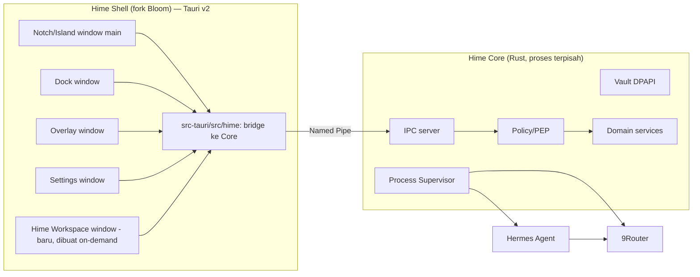

# 02 — STRATEGY & DECISIONS

## 1. Keputusan pivot

| # | Keputusan | Alasan |
|---|---|---|
| D1 | Hime Desktop buatan sendiri **dihentikan**. UI Hime dibangun sebagai **fork Bloom**. | UI Fase 07 gagal visual (tampak seperti aplikasi desktop biasa, bukan Island). Bloom sudah punya Island/notch + dock dengan fisika spring yang matang. |
| D2 | **Hime Core (Rust) dipertahankan sebagai proses terpisah.** | Batas keamanan (PEP, vault, tool gateway) tidak boleh ikut mati/ikut dikompromikan bersama shell pengganti taskbar; Core sudah dibangun dan diuji (Fase 06–07). |
| D3 | Shell Bloom menjadi **klien UI** Core lewat IPC (Named Pipe, framing HIME + JSON-RPC 2.0) melalui modul bridge baru di `src-tauri/src/hime/`. | Selaras pola Bloom: perintah di `commands.rs`, event via `app.emit`, pekerja panjang di `services.rs`. |
| D4 | Integrasi **aditif dan terisolasi**; sentuhan ke berkas Bloom dicatat di *touchpoint registry*. | Memudahkan menarik perbaikan upstream dan mengurangi konflik merge. |
| D5 | Desain dan aturan kode **mengikuti Bloom** (bukan standar lama kita) untuk semua kode shell (TS/React/Rust shell). Standar Core Rust tetap legacy 04. | Permintaan owner; konsistensi. |
| D6 | Konfigurasi/UI lama Hime **dihapus tanpa backup** setelah proses panen (harvest) terverifikasi (lihat berkas 05). | Permintaan owner. |
| D7 | Repo baru = klon Bloom (di-pin ke tag rilis terbaru saat impor), remote `upstream` dipertahankan untuk cherry-pick, **tanpa push** ke mana pun tanpa izin owner. | Kontrol versi aman. |
| D8 | **Linux dikeluarkan dari v1.0** (UR-18 diturunkan). Core tetap portabel lewat PAL; shell Bloom Windows-only. | Bloom adalah pengganti taskbar Windows dengan hook Win32/WASAPI/COM/WMI; mem-port-nya di luar jangkauan. |
| D9 | Updater dan pengumuman bawaan Bloom **dinonaktifkan atau diarahkan ke sumber Hime** sebelum build pertama dijalankan di mesin owner. | Jika tidak, updater Bloom dapat menimpa Hime dengan Bloom asli. |

## 2. Arsitektur tingkat tinggi

## 3. Lisensi dan kepatuhan (WAJIB dipahami)

- Bloom = **GPL-3.0**. Karya turunan (shell Hime) harus tetap **GPL-3.0**: pertahankan `LICENSE`, pemberitahuan hak cipta, tandai perubahan, dan **sediakan source jika didistribusikan** ke orang lain. Untuk pemakaian pribadi owner tidak ada kewajiban distribusi, tetapi jangan melanggar syarat bila nanti dibagikan.
- Hime Core, Hermes, 9Router adalah program terpisah yang berkomunikasi lewat IPC/HTTP: tetap tinjau lisensi masing-masing dan catat di `docs/legal/THIRD-PARTY.md`.
- **Jangan menyalin aset berhak cipta Nusa.** Nusa hanya referensi pengalaman.
- Bloom menyatakan (CONTRIBUTING) bahwa asisten AI tertanam **bukan bagian roadmap upstream** → Hime adalah fork dengan roadmap sendiri; jangan mengirim fitur Hime ke upstream.
- Catatan: README Bloom menyebut clone dari `SehajveerSingh2005/bloom`, sedangkan repo kanonis yang diberikan owner adalah `little-systems/bloom`. Gunakan yang diberikan owner; bila gagal, cek pengalihan dan catat.

## 4. Konsekuensi yang harus diketahui

1. **Windows-only.** Hime = Windows. Linux/Android tidak berubah kecuali: aplikasi Android (Fase 11) tetap sebagai klien terpisah.
2. **Resource:** Bloom sengaja ringan di idle. Hime tidak boleh merusaknya: tanpa polling idle, event-driven, window baru dibuat *on demand*, ukur delta terhadap baseline Bloom.
3. **Risiko shell:** Bloom menyembunyikan taskbar. Kesalahan kode dapat meninggalkan layar tanpa taskbar atau jendela mati yang menutupi klik. Protokol aman di berkas 04 wajib.
4. **Tiga window Bloom + satu baru:** menambah window = ubah `tauri.conf.json`, `vite.config.ts`, berkas HTML baru, dan `capabilities/default.json` (aturan Bloom).
5. **Backend lama tetap valid:** roadmap Fase 08–15 (AI runtime, intelligence, storage, mobile, productivity, browser/dev, specialists, hardening) tetap dikerjakan; hanya UI-nya dialihkan ke permukaan Bloom.
6. **Pengembangan upstream berjalan terus.** Pin ke commit/tag saat impor; ambil pembaruan upstream hanya sengaja (cherry-pick terpilih), bukan merge otomatis.

## 5. Pemetaan sumber kebenaran

| Topik | Sumber kebenaran |
|---|---|
| Perilaku, struktur, gaya kode Bloom | **Source Bloom aktual** (dipelajari di Stage H0) → `docs/hime/BLOOM-CONVENTIONS.md` |
| Kontrak Core ↔ shell | `06-INTEGRATION-ARCHITECTURE.md` + `docs/api/` di repo |
| Keamanan | `legacy/06-SECURITY-SPECIFICATION.md` |
| Kebutuhan pengguna | `legacy/02-…` (UR-01..18) |
| Visual | Panel Bloom yang sudah ada + persetujuan owner |
