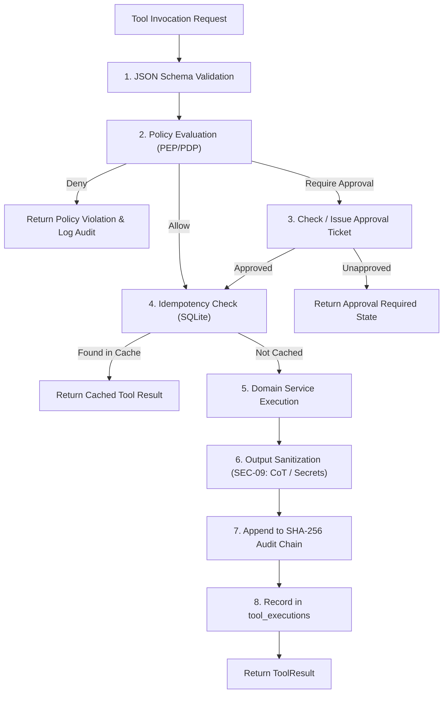

# Hime Core Tool Contracts

**Version:** 1.0.0  
**Phase:** Phase 09 — Intelligence Core  
**Enforcer:** Hime Core Tool Gateway (`hime-core::ai::tools`)

---

## 1. Tool Execution Pipeline

Every tool invocation routed through Hime Core passes through the following deterministic pipeline:



---

## 2. Tool Registry Specification

| Tool ID | Domain | Risk Level | Idempotent | Timeout (ms) | Description |
|:---|:---|:---|:---:|:---:|:---|
| `tasks.create` | `tasks` | **L1** (CreateSafe) | No | 5000 | Creates a planned task in Task Engine |
| `tasks.list` | `tasks` | **L0** (ReadOnly) | Yes | 3000 | Lists tasks with optional status filter |
| `tasks.update` | `tasks` | **L2** (Modify) | Yes | 5000 | Updates task status, progress, or state |
| `system.info` | `system` | **L0** (ReadOnly) | Yes | 2000 | Reads OS platform, architecture, and CPU cores |
| `files.stat` | `files` | **L0** (ReadOnly) | Yes | 3000 | Safely checks file existence and size (allowlisted paths only) |
| `notify.send` | `notify` | **L1** (CreateSafe) | No | 2000 | Emits a non-intrusive desktop notification alert |
| `translate.selection` | `translation` | **L0** (ReadOnly) | Yes | 10000 | Translates text selection into Indonesian (opt-in gated) |

---

## 3. Tool Schemas

### `tasks.create`
- **Risk Level:** `L1_CreateSafe`
- **Parameters:**
  ```json
  {
    "type": "object",
    "required": ["title"],
    "properties": {
      "title": { "type": "string" },
      "description": { "type": "string" },
      "priority": { "type": "string", "enum": ["low", "medium", "high"] }
    }
  }
  ```
- **Output:**
  ```json
  {
    "id": "task-101",
    "title": "Build workspace",
    "status": "queued",
    "progress": 0.0,
    "created_at": 1731510000
  }
  ```

### `tasks.list`
- **Risk Level:** `L0_ReadOnly`
- **Parameters:**
  ```json
  {
    "type": "object",
    "properties": {
      "status": { "type": "string", "enum": ["queued", "running", "waiting_approval", "paused", "succeeded", "failed", "cancelled"] }
    }
  }
  ```

### `tasks.update`
- **Risk Level:** `L2_Modify`
- **Parameters:**
  ```json
  {
    "type": "object",
    "required": ["id", "status"],
    "properties": {
      "id": { "type": "string" },
      "status": { "type": "string" },
      "progress": { "type": "number" }
    }
  }
  ```

### `system.info`
- **Risk Level:** `L0_ReadOnly`
- **Parameters:** `{}`
- **Output:**
  ```json
  {
    "os": "windows",
    "arch": "x86_64",
    "hime_version": "0.1.0",
    "cores": 16
  }
  ```

### `files.stat`
- **Risk Level:** `L0_ReadOnly` (Strict path validation enforced)
- **Parameters:**
  ```json
  {
    "type": "object",
    "required": ["path"],
    "properties": {
      "path": { "type": "string" }
    }
  }
  ```
- **Rejections:** Traversal `..`, NTFS streams `:`, reserved device names (`CON`, `PRN`), sensitive folders (`.ssh`, `.aws`, `C:\Windows`).

### `notify.send`
- **Risk Level:** `L1_CreateSafe`
- **Parameters:**
  ```json
  {
    "type": "object",
    "required": ["message"],
    "properties": {
      "title": { "type": "string" },
      "message": { "type": "string" },
      "level": { "type": "string", "enum": ["info", "warning", "error"] }
    }
  }
  ```

### `translate.selection`
- **Risk Level:** `L0_ReadOnly`
- **Parameters:**
  ```json
  {
    "type": "object",
    "required": ["text"],
    "properties": {
      "text": { "type": "string" },
      "target_lang": { "type": "string", "default": "id" }
    }
  }
  ```
- **Privacy Gating:** Rejects translation if `is_opted_in` is false or if input contains API keys/tokens.
