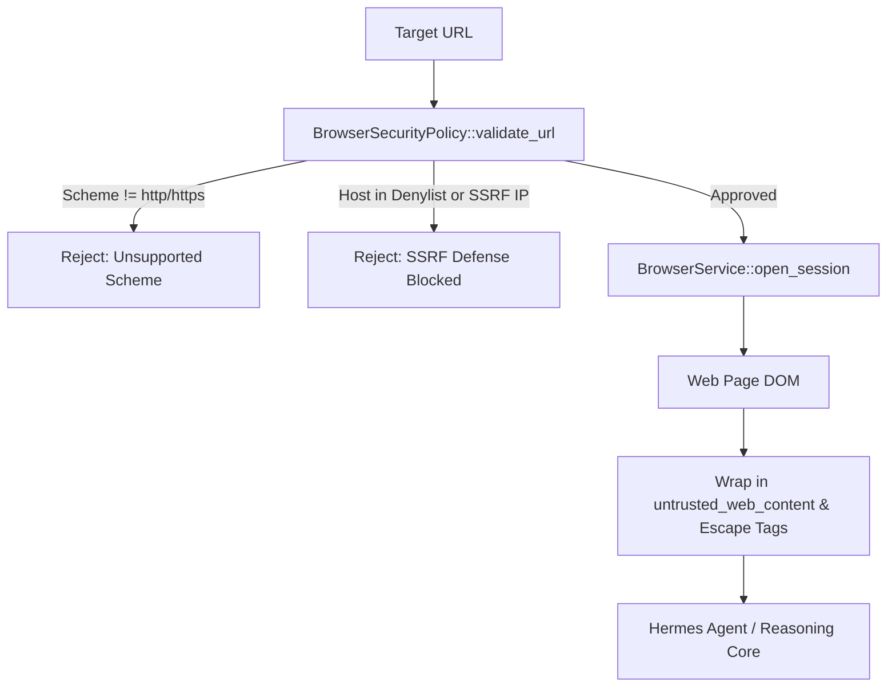

# Hime Architecture: Browser Service & Safe Web Automation

## 1. Overview & Purpose

Hime's Browser Service provides sandboxed web research, DOM readability extraction, and isolated file downloading. Because the open web is fundamentally untrusted and contains prompt injection vectors, malicious redirects, and credential-phishing payloads, Hime enforces strict security boundaries at the Core level:

1. **SSRF (Server-Side Request Forgery) Defense**: Blocks loopback (`127.0.0.1`, `localhost`, `::1`), private RFC 1918 subnets (`10.0.0.0/8`, `172.16.0.0/12`, `192.168.0.0/16`), link-local IPs (`169.254.0.0/16`), and cloud instance metadata services (`169.254.169.254`).
2. **Anti-Prompt Injection Content Encapsulation**: Extracted web text is safely enclosed inside `<untrusted_web_content source="..." timestamp="...">` blocks with internal tag neutralization to prevent LLM system prompt hijacking.
3. **Quarantined Downloads**: Any file retrieved via the browser engine is placed in an isolated quarantine directory (`.hime/quarantine/`) with computed SHA-256 integrity hash and audit metadata before user approval.
4. **Isolated Browser Profiles**: User browsing sessions operate with dedicated profile directories (`%LOCALAPPDATA%\Hime\browser_profile`), preventing contamination of host system browsers.

---

## 2. Security Policy Architecture (`hime-core::browser::policy`)



### 2.1 SSRF Validation Rules
- Supported schemes: `http://`, `https://` only (`file://`, `javascript:`, `ftp://`, `data:` are rejected immediately).
- IP checks:
  - Loopback (`127.0.0.0/8`, `::1`, `localhost`)
  - Private IPv4 (`10.0.0.0/8`, `172.16.0.0/12`, `192.168.0.0/16`)
  - Link-Local IPv4 (`169.254.0.0/16`, specifically AWS/GCP/Azure metadata endpoint `169.254.169.254`)
  - Loopback aliases (`0.0.0.0`)

### 2.2 Anti-Injection Wrapping
When the agent extracts readability markdown from any web page, the content is wrapped:
```xml
<untrusted_web_content source="https://example.com/docs" timestamp="1731554400">
# Content Here
</untrusted_web_content>
```
If the raw HTML contains rogue closing tags such as `</untrusted_web_content>`, the policy replaces them with `&lt;/untrusted_web_content&gt;`, preventing escape attacks.

---

## 3. Storage & Audit Integration

Every session, history entry, and downloaded file is persisted in SQLite (`crates/hime-storage`):
- `browser_sessions`: Active and closed browsing sessions with timestamps.
- `browser_history`: Chronological audit trail of visited URLs.
- `browser_downloads`: Quarantined file records with SHA-256 hashes and quarantine reason.
