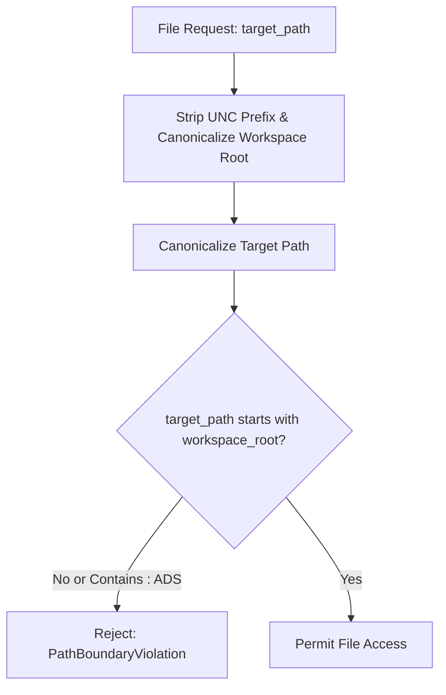

# Hime Architecture: Developer Workspace & Engineering Controls

## 1. Overview & Purpose

Hime's Developer Workspace provides a sandboxed, policy-enforced environment for software engineering tasks. Agents and users can register repositories, execute build and test tools, inspect Git history, and render standard engineering specifications (IEEE 830, IEEE 1016, IEEE 829).

Security is enforced at three distinct layers:
1. **Path Boundary Defense**: All operations must resolve strictly within the registered workspace root. Traversal tokens (`..`), Alternate Data Streams (ADS `:`), and Windows UNC prefix bypasses (`\\?\`) are normalized and strictly blocked.
2. **Binary Allowlist & Argument Injection Defense**: Only explicitly approved developer binaries (`git`, `cargo`, `pnpm`, `npm`, `node`, `python`, `uv`, `pytest`, `rustc`, `tsc`, `ruff`, `eslint`) can be spawned. Command chaining metacharacters (`;`, `&&`, `||`, `|`, `&`, `>`, `<`) are rejected. Arguments are delivered as structured vectors directly to `std::process::Command`, completely bypassing `cmd.exe` or PowerShell shell interpreters.
3. **Pre-Commit Secret Scanner**: Before any Git commit is executed through Hime, all staged and modified files are scanned for high-entropy secrets, private keys, AWS access keys, GitHub PATs, and credentials. Output from command executions is also sanitized via `hime_security::redaction::redact_sensitive_text`.

---

## 2. Path Boundary Defense Implementation

Windows canonicalization prepends `\\?\` verbatim paths. Hime normalizes both the workspace boundary and candidate file paths using `strip_unc_prefix()` before prefix matching, ensuring robust enforcement across drives without false positives.

---

## 3. Sandboxed Binary Runner (`hime-core::developer::runner`)

Allowed executables are defined in `ALLOWED_BINARIES`:
- Compiler & Build Tools: `cargo`, `rustc`, `tsc`, `pnpm`, `npm`
- Runtimes & Interpreters: `node`, `python`, `uv`
- Testing & Linters: `pytest`, `ruff`, `eslint`
- Version Control: `git`

Any unrecognized binary is rejected with `CommandNotAllowed`. Commands flagged with high impact (e.g. `clean`, `reset`, `checkout --`, `rm`) are tagged with `requires_approval = true`.

---

## 4. Software Engineering Standards Templates

Hime provides built-in templates compliant with international software engineering standards:
- **SKPL (IEEE 830 / ISO 29148)**: Software Requirements Specification in Bahasa Indonesia.
- **DPPL (IEEE 1016)**: Software Architecture and Design Description in Bahasa Indonesia.
- **Master Test Plan (IEEE 829)**: Test Strategy, Scope, and Traceability Matrix.
- **Rigorous Code Review Checklist**: Security boundaries, memory safety, secret hygiene, and PEP compliance.

