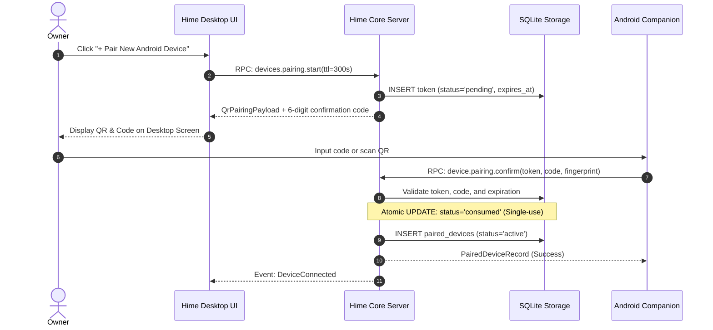

# Hime Mobile and Device Layer Architecture

> **Component:** Hime Core (`hime-core::device`), Hime Storage, Hime Desktop, Hime Android Companion  
> **Phase:** Phase 11 — Mobile and Device Layer  
> **Status:** Implemented & Verified

---

## 1. System Topology & Dual Control Plane

The Hime ecosystem connects personal devices (Windows Desktop, Android smartphones, and tablets) while maintaining **Hime Core on Desktop as the single authoritative Policy Enforcement Point (PEP)**.

```mermaid
flowchart TD
    subgraph WindowsDesktop ["Windows Desktop Host"]
        DesktopUI["Hime Desktop UI (Tauri)"]
        HimeCore["Hime Core (Rust Engine)"]
        LocalCA["Local PKI CA Authority"]
        StorageEngine["Safe File Operations Engine"]
        SQLite[("Hime SQLite Database")]
        
        DesktopUI <-->|Named Pipe IPC| HimeCore
        HimeCore --> LocalCA
        HimeCore --> StorageEngine
        HimeCore <--> SQLite
    end

    subgraph AndroidMobile ["Android Mobile Companion"]
        ComposeUI["Jetpack Compose UI (Chat/Tasks/Storage/Security)"]
        FgService["Foreground Service (DataSync)"]
        Keystore["Android KeyStore (Hardware TEE/StrongBox)"]
        SAF["Storage Access Framework (SAF)"]
        
        ComposeUI --> FgService
        FgService --> Keystore
        FgService --> SAF
    end

    HimeCore <==>|Mutual TLS WebSocket (JSON-RPC 2.0)| FgService
```

---

## 2. Cryptographic Identity & Local PKI

1. **Local Root CA:**
   - Hime Core manages an internal Local Certificate Authority (`LocalPkiAuthority`).
   - Private CA keys are guarded in memory and never exported.
   - The Root CA generates a unique fingerprint (e.g. `SHA256:HIME-ROOT-CA-...`) displayed during pairing.
2. **Device Hardware KeyStore:**
   - The Android Companion generates an EC (P-256) key pair inside `AndroidKeyStore`.
   - Private keys never leave hardware-backed security (StrongBox / TEE).
   - Only public keys and SHA-256 certificate fingerprints are transmitted to Core during pairing.
3. **Mutual TLS (mTLS):**
   - Connections between Mobile and Desktop require valid client certificate authentication.
   - Client certificate fingerprints are checked on every RPC request against the `paired_devices` database table.

---

## 3. Pairing Lifecycle & Anti-Replay Security



- **Replay Protection:** Tokens transition from `pending` to `consumed` in the same database transaction. Attempting to reuse an existing token fails immediately.
- **TTL Expiration:** Pairing sessions expire automatically after 300 seconds.

---

## 4. Remote Approval Protocol (UR-02 / UR-04)

- When an autonomous task or tool execution requires L2/L3 permissions, Hime Core generates an `ApprovalRecord` with a unique ticket ID.
- Mobile devices subscribed to `device.approvals.list` receive notifications.
- When the owner resolves an approval from Android:
  1. Mobile sends `device.approvals.resolve(ticket_id, decision)`.
  2. Core verifies the ticket is still pending and not expired.
  3. Core atomically flags `consumed = true`, updates status, and publishes `SystemEvent::ApprovalResolved`.
  4. Concurrent resolution attempts (from Desktop or another device) fail closed.

---

## 5. Chunked Resumable File Transfers

- Files are transferred in chunks (default 1 MB) using JSON-RPC messages `device.transfer.init`, `device.transfer.chunk`, and `device.transfer.finalize`.
- Every chunk verifies a local SHA-256 hash before writing to disk.
- Final assembly passes through `.hime/staging` and validates the full file SHA-256 before `SafeFileOperationsEngine` moves it to the target destination.

---

## 6. Immediate Revocation

- Desktop administrator can revoke any paired device with one click (`devices.revoke`).
- Core updates device status to `revoked` in SQLite and terminates active WebSocket sessions.
- Any subsequent RPC request bearing the revoked certificate fingerprint is immediately rejected with HTTP/RPC `UNAUTHORIZED`.
