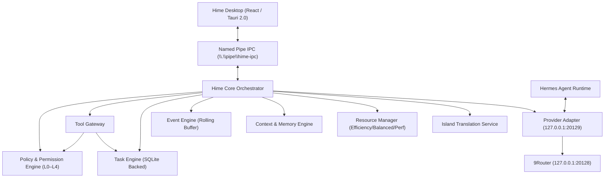

# Hime Intelligence Core Architecture

**Version:** 1.0.0  
**Phase:** Phase 09 — Hime Intelligence Core  
**Classification:** Internal Architectural Reference  
**Security Boundary:** Hime Core (Sole PEP & PDP)

---

## 1. Executive Summary

The **Hime Intelligence Core** transforms Hime from a reactive conversation agent into a deterministic, multi-step orchestration system capable of planning, executing, verifying, and monitoring AI workflows across desktop systems.

It strictly adheres to the core security principle:
> **Hime Core is the sole Policy Enforcement Point (PEP) and Policy Decision Point (PDP).**  
> External runtimes (such as Hermes Agent and 9Router) are untrusted execution environments without authority to access host resources directly.

---

## 2. Component Architecture Overview

---

## 3. Subsystem Specifications

### 3.1 Policy & Permission Engine (`hime-security::policy`)
- **Declarative Policy as Code:** Configured deterministically in Rust; model hallucinations cannot grant permissions.
- **Risk Classification:**
  - **L0 (ReadOnly):** Informational lookups, system ping, read allowed files (`files.stat`, `system.info`).
  - **L1 (CreateSafe):** Safe creations in temporary or isolated state (`tasks.create`, `notify.send`).
  - **L2 (Modify):** Safe modifications on owned workspace objects (`tasks.update`).
  - **L3 (Destructive):** File deletions, destructive operations. Requires single-use approval ticket (TTL 60s).
  - **L4 (System):** Process spawning, OS configuration modifications. Requires explicit confirmation.
- **Defense Mechanisms:**
  - Path traversal detection (`..` sequences rejected).
  - NTFS Alternate Data Streams rejection (`:` rejected).
  - Windows reserved device names blocked (`CON`, `PRN`, `AUX`, `NUL`, `COM1..9`, `LPT1..9`).
  - System directory protections (`C:\Windows`, `C:\Program Files`, etc.).
  - Sensitive credential paths protected (`.ssh`, `.aws`, `.gnupg`).
  - Destructive command patterns blocked (`rmdir /s`, `del /f /s /q`, `powershell stop-computer`).

### 3.2 Tool Gateway (`hime-core::ai::tools`)
- **Pipeline:**
  1. Parameter schema validation.
  2. Policy evaluation (L0–L4).
  3. Approval check for L3/L4 operations.
  4. Idempotency cache lookup (`hime-storage::tool_executions`).
  5. Execution in domain service.
  6. Output sanitization (SEC-09: Chain-of-Thought & secret key redaction).
  7. Append-only, SHA-256 hash-chained audit logging (`hime-storage::audit_events`).
- **Initial Built-in Tools:**
  - `tasks.create` (L1)
  - `tasks.list` (L0)
  - `tasks.update` (L2)
  - `system.info` (L0)
  - `files.stat` (L0)
  - `notify.send` (L1)
  - `translate.selection` (L0)

### 3.3 Task Engine (`hime-core::ai::task_engine`)
- **State Machine:**
  `Queued -> Running -> (WaitingApproval | Paused) -> Succeeded | Failed | Cancelled`.
- **Crash Recovery:**
  On startup, uncompleted tasks left in `running` or `waiting_approval` state are recovered to `queued` for safe resumption.
- **Backpressure & Concurrency Limits:**
  Respects active `ResourceManager` settings:
  - `Efficiency`: 1 concurrent task.
  - `Balanced`: 2 concurrent tasks.
  - `Performance`: 4 concurrent tasks.
- **Retry Policy:**
  Exponential backoff with maximum retry count limits (`max_retries = 3`).

### 3.4 Event Engine (`hime-core::ai::event_engine`)
- **Typed Events:** Versioned schema (`schema_version: 1`), unique event ID, correlation ID, millisecond timestamps.
- **Rolling Buffer:** In-memory circular buffer (default 200 events) for at-least-once delivery to disconnected or restarting desktop UI clients.

### 3.5 Context & Memory Engine (`hime-core::ai::memory`)
- **Provenance Tracking:** Every memory record stores source, category, timestamp, relevance score, and retention policy.
- **Token-Budgeted Retrieval:** Prompts are built within a bounded token budget (`build_prompt_context(query, max_tokens)`), preventing unbounded context bloat.
- **User Privacy Control:** Full user inspection and deletion via `memory.delete`.

### 3.6 Island Intelligence: Selected-Text Translation (UR-16)
- **Selection Capture:** Platform Abstraction Layer (`hime-pal::selection::SelectionReader`) captures selected text while safely saving and restoring the user's original clipboard content.
- **Privacy Opt-In Gate:** Disabled by default; user must explicitly opt in.
- **Credential Filter:** Sensitive text (API keys, private keys, passwords) is blocked from cloud transmission.
- **Dynamic Island Display:** Expands into the Island HUD showing the original and Indonesian translation, with one-click copy and dismiss actions.
