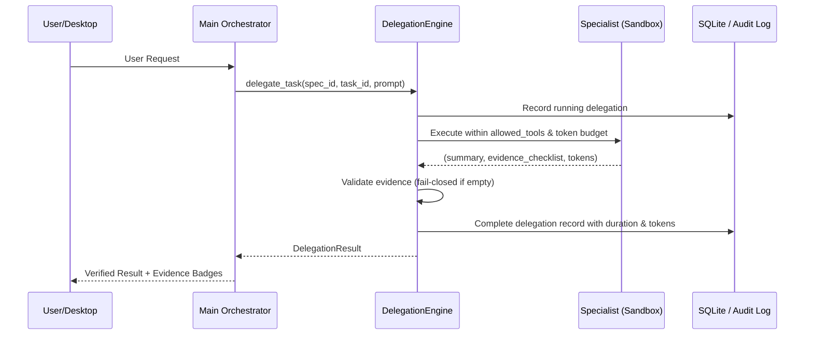

# Hime Architecture: Specialist Agents, Skills & Proactive Assistance

## 1. Architectural Philosophy

In accordance with Hime's core engineering principle: **Specialization without uncontrolled proliferation**.
Rather than running dozens of unvetted, concurrent autonomous agent processes that compete for system resources and confuse user intent, Hime enforces:
1. **Single Orchestration Runtime**: The Primary Orchestrator (Hermes Agent / Hime Core) maintains full context governance and delegates subtasks to tightly-scoped domain specialists.
2. **Explicit Capability and Tool Boundaries**: Each specialist possesses a fixed, non-escalatable subset of allowed tools (`allowed_tools`), a strict token budget, and an execution timeout.
3. **Evidence-First Verification**: Specialists must deliver structured results accompanied by verifiable evidence (file paths, hashes, metrics). Claims without evidence fail closed.
4. **Local Hardware Realism**: All data and AI operations are bounded to local CPU capabilities (Intel i5, 1GB RAM budget), avoiding hallucinated GPU resources.

---

## 2. Specialist Domain Registry

| Specialist ID | Domain | Role Title | Allowed Tools | Resource Budget | Evaluation Score |
|:---|:---|:---|:---|:---:|:---:|
| `specialist.software_engineer` | developer | Senior Systems & Software Engineer | `dev.run_command`, `dev.git_status`, `files.stat`, `files.list` | 6,144 tokens / 90s | **96.5 / 100** |
| `specialist.data_ai` | data_ai | Data Analyst, Scientist & ML Engineer | `data_ai.profile_dataset`, `data_ai.design_experiment`, `files.stat` | 4,096 tokens / 60s | **95.0 / 100** |
| `specialist.research` | browser | Autonomous Web Researcher | `browser.open_page`, `browser.extract`, `browser.download` | 5,120 tokens / 60s | **94.0 / 100** |
| `specialist.document` | documents | Office & Academic Formatting Specialist | `docs.create_report`, `docs.merge_pdfs` | 4,096 tokens / 60s | **97.0 / 100** |
| `specialist.productivity` | productivity | Personal Accountability & Study Scheduler | `productivity.tasks.create`, `productivity.schedules.plan` | 3,072 tokens / 45s | **98.0 / 100** |
| `specialist.storage` | storage | Storage Intelligence & Operations Analyst | `storage.scan`, `storage.search` | 4,096 tokens / 60s | **95.5 / 100** |

---

## 3. Delegation Lifecycle (`hime-core::ai::specialists::delegation`)

---

## 4. Data & AI Studio (UR-13)

Designed specifically for academic research, engineering analytics, and machine learning pipelines:
- **Descriptive Profiling**: Fast, zero-dependency CSV parsing computing column data types, missing counts/percentages, min, max, and mean.
- **Anti-Data-Leakage Experimentation**: Automatically formulates 5-fold cross-validation designs where preprocessing (scaling, imputation, encoding) is strictly isolated within training folds.
- **Hardware Bounding**: Guarantees experiments fit standard laptop CPU environments without crashing or freezing background tasks.

---

## 5. Safe Proactive Assistance

To prevent annoying or intrusive notifications:
1. **Strictly Opt-in**: Proactive suggestions are governed by `is_enabled` (toggleable in UI).
2. **Rate Limiting**: Configurable cooldown (default 30 minutes) prevents notification spam.
3. **Mute Modes**: Quick mute options (1 hr, 4 hrs, 24 hrs) for deep focus periods.
4. **Usefulness Metric Tracking**: Tracks `accepted`, `dismissed`, and `muted` responses to optimize recommendations over time.

