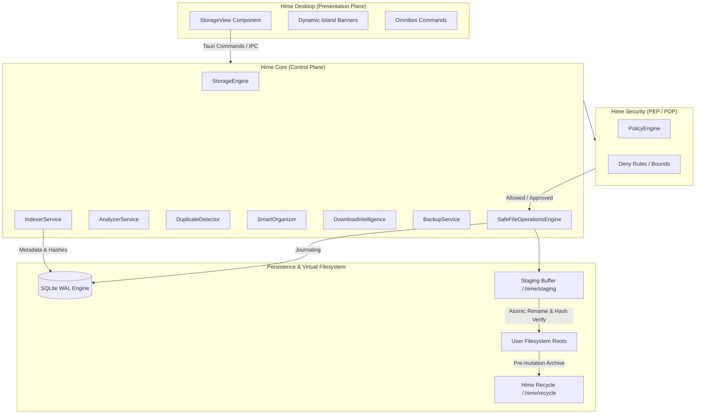

# Hime Architecture — Storage Intelligence & Safe File Operations Engine

## 1. System Overview & Objectives
Phase 10 implements **Storage Intelligence** for Hime, providing automated, policy-governed local storage management, intelligent file organization, download interception, duplicate & version detection, and crash-resilient atomic file operations with reversible recovery.

The primary objective is to guarantee **zero unintended data loss** through deterministic staging, hash validation, and reversible archiving into **Hime Recycle** rather than permanent OS deletion.



---

## 2. Core Components

### 2.1 Safe File Operations Engine (`SafeFileOperationsEngine`)
The safe file operations engine forms the core data-safety barrier for all file modifications:
- **Pre-execution Policy Validation:** All incoming paths are verified through `PolicyEngine::validate_path_safety`:
  - Path traversal sequences (`..`) rejected.
  - NTFS Alternate Data Streams (`:stream`) rejected.
  - Windows reserved device names (`CON`, `PRN`, `AUX`, `NUL`, `COM1..9`, `LPT1..9`) rejected.
  - Protected sensitive locations (`.ssh`, `.aws`, `.gnupg`, etc.) rejected.
  - Operating system system roots (`C:\Windows`, `C:\Program Files`, etc.) rejected.
- **Atomic Execution Flow:**
  1. Source file content SHA-256 is calculated (`source_hash`).
  2. File operation record created in SQLite journal with status `staged`.
  3. Source copied to staging directory (`.hime/staging/<op_id>_<file_name>.staging`).
  4. Staged copy flushed and synced to disk via `File::sync_all`.
  5. SHA-256 of staged file verified against `source_hash`.
  6. Atomic rename transfers staged file to final target destination.
  7. SHA-256 of destination file verified against `source_hash`.
  8. Source file is moved into **Hime Recycle** (`.hime/recycle/<timestamp>_<file_name>`), never permanently unlinked.
  9. Journal operation status committed to SQLite.
- **Crash Recovery Protocol:** On Core startup, `recover_uncommitted_operations()` scans `file_operations` for operations stuck in `staged` or `in_progress`. Any orphaned staging files in `.hime/staging` are purged and the journal status is set to `rolled_back`.

### 2.2 Filesystem Indexer (`IndexerService`)
- Recursive directory traversal bounded by user-approved workspace roots (Documents, Downloads, Desktop, Project directories).
- Blacklisted system folders: `node_modules`, `.git`, `.cache`, `target`, `dist`, `$RECYCLE.BIN`, `System Volume Information`.
- Bounded hashing: SHA-256 hash computed for files up to 50 MB.
- Extracted metadata: canonical path, parent directory, file name, extension, size, mtime, ctime, MIME type.
- Stored in SQLite `indexed_files` with indices on `parent_dir`, `size_bytes`, `extension`, and `content_hash`.

### 2.3 Storage Analyzer (`AnalyzerService`)
- Disk usage aggregation by file extension.
- Top largest files identification across indexed roots.
- Stale download detection (files in download directories older than 30 days).
- Cleanable suggestions: temporary cache files (`.tmp`), obsolete installers (`.exe`, `.msi`, `.iso`, `.dmg`) older than 30 days.

### 2.4 Duplicate & Version Intelligence (`DuplicateDetector`)
- **Exact Duplicates:** Fast lookup grouping by `content_hash` and `size_bytes` where content hash is identical.
- **Version Candidates:** Detects files with similar naming conventions (`laporan (1).docx` vs `laporan.docx`, `project_v2.zip` vs `project.zip`) but differing hashes, identifying which file is newer by modification timestamp and recommending archiving of older versions.

### 2.5 Smart Organizer (`SmartOrganizer`)
- Matches files against user-configured rules in `file_rules`.
- Proposes destination directory and templated naming conventions (`{name}_{date}.{ext}`).
- Non-interactive safety: proposals are generated as structured previews before execution (`evaluate_proposals` -> `execute_proposal`).

### 2.6 Download Intelligence (`DownloadIntelligence`)
- Detects in-progress downloads (`.crdownload`, `.part`, `.tmp`) and defers user interruption until completion.
- Upon completion, compares against `indexed_files` by SHA-256 content hash:
  - Exact duplicates trigger duplicate prompt: option to discard or keep both.
  - Similar names with differing hashes trigger version prompt: replace & archive old into Hime Recycle.

### 2.7 Backup & Recovery Service (`BackupService`)
- Creates snapshot copies of directory trees.
- Computes SHA-256 cryptographic manifest across all relative file paths and hashes.
- Integrity verification: `verify_backup(id)` recalculates the current manifest and compares against stored hash to detect unauthorized tampering or bit rot.

---

## 3. Database Schema Migrations

```sql
CREATE TABLE IF NOT EXISTS indexed_files (
    path TEXT PRIMARY KEY,
    parent_dir TEXT NOT NULL,
    file_name TEXT NOT NULL,
    extension TEXT,
    size_bytes INTEGER NOT NULL,
    modified_at INTEGER NOT NULL,
    created_at INTEGER NOT NULL,
    is_dir BOOLEAN NOT NULL,
    content_hash TEXT,
    mime_type TEXT,
    indexed_at INTEGER NOT NULL
);
CREATE INDEX IF NOT EXISTS idx_files_parent ON indexed_files(parent_dir);
CREATE INDEX IF NOT EXISTS idx_files_size ON indexed_files(size_bytes);
CREATE INDEX IF NOT EXISTS idx_files_ext ON indexed_files(extension);
CREATE INDEX IF NOT EXISTS idx_files_hash ON indexed_files(content_hash);

CREATE TABLE IF NOT EXISTS file_operations (
    id TEXT PRIMARY KEY,
    op_type TEXT NOT NULL,
    source_path TEXT NOT NULL,
    destination_path TEXT,
    backup_path TEXT,
    source_hash TEXT,
    dest_hash TEXT,
    actor TEXT NOT NULL,
    approval_id TEXT,
    status TEXT NOT NULL,
    started_at INTEGER NOT NULL,
    completed_at INTEGER,
    error_message TEXT
);
CREATE INDEX IF NOT EXISTS idx_file_ops_status ON file_operations(status);

CREATE TABLE IF NOT EXISTS file_rules (
    id TEXT PRIMARY KEY,
    name TEXT NOT NULL,
    pattern TEXT NOT NULL,
    target_dir TEXT NOT NULL,
    naming_template TEXT,
    action TEXT NOT NULL,
    is_active BOOLEAN NOT NULL DEFAULT 1,
    created_at INTEGER NOT NULL,
    updated_at INTEGER NOT NULL
);

CREATE TABLE IF NOT EXISTS storage_backups (
    id TEXT PRIMARY KEY,
    source_root TEXT NOT NULL,
    backup_destination TEXT NOT NULL,
    file_count INTEGER NOT NULL,
    total_bytes INTEGER NOT NULL,
    manifest_hash TEXT NOT NULL,
    created_at INTEGER NOT NULL,
    verified_at INTEGER
);
```

---

## 4. Verification Evidence & Benchmarks
- Automated integration test suite `storage_integration.rs` verifies all 10 storage workflows:
  - Synthetic sandbox indexing and disk analysis.
  - Multi-stage duplicate and version candidate detection.
  - Atomic safe move, Hime Recycle staging, and one-click restore.
  - Safe delete to Hime Recycle and full restoration.
  - Startup crash recovery and journal rollback of uncommitted staging files.
  - Rejection of path traversal (`..`), NTFS ADS (`:stream`), and Windows reserved device names (`CON`, `NUL`).
  - Rule-based proposal generation and execution.
  - Download completion and duplicate detection.
  - Backup snapshot creation, manifest calculation, and tamper detection.
  - IPC JSON-RPC endpoints dispatch.
