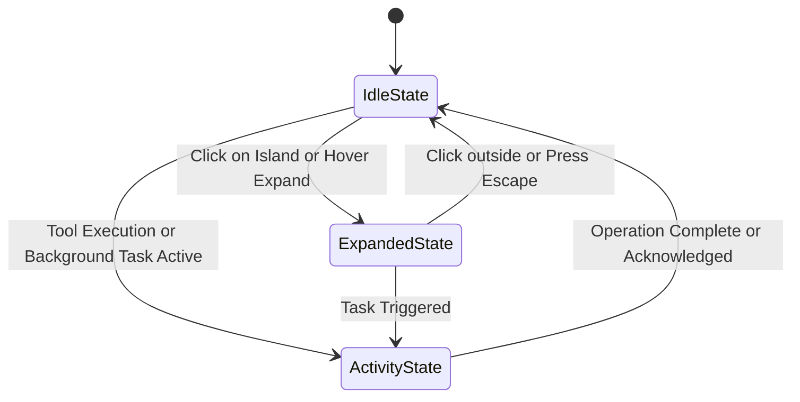

# Hime Desktop Experience — UX Interaction Specification

- **Document ID:** DOCS-DESKTOP-UX-SPEC
- **Phase:** Phase 07 — Hime Desktop Experience
- **Authority:** System Architect & Technical Lead
- **Status:** APPROVED IMPLEMENTATION SPECIFICATION

---

## 1. Dynamic Island State Machine

The Dynamic Island transitions between three core states:

### State Behaviors
1. **Idle State:**
   - Width: 310px, Height: 40px, Pill radius: 9999px.
   - Shows live pulsing green dot (Online) or red dot (Offline).
   - "HIME" brand mark with `ONLINE` badge.
   - Micro search trigger pill (`⌘K`).
   - Unread notification counter badge when alerts are waiting.
2. **Expanded State:**
   - Width: 480px, Height: 110px, Rounded radius: 20px.
   - Opens drawer with quick action buttons: "Ping Core" and "Test Policy".
   - Shows active Windows Named Pipe endpoint info (`\\.\pipe\hime-ipc`).
3. **Agent Activity State:**
   - Width: 380px, Height: 40px.
   - Active spinner with live operation label (e.g., `tool.execute: file_read` or `Evaluating PEP/PDP policy...`).
   - Strictly conforms to SEC-09: **Zero private chain-of-thought, zero hidden deliberation, and zero internal prompt tokens are rendered.**

---

## 2. Universal Omnibox (`Ctrl + K`)

- **Instant Trigger:** Pressing `Ctrl + K` (or `Cmd + K`) immediately opens the centered command modal with backdrop blur.
- **Keyboard Traversal:**
  - `ArrowDown` / `ArrowUp`: Highlights commands in list with active left violet border.
  - `Enter`: Executes selected command and closes Omnibox.
  - `Escape`: Closes modal without action.
- **Clear Milestone Boundaries:** Future agent actions (Hermes chat, autonomous loops) are displayed with a distinct `[Phase 08 Planned]` badge so the user has complete visibility into what is live today versus scheduled for Phase 08.

---

## 3. Keyboard Shortcuts Registry

| Shortcut | Action | Scope |
|:---|:---|:---|
| `Ctrl + K` / `Cmd + K` | Open/Close Universal Omnibox | Global |
| `Ctrl + P` | Trigger live IPC Ping roundtrip | Global |
| `Ctrl + T` | Toggle Dark / Light theme | Global |
| `Ctrl + M` | Toggle Compact HUD (460x88) / Expanded Window (980x700) | Global |
| `Alt + 1` | Navigate to Overview | Global |
| `Alt + 2` | Navigate to Assistant | Global |
| `Alt + 3` | Navigate to Activity Stream | Global |
| `Alt + 4` | Navigate to Tasks | Global |
| `Alt + 5` | Navigate to Notifications | Global |
| `Alt + 6` | Navigate to Settings | Global |
| `Escape` | Dismiss Omnibox / Active Modal / Dynamic Island | Global |

