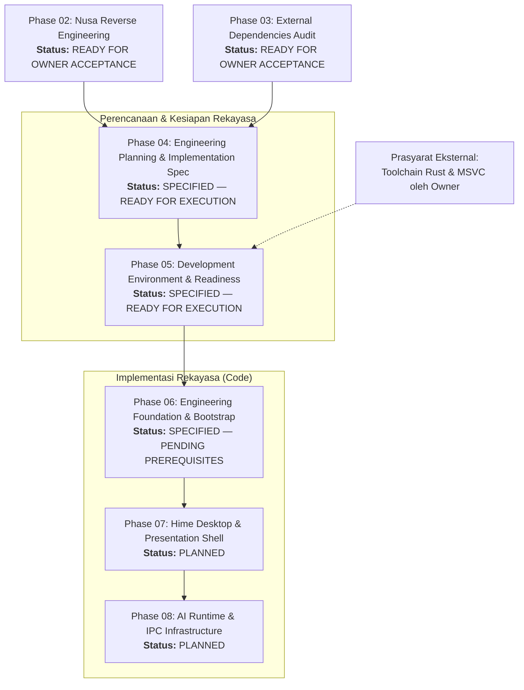

# Roadmap Reconciliation & Engineering Execution Plan: Hime Assistant

- **Document ID:** ROADMAP-RECONCILIATION-AND-EXECUTION-PLAN
- **Task Authority:** System Architect & Technical Lead
- **Execution Role:** Senior Software Engineer & Technical Execution Agent
- **Date:** 2026-11-09
- **Status Akhir:** **READY FOR ARCHITECT REVIEW**
- **Kebijakan Rekayasa Mutlak:** *ZERO CODE, ZERO COMMIT, ZERO PUSH, ZERO AUTOMATIC SOFTWARE INSTALLATION, ZERO UPSTREAM MODIFICATION*

---

## 1. Executive Summary

Dokumen ini merupakan laporan konsolidasi menyeluruh (*master reconciliation & execution plan*) yang merestrukturisasi dan menyelaraskan peta jalan rekayasa (*engineering roadmap*) proyek **Hime** dari fase riset dekonstruksi menuju fase implementasi kode sumber yang siap dieksekusi secara deterministik.

Berdasarkan audit komprehensif terhadap repositori, dokumen tata kelola rekayasa, hasil riset reverse engineering Nusa (Phase 02), audit dependensi eksternal Hermes Agent & 9Router (Phase 03), kebutuhan produk (TASK-02-04), cetak biru arsitektur (TASK-02-05 & 02-05A), serta laporan konsolidasi sebelumnya ([`PHASE-02-03-CONSOLIDATED-CLOSURE-REPORT.md`](file:///x:/folder_ai/Hime/project-management/PHASE-02-03-CONSOLIDATED-CLOSURE-REPORT.md)), ditemukan adanya kebutuhan rekonsiliasi formal terhadap urutan, penamaan, dan ruang lingkup **Phase 04**, **Phase 05**, dan **Phase 06**.

### Intisari Rekonsiliasi Roadmap:
1. **Status Fase Terdahulu:**
   - **Phase 00 (Project Governance):** `ACCEPTED & COMPLETED`.
   - **Phase 01 (Discovery & Technical Validation):** `ACCEPTED & COMPLETED`.
   - **Phase 02 (Nusa Reverse Engineering & UX Discovery):** `READY FOR OWNER ACCEPTANCE` (Telah menuntaskan 7 task & 23 deliverables; tidak boleh dianggap `ACCEPTED` sebelum persetujuan resmi Project Owner).
   - **Phase 03 (Hermes & 9Router Integration Audit):** `READY FOR OWNER ACCEPTANCE` (Telah menuntaskan 19 laporan riset audit dependensi; tidak boleh dianggap `ACCEPTED` sebelum persetujuan resmi Project Owner).
2. **Rekonsiliasi Phase 04 & Phase 05:**
   - Secara historis, spesifikasi produk tingkat tinggi (33 FRs & 18 NFRs) dan cetak biru arsitektur sistem (12 ADRs) telah diselesaikan dalam TASK-02-04 dan TASK-02-05.
   - Sesuai arahan arsitektur terkini dari Technical Lead, **Phase 04** kini didefinisikan secara tegas sebagai: **Engineering Planning & Implementation Specification** (penerjemahan arsitektur menjadi rencana teknis modular terinci, ownership modul, skema IPC biner, dan Definition of Done).
   - **Phase 05** kini didefinisikan secara tegas sebagai: **Development Environment & Implementation Readiness** (verifikasi kesiapan host Windows 11, pengujian non-destruktif toolchain, pembuatan skrip alur kerja pengembangan, dan penyiapan konfigurasi lokal).
3. **Spesifikasi Phase 06:**
   - **Phase 06** ditetapkan sebagai **Engineering Foundation** (pembangunan repositori monorepo Rust multi-crate, kerangka dasar Hime Desktop & Hime Core, library transpor IPC `HIME`, supervisor Windows Job Object, dan modul secret vault DPAPI).
   - Tidak ada kode implementasi Phase 06 yang ditulis pada sesi ini (*Zero Implementation Code*).
4. **Retensi Penuh Implementation Blockers:**
   - **IB-01 (Penyimpanan Kredensial Plaintext SQLite 9Router - CWE-312)** dan **IB-02 (Localhost Authentication Bypass 9Router)** dipertahankan secara mutlak sebagai **OPEN IMPLEMENTATION BLOCKERS** dan menjadi gerbang keamanan wajib (*Security Gates*) yang harus diselesaikan pada fase implementasi teknis.

---

## 2. Kondisi Repositori Aktual Berdasarkan Bukti Empiris

Audit terhadap repositori `x:\folder_ai\Hime` pada working tree lokal (`main`) menghasilkan bukti faktual sebagai berikut:

| Area Repositori | Status Aktual | Bukti Empiris & Referensi |
|:---|:---:|:---|
| **Git Working Tree** | Clean diff, 0 commit/push | `git status`: Hanya `PROJECT_STATUS.md` yang dimodifikasi; seluruh dokumen baru berstatus untracked. HEAD pada `cfce9da`. |
| **Kepatuhan Format Dokumen** | 100% Lolos Validasi | 55 file markdown di `project-management/` diperiksa: 0 CRLF (strictly LF), 0 trailing whitespace, valid UTF-8, single EOF newline. |
| **Kode Implementasi Hime** | 0 Baris Kode | Direktori `apps/` dan `crates/` belum dibuat (*Zero Implementation Code* dipatuhi penuh). |
| **Modifikasi Upstream** | 0 Modifikasi | Repository `NousResearch/hermes-agent` dan `decolua/9router` berstatus clean tanpa modifikasi lokal (*ADR-006 compliant*). |
| **Toolchain Host Terpasang** | Siap Parsial | Node.js v24.2.0, Python 3.13, uv 0.12.0, Git v2.55.0, WebView2 Runtime v157.0 (`[VERIFIED]`). |
| **Toolchain Host Hilang** | Belum Terpasang | Rust (`rustc`/`cargo`), MSVC C++ Build Tools 2022 (v143), Windows 10/11 SDK, Tauri CLI v2 (`[MISSING]`). |
| **Software Otomatis** | 0 Software Dipasang | Tidak ada paket atau installer yang dijalankan secara otomatis (*Zero Automatic Installation* dipatuhi). |

---

## 3. Hasil Rekonsiliasi Roadmap (Jawaban Terhadap 6 Pertanyaan Kunci)

### 1. Apakah Phase 04 sudah didefinisikan sebelumnya?
**Jawaban:** Pada dokumen roadmap awal (`IMPLEMENTATION-ROADMAP.md` dari Phase 01), Phase 04 awalnya diberi judul *"Product & System Specification"*. Namun, pekerjaan spesifikasi produk dan kebutuhan fungsional (33 FRs & 18 NFRs) secara aktual telah dieksekusi dan dirampungkan di bawah task ID `TASK-02-04`. Oleh karena itu, Phase 04 sebelumnya mengalami kekosongan peran operasional pasca-TASK-02-04. Melalui arahan arsitektur ini, Phase 04 kini didefinisikan secara kanonikal sebagai **Engineering Planning & Implementation Specification**.

### 2. Apakah Phase 05 sudah didefinisikan sebelumnya?
**Jawaban:** Pada dokumen roadmap awal, Phase 05 awalnya diberi judul *"Architecture & Security Design"*. Serupa dengan Phase 04, perancangan arsitektur sistem, C4 model, dan 12 ADR secara aktual telah diselesaikan di bawah task ID `TASK-02-05` dan `TASK-02-05A`. Melalui arahan arsitektur ini, Phase 05 kini didefinisikan secara kanonikal sebagai **Development Environment & Implementation Readiness**.

### 3. Apakah Phase 04 dan Phase 05 memiliki deliverable dan acceptance criteria yang jelas?
**Jawaban:** Sebelumnya belum memiliki spesifikasi formal berbasis template fase (`PHASE_TEMPLATE.md`). Melalui pekerjaan rekonsiliasi ini, kedua fase kini telah dilengkapi dengan dokumen spesifikasi formal lengkap:
- [`project-management/phases/PHASE-04-SPECIFICATION.md`](file:///x:/folder_ai/Hime/project-management/phases/PHASE-04-SPECIFICATION.md) (8 task terperinci, deliverables, dan exit criteria).
- [`project-management/phases/PHASE-05-SPECIFICATION.md`](file:///x:/folder_ai/Hime/project-management/phases/PHASE-05-SPECIFICATION.md) (6 task terperinci, deliverables, dan exit criteria).

### 4. Apakah ada pekerjaan yang sebenarnya sudah diselesaikan pada fase sebelumnya?
**Jawaban:** Ya. Spesifikasi kebutuhan fungsional produk (33 FRs, 18 NFRs, UX Dynamic Island morphology) dan perancangan arsitektur tingkat tinggi (12 ADRs, 16 Batasan Implementasi, topologi 4-proses, kontrak biner IPC) telah tuntas diselesaikan pada TASK-02-04 dan TASK-02-05. Phase 04 dan Phase 05 yang baru tidak akan mengulang pekerjaan konseptual tersebut, melainkan berfokus pada **spesifikasi modular tingkat implementasi (low-level spec)** dan **kesiapan lingkungan pengembangan**.

### 5. Apakah ada ketergantungan yang belum terpenuhi?
**Jawaban:** Ya. Ketergantungan kritis yang belum terpenuhi adalah **instalasi toolchain Rust (compiler `rustc 1.80+` & `cargo`) dan Microsoft C++ Build Tools 2022 (MSVC v143 & Windows SDK)** pada host Windows 11. Ketergantungan ini merupakan prasyarat mutlak sebelum Phase 06 dapat mengompilasi kode.

### 6. Apakah roadmap memiliki inkonsistensi nomor fase, urutan, atau ruang lingkup?
**Jawaban:** Ya, terdapat ketidaksesuaian historis antara nomor fase pada roadmap 16-fase asli dengan penamaan task `TASK-02-04` dan `TASK-02-05`. Rekonsiliasi ini menyelesaikan ketidaksesuaian tersebut secara elegan tanpa merusak struktur fase kanonikal 00 s/d 15.

---

## 4. Definisi Formal & Ruang Lingkup Phase 04, Phase 05, dan Phase 06



### A. Phase 04 — Engineering Planning & Implementation Specification
- **Tujuan:** Menerjemahkan cetak biru arsitektur konseptual menjadi spesifikasi implementasi perangkat lunak modular yang terinci.
- **Ruang Lingkup:**
  1. Penetapan batas tanggung jawab komponen (*bounded contexts*) dan matriks kepemilikan modul.
  2. Struktur monorepo multi-crate Cargo (`apps/hime-desktop`, `crates/hime-core`, `crates/hime-ipc`, `crates/hime-pal`, `crates/hime-storage`, `crates/hime-security`).
  3. Definisi skema kontrak biner `HIME` 12-byte header dan payload JSON-RPC 2.0.
  4. Penyematan versi dependensi dan kompatibilitas crate Rust & frontend.
  5. Desain mitigasi teknis IB-01 (in-memory injection/proxy) dan IB-02 (socket owner PID check & reverse proxy).
  6. Strategi penyimpanan data SQLite WAL single-writer dan 5-dimensi operasi sistem berkas aman.
  7. Strategi testing, QA matrix, dan *Definition of Done (DoD)* untuk setiap modul.
- **Deliverable Utama:** 8 dokumen spesifikasi implementasi teknis di `docs/architecture/`, `docs/security/`, dan `docs/testing/`.
- **Exit Criteria:** Seluruh kontrak antarmuka terdefinisi tanpa ambiguitas tipe data dan disahkan oleh Technical Lead.

### B. Phase 05 — Development Environment & Implementation Readiness
- **Tujuan:** Memverifikasi kesiapan lingkungan host Windows 11 secara non-destruktif dan menyiapkan infrastruktur skrip pengembangan lokal.
- **Ruang Lingkup:**
  1. Audit komprehensif toolchain host Windows 11 dan klasifikasi ketersediaan perangkat lunak.
  2. Pembuatan skrip diagnostik lingkungan `scripts/check-env.ps1`.
  3. Pembuatan skrip alur kerja pengembangan: `scripts/build.ps1`, `scripts/test.ps1`, `scripts/dev.ps1`.
  4. Penyiapan konfigurasi pengembangan lokal, port loopback (`20128`), dan template `.env.example`.
  5. Penguatan aturan keamanan repository `.gitignore` untuk mencegah kebocoran kredensial lokal.
  6. Panduan instalasi toolchain yang hilang bagi Project Owner.
- **Deliverable Utama:** 4 skrip otomatisasi di `scripts/`, template konfigurasi lokal, dan laporan audit kesiapan host.
- **Exit Criteria:** Skrip `check-env.ps1` mendeteksi seluruh toolchain (setelah instalasi oleh Owner) dan menghasilkan status PASS 100%.

### C. Phase 06 — Engineering Foundation
- **Tujuan:** Membangun *kernel plumbing* pertama ekosistem Hime yang dapat dikompilasi, diuji, dan dieksekusi secara aman.
- **Ruang Lingkup:**
  1. Inisialisasi monorepo Rust multi-crate (`Cargo.toml` root virtual workspace).
  2. Kerangka dasar Hime Desktop berbasis Tauri 2.0 (backend Rust + React 19 / Vite UI).
  3. Kerangka dasar Hime Core berbasis Tokio async runtime dengan modular monolith trait architecture.
  4. Implementasi library transpor IPC `hime-ipc` (framing biner `HIME`, batas 16MB pre-allocation, Named Pipe Win32 terotentikasi DACL, monotonic nonce anti-replay).
  5. Implementasi Process Supervisor (`HimeSupervisorJob`) menggunakan Win32 Job Object dengan jaminan *Zero Orphan Processes*.
  6. Implementasi Secret Vault berbasis Windows DPAPI (`CryptProtectData`) dengan cakupan `CurrentUser`.
  7. Implementasi logging terstruktur berbasis crate `tracing` dengan filter redaksi regex data sensitif (**SEC-09**).
  8. Harness pengujian otomatis (unit test per crate, contract tests IPC, integration test supervisor kill).
- **Deliverable Utama:** Kode sumber fondasi pada `apps/` dan `crates/`, suite pengujian passing 100%.
- **Exit Criteria:** `cargo build --workspace` dan `cargo test --workspace` lulus tanpa error dan warning; uji kill proses induk membuktikan 0 child process yang tertinggal.

---

## 5. Grafik Ketergantungan Antarfase (Inter-Phase Dependency Graph)

```text
[Phase 00: Project Governance] (DONE)
      │
      ▼
[Phase 01: Host Discovery & Baseline] (DONE)
      │
      ├──────────────────────────────────────────┐
      ▼                                          ▼
[Phase 02: Nusa RE & UX] (READY FOR ACCEPTANCE)  [Phase 03: External Deps Audit] (READY FOR ACCEPTANCE)
      │                                          │
      └─────────────────────┬────────────────────┘
                            ▼
              [Phase 04: Engineering Planning & Spec] (READY TO EXECUTE)
                            │
                            ▼
              [Phase 05: Dev Environment & Readiness] (READY TO EXECUTE)
                            │
                            ▼ ◄─── [Prasyarat: Owner Pasang Toolchain Rust/MSVC]
              [Phase 06: Engineering Foundation] (READY POST-PREREQUISITES)
                            │
                            ├──────────────────────────┐
                            ▼                          ▼
              [Phase 07: Hime Desktop UI]   [Phase 08: AI Runtime & IPC]
```

---

## 6. Pertimbangan Stack Teknologi & Kompatibilitas Hardware

### A. Peta Versi Teknologi Resmi (Pinned Versions)
| Komponen | Pilihan Teknologi | Versi Target | Alasan Arsitektural |
|:---|:---|:---:|:---|
| **Core Systems Language** | Rust | $\ge 1.80.0$ (Edition 2021) | Memory safety tanpa GC overhead, ekosistem Tokio async kelas enterprise. |
| **Desktop Shell** | Tauri | v2.0 Stable | Memory footprint rendah (~50-80MB), native Win32 window handles, multi-window support. |
| **Frontend Framework** | React + TypeScript | React 19, TS 5.5+ | Kompatibilitas ekosistem modern, modular component architecture. |
| **UI Motion & Styling** | Motion + Tailwind CSS | Motion 11, Tailwind 3.4+ | Transisi spring fluid 60 FPS untuk Dynamic Island HUD morphing. |
| **Local Database Engine**| SQLite via `rusqlite` | SQLite 3.45+ (bundled) | Mode WAL single-writer/multi-reader, FTS5 virtual tables untuk semantic context. |
| **Python Runtime** | Python via `uv` | Python 3.11/3.13, uv 0.12+ | Runtime resmi Hermes Agent; `uv` menyediakan manajemen virtualenv ultra-cepat. |
| **Node.js Gateway** | Node.js | v24 LTS | Runtime resmi 9Router AI Gateway. |

### B. Kalibrasi Terhadap Batasan Hardware Riil Host
- **Host Processor:** Intel Core i5-8250U (4 Cores / 8 Threads, base 1.6 GHz, boost up to 3.4 GHz).
- **Sisa RAM Bebas Terukur:** **~3.71 GB** (dari total fisik 20.8 GB).
- **iGPU:** Intel UHD Graphics 620 (Mendukung DirectComposition, DirectX 11/12 hardware composition).
- **Implikasi Rekayasa:**
  1. *Konkurensi 1 Active Agent Task:* Menjalankan lebih dari 1 tugas agen paralel pada hardware ini berisiko memicu RAM thrashing dan degradasi antarmuka. Batasan konkurensi tepat 1 tugas aktif ditegakkan pada MVP.
  2. *Target Anggaran RAM:* Stack Idle $\le 215\text{ MB}$, Normal Active $\le 470\text{ MB}$, Peak $\le 690\text{ MB}$.
  3. *Cloud Inference:* Tidak ada LLM lokal yang dijalankan pada host; seluruh inferensi dilakukan via cloud providers melalui 9Router.

---

## 7. Status Gerbang Keamanan (Security Gates & Open Blockers)

Kedua pemblokir implementasi berikut **TIDAK BOLEH DITURUNKAN STATUSNYA** dan menjadi gerbang keamanan wajib (*mandatory security gates*):

```text
+---------------------------------------------------------------------------------------+
|                              MANDATORY SECURITY GATES                                 |
+---------------------------------------------------------------------------------------+
| GATE SG-01: IB-01 — 9Router Plaintext Credential Storage Mitigation                  |
| - Masalah: File SQLite data.sqlite 9Router menyimpan API keys secara plaintext        |
| - Status: OPEN IMPLEMENTATION BLOCKER                                                 |
| - Mitigasi Wajib: Hime Secret Vault (DPAPI) + In-Memory Credential Injection / Proxy.  |
| - Batasan: API key berbayar/sensitif DILARANG ditulis ke data.sqlite disk.             |
| - Fase Penegakan: Phase 06 (Vault Foundation) & Phase 08 (9Router Integration Gate).  |
+---------------------------------------------------------------------------------------+
| GATE SG-03: IB-02 — 9Router Localhost Authentication Bypass Mitigation                |
| - Masalah: Port loopback 127.0.0.1:20128 dapat diakses proses lokal tanpa autentikasi |
| - Status: OPEN IMPLEMENTATION BLOCKER                                                 |
| - Mitigasi Wajib: Verifikasi Socket Owner PID (GetExtendedTcpTable) + Fail-Closed +    |
|                   Hime Core Authenticating Reverse Proxy (OD-01).                     |
| - Batasan: Port 20128 DILARANG diekspos langsung tanpa token per-request.             |
| - Fase Penegakan: Phase 06 (Process Supervisor) & Phase 08 (9Router Integration Gate).|
+---------------------------------------------------------------------------------------+
```

---

## 8. Inventaris Prasyarat Pengembangan (Development Prerequisites)

| Komponen Toolchain | Status Aktual | Klasifikasi Kesiapan | Tindakan Penanganan |
|:---|:---:|:---:|:---|
| **Node.js** | v24.2.0 terpasang | `[VERIFIED]` | Siap digunakan untuk runtime 9Router dan tooling frontend. |
| **Python** | 3.13 terpasang | `[VERIFIED]` | Siap digunakan untuk runtime Hermes Agent. |
| **uv** | 0.12.0 terpasang | `[VERIFIED]` | Siap digunakan untuk manajemen dependensi dan virtualenv Hermes. |
| **Git** | 2.55.0 terpasang | `[VERIFIED]` | Siap digunakan untuk pelacakan versi repositori. |
| **WebView2 Runtime** | v157 terpasang | `[VERIFIED]` | Siap digunakan untuk presentation shell Tauri 2.0. |
| **Rust Compiler (`rustc`)** | Belum terpasang | `[MISSING — OWNER ACTION]` | Pengguna mengunduh dan menjalankan `rustup-init.exe`. |
| **Cargo Package Manager** | Belum terpasang | `[MISSING — OWNER ACTION]` | Terpasang otomatis bersamaan dengan Rust toolchain. |
| **MSVC C++ Build Tools** | Belum terpasang | `[MISSING — OWNER ACTION]` | Pengguna memasang Visual Studio Build Tools 2022 (workload C++). |
| **Windows 10/11 SDK** | Belum terpasang | `[MISSING — OWNER ACTION]` | Terpasang bersamaan dengan workload C++ Build Tools. |
| **Tauri CLI v2** | Belum terpasang | `[MISSING — CAN BE PREPARED]` | Dipasang via `cargo install tauri-cli` setelah Cargo terpasang. |
| **Development Scripts** | Belum terpasang | `[CAN BE PREPARED]` | Disiapkan pada Phase 05 (`check-env.ps1`, `build.ps1`, dll.). |

---

## 9. Kriteria Penerimaan Fase (Acceptance Criteria per Phase)

### Kriteria Penerimaan Phase 04:
1. 8 dokumen spesifikasi implementasi rekayasa (TASK-04-01 s/d TASK-04-08) diselesaikan secara lengkap.
2. Skema biner `HIME` dan payload JSON-RPC 2.0 disepakati tanpa ambiguitas tipe data.
3. Desain mitigasi teknis IB-01 dan IB-02 disahkan oleh Technical Lead.
4. Definition of Done (DoD) formal ditetapkan untuk seluruh komponen monorepo.

### Kriteria Penerimaan Phase 05:
1. Skrip diagnostik `scripts/check-env.ps1` selesai dibuat dan teruji non-destruktif.
2. Seluruh skrip pengembangan (`build.ps1`, `test.ps1`, `dev.ps1`) selesai disiapkan.
3. Project Owner telah menginstal toolchain Rust dan MSVC, dibuktikan dengan luaran sukses dari `scripts/check-env.ps1`.
4. File `.gitignore` dan template konfigurasi lokal diverifikasi aman dari kebocoran kredensial.

### Kriteria Penerimaan Phase 06:
1. Workspace monorepo Cargo berhasil dibuat dan mengompilasi 6 target crate tanpa error dan warning (`cargo build --workspace`).
2. Seluruh unit tests dan contract tests IPC passing 100% (`cargo test --workspace`).
3. Pengujian deterministik supervisor membuktikan subproses dummy mati seketika saat proses induk dihentikan paksa (*Zero Orphan Processes*).
4. Secret vault DPAPI membuktikan enkripsi dan dekripsi data berhasil tanpa menulis plaintext secret ke disk.

---

## 10. Risiko dan Keputusan yang Membutuhkan Persetujuan Project Owner

1. **Keputusan Persetujuan Akseptansi Phase 02 & Phase 03:**
   - Menandatangani dokumen akseptansi formal [`PHASE-02-ACCEPTANCE.md`](file:///x:/folder_ai/Hime/project-management/PHASE-02-ACCEPTANCE.md) dan [`PHASE-03-ACCEPTANCE.md`](file:///x:/folder_ai/Hime/project-management/PHASE-03-ACCEPTANCE.md) untuk meresmikan penutupan kedua fase riset.
2. **Tindakan Fisik Pengguna: Pemasangan Toolchain Rust & MSVC:**
   - Menjalankan `rustup-init.exe` dan memasang Visual Studio Build Tools 2022 pada host Windows 11 sebagai prasyarat eksternal sebelum kompilasi Phase 06 dapat dijalankan.
3. **Keputusan Arsitektur OD-01 (Loopback Authenticating Reverse Proxy):**
   - Mengesahkan rekomendasi arsitek bahwa Hime Core akan bertindak sebagai *Authenticating Reverse Proxy* lokal di depan 9Router guna menutup celah IB-02 tanpa melanggar ADR-006 (*Zero Upstream Modification*).

---

## 11. Rekomendasi Langkah Berikutnya

Sesuai peran sebagai Technical Execution Agent:
1. Menyerahkan laporan ini kepada **System Architect & Technical Lead** untuk peninjauan teknis (**Status: `READY FOR ARCHITECT REVIEW`**).
2. Setelah disetujui Technical Lead, pekerjaan dilanjutkan dengan mengeksekusi **Phase 04 (Engineering Planning & Implementation Specification)** untuk menyusun dokumen spesifikasi detail komponen dan kontrak IPC biner.
3. Secara paralel, Project Owner dapat melakukan instalasi toolchain Rust & MSVC pada host Windows sesuai panduan yang telah disiapkan.
