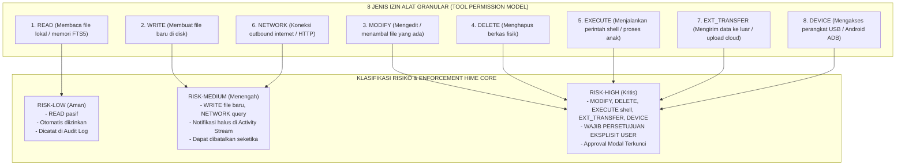
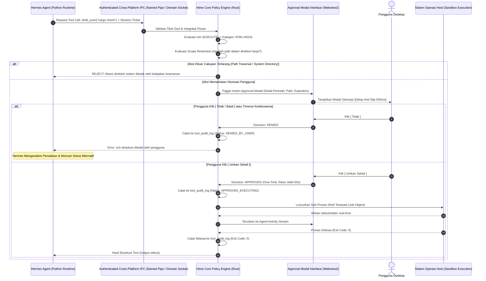

# Hime Agent Experience Specification (Hermes Agent & Policy Enforcement)

- **Document ID:** HIME-AGENT-EXPERIENCE-SPECIFICATION
- **Task ID:** TASK-02-04 / TASK-02-04B / TASK-02-04D (Product Requirements & Experience Architecture)
- **Phase:** Phase 02 — Nusa Reverse Engineering & Architecture Discovery (Product Specification)
- **Authority:** Lead AI Systems Architect & Senior Security Governance Engineer
- **Status:** **CALIBRATED SPECIFICATION — PENDING OWNER REVIEW**
- **Date:** 2026-11-08

---

## 1. Executive Summary & Core Security Boundary

Dokumen ini mendefinisikan arsitektur pengalaman agen (*Agent Experience / AX*) serta spesifikasi penegakan kebijakan (*Policy Enforcement Architecture*) antara antarmuka **Hime Desktop**, pusat orkestrasi **Hime Core**, dan runtime agen otonom **Hermes Agent**.

Berdasarkan hasil audit tata kelola (TASK-02-04B), dokumen ini menetapkan arsitektur keamanan yang tidak dapat dikompromikan:
1. **Pusat Penegakan Kebijakan Tunggal (*Centralized Policy Enforcement Gate*):** Hime Core bertindak sebagai satu-satunya *Policy Decision Point (PDP)* dan *Policy Enforcement Point (PEP)*. **Hermes Agent dilarang memiliki jalur eksekusi alat atau tindakan sistem yang mem-bypass atau melewati penegakan kebijakan Hime Core.** Seluruh pemanggilan alat dan aksi sistem yang didelegasikan wajib dikirim melalui lapisan abstraksi IPC terotentikasi (Named Pipe di Windows / Unix Domain Socket di Linux) yang divalidasi oleh Hime Core.
2. **Kualifikasi Batas Keamanan Modal Otorisasi:** Modal persetujuan (*Approval Modal*) adalah **antarmuka persetujuan pengguna (*user authorization UI*)**, BUKAN batas keamanan kriptografis (*security boundary*) itu sendiri. Batas keamanan sejati berada pada logika validasi kernel IPC Hime Core. Jeda waktu 500 ms adalah **fitur ergonomi anti-slip** (mencegah klik panik/refleks), bukan kontrol keamanan substantif.
3. **Privasi Penalaran Mental:** Sesuai instruksi produk, **pemikiran internal mentah (*private chain-of-thought*) DILARANG ditampilkan ke antarmuka pengguna**. Seluruh aktivitas divisualisasikan secara bersih dan terstruktur melalui **Agent Activity Stream**.

---

## 2. Granular Tool Permission Model & Classification

Setiap operasi alat (*tool action*) yang diminta oleh Hermes Agent dianalisis dan dievaluasi terhadap 8 jenis izin granular:



### Rincian 8 Izin Granular:
1. **READ:** Membaca konten file teks, kode sumber, atau kueri memori FTS5 lokal.
2. **WRITE:** Membuat file dokumen baru di dalam direktori kerja yang diizinkan (*allowed workspace*).
3. **MODIFY:** Menimpa atau memodifikasi baris kode pada file yang sudah ada (memerlukan tinjauan visual diff).
4. **DELETE:** Menghapus berkas fisik dari media penyimpanan (dilarang keras tanpa otorisasi eksplisit).
5. **EXECUTE:** Mengeksekusi perintah shell (PowerShell / Bash / CMD) atau meluncurkan proses biner pihak ketiga.
6. **NETWORK:** Membuka soket jaringan keluar untuk pencarian web atau pembacaan artikel publik.
7. **EXT_TRANSFER:** Mengunggah file lokal, kredensial, atau data pribadi ke server eksternal di luar loopback.
8. **DEVICE:** Mengirimkan perintah ADB atau instruksi manipulasi berkas ke smartphone Android yang terhubung.

---

## 3. Hime Core Policy Enforcement Lifecycle

Alur penegakan kebijakan berjalan dalam siklus terisolasi di mana Hermes Agent tidak dapat memicu sistem operasi secara mandiri:



---

## 4. Cross-Platform IPC Architecture & Transport Abstraction [DESIGN SPECIFICATION / IMPLEMENTATION REQUIREMENT]

Untuk memastikan komunikasi antara Hermes Agent dan Hime Core aman, tidak dapat disusupi proses lain, tidak dapat dibypass, dan dapat berjalan secara konsisten lintas sistem operasi (Windows 11 dan Linux), arsitektur IPC menetapkan spesifikasi teknis dan abstraksi transport berikut:

### A. Pembedaan Konseptual Keamanan
Sistem membedakan secara tegas empat lapisan kontrol keamanan:
1. **Autentikasi (*Authentication*):** Membuktikan keabsahan identitas proses klien pemanggil (memastikan hanya Hermes Agent resmi yang diluncurkan Hime Core yang dapat berkomunikasi).
2. **Otorisasi (*Authorization*):** Menentukan apakah aksi alat spesifik yang diminta diizinkan berdasarkan konfigurasi, hak akses, dan persetujuan pengguna.
3. **Isolasi Proses (*Process Isolation*):** Memisahkan batas memori dan hak eksekusi antara proses Hime Core dan Hermes Agent.
4. **Penegakan Kebijakan (*Policy Enforcement*):** Titik intersepsi terpusat di Hime Core di mana seluruh permintaan alat dievaluasi dan digerbang (*gated*) secara deterministik.

### B. Kontrak IPC Bersama (Shared IPC Contract)
Saluran komunikasi antara Hime Core dan Hermes Agent mematuhi kontrak pesan terstruktur yang independen dari implementasi sistem operasi:
- **Message Envelope:** Menggunakan format terstruktur berbasis JSON-RPC / typed schema:
  ```json
  {
    "request_id": "c1f7a4e0-9b65-4f32-8419-7569b7a4c901",
    "correlation_id": "9b77ac75-3ffc-4bc7-8248-1208fedb78d7",
    "protocol_version": "1.0",
    "session_token": "<256-bit hex token>",
    "tool_name": "terminal_tool",
    "permission_type": "EXECUTE",
    "risk_tier": "HIGH",
    "params": {
      "command": "cargo test --workspace",
      "working_dir": "X:\\folder_ai\\Hime"
    },
    "timestamp_utc": 1731057600,
    "nonce": 1042
  }
  ```
- **Protocol Version:** Nilai tetap `"1.0"`. Permintaan dengan versi protokol tidak kompatibel ditolak seketika.
- **Request ID & Correlation ID:** `request_id` (UUIDv4) mengidentifikasi transaksi pesan unik. `correlation_id` (UUIDv4) mengikat seluruh alur siklus hidup instruksi: dari prompt Omnibox pengguna, streaming LLM, kemunculan Action Approval Modal, hingga pencatatan baris di `tool_audit_log`.
- **Authentication Context:** Setiap pesan membawa `session_token` efemeral yang divalidasi oleh Hime Core.
- **Authorization Context:** Menyertakan `permission_type` (dari 8 izin granular), `risk_tier` (LOW, MEDIUM, HIGH), serta direktori target `working_dir`.
- **Typed Schema:** Seluruh parameter dalam `params` divalidasi skemanya sebelum diproses oleh Hime Core PDP.
- **Error Model:** Kesalahan IPC dilaporkan menggunakan kode kesalahan terstruktur (misalnya `ERR_AUTH_FAILED`, `ERR_UNAUTHORIZED_PID`, `ERR_TIMEOUT`, `ERR_PERMISSION_DENIED`, `ERR_MALFORMED_PAYLOAD`).
- **Timeout & Cancellation:** Batas waktu eksekusi default per-aksi alat adalah **30 detik**. Klien atau server dapat mengirim pesan pembatalan deterministik (`action: "cancel"`), yang memicu pembatalan sub-proses seketika.
- **Replay Protection:** Setiap pesan membawa `nonce` sekuensial (harus selalu bertambah secara monotonik) dan `timestamp_utc`. Pesan ditolak jika `nonce` mundur atau selisih waktu (*clock drift*) melebihi $\mathbf{\pm 5\text{ detik}}$ dari jam lokal host.

### C. Adapter Transport Windows: Named Pipe (`\\.\pipe\hime-hermes`)
- **Server Pipe Win32:** Dibuat oleh Hime Core via `CreateNamedPipeW` dengan flag `PIPE_TYPE_MESSAGE | PIPE_READMODE_MESSAGE | PIPE_WAIT | PIPE_REJECT_REMOTE_CLIENTS`.
- **DACL & User SID:** Discretionary Access Control List (DACL) dikonfigurasi kustom untuk hanya memberikan hak `GENERIC_READ | GENERIC_WRITE` kepada **`Current User SID`** (identitas pengguna Windows yang aktif) dan secara eksplisit menolak akses jaringan (*Deny Network Logon SID*).
- **Batasan Keamanan DACL (*Security Limitation*):** Pengaturan DACL berbasis User SID **TIDAK MENGISOLASI ancaman dari proses atau skrip lain yang berjalan di bawah akun pengguna Windows yang sama (Standard User)**. Oleh karena itu, verifikasi PID klien wajib ditegakkan.
- **Client Process Identity Verification (Verifikasi PID Klien):**
  - Segera setelah koneksi pipa diterima via `ConnectNamedPipe`, Hime Core memanggil Win32 API `GetNamedPipeClientProcessId(pipe_handle, &client_pid)`.
  - Hime Core mencocokkan `client_pid` terhadap PID proses anak Hermes Agent yang dicatat saat diluncurkan oleh Process Supervisor.
  - Jika PID tidak cocok, koneksi diputus seketika via `DisconnectNamedPipe`.
- **Handshake Token Efemeral:** Hime Core menghasilkan token acak 256-bit berbasis CSPRNG dan menyuntikkannya ke environment block Hermes Agent saat peluncuran. Hermes Agent wajib mengirim handshake dalam $\le \mathbf{5000\text{ ms}}$ pasca koneksi socket dibuka.

### D. Adapter Transport Linux: Unix Domain Socket
- **Lokasi Socket Runtime:** Socket dibuat pada direktori runtime per-pengguna:
  `$XDG_RUNTIME_DIR/hime/hermes.sock` (fallback jika `$XDG_RUNTIME_DIR` tidak disetel: `/run/user/<UID>/hime/hermes.sock`).
- **Filesystem Permissions:** Direktori induk `hime/` disetel ke mode `0700` (`drwx------`) dan berkas socket `hermes.sock` disetel ke mode `0600` (`srw-------`). Kernel Linux secara otomatis memblokir akses dari pengguna Unix lain pada tingkat VFS.
- **Peer Credential Verification (`SO_PEERCRED`):**
  - Segera setelah koneksi soket diterima melalui `accept()`, Hime Core memanggil:
    `getsockopt(client_fd, SOL_SOCKET, SO_PEERCRED, &ucred, &len)`.
  - Hime Core memverifikasi struktur `struct ucred`:
    1. `ucred.uid == getuid()` (proses klien harus berjalan di bawah User ID Linux yang identik).
    2. `ucred.pid == expected_hermes_child_pid` (PID proses pemanggil harus cocok persis dengan PID proses anak Hermes yang dicatat oleh supervisor saat `fork`/`exec`).
  - Jika UID atau PID tidak cocok, socket langsung ditutup (`close(client_fd)`) tanpa membaca data.
- **Handshake Token Efemeral:** Sama dengan Windows, token CSPRNG 256-bit divalidasi dalam jendela waktu $\le \mathbf{5000\text{ ms}}$.

### E. Abstraksi Terpadu Hime Core (`IpcTransport` Trait)
Hime Core mengekspos satu abstraksi IPC platform-independen melalui trait Rust:
```rust
#[async_trait]
pub trait IpcTransport: Send + Sync {
    async fn initialize(&mut self) -> Result<(), IpcError>;
    async fn accept_authenticated_client(&mut self, expected_pid: u32) -> Result<Box<dyn IpcChannel>, IpcError>;
    async fn close(&mut self) -> Result<(), IpcError>;
}

#[async_trait]
pub trait IpcChannel: Send + Sync {
    async fn send_message(&mut self, envelope: &IpcEnvelope) -> Result<(), IpcError>;
    async fn receive_message(&mut self) -> Result<IpcEnvelope, IpcError>;
    async fn disconnect(&mut self) -> Result<(), IpcError>;
}
```
- **Hermes Agent Adapter:** Hermes Agent tidak bergantung langsung pada primitif transport sistem operasi tertentu. Hermes menggunakan adapter klien Python (`hermes_ipc_client.py`) yang mendeteksi platform saat runtime: menggunakan Named Pipe pada Windows (`sys.platform == "win32"`) dan Unix Domain Socket pada Linux (`sys.platform.startswith("linux")`). Logika penalaran agentic Hermes hanya berinteraksi dengan API adapter tingkat tinggi.

### F. Siklus Hidup Koneksi & Penanganan Kegagalan IPC
- **State Machine Siklus Hidup:** `UNCONNECTED` $\rightarrow$ `LISTENING` $\rightarrow$ `HANDSHAKING` $\rightarrow$ `AUTHENTICATED_IDLE` $\rightarrow$ `EXECUTING_TOOL` $\rightarrow$ `TERMINATING`.
- **Penanganan Kegagalan (*IPC Failure Handling*):**
  - Jika saluran terputus di tengah jalan (`ERROR_BROKEN_PIPE` di Windows atau `ECONNRESET`/`EPIPE` di Linux), klien crash, atau transmisi terhenti, Hime Core menandai tugas agen sebagai `FAILED_IPC_DISCONNECT`.
  - Hime Core segera menterminasi sub-proses shell terawasi yang sedang berjalan via Win32 Job Object atau Linux `kill(child_pid, SIGTERM)`.
  - Hime Core menutup handle/file descriptor lama dan mempersiapkan instance transport baru melalui Process Supervisor.

### G. Penolakan Klien Tidak Terotorisasi (*Unauthorized Client Rejection*)
- Setiap koneksi dari proses dengan PID tidak sah, token handshake salah, atau pesan malformed menghasilkan:
  1. Pemutusan koneksi seketika (`DisconnectNamedPipe` / `close(fd)`).
  2. Pencatatan insiden keamanan lengkap (PID pemanggil, waktu, kode kesalahan) ke dalam `AUDIT.jsonl`.
  3. Notifikasi sistem non-intrusif pada Hime Desktop mengenai deteksi anomali IPC.

### H. Klasifikasi Mitigasi Tingkat OS Tambahan
Peningkatan isolasi proses OS lanjutan (seperti menjalankan Hermes Agent di dalam Windows AppContainer, penerapan Windows Restricted Token, eksekusi di bawah akun service lokal khusus, Linux cgroups v2 resource limits, atau filter soket Windows Filtering Platform / WFP) diklasifikasikan sebagai **`[DESIGN REQUIREMENT / TECHNICAL DEPENDENCY]`** untuk dievaluasi dan diimplementasikan pada Fase 05/06, BUKAN sebagai kontrol yang telah terverifikasi saat ini (`[NOT AN EXISTING VERIFIED CONTROL]`).

---

## 5. Hermes Tool Execution Boundary & Subprocess Clarification

### A. Prinsip Invarian Keamanan Inti (No Bypass of Policy Enforcement)
Tujuan utama model keamanan Hime adalah menjamin bahwa **Hermes Agent TIDAK MEMILIKI jalur eksekusi untuk alat (*tools*) atau aksi sistem tingkat OS yang melewati mekanisme penegakan kebijakan (*Policy Enforcement Point*) di Hime Core.** Prompt injection atau penalaran menyimpang pada model bahasa tidak boleh mampu memicu aksi destruktif atau akses berkas di luar ruang kerja secara sepihak.

### B. Klarifikasi Sub-Proses: Internal Runtime vs Eksekusi Alat Didelegasikan
Larangan eksekusi mandiri dikalibrasi secara cermat agar tidak merusak fungsionalitas normal interpreter Python:

1. **Sub-proses Internal Runtime (*Internal Runtime Subprocesses*):**
   - **Status: DIIZINKAN & TIDAK DIBLOKIR.**
   - Runtime Python Hermes Agent secara wajar memerlukan operasi sub-proses standar internal (seperti memeriksa status virtualenv `sys.executable`, mendeteksi interpreter pendukung, membaca metadata paket terpasang, atau menginisialisasi pustaka internal).
   - Pemanggilan primitif seperti `subprocess.run` atau utilitas pustaka standar Python untuk keperluan runtime internal ini **TIDAK DILARANG SECARA ABSOLUT**, selama pemanggilan tersebut terisolasi dalam konteks siklus hidup internal Hermes sendiri dan bukan merupakan eksekusi tindakan yang diminta oleh LLM/pengguna.

2. **Eksekusi Alat yang Didelegasikan (*Delegated Tool Execution*):**
   - **Status: DILARANG KERAS DIEKSEKUSI LANGSUNG OLEH HERMES.**
   - Setiap tindakan alat (*tools*) yang diminta oleh model AI (seperti eksekusi terminal bash/powershell, pembuatan berkas, pengubahan isi dokumen, scraping jaringan, atau eksekusi perintah kompilasi) **DILARANG MENGGUNAKAN `subprocess.run`, `os.system`, atau library manipulasi sistem berkas langsung dari modul alat Hermes**.
   - Seluruh modul alat pada registri alat Hermes wajib dialihkan (*shimmed*) menjadi pesan IPC yang diteruskan ke Hime Core. Hime Core yang akan mengevaluasi izin, meminta persetujuan pengguna (jika perlu), dan mengeksekusi tindakan tersebut di bawah pengawasan ketat.

3. **Aksi Sistem Tingkat OS (*OS-Level System Actions*):**
   - **Status: DIBLOKIR TOTAL DARI HERMES AGENT.**
   - Modifikasi registri Windows, perubahan konfigurasi sistem `/etc/`, manipulasi service latar belakang OS, pembukaan raw socket network, atau upaya eskalasi privilege administrator diblokir secara tegas.

4. **Pengawasan Proses (*Process Supervision*):**
   - Hime Core bertindak sebagai proses induk pengawas yang mengawasi Hermes Agent:
     - **Windows:** Proses anak Hermes dimasukkan ke dalam **Windows Job Object** dengan flag `JOB_OBJECT_LIMIT_KILL_ON_JOB_CLOSE` serta batasan kuota memori proses.
     - **Linux:** Menggunakan `prctl(PR_SET_PDEATHSIG, SIGTERM)` dan pembatasan isolasi resource via cgroup v2 transient scope.

5. **Alur Eksekusi Terdelegasi melalui Hime Core (PEP/PDP Pipeline):**
   - Hermes mendeteksi pemanggilan alat $\rightarrow$ Mengemas request ke envelope IPC $\rightarrow$ Hime Core memverifikasi otentikasi token & PID $\rightarrow$ Hime Core Policy Decision Point (PDP) mengevaluasi izin terhadap whitelist workspace $\rightarrow$ Jika berisiko tinggi, munculkan Action Approval Modal $\rightarrow$ Jika disetujui, Hime Core meluncurkan sub-proses terisolasi (PEP) $\rightarrow$ Output dialirkan real-time ke Agent Activity Stream $\rightarrow$ Hasil eksekusi dikembalikan ke Hermes via saluran IPC.

---

## 6. Parameter Penegakan Kebijakan (Policy Parameters)

### A. Pembatasan Cakupan Direktori (*Scope Restriction*)
- Hime Core memberlakukan batas direktori kerja (*sandbox workspace scope*).
- Hermes Agent **dilarang mengeksekusi operasi baca/tulis di luar direktori proyek kerja pengguna** tanpa persetujuan eksplisit. Direktori sistem operasi krusial (`C:\Windows\`, `C:\Program Files\`, `/etc/`, `/bin/`, `/usr/`) masuk dalam **Blacklist Mutlak (*Hard Deny List*)** yang tidak dapat diizinkan bahkan melalui modal persetujuan.

### B. Masa Berlaku Izin (*Approval Expiration*)
- Setiap izin yang diberikan pengguna melalui modal memiliki batas kedaluwarsa waktu (*Time-to-Live / TTL*):
  - **Izin Sekali Pakai (*One-Time Approval*):** Berlaku maksimal **60 detik** sejak tombol ditekan; kedaluwarsa otomatis jika alat tidak segera dieksekusi.
  - **Izin Selama Sesi Ini (*Session Approval*):** Kedaluwarsa otomatis saat jendela sesi obrolan ditutup atau setelah **15 menit tanpa aktivitas pengguna**.
- Seluruh izin otomatis dibatalkan (*revoked*) saat aplikasi Hime ditutup atau berpindah repositori kerja.

### C. Audit Jejak Eksekusi (*Execution Audit Logging*)
Setiap pemanggilan alat dicatat secara permanen pada basis data lokal `tool_audit_log`:
```sql
CREATE TABLE tool_audit_log (
    audit_id TEXT PRIMARY KEY,
    timestamp_utc INTEGER NOT NULL,
    tool_name TEXT NOT NULL,
    permission_type TEXT NOT NULL,     -- 'READ', 'WRITE', 'EXECUTE', dll.
    risk_level TEXT NOT NULL,          -- 'LOW', 'MEDIUM', 'HIGH'
    command_payload TEXT NOT NULL,
    target_path TEXT,
    authorization_decision TEXT,       -- 'AUTO_ALLOWED', 'USER_APPROVED', 'USER_DENIED'
    execution_duration_ms INTEGER,
    exit_code INTEGER,
    error_message TEXT
);
```

### D. Penanganan Penolakan Izin (*Denial Handling by Agent*)
Ketika pengguna menolak pemanggilan alat, Hime Core mengembalikan pesan penolakan terstruktur ke Hermes Agent:
```json
{
  "status": "permission_denied",
  "tool": "shell_exec",
  "reason": "User explicitly denied execution of the shell command.",
  "recovery_instruction": "Do not attempt to execute this exact command again. Explain the necessity to the user or propose an alternative safe approach."
}
```
Hermes Agent diprogram untuk **tidak mencoba mengeksekusi perintah yang sama secara berulang-ulang (*anti-looping guard*)** ketika menerima status penolakan ini.

---

## 7. Agent Activity Stream & Ketiadaan Private Chain-of-Thought

### A. Visualisasi Operasional Bersih
Agent Activity Stream menyajikan linimasa tindakan ringkas tanpa membanjiri antarmuka dengan monolog internal model AI:
1. **Status Header:** Menampilkan tujuan langkah saat ini (misal: *"Menganalisis dependensi `Cargo.toml`"*).
2. **Tool Badges:** Badge nama alat terstandardisasi dengan warna visual sesuai kategori (Biru untuk Read, Kuning untuk Write, Merah untuk Execute).
3. **Collapsible Terminal Drawer:** Pengguna dapat membuka atau menutup log teknis stdout/stderr sesuai keinginan tanpa dipaksa melihat teks panjang.

### B. Tombol Interupsi & Pembatalan Seketika (Cancellation)
- Tombol `[ Hentikan / Batal ]` tersedia permanen pada Activity Stream saat tugas sedang berjalan.
- Menekan tombol pembatalan seketika memicu pemanggilan `TerminateJobObject` (Windows) / `SIGKILL` (Linux) terhadap seluruh proses anak dalam waktu $\le \mathbf{200\text{ ms}}$.
