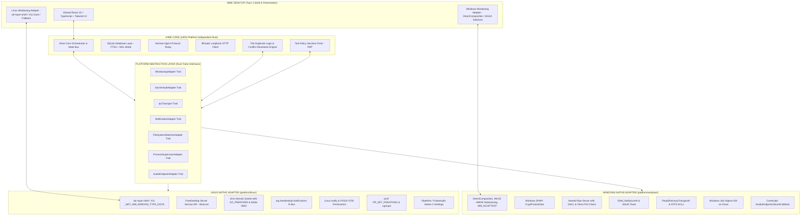

# Hime Cross-Platform Experience Architecture Specification (Calibrated)

- **Document ID:** HIME-CROSS-PLATFORM-EXPERIENCE-ARCHITECTURE
- **Task ID:** TASK-02-04 / TASK-02-04B / TASK-02-04D (Product Requirements & Experience Architecture)
- **Phase:** Phase 02 — Nusa Reverse Engineering & Architecture Discovery (Product Specification)
- **Authority:** Principal Cross-Platform Systems Architect & Lead Desktop Windowing Engineer
- **Status:** **CALIBRATED SPECIFICATION — PENDING OWNER REVIEW**
- **Date:** 2026-11-08

---

## 1. Executive Summary & Core Platform Boundaries

Dokumen ini mendefinisikan strategi arsitektur lintas platform (*Cross-Platform Architecture Strategy*) untuk **Hime**.

Berdasarkan keputusan arsitektur resmi dan arahan Project Owner (TASK-02-04B):
> **Prinsip Utama: Windows-first, cross-platform by design.**
>
> 1. **Windows 11** merupakan platform implementasi, pengujian, dan rilis utama pada fase awal (Phase 01–07).
> 2. **Linux** merupakan target platform resmi berikutnya (Phase 2).
> 3. **Batas Domain Arsitektur yang Tegas:**
>    - **Hime Core (Platform-Independent Domain):** Wajib 100% bebas dari dependensi Windows API langsung. Mengelola logika bisnis, state machine, abstraksi transport IPC (`IpcTransport` trait), pengindeksan SQLite FTS5, dan evaluasi izin alat.
>    - **Hime Desktop (Presentation & Window Shell):** Memiliki adapter UI dan konfigurasi windowing khusus OS melalui Tauri 2 untuk menangani perbedaan mendasar antara Windows compositing, X11, dan Wayland.
>    - **Platform Abstraction Layer (PAL):** Kumpulan Rust traits yang menjembatani Hime Core dengan implementasi sistem operasi.
> 4. **Penolakan Pemaksaan Perilaku Seragam (*No Forced Parity*):** Sistem dilarang memaksakan perilaku identik jika kapabilitas platform berbeda secara inheren (misalnya: tidak memaksakan blur acrylic DWM pada Linux yang tidak memiliki compositor blur, dan tidak memaksakan penempatan koordinat absolut pada Wayland).
> 5. **Prinsip Kejujuran:** Dilarang mengklaim kompatibilitas Linux sebelum dilakukan verifikasi biner dan pengujian empiris nyata.

---

## 2. Platform Abstraction Layer (PAL) & Architectural Boundaries

Pemisahan tanggung jawab antara Hime Core, Hime Desktop, dan Platform Adapter diatur sebagai berikut:

---

## 3. Deep Dive: Kapabilitas Native Windows (Tier 1 Target)

Implementasi utama Hime dioptimalkan secara mendalam pada lingkungan Windows 11:

### 1. Manajemen Jendela & Overlay Grafis (Win32 & DirectComposition)
- **Extended Styles Terukur:** `WS_EX_NOREDIRECTIONBITMAP | WS_EX_COMPOSITED | WS_EX_TOOLWINDOW | WS_EX_TOPMOST` (`0x08200088`).
- **Mekanisme Tembus-Klik (*Click-Through Transparency*):** Subclassing window procedure untuk menangani pesan `WM_NCHITTEST`. Mengembalikan `HTCLIENT` pada poligon visual aktif dan `HTTRANSPARENT` pada area kanvas transparan 740 × 212 px.
- **Pencegahan Pencurian Fokus:** Mengombinasikan `WS_EX_NOACTIVATE` dan respons pesan `WM_MOUSEACTIVATE` yang mengembalikan `MA_NOACTIVATE` agar pengetikan pengguna pada jendela aplikasi lain tidak terganggu saat island berekspansi.
- **DWM Backdrop Blur:** Memanggil `DwmSetWindowAttribute` dengan `DWMWA_SYSTEMBACKDROP_TYPE` untuk menghasilkan efek kaca buram DWM Acrylic yang sinkron dengan animasi ekspansi kanvas.

### 2. Keamanan Kredensial (Windows DPAPI — Planned Mitigation Control)
- **Kondisi Eksisting 9Router (`[VERIFIED STATIC]`):** Basis data SQLite lokal 9Router (`%APPDATA%\9router\db\data.sqlite`) menyimpan kunci API penyedia AI dalam format teks polos (CWE-312) pada tabel `providerConnections`.
- **Kontrol Terencana Hime Core (`[PLANNED CONTROL]`):** Hime Core mengimplementasikan pembungkus keamanan (*security wrapper*) yang mengenkripsi seluruh rahasia dan kunci API menggunakan Windows DPAPI (`CryptProtectData`) dengan cakupan `DataProtectionScope.CurrentUser` sebelum disimpan ke disk.
- Kredensial hanya dapat didekripsi pada mesin fisik yang sama dan di bawah akun logon pengguna Windows yang identik.

### 3. Pengawasan Proses Anak (Windows Job Objects)
- Mengaitkan proses backend eksternal (Hermes Python runtime dan 9Router Node.js) ke dalam Windows Job Object menggunakan bendera `JOB_OBJECT_LIMIT_KILL_ON_JOB_CLOSE`.
- Jika Hime Desktop ditutup, mati paksa (*kill*), atau mengalami crash, sistem operasi Windows secara otomatis menterminasi seluruh proses anak seketika tanpa meninggalkan proses yatim (*zero orphan processes*).

### 4. Pemantauan Berkas & Hardening Direktori (NTFS)
- Memantau folder `Downloads` menggunakan Win32 API `ReadDirectoryChangesW` dengan thread worker asynchronous.
- Menerapkan Windows Access Control Lists (ACLs) pada folder `%USERPROFILE%\.hime\` dan `%APPDATA%\9router\` via `SetNamedSecurityInfoW` untuk menolak akses akun pengguna lain.

### 5. Komunikasi Antar-Proses (Windows Named Pipe IPC)
- Menggunakan server Named Pipe Win32 `\\.\pipe\hime-hermes` dengan konfigurasi bendera `PIPE_TYPE_MESSAGE | PIPE_READMODE_MESSAGE | PIPE_REJECT_REMOTE_CLIENTS`.
- Menetapkan Discretionary Access Control List (DACL) eksplisit: hanya memberikan izin `GENERIC_READ | GENERIC_WRITE` kepada `Current User SID` dan secara tegas menolak akses lintas jaringan (*Deny Network Logon SID*).
- Menegakkan verifikasi identitas proses klien seketika pasca koneksi pipa via Win32 API `GetNamedPipeClientProcessId`, memvalidasi bahwa PID klien cocok persis dengan PID Hermes Agent yang terdaftar pada Process Supervisor Hime Core.

---

## 4. Deep Dive: Kapabilitas Native Linux (Tier 2 Target)

Arsitektur Linux dirancang secara teliti dengan mempertimbangkan fragmentasi display server dan desktop environment:

### 1. Display Server Fragmentation & Arahan GNOME Wayland (DIR-03)
- **Sesi Wayland (KDE Plasma & wlroots Compositors):**
  - Menggunakan protokol Wayland **`wlr-layer-shell-unstable-v1`** untuk menempatkan kanvas pada lapisan `LAYER_TOP` di tepi atas monitor dengan penanganan eksklusif zone.
- **Sesi GNOME Wayland (Penerapan Arahan Project Owner DIR-03):**
  - GNOME Shell secara default menolak protokol `wlr-layer-shell`.
  - **Graceful Fallback:** Hime **TIDAK MEMAKSAKAN** pemasangan ekstensi GNOME Shell pihak ketiga; Hime beralih secara otomatis (*graceful fallback*) ke **Floating Utility Window Mode**.
  - Pada mode ini, jendela Hime beroperasi sebagai jendela utilitas tanpa dekorasi (*frameless utility window*) dengan extended hint `_NET_WM_WINDOW_TYPE_UTILITY`, terpusat di layar atas dan dapat dipanggil instan via shortcut `Alt + Space`.
- **Sesi X11 (Legacy / Workstation):**
  - Menggunakan Extended Window Manager Hints (EWMH): menyetel `_NET_WM_WINDOW_TYPE` ke `_NET_WM_WINDOW_TYPE_DOCK` dan `_NET_WM_STATE_ABOVE`.
  - Transparansi klik diatur melalui XShape extension atau X11 input shape mask.

### 2. Keamanan Kredensial (FreeDesktop Secret Service API — Planned Mitigation Control)
- **Kondisi Eksisting 9Router (`[VERIFIED STATIC]`):** Basis data SQLite lokal 9Router di Linux (`~/.9router/db/data.sqlite`) menyimpan kunci API dalam teks polos.
- **Kontrol Terencana Hime Core (`[PLANNED CONTROL]`):** Menggunakan library `libsecret` yang berkomunikasi melalui D-Bus dengan pengelola keyring native Linux (GNOME Keyring di GNOME, KWallet di KDE Plasma).
- Jika keyring sistem tidak tersedia (misal di distro minimalis), Hime menyediakan enkripsi lokal fallback menggunakan AES-256-GCM dengan kunci master derivasi passphrase lokal (Argon2id).

### 3. Pengawasan Proses (POSIX prctl & cgroups)
- Memanggil `prctl(PR_SET_PDEATHSIG, SIGTERM)` pada setiap sub-proses anak segera setelah pemanggilan `fork()`.
- Jika proses induk Hime Core mati, kernel Linux secara otomatis mengirimkan sinyal `SIGTERM` ke seluruh proses anak.
- Mengelompokkan sub-proses ke dalam cgroup `systemd` sementara (*transient systemd scope*) untuk membatasi utilisasi memori dan CPU.

### 4. Baki Sistem & Notifikasi
- Baki sistem menggunakan spesifikasi Freedesktop **StatusNotifierItem (SNI)** via D-Bus (didukung oleh KDE, GNOME via AppIndicator extension, XFCE).
- Notifikasi desktop dialirkan melalui antarmuka D-Bus `org.freedesktop.Notifications`.

### 5. Komunikasi Antar-Proses (Linux Unix Domain Socket IPC)
- Menggunakan Unix Domain Socket runtime yang berlokasi pada `$XDG_RUNTIME_DIR/hime/hermes.sock` (fallback `/run/user/<UID>/hime/hermes.sock`).
- File permission socket disetel ke mode `0600` (`srw-------`) dan direktori induk ke mode `0700` (`drwx------`), memastikan perlindungan isolasi pada level Linux VFS dari pengguna lain.
- Melakukan verifikasi peer credentials wajib via `getsockopt(client_fd, SOL_SOCKET, SO_PEERCRED, &ucred, &len)` segera setelah `accept()`: memvalidasi bahwa `ucred.uid == getuid()` dan `ucred.pid == expected_hermes_child_pid`.

---

## 5. Official Cross-Platform Capability Matrix

Tabel berikut menetapkan status ketersediaan fitur secara jujur dan transparan antara Windows dan Linux:

| Fitur / Kemampuan Sistem | Status di Windows 11 | Status di Linux (Wayland / X11) | Klasifikasi Dukungan Lintas Platform |
|:---|:---:|:---:|:---:|
| **Dynamic Island Overlay Positioning** | Native DirectComposition Top-Docked | `wlr-layer-shell` (KDE) / Dock (X11) / Floating Utility (GNOME) | **Shared Capability (Adapters Berbeda)** |
| **Per-Pixel Click-Through Transparency** | `WM_NCHITTEST` (`HTTRANSPARENT`) | Input shape masking / Layer-shell passthrough | **Shared Capability** |
| **Pencegahan Pencurian Fokus Ketik** | `WS_EX_NOACTIVATE` + `WM_MOUSEACTIVATE` | Wayland `keyboard_interactivity=0` | **Shared Capability** |
| **Pintasan Keyboard Global (`Alt+Space`)** | Win32 `RegisterHotKey` / Low-level Hook | X11 `XGrabKey` / Wayland GlobalShortcuts Portal| **Shared Capability** |
| **Inter-Process Communication (IPC)** | Win32 Named Pipe (`\\.\pipe\hime-hermes`) + DACL + Client PID Check | Unix Domain Socket (`$XDG_RUNTIME_DIR/hime/hermes.sock`) mode `0600` + `SO_PEERCRED` | **Shared Capability (Abstraksi `IpcTransport` Trait)** |
| **Enkripsi Kredensial Hardware-Backed** | Windows DPAPI (`CryptProtectData`) - Planned Hime Core Wrapper untuk Plaintext DB 9Router | FreeDesktop Secret Service (`libsecret`) - Planned Hime Core Wrapper | **Shared Capability (Planned Mitigation)** |
| **Terminasi Bersih Proses Anak (Zero Orphan)**| Windows Job Objects (`Kill-on-Close`) | `prctl(PR_SET_PDEATHSIG)` + Systemd Scopes | **Shared Capability** |
| **Intersepsi OSD Volume Perangkat Keras**| Windows CoreAudio Endpoint Callbacks | PipeWire / PulseAudio native D-Bus listener | **Shared Capability** |
| **Pemantauan Berkas Folder Downloads** | `ReadDirectoryChangesW` (NTFS) | Linux `inotify` / `fanotify` | **Shared Capability** |
| **Acrylic Backdrop Blur Komposisi** | DWM Acrylic Blur System Backdrop | KWin Blur Effect (KDE) / Wayland Blur Protocol | **Limited on Linux (Bergantung Compositor)** |
| **Dukungan GNOME Wayland Native Overlay** | N/A (Windows-only) | Graceful Fallback ke Floating Utility Window | **Fallback Mode on GNOME Wayland** |
| **Integrasi Android via USB / ADB** | WinUSB + ADB Windows Daemon | Linux udev rules + Native ADB Linux | **Shared Capability (Phase 2)** |
| **Pencadangan Berkas Lintas Perangkat** | Local Storage + SQLite WAL | Local POSIX Storage + SQLite WAL | **Shared Capability (100% Platform-Agnostic)**|

---

## 6. Packaging, Distribution, & Build Strategy

### A. Windows Distribution
- **Target Packaging:** Microsoft MSIX package dan Single-Executable Installer (`.exe` via Inno Setup / WiX).
- **Toolchain Target:** `x86_64-pc-windows-msvc`.
- **Dependensi Built-in:** Bundled WebView2 bootstrapper (atau deteksi evergreen WebView2 runtime sistem).

### B. Linux Distribution
- **Target Packaging:** **AppImage** (distribusi universal tanpa dependensi luar), **Flatpak** (distribusi sandboxed Flathub), dan paket native `.deb` / `.rpm`.
- **Toolchain Target:** `x86_64-unknown-linux-gnu`.
- **Dependensi Web:** WebKit2GTK 4.1 (standar Tauri 2 Linux backend).
- **Prinsip Kejujuran:** Tidak ada rilis paket Linux biner yang akan dipublikasikan sebelum pengujian fungsional dan UI lulus 100% pada lingkungan pengujian Ubuntu 24.04 LTS dan Fedora 40.
