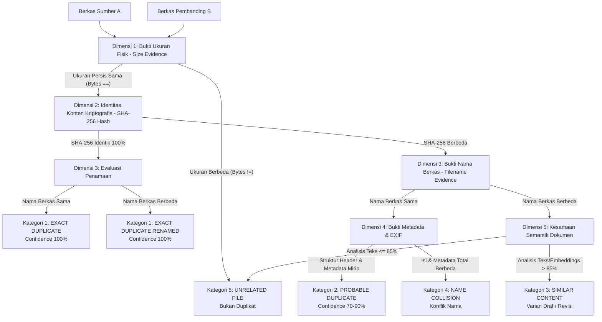
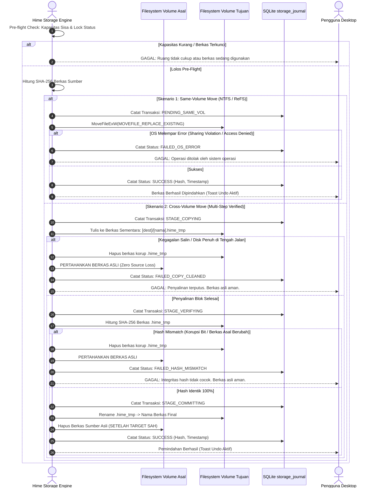

# Hime File & Storage Experience Specification (Calibrated)

- **Document ID:** HIME-FILE-AND-STORAGE-EXPERIENCE
- **Task ID:** TASK-02-04 / TASK-02-04B / TASK-02-04D (Product Requirements & Experience Architecture)
- **Phase:** Phase 02 — Nusa Reverse Engineering & Architecture Discovery (Product Specification)
- **Authority:** Principal Storage Systems Architect & Senior Data Experience Designer
- **Status:** **CALIBRATED SPECIFICATION — PENDING OWNER REVIEW**
- **Date:** 2026-11-08

---

## 1. Executive Summary & Core Tenets

Dokumen ini mendefinisikan arsitektur pengelolaan berkas, mitigasi konflik unduhan, deteksi duplikasi bertingkat, siklus hidup operasi berkas yang andal, dan mekanisme pembatalan (*Undo*) untuk **Hime**.

Berdasarkan hasil evaluasi rekayasa (TASK-02-04B), dokumen ini mengkalibrasi seluruh proses pengelolaan berkas agar berpegang teguh pada empat prinsip mutlak:
1. **Zero Source Loss Guarantee:** Berkas sumber asli **DILARANG DIHAPUS** sebelum seluruh proses penyalinan, pemindahan, dan verifikasi integritas hash terbukti berhasil 100%.
2. **Kualifikasi Atomisitas Lintas-Volume:** Pengakuan jujur bahwa operasi pemindahan berkas lintas volume (misal Drive C: ke Drive X:, atau laptop ke penyimpanan Android) **tidak bersifat atomik secara inheren pada tingkat filesystem**; atomisitas hanya dapat dijamin pada pemindahan volume yang sama (*same-volume move*). Operasi lintas volume wajib menggunakan siklus hidup multi-tahap yang terlindungi.
3. **Pemisahan Kriptografis vs Semantik:** Hash kriptografis SHA-256 adalah bukti identitas konten mutlak; kesamaan semantik (*semantic similarity*) **hanya digunakan untuk merekomendasikan file serupa, BUKAN untuk menyatakan duplikasi pasti**.
4. **Reliable 30-Day Undo Journal:** Pembatalan operasi pemindahan berkas dilindungi oleh verifikasi integritas sebelum pemulihan, penanganan konflik jika berkas tujuan telah dimodifikasi, serta batas retensi waktu dan kapasitas.

---

## 2. Refined 5-Dimensional Duplicate Detection Model

Untuk mencegah bencana salah hapus dokumen penting, Hime menerapkan taksonomi bukti deteksi berkas dalam 5 dimensi terpisah:



### A. Klasifikasi 5 Dimensi Bukti
1. **Bukti Ukuran Fisik (*Size Evidence*):** Saringan eliminasi tercepat ($\mathcal{O}(1)$). Jika ukuran berkas berbeda 1 byte saja, berkas dipastikan bukan duplikat identik.
2. **Identitas Konten Kriptografis (*Cryptographic Content Identity*):** Checksum SHA-256 dari seluruh isi berkas. Merupakan satu-satunya bukti teknis yang dapat menyatakan dua berkas identik bit-per-bit.
3. **Bukti Nama Berkas (*Filename Evidence*):** Nama berkas dan ekstensinya. Menjadi bukti pendukung untuk mendeteksi apakah berkas merupakan salinan ganda tidak sengaja (misal `dokumen (1).pdf`) atau dua berkas berbeda yang kebetulan bernama sama.
4. **Bukti Metadata (*Metadata Evidence*):** Waktu pembuatan (*creation timestamp*), author dokumen, resolusi gambar, atau data EXIF kamera pemotret.
5. **Kesamaan Semantik (*Semantic Similarity*):** Analisis embedding atau perbandingan teks dokumen. **CATATAN TEGAS:** Kesamaan semantik **TIDAK PERNAH digunakan untuk menyatakan duplikasi pasti**, melainkan hanya untuk memberi tahu pengguna bahwa berkas tersebut adalah varian draf revisi (misal draf proposal v1 vs v2).

### B. Matriks Kategori Hasil, Tingkat Keyakinan, & Tindakan yang Diizinkan

| Kategori Hasil | Kriteria Teknis Bukti | Tingkat Keyakinan (*Confidence*) | Tindakan yang Diizinkan Sistem | Tindakan Terlarang |
|:---|:---|:---:|:---|:---|
| **Kategori 1: Exact Duplicate** | Ukuran sama + Hash SHA-256 identik 100%. | **100% (Definitif)** | Rekomendasikan pembersihan salinan ganda; simpan 1 berkas primer; pindahkan salinan ke folder backup/recycle bin. | Dilarang menghapus salinan primer. |
| **Kategori 2: Probable Duplicate** | Ukuran sama + Metadata & header mirip, namun hash beda tipis (misal tag MP3 / EXIF diubah). | **70% – 90% (Tinggi)** | Tampilkan pratinjau komparasi metadata; tanyakan konfirmasi manual pengguna: *"Apakah ingin mengganti draf lama?"* | **DILARANG membersihkan otomatis tanpa konfirmasi.** |
| **Kategori 3: Similar Content** | Isi teks semantik mirip $>85\%$, namun ukuran dan hash berbeda nyata (varian revisi dokumen). | **50% – 70% (Menengah)** | Tampilkan kartu versi: *"Ditemukan versi revisi sebelumnya"*; tawarkan opsi simpan sebagai `v2` atau pengarsipan. | **DILARANG menganggap sebagai duplikat identik.** |
| **Kategori 4: Name Collision** | Nama berkas persis sama, namun ukuran dan hash berbeda total. | **0% Duplikat Konten** | Lindungi kedua berkas; tanyakan lokasi simpan alternatif atau tambahkan penomoran unik otomatis `_new`. | **DILARANG menimpa (overwrite) berkas lama secara diam-diam.** |
| **Kategori 5: Unrelated File** | Ukuran, hash, nama, dan isi tidak memiliki korelasi. | **0%** | Diabaikan; diproses sebagai berkas independen normal. | N/A |

---

## 3. Safe File Operation Lifecycle & Filesystem Atomicity Qualification

Untuk menjamin tidak ada berkas pengguna yang rusak atau hilang di tengah jalan, seluruh operasi pemindahan berkas mematuhi siklus hidup terstruktur dengan batasan atomisitas dan daya tahan sistem berkas yang dikualifikasikan secara mendalam:

### A. Kualifikasi 5 Dimensi Jaminan Sistem Berkas (Filesystem Guarantee Reality)
Klaim keandalan dan atomisitas pemindahan berkas dibatasi oleh karakteristik sistem operasi dan arsitektur filesystem. Hime membedakan secara tegas lima dimensi teknis:

1. **Namespace Atomicity (*Atomisitas Ruang Nama / Direktori*):**
   - Merujuk pada pembaruan entri direktori di mana nama berkas lama digantikan atau dipindahkan ke nama berkas baru secara atomik tanpa adanya celah waktu (*time-of-check to time-of-use / TOCTOU gap*) di mana berkas target tidak ada.
   - **Primitif Platform:**
     - **Windows (Win32):** Menggunakan `MoveFileExW(lpExistingFileName, lpNewFileName, MOVEFILE_REPLACE_EXISTING)`. Jika berkas tujuan sudah ada, direktori menggantikan entri secara atomik pada filesystem yang mendukung.
     - **POSIX / Linux:** Menggunakan `rename(oldpath, newpath)`. Pada kernel Linux $\ge 3.15$, Hime memanfaatkan syscall `renameat2(AT_FDCWD, oldpath, AT_FDCWD, newpath, RENAME_NOREPLACE)` ketika memindahkan berkas tanpa menimpa berkas tujuan yang sudah ada secara tak sengaja.
   - **Batasan Nyata:** Atomisitas ruang nama ini hanya berlaku jika berkas asal dan tujuan berada pada **volume/mount point yang sama (*same-volume move*)**.

2. **Data Integrity (*Integritas Konten Data*):**
   - Atomisitas namespace tidak secara otomatis menjamin isi data tidak korup selama transfer.
   - Hime memvalidasi integritas data secara independen menggunakan hash kriptografis SHA-256 berkas sebelum dan sesudah operasi, memastikan tidak terjadi korupsi bit (*bit rot*), pemotongan stream (*truncated write*), atau manipulasi data di luar kendali.

3. **Crash Consistency (*Konsistensi Struktur saat Crash*):**
   - Mengacu pada integritas metadata sistem berkas agar tidak berada dalam status rusak (*corrupt filesystem*) jika terjadi kegagalan daya mendadak (*power loss*) atau kernel crash.
   - Filesystem modern berbasis *journaling* (NTFS, ReFS pada Windows; ext4, XFS pada Linux) menjamin konsistensi log metadata, sehingga sistem operasi dapat memulihkan struktur pohon direktori saat boot berikutnya tanpa memerlukan `fsck`/`chkdsk` penuh.

4. **Durability (*Daya Tahan / Persistensi Fisik Non-Volatile*):**
   - **Pembedaan Krusial:** Keberhasilan pemanggilan `MoveFileExW` atau `rename()` hanya menjamin perubahan tercatat di memory buffer cache kernel OS, **BUKAN bahwa data telah tertulis ke media fisik flash/disk (NAND/Platter)**.
   - Jika listrik terputus seketika setelah operasi rename selesai di cache memori, data baru dapat hilang atau berkas kembali ke keadaan sebelum rename.
   - **Primitif Durability Hime:**
     - **Windows:** Memanggil `FlushFileBuffers(handle)` atau menetapkan bendera `MOVEFILE_WRITE_THROUGH` pada skenario kritis untuk memaksa controller hardware melakukan flushing write-cache ke media non-volatile.
     - **Linux:** Memanggil `fsync(fd)` atau `fdatasync(fd)` pada berkas dan memanggil `fsync(dir_fd)` pada direktori induk untuk menjamin entri direktori benar-benar persisten di disk fisik.

5. **Cross-Volume Transactions (*Transaksi Lintas-Volume*):**
   - Pemindahan antar-volume fisik atau logis berbeda (misal dari `C:\` ke `D:\`, atau laptop ke smartphone Android via USB) **secara fundamental tidak dapat bersifat atomik di tingkat sistem operasi**.
   - Hime menerapkan **Prosedur Multi-Tahap Terverifikasi (*Verified Multi-Step Lifecycle*)**:
     * *Tahap 1 (Pre-flight Check):* Validasi ketersediaan ruang disk bebas ($\ge \text{Ukuran Berkas} + 50\text{ MB}$) dan hak tulis direktori tujuan.
     * *Tahap 2 (Copy Stream):* Menyalin data ke berkas sementara `.hime_tmp` di volume tujuan.
     * *Tahap 3 (Checksum Verification):* Menghitung dan memvalidasi hash SHA-256 berkas `.hime_tmp` terhadap berkas asal.
     * *Tahap 4 (Atomic Rename Target):* Mengganti nama berkas `.hime_tmp` menjadi nama final di volume tujuan menggunakan same-volume rename atomik (`MoveFileExW` / `renameat2`).
     * *Tahap 5 (Flush Durability):* Memanggil `FlushFileBuffers` / `fsync` untuk memastikan berkas tujuan telah persisten di media fisik.
     * *Tahap 6 (Delete Source):* Menghapus berkas sumber asli **hanya dan hanya jika Tahap 4 & 5 telah terkonfirmasi sukses 100%**.

### B. Variasi & Keterbatasan Nyata Filesystem yang Didukung
Hime dilarang mengasumsikan jaminan yang seragam di seluruh media penyimpanan:
- **NTFS (Windows):** Mendukung atomic namespace rename via MFT. Namun, buffer data tetap tertahan di RAM OS kecuali dipaksa melalui flushing.
- **ReFS (Windows):** Menggunakan copy-on-write (CoW) untuk metadata dan file data dengan integrity streams opsional.
- **ext4 / XFS (Linux):** Mendukung atomic metadata rename. Untuk menjamin durability penuh, kernel mewajibkan `fsync` pada file dan `fsync` pada direktori induk.
- **FAT32 & exFAT (Flash Drive / Kartu SD / Penyimpanan Eksternal):** **TIDAK MEMILIKI JOURNALING METADATA.** Pembaruan entri direktori pada FAT32/exFAT tidak menjamin atomisitas POSIX; kegagalan daya di tengah penulisan kluster dapat menyebabkan berkas yatim (*orphaned clusters*) atau direktori korup. Hime memperlakukan volume FAT32/exFAT dengan kehati-hatian ekstra dan verifikasi ganda.
- **Network Shares (SMB/CIFS, NFS) & Cloud Virtual Stubs:** Operasi pemindahan pada volume jaringan dapat dipecah secara transparan oleh driver jaringan menjadi operasi salin-dan-hapus yang non-atomik. Berkas virtual (misal OneDrive Files On-Demand) dapat memicu kegagalan transmisi jika berkas offline belum dihidrasi.
- **Kunci Berkas & Izin Akses:** Pemindahan dapat gagal seketika jika berkas sedang dibuka secara eksklusif oleh proses lain (`ERROR_SHARING_VIOLATION` / `EBUSY`) atau terhalang izin akses (`ERROR_ACCESS_DENIED` / `EACCES`).

### C. Persyaratan Pengujian Sistem Berkas (Testing Requirement on Supported Filesystems)
Sebagai syarat penyelesaian implementasi (*Implementation Requirement*), test suite otomatis Hime Storage Engine **wajib menjalankan pengujian integrasi empiris pada masing-masing filesystem target yang didukung**:
1. Verifikasi Same-Volume Rename dan Durability Flush pada partisi **NTFS** (Windows) dan **ext4** (Linux).
2. Verifikasi Cross-Volume Multi-Step Copy & Source Deletion antara partisi berbeda.
3. Simulasi interupsi kegagalan (disk full, simulasi crash, abort di tengah transfer) pada volume **FAT32 / exFAT** untuk membuktikan prinsip *Zero Source File Loss*.
4. Pengujian perilaku error handling saat menghadapi file lock (`ERROR_SHARING_VIOLATION`) dan ACL permission error.

### D. Prinsip Dasar yang Tidak Boleh Dilanggar
1. **Zero Source File Loss:** Berkas sumber asli tidak pernah dihapus sebelum berkas di destinasi terverifikasi valid dan utuh 100%.
2. **Ketiadaan Klaim Atomisitas Palsu:** Hime tidak pernah mengklaim operasi lintas-volume bersifat atomik sebagai satu kesatuan.
3. **Pelacakan Jurnal Transaksi:** Setiap tahap operasi dicatat dalam `storage_journal` (`last_completed_step`) untuk pemulihan deterministik.
4. **Perlindungan Terhadap Modifikasi Pengguna:** Pemulihan pasca-crash (*crash recovery*) dilarang menimpa atau menghapus berkas yang telah dimodifikasi oleh pengguna selama jeda waktu crash.

### E. Diagram Alir Siklus Hidup Operasi Berkas Andal



### F. Protokol Pemulihan Pasca-Crash (*Crash Recovery Protocol*)
Tabel `storage_journal` mencatat setiap tahap operasi secara transaksional (`last_completed_step`). Jika terjadi *power loss* atau crash proses Hime Core di tengah jalan, prosedur pemulihan saat restart berikutnya:
1. **Crash saat `STAGE_COPYING` atau `STAGE_VERIFYING`:** Berkas asal masih 100% utuh. Hime mendeteksi berkas sisa `.hime_tmp` di volume tujuan, menghapusnya, dan menandai status entri jurnal sebagai `ABORTED_CLEANED`.
2. **Crash saat `STAGE_COMMITTING` (Destinasi final sudah terbentuk, sumber belum sempat dihapus):** Sistem mendeteksi berkas asal dan berkas tujuan keduanya ada dengan hash SHA-256 identik. Sistem tidak menduplikasi data, menyelesaikan penghapusan berkas asal yang tertunda, dan memperbarui status jurnal menjadi `SUCCESS`.
3. **Perlindungan Terhadap Modifikasi Pengguna Pasca-Crash:** Jika berkas di destinasi ternyata telah dimodifikasi oleh pengguna atau proses eksternal selama Hime mati (terdeteksi dari perubahan SHA-256 hash atau mtime), prosedur pemulihan **DILARANG SECARA DIAM-DIAM MENIMPA ATAU MENGHAPUS PERUBAHAN PENGGUNA**. Operasi ditandai sebagai `REQUIRES_USER_INTERVENTION` dan modal dialog ditampilkan kepada pengguna untuk memilih tindakan pemulihan yang aman.

---

## 4. Mekanisme & Keterbatasan Pembatalan 30 Hari (Undo Reliability)

### A. Bagaimana Jurnal Undo Bekerja
Setiap operasi pemindahan yang berhasil dicatat dalam tabel SQLite lokal `storage_journal`:
```sql
CREATE TABLE storage_journal (
    operation_id TEXT PRIMARY KEY,
    source_path TEXT NOT NULL,
    destination_path TEXT NOT NULL,
    file_size_bytes INTEGER NOT NULL,
    sha256_hash TEXT NOT NULL,
    timestamp_utc INTEGER NOT NULL,
    status TEXT NOT NULL,          -- 'SUCCESS', 'UNDONE', 'EXPIRED'
    is_cross_volume INTEGER NOT NULL
);
```

### B. Prosedur Pembatalan (*Undo Rollback*) & Penanganan Kasus Ekstrem
Ketika pengguna menekan tombol `[ Batalkan / Undo ]`:
1. **Pre-flight Integrity Check pada Destinasi:**
   - Sistem memeriksa keberadaan berkas di `destination_path`.
   - Sistem menghitung ulang hash SHA-256 berkas di destinasi saat ini.
2. **Penanganan Kasus Ekstrem (*Edge Cases*):**
   - **Kasus 1: Berkas Destinasi Telah Dimodifikasi Pengguna (*Modified Destination*):**
     Jika hash berkas di destinasi saat ini berbeda dengan hash saat operasi pemindahan dilakukan, **Sistem DILARANG melakukan Undo otomatis**. Sistem memunculkan alert peringatan:
     *"Berkas di lokasi tujuan telah disunting sejak dipindahkan. Menjalankan Undo akan menimpa perubahan terbaru Anda. Pilih tindakan: [ Buat Salinan Baru di Asal ] atau [ Batalkan Undo ]"*.
   - **Kasus 2: Berkas Destinasi Telah Dihapus (*Missing Destination*):**
     Sistem menampilkan pesan ramah bahwa berkas telah dipindahkan/dihapus di luar Hime, dan menandai entri jurnal sebagai `EXPIRED`.
   - **Kasus 3: Lokasi Asal Telah Ditempati Berkas Baru (*Source Path Collision*):**
     Jika direktori asal kini memuat berkas baru dengan nama yang sama, berkas yang di-undo diganti nama menjadi `[nama]_restored.[ext]` untuk mencegah penimpaan tidak sengaja.
3. **Kebijakan Retensi Jurnal (*Retention Policy*):**
   - Entri jurnal dipertahankan selama **30 hari**.
   - Entri yang berumur $> 30\text{ hari}$ otomatis dipangkas (*pruned*) dari basis data.
   - Manajemen Kapasitas Jurnal: Jurnal hanya menyimpan metadata teks path dan hash kriptografis ($\sim 500\text{ bytes}$ per entri), sehingga 10.000 riwayat operasi pemindahan hanya memakan ruang $\sim 5\text{ MB}$ pada database SQLite.

---

## 5. Acceptance Criteria untuk Kasus Kegagalan Ekstrem

Tabel berikut menetapkan kriteria penerimaan teknis wajib untuk setiap skenario kegagalan:

| Skenario Uji Kegagalan | Kondisi Pemicu | Kriteria Penerimaan Wajib (*Acceptance Criteria*) |
|:---|:---|:---|
| **AC-FAIL-01: Failed Copy** | Koneksi disk USB terputus di tengah proses penyalinan lintas-volume. | Sistem mendeteksi error I/O, menghapus berkas sementara `.hime_tmp`, dan mempertahankan berkas sumber 100% utuh. |
| **AC-FAIL-02: Hash Mismatch** | Berkas sumber mengalami korupsi bit atau dimodifikasi aplikasi lain selama penyalinan. | Pengecekan SHA-256 mendeteksi perbedaan hash; berkas `.hime_tmp` dihapus; berkas asal dipertahankan; melempar alert galat integritas. |
| **AC-FAIL-03: Process Crash** | Proses Hime Core dimatikan paksa (`taskkill /F`) di tengah penulisan berkas. | Saat startup berikutnya, Hime mendeteksi berkas `.hime_tmp` yang menggantung (*dangling*), membersihkannya, dan memeriksa status berkas asal. |
| **AC-FAIL-04: Disk Full** | Ruang hard disk tujuan habis saat operasi berlangsung. | Pre-flight check menolak operasi jika sisa ruang disk $< \text{Ukuran Berkas} + 50\text{ MB}$; jika disk mendadak penuh di tengah jalan, bersihkan `.hime_tmp` dan batalkan. |
| **AC-FAIL-05: File Locked** | Berkas sedang dibuka secara eksklusif oleh aplikasi lain (misal Word / Excel). | Pengecekan handle kunci menolak pemindahan; menampilkan pesan ramah: *"Berkas sedang digunakan oleh aplikasi lain"*. |
| **AC-FAIL-06: Source Changed during Operation** | Berkas asal diedit saat proses transfer panjang (misal video besar 4 GB). | Verifikasi hash akhir gagal; membatalkan pemindahan; tidak ada penimpaan data usang. |
| **AC-FAIL-07: Undo after Dest Modified** | Pengguna mengedit isi berkas di folder tujuan lalu mencoba menekan tombol Undo. | Pengecekan hash mendeteksi perubahan; sistem menolak rollback otomatis dan meminta otorisasi eksplisit pengguna. |
