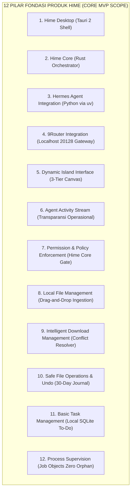

# Hime MVP Definition & Product Roadmap Specification (Calibrated)

- **Document ID:** HIME-MVP-AND-PRODUCT-ROADMAP
- **Task ID:** TASK-02-04 / TASK-02-04B / TASK-02-04D (Product Requirements & Experience Architecture)
- **Phase:** Phase 02 — Nusa Reverse Engineering & Architecture Discovery (Product Specification)
- **Authority:** Principal Product Manager & Lead Systems Architect
- **Status:** **CALIBRATED SPECIFICATION — PENDING OWNER REVIEW**
- **Date:** 2026-11-08

---

## 1. Executive Summary & Calibration Tenets

Dokumen ini mendefinisikan ruang lingkup produk minimal yang layak (*Minimum Viable Product / MVP*) serta peta jalan pengembangan bertahap (*Product Roadmap*) untuk **Hime**.

Berdasarkan evaluasi tata kelola rekayasa (TASK-02-04B), ruang lingkup MVP Hime dikalibrasi secara disiplin untuk memprioritaskan **fondasi produk dan keandalan sistem**, serta menanggalkan fitur utilitas sekunder yang dapat mengaburkan fokus rilis pertama:
1. **Prioritas Mutlak Fondasi Inti:** MVP difokuskan pada 12 kapabilitas fondasi arsitektur Hime.
2. **Rekalibrasi Utilitas Gaya Hidup (Lifestyle Utilities):** Cincin hidrasi (*hydration ring*) dan jadwal shalat lokal dievaluasi ulang dan dikeluarkan dari kriteria kelayakan MVP inti. Utilitas ini diklasifikasikan sebagai fitur sekunder opsional (*Optional Utilities / Phase 2 Plugin*).
3. **Kepastian Roadmap Manajemen Android:** Manajemen penyimpanan smartphone Android via ADB USB dipastikan **tetap berada dalam peta jalan resmi Hime pada Phase 2**, bukan dihilangkan dari visi produk.
4. **Penerapan Arahan Project Owner:**
   - *OQ-01:* Mode Klik (*Click-to-Expand*) ditetapkan sebagai default behavior pembukaan Dynamic Island. Mode Hover menjadi opsi konfigurasi pengguna.
   - *OQ-02:* Integrasi Android tahap awal berfokus pada protokol ADB USB kabel, dengan desain yang mempertahankan kesiapan penambahan Wi-Fi P2P Companion.
   - *OQ-03:* GNOME Wayland di Linux menggunakan fallback anggun (*graceful fallback*) ke mode jendela utilitas mengapung (*Floating Utility Window*).
   - *OQ-04:* Persistensi memori percakapan MVP menggunakan SQLite FTS5 dengan lapisan abstraksi (*Storage Abstraction Layer*) agar modul semantic embedding dapat ditambahkan secara mulus pada fase berikutnya.

---

## 2. 12 Fondasi Inti Produk Hime (Core MVP Scope)

MVP Hime didefinisikan secara tegas melalui 12 pilar fondasi berikut:



### Rincian 12 Fondasi Inti MVP:
1. **Hime Desktop:** Shell aplikasi desktop native berbasis Tauri 2.0, React 19, TypeScript, dan Tailwind CSS.
2. **Hime Core:** Pusat orkestrasi berbasis Rust yang mengelola status sistem, abstraksi cross-platform IPC (`IpcTransport` trait), dan antarmuka sistem operasi.
3. **Hermes Agent Integration:** Pengaitan runtime penalaran otonom Hermes Agent melalui saluran IPC berotentikasi (Named Pipe di Windows / Unix Domain Socket di Linux).
4. **9Router Integration:** Pengintegrasian gateway inferensi multi-penyedia yang berjalan sebagai managed background service pada `127.0.0.1:20128` dengan rotasi password CSPRNG.
5. **Dynamic Island Interface:** Antarmuka pulau mengapung di batas atas layar dengan Kanvas Elastis 3-Tier (Tier 1: 34 px Ambient, Tier 2: 212 px HUD, Tier 3: 480–600 px Workspace) dan transparansi tembus-klik (`WM_NCHITTEST`). Mode default: Klik untuk membuka (*Click-to-Expand*).
6. **Agent Activity Stream:** Visualisasi linimasa tindakan agen, nama alat, dan log output tanpa menampilkan pemikiran internal privat (*no private chain-of-thought*).
7. **Permission & Policy Enforcement:** Penegakan kebijakan keamanan terpusat di Hime Core dengan 8 izin granular dan Interactive Action Approval Modal untuk tindakan berisiko tinggi.
8. **Local File Management:** Penyeretan dokumen (*drag-and-drop*) langsung ke island untuk ekstraksi teks konteks instan.
9. **Intelligent Download Management:** Pemantauan folder `Downloads` untuk mendeteksi konflik berkas dan menyarankan penataan lokasi simpan.
10. **Safe File Operations & Undo:** Prosedur pemindahan berkas aman (atomic same-volume, verified multi-step cross-volume) dan jurnal pembatalan (*Undo*) berbasis SQLite.
11. **Basic Task Management:** Pengelolaan checklist tugas harian lokal sederhana yang terintegrasi di panel Tier 2.
12. **Process Supervision:** Pengawas siklus hidup proses mandiri menggunakan Windows Job Objects (`Kill-on-Close`) untuk menjamin nol proses yatim piatu (*Zero Orphan Process*).

---

## 3. Evaluasi & Rekalibrasi Fitur Gaya Hidup (Lifestyle Utilities)

Sesuai instruksi evaluasi (TASK-02-04B), fitur-fitur sekunder dievaluasi kembali kelayakannya untuk MVP:

| Fitur Sekunder | Evaluasi Kelayakan MVP | Keputusan Rekalibrasi Produk | Penempatan Fase |
|:---|:---|:---|:---:|
| **Cincin Progres Hidrasi (*Hydration Ring*)** | Memiliki nilai kebiasaan baik, namun bukan merupakan fondasi arsitektur kerja AI desktop. Memasukkannya ke MVP inti berisiko menambah kompleksitas visual tanpa relevansi terhadap orkestrasi agen. | **Dikeluarkan dari MVP Inti.** Diposisikan sebagai *Optional Lifestyle Widget* yang dinonaktifkan secara default atau dimuat sebagai widget tambahan. | **Phase 2 (Optional)** |
| **Jadwal Shalat Lokal Kemenag** | Bernilai tinggi bagi pengguna Muslim di Indonesia, namun memiliki dependensi geografis spesifik dan bukan prasyarat teknis bagi fungsi AI atau manajemen berkas. | **Dikeluarkan dari MVP Inti.** Diposisikan sebagai *Regional Productivity Plugin* yang dapat diaktifkan melalui menu pengaturan. | **Phase 2 (Optional)** |
| **Integrasi Maskot Pixel-Art** | Fitur estetika murni dari referensi Nusa tanpa implikasi fungsional rekayasa. | **Dikeluarkan sepenuhnya.** Tidak menjadi fokus pengembangan Hime. | **Deferred / Future** |

---

## 4. Peta Jalan Pengembangan Multi-Fase (Product Evolution Roadmap)

Peta jalan Hime dirancang dalam 4 fase evolusi yang realistis dan berkesinambungan:

```text
+----------------------------------------------------------------------------------------------------+
| PETA JALAN RESMI EVOLUSI PRODUK HIME (OFFICIAL PRODUCT ROADMAP):                                   |
+----------------------------------------------------------------------------------------------------+
| FASE 1: THE CORE AI CO-PILOT (MVP RELEASE - WINDOWS 11)                                            |
| [Status Target: Kesiapan Produksi Fondasi Inti]                                                    |
| - 12 Pilar Fondasi Inti (Desktop, Core, Hermes, 9Router, Island 3-Tier, Activity Stream, PEP Gate)  |
| - Omnibox Keyboard-First (Alt+Space) & Streaming Markdown Relay (127.0.0.1:20128)                  |
| - File Intelligence & Safe Downloads Conflict Resolver dengan SHA-256 Duplicates & Undo Journal    |
| - Enkripsi Kredensial DPAPI, Job Objects Process Supervision, Zero Plaintext Secrets               |
|                                                                                                    |
| FASE 2: CROSS-PLATFORM & DEVICE EXTENSION (POST-MVP)                                               |
| [Fokus: Ekspansi Ekosistem Sistem Operasi & Integrasi Perangkat Mobile]                             |
| - Linux Platform Adapter: Implementasi wlr-layer-shell (KDE), X11 dock, dan libsecret              |
|   (dengan Graceful Fallback ke Floating Utility Window pada GNOME Wayland).                        |
| - Android Storage Management via ADB USB: Deteksi memori HP, pencadangan foto lama ke laptop,      |
|   dan pembersihan aman dengan konfirmasi eksplisit (arsitektur siap untuk Wi-Fi P2P Companion).    |
| - Browser Research Automation: Headless web readability scraper untuk artikel web publik.          |
| - Memory Abstraction Layer: Integrasi awal vector embeddings lokal pada SQLite storage layer.      |
| - Optional Lifestyle Plugins: Cincin hidrasi dan jadwal shalat lokal Kemenag.                      |
|                                                                                                    |
| FASE 3: ADVANCED WORKSPACES & MULTI-AGENT COLLABORATION                                            |
| [Fokus: Otomatisasi Rekayasa Perangkat Lunak & Riset Akademik Mendalam]                            |
| - Research Workspace: Multi-document PDF synthesizer dan citation tracker.                        |
| - Developer Workspace: Code syntax diff visualizer dan atomic branch patching engine.              |
| - Interactive Browser Automation: Form autofill dan penanganan etis rintangan CAPTCHA (human gate). |
| - Ekspor Dokumen Multi-Format: Konversi draf Markdown ke PDF dan Office Word (.docx).              |
| - Multi-Agent Task Orchestration: Manajemen antrean multi-agen dengan alokasi kuota CPU cerdas.    |
|                                                                                                    |
| FUTURE HORIZONS: UBIQUITOUS PERSONAL AI ENVIRONMENT                                                |
| [Visi Jangka Panjang Ekosistem Hime]                                                               |
| - Hime Mobile Native App (Kotlin): Klien mobile mandiri untuk sinkronisasi P2P nirkabel.          |
| - Specialist Agent Skills Marketplace: Ekosistem modul agen pihak ketiga terverifikasi.            |
+----------------------------------------------------------------------------------------------------+
```

---

## 5. Matriks Rekapitulasi Rencana Peluncuran Fitur Terkalibrasi

| Domain Modul | Cakupan Rilis MVP (Phase 1) | Cakupan Rilis Phase 2 | Cakupan Rilis Phase 3 & Future |
|:---|:---|:---|:---|
| **Platform Target** | **Windows 11 (Tauri 2 + DirectComposition)** | **Linux (KDE wlr-layer-shell / X11 dock / GNOME fallback)** | Multi-Monitor Desktop & Linux Wayland Portals |
| **Antarmuka Kanvas** | **Kanvas Elastis 3-Tier (Default: Click-to-Expand)** | Opsi Hover Dwell 250 ms teruji, tema kustom | Adaptive Layout Ultrawide Display |
| **Kecerdasan AI** | **Hermes Agent (Single Active Task FIFO) + 9Router** | Task scheduler latar belakang ringan | Multi-Agent parallel orchestration |
| **Keamanan & Policy** | **Action Approval Modal, DPAPI Vault, Job Objects** | Linux Secret Service Keyring (`libsecret`) | Granular RBAC & Enterprise Audit Compliance |
| **Manajemen Berkas** | **Downloads Conflict Resolver, SHA-256 Check, Undo** | Visual Storage Treemap, Safe Archive Manager | Automated Deduplication Daemon |
| **Integrasi Perangkat**| **Deteksi Baterai & Daya Laptop Lokal** | **Android Storage Management via ADB USB** | Wireless Wi-Fi Companion & Hime Mobile App |
| **Perkakas Developer** | **Sandboxed Terminal Execution, Collapsible Log** | Visual Code Syntax Diff Viewer | Automated Git Branching & PR Generator |
| **Perkakas Riset** | **File Context Ingestion (Drag-and-Drop)** | Headless Web Readability Scraper | Multi-PDF Synthesizer & Citation Manager |
| **Memori & Konteks** | **SQLite FTS5 Full-Text Search (Local Memory)** | Local Semantic Embedding Vector Index | Continuous Cross-Session Knowledge Graph |
| **Gaya Hidup** | **Checklist To-Do Harian Lokal Sederhana** | Optional: Cincin Hidrasi, Jadwal Shalat | Automated Weekly Retrospective Digest |
