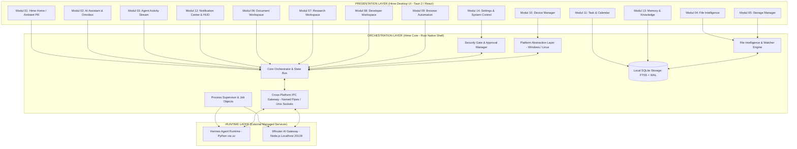

# Hime Product Module Architecture Specification

- **Document ID:** HIME-PRODUCT-MODULE-ARCHITECTURE
- **Task ID:** TASK-02-04 / TASK-02-04D (Product Requirements & Experience Architecture)
- **Phase:** Phase 02 — Nusa Reverse Engineering & Architecture Discovery (Product Specification)
- **Authority:** Lead Systems Architect & Principal Software Designer
- **Status:** **APPROVED ARCHITECTURAL SPECIFICATION**
- **Date:** 2026-11-08

---

## 1. Executive Summary

Dokumen ini mendefinisikan arsitektur modular produk untuk **Hime**.

Berbeda dengan aplikasi konvensional yang memaksakan setiap fitur menjadi halaman navigasi terpisah yang kaku, arsitektur Hime mengadopsi pendekatan **Kemampuan Terpadu Berbasis Ruang Kerja (*Unified Workspace Capabilities*)**. Modul-modul dirancang sebagai kapabilitas yang saling terhubung dan dapat dipanggil secara kontekstual di dalam kanvas elastis Hime, baik dalam bentuk kapsul ringkas, panel melayang, maupun ruang kerja penuh (*full workspace*).

Dokumen ini menganalisis 14 modul produk, merinci tanggung jawab, fitur utama, interaksi pengguna, keterkaitan antar-modul, dependensi terhadap Hime Core, dependensi terhadap OS, serta klasifikasi tahapan rilisnya (MVP vs Fase Lanjutan).

---

## 2. High-Level Product Module Ecosystem

Diagram berikut memetakan relasi hierarkis antara antarmuka pengguna, modul produk, Hime Core, dan backend eksternal:

---

## 3. Detailed Specification of the 14 Product Modules

### Modul 01: Hime Home (Ambient Capsule & Glanceable Status)
- **Tanggung Jawab:** Menyajikan jangkar visual utama kehadiran Hime di desktop, menampilkan status keheningan sistem, progres baterai/status sekilas, serta menjadi titik pemicu ekspansi.
- **Fitur Utama:** Minimal Idle Pill, Status/Battery Progress Ring, Digital Time Display, Subtle Activity Pulse.
- **Interaksi Pengguna:** Klik kiri eksplisit sebagai default untuk membuka expanded panel (Tier 2) sesuai DIR-01; opsi hover dwell (250 ms) tersedia melalui konfigurasi; klik kanan untuk menu cepat; drop target untuk berkas.
- **Hubungan Antar-Modul:** Kontainer induk untuk Modul 02, 03, 11, dan 12.
- **Ketergantungan Hime Core:** Event bus status sistem, windowing position controller.
- **Ketergantungan OS:** DirectComposition borderless window, non-activating topmost overlay.
- **Klasifikasi:** **MVP (Must Have)**.

### Modul 02: AI Assistant & Omnibox (Command & Prompt Interface)
- **Tanggung Jawab:** Antarmuka masukan prompt utama, penerimaan pertanyaan bahasa alami, pengiriman instruksi ke 9Router/Hermes, dan penyajian streaming respons Markdown.
- **Fitur Utama:** Omnibox bar, prompt chips (*context badges*), streaming token text renderer, copy-to-clipboard, tombol stop generation.
- **Interaksi Pengguna:** Pemanggilan via `Alt + Space`, input teks cepat, penyematan dokumen via drag-and-drop, navigasi riwayat prompt dengan tombol panah atas/bawah.
- **Hubungan Antar-Modul:** Memicu Modul 03 saat tugas membutuhkan tools, memanfaatkan Modul 13 untuk penarikan riwayat, berinteraksi dengan Modul 06 untuk draf panjang.
- **Ketergantungan Hime Core:** SSE Token Streaming Bridge, IPC channel ke 9Router loopback.
- **Ketergantungan OS:** Global hotkey registration.
- **Klasifikasi:** **MVP (Must Have)**.

### Modul 03: Agent Activity Stream (Operational Transparency & Inspection)
- **Tanggung Jawab:** Memvisualisasikan rencana tindakan, langkah eksekusi alat, log stdout/stderr, dan progres kerja Hermes Agent secara real-time dan terstruktur tanpa menampilkan private chain-of-thought.
- **Fitur Utama:** Badge alat dinamis (`tool://invoking`), linimasa progres bertahap, ringkasan hasil keluaran, panel log detail yang dapat diperluas (*collapsible logs*), tombol interupsi tugas (*Cancel*).
- **Interaksi Pengguna:** Memantau kemajuan tugas secara pasif, mengklik log untuk melihat rincian perintah, menekan tombol `[ Batal ]` jika diperlukan.
- **Hubungan Antar-Modul:** Terhubung erat dengan Modul 08 (Developer Workspace) dan Modul 14 (Security Approval Modal).
- **Ketergantungan Hime Core:** IPC streaming status Hermes Agent (Windows Named Pipe / Linux Unix Domain Socket via `IpcTransport` trait).
- **Ketergantungan OS:** Sub-process tree tracking.
- **Klasifikasi:** **MVP (Must Have)**.

### Modul 04: File Intelligence (Semantic Ingestion & Classifier)
- **Tanggung Jawab:** Menganalisis berkas yang di-drop atau diunduh pengguna, mengekstrak teks, menghitung hash konten kriptografis SHA-256, dan menentukan kategori dokumen semantik.
- **Fitur Utama:** Multi-format parser (PDF, MD, Code, TXT, JSON), hash generator, MIME type classifier, context injector.
- **Interaksi Pengguna:** Menyeret berkas dari File Explorer ke kanvas Hime; melihat metadata ringkas berkas terlampir.
- **Hubungan Antar-Modul:** Menyuplai konteks ke Modul 02 & 07, memberi masukan ke Modul 05 (Storage Manager).
- **Ketergantungan Hime Core:** Local text extractor utility, background worker thread.
- **Ketergantungan OS:** OLE drag-and-drop COM interface (Windows) / X11/Wayland DnD (Linux).
- **Klasifikasi:** **MVP (Must Have)**.

### Modul 05: Storage Manager (Local Storage & Downloads Organizer)
- **Tanggung Jawab:** Memantau folder `Downloads`, mendeteksi duplikat berkas riil, menyelesaikan konflik penamaan berkas baru, menyarankan pemindahan berkas terorganisir, dan menyediakan buffer pembatalan (*Undo*).
- **Fitur Utama:** File System Watcher, duplicate detection engine (size + SHA-256 + metadata), download conflict prompt, atomic move operator, undo rollback journal.
- **Interaksi Pengguna:** Merespons kartu prompt resolusi konflik saat berkas baru terunduh; meninjau daftar duplikat dan menekan tombol `[ Bersihkan Duplikat ]`.
- **Hubungan Antar-Modul:** Bekerja sama dengan Modul 04 untuk klasifikasi dokumen, mencatat riwayat pemindahan di Modul 13.
- **Ketergantungan Hime Core:** Filesystem event listener (ReadDirectoryChangesW / inotify), SQLite journal storage.
- **Ketergantungan OS:** Atomic file rename operations, filesystem permissions.
- **Klasifikasi:** **MVP (Must Have)**.

### Modul 06: Document Workspace (Rich Markdown Canvas & Editor)
- **Tanggung Jawab:** Menyediakan ruang kerja penyuntingan, pemformatan, dan peninjauan dokumen panjang atau draf laporan hasil generasi AI.
- **Fitur Utama:** GFM Markdown editor, live syntax preview, code snippet highlighting, document export button.
- **Interaksi Pengguna:** Mengedit teks secara langsung, menambahkan instruksi revisi lanjutan, menyalin blok kode.
- **Hubungan Antar-Modul:** Merupakan wujud ekspansi Tier 3 dari Modul 02 saat berurusan dengan teks panjang.
- **Ketergantungan Hime Core:** Local file save operator.
- **Ketergantungan OS:** File save dialog, clipboard bridge.
- **Klasifikasi:** **MVP (Must Have)**.

### Modul 07: Research Workspace (Multi-Document Synthesizer)
- **Tanggung Jawab:** Mengelola koleksi berkas referensi (paper ilmiah, artikel, buku digital) dan memfasilitasi sintesis komparatif lintas-dokumen.
- **Fitur Utama:** Multi-PDF context aggregator, comparative matrix generator, citation tracker.
- **Interaksi Pengguna:** Menyeret sekelompok paper penelitian, meminta tabel komparasi metodologi, menyimpan hasil sintesis.
- **Hubungan Antar-Modul:** Menggabungkan kemampuan Modul 04 (File Intelligence) dan Modul 02 (AI Assistant).
- **Ketergantungan Hime Core:** Multi-file memory indexing, context window budget optimizer.
- **Ketergantungan OS:** Filesystem reader.
- **Klasifikasi:** **MVP (Must Have)**.

### Modul 08: Developer Workspace (Sandboxed Terminal & Code Diff Tools)
- **Tanggung Jawab:** Memfasilitasi interaksi pengembang dengan ekosistem coding lokal: menjalankan perintah pengujian unit, memeriksa status git, dan meninjau visualisasi perbedaan kode (diff).
- **Fitur Utama:** Sandboxed terminal runner, stdout/stderr live log viewer, visual syntax code diff viewer, atomic patch applier.
- **Interaksi Pengguna:** Menginstruksikan eksekusi pengujian, menyetujui izin perintah terminal di Modul 14, meninjau highlight merah/hijau diff sebelum klik `[ Terapkan Patch ]`.
- **Hubungan Antar-Modul:** Terhubung langsung dengan Modul 03 (Activity Stream) dan Modul 14 (Security Gate).
- **Ketergantungan Hime Core:** Process execution engine, timeout supervisor, atomic file patcher.
- **Ketergantungan OS:** Sub-process spawning (`cmd.exe`, `powershell.exe`, `/bin/bash`), standard streams redirection.
- **Klasifikasi:** **MVP (Must Have)**.

### Modul 09: Browser Automation (Headless Web Research & Scraper)
- **Tanggung Jawab:** Mengotomatisasi navigasi web publik untuk mengumpulkan informasi, membaca artikel terkini, atau memantau perubahan data web, dengan penanganan anti-bot etis.
- **Fitur Utama:** Readability scraper, DOM selector extractor, visual CAPTCHA detection & interactive fallback window launcher.
- **Interaksi Pengguna:** Meminta riset web dari Omnibox; menyelesaikan tantangan CAPTCHA secara manual pada jendela peramban jika terblokir.
- **Hubungan Antar-Modul:** Menyuplai data kontekstual ke Modul 02 dan Modul 07.
- **Ketergantungan Hime Core:** Headless browser process bridge (Playwright/Puppeteer).
- **Ketergantungan OS:** Outbound network socket, browser binary launcher.
- **Klasifikasi:** **Phase 2 (Post-MVP)**.

### Modul 10: Device Manager (Android Storage & Device Companion)
- **Tanggung Jawab:** Mendeteksi perangkat Android yang terhubung, menganalisis status memori internal/eksternal HP, dan mengelola pencadangan media secara aman.
- **Fitur Utama:** Android Bridge Protocol (ADB / Wi-Fi P2P Companion Daemon), storage capacity inspector, media file batch transfer, checksum verification.
- **Interaksi Pengguna:** Meninjau kapasitas memori HP dari kartu Hime; mengklik tombol persetujuan transfer foto lama ke laptop untuk mengosongkan ruang HP.
- **Hubungan Antar-Modul:** Terhubung dengan Modul 05 (Storage Manager) untuk penempatan arsip di laptop.
- **Ketergantungan Hime Core:** USB device watcher, socket transfer protocol, SHA-256 integrity checker.
- **Ketergantungan OS:** WinUSB / Linux libusb, ADB bridge process.
- **Klasifikasi:** **Phase 2 (Post-MVP)**.

### Modul 11: Task & Calendar (Local Tasks & Lifestyle Plugins)
- **Tanggung Jawab:** Mengelola daftar checklist tugas harian dan target prioritas secara terpadu. Fitur utilitas gaya hidup seperti pengingat hidrasi (`FR-PROD-02`) dan hitung mundur jadwal shalat offline (`FR-PROD-03`) diposisikan sebagai plugin opsional Fase 2.
- **Fitur Utama:** Quick task creator, task check-off with audio chime, Today summary card, optional plugin interface for hydration & prayer reminders.
- **Interaksi Pengguna:** Mengetik to-do cepat di panel Today, mencentang tugas yang selesai; mengaktifkan plugin jadwal shalat/hidrasi opsional jika diinginkan.
- **Hubungan Antar-Modul:** Menyuplai ringkasan pagi ke Modul 01 (Hime Home), berinteraksi dengan Modul 12 untuk pengingat audio.
- **Ketergantungan Hime Core:** Local SQLite task table (`hime_tasks.db`).
- **Ketergantungan OS:** Audio playback native (`PlaySoundW` / ALSA audio).
- **Klasifikasi:** **MVP (Local Tasks - Must Have)** / **Phase 2 (Optional Lifestyle Plugins - Could Have)**.

### Modul 12: Notification Center & Hardware HUD Alerts
- **Tanggung Jawab:** Mengonsolidasikan notifikasi sistem operasi dan hardware (Volume, Brightness, Baterai) ke dalam tampilan Dynamic Island sementara, serta menampilkan pop-up toast tindakan.
- **Fitur Utama:** Transient volume HUD pill, battery status alert, actionable toast cards, sound chime feedback.
- **Interaksi Pengguna:** Menerima umpan balik visual saat menekan tombol volume hardware; mengklik tombol aksi pada notifikasi tugas selesai.
- **Hubungan Antar-Modul:** Menampilkan alert atas nama Modul 03, 05, dan 11.
- **Ketergantungan Hime Core:** Audio volume listener thread, native notification dispatch.
- **Ketergantungan OS:** CoreAudio callback (Windows) / PipeWire/PulseAudio (Linux), non-activating top overlay window.
- **Klasifikasi:** **MVP (Must Have)**.

### Modul 13: Memory & Knowledge (FTS5 Search & Knowledge Store)
- **Tanggung Jawab:** Menyimpan, mengindeks, dan menelusuri riwayat percakapan masa lalu, catatan, dan ringkasan berkas menggunakan basis data teks penuh lokal.
- **Fitur Utama:** SQLite FTS5 indexer, sliding window context pruner, semantic memory recall query builder.
- **Interaksi Pengguna:** Mengajukan pertanyaan tentang percakapan atau dokumen masa lalu ("Apa kesimpulan rapat kemarin?").
- **Hubungan Antar-Modul:** Menyediakan memori kontekstual bagi Modul 02 (AI Assistant) dan Modul 03 (Agent).
- **Ketergantungan Hime Core:** Local SQLite database instance (`hime_memory.db`).
- **Ketergantungan OS:** Local filesystem access dengan hak ACL terbatas.
- **Klasifikasi:** **MVP (FTS5 Basics)** / **Phase 2 (Full Semantic Embeddings)**.

### Modul 14: Settings & System Control (Configuration & Security Gate)
- **Tanggung Jawab:** Mengelola preferensi tampilan, tema, shortcut keyboard, konfigurasi model 9Router, pembungkus enkripsi kredensial DPAPI (memitigasi plaintext credentials pada database SQLite 9Router `%APPDATA%\9router\db\data.sqlite` pada Windows / `~/.9router/db/data.sqlite` pada Linux — sebagai kontrol mitigasi terencana Hime Core `[PLANNED CONTROL]`), serta bertindak sebagai satu-satunya pusat penegakan kebijakan (*Policy Enforcement Point & Policy Decision Point*). Hermes Agent tidak memiliki jalur eksekusi alat atau aksi sistem OS secara langsung tanpa pengawasan Hime Core. Action Approval Modal bertindak sebagai antarmuka persetujuan (bukan batas keamanan kriptografis), dengan jeda tombol 500 ms sebagai kontrol ergonomi anti-slip.
- **Fitur Utama:** Centralized Policy Enforcement Gate (PDP/PEP), Interactive Action Approval Modal (Human-in-the-Loop) dengan 8 izin granular, credential vault (DPAPI / Secret Service) & 9Router DPAPI hardening wrapper, model & provider switcher, trigger mode toggle (click default vs hover), autostart toggle, system tray context menu.
- **Interaksi Pengguna:** Memberikan izin otorisasi saat agen hendak mengeksekusi perintah berisiko tinggi; mengubah preferensi model AI atau tema aplikasi.
- **Hubungan Antar-Modul:** Bertindak sebagai gerbang otorisasi keamanan wajib untuk Modul 03, 05, dan 08.
- **Ketergantungan Hime Core:** Security Policy Engine & Cross-Platform IPC Validator (`IpcTransport`), DPAPI/Secret Service encryption wrapper, 9Router configuration updater.
- **Ketergantungan OS:** Windows DPAPI / Linux libsecret, Windows Registry auto-run / Linux desktop autostart.
- **Klasifikasi:** **MVP (Must Have)**.

---

## 4. Matriks Ringkasan Arsitektur Modul

Tabel berikut menyajikan rekapitulasi karakteristik 14 modul produk Hime:

| ID Modul | Nama Modul Produk | Peran Antarmuka (UI Role) | Ketergantungan OS Utama | Ketergantungan Hime Core | Klasifikasi Fase |
|:---:|:---|:---|:---|:---|:---:|
| **M-01** | Hime Home | Ambient Top Capsule (Tier 1) | DirectComposition / Non-activating HWND | Window Positioning & State Bus | **MVP** |
| **M-02** | AI Assistant & Omnibox | Floating Prompt Bar (Tier 2/3) | Global Hotkey Hook (`Alt + Space`) | SSE Token Streaming & 9Router Bridge | **MVP** |
| **M-03** | Agent Activity Stream | Sub-View di Tier 2 & 3 Panel | Sub-process tracking | Cross-Platform IPC Hermes Agent (`IpcTransport`) | **MVP** |
| **M-04** | File Intelligence | Drag Target & Context Chips | OLE `IDropTarget` / X11 DnD | Multi-Format Text Extractor | **MVP** |
| **M-05** | Storage Manager | Conflict Dialog & Action Card | Filesystem Watcher & Atomic Rename | SQLite Move Journal & Duplicate Engine | **MVP** |
| **M-06** | Document Workspace | Full Expanded Canvas (Tier 3) | Native File Save Dialog | Markdown Engine & Local Exporter | **MVP** |
| **M-07** | Research Workspace | Multi-Document View (Tier 3) | Filesystem Read | Context Distillation & Memory Aggregator | **MVP** |
| **M-08** | Developer Workspace | Sandboxed Terminal & Code Diff | Child Process Spawning (`cmd`/`bash`) | Command Supervisor & Timeout Guard | **MVP** |
| **M-09** | Browser Automation | Background Task + Fallback Pop-up | Outbound Network Sockets | Headless Browser Bridge (Puppeteer) | **Phase 2** |
| **M-10** | Device Manager | Device Card & Storage Inspector | USB Drivers / ADB Bridge | P2P Protocol & Checksum Validator | **Phase 2** |
| **M-11** | Task & Calendar | Compact Card di Tier 2 Panel | Audio Notification Chime | SQLite Task Engine (Prayer: Phase 2 Plugin) | **MVP (Tasks) / Phase 2 (Lifestyle)** |
| **M-12** | Notification Center & HUD | Transient HUD Overlay (~2.5s) | CoreAudio / Power Management | Hardware Event Listener & Dispatcher | **MVP** |
| **M-13** | Memory & Knowledge | Context Provider (Background) | Restricted Local Filesystem ACL | SQLite FTS5 Full-Text Search Engine | **MVP (Basic)** |
| **M-14** | Settings & System Control | Dialog Jendela Mandiri (654x556) | DPAPI Encryption & Registry Autostart | Security PDP/PEP & Process Supervisor | **MVP** |
