# Hime Product Vision & Philosophy Specification

- **Document ID:** HIME-PRODUCT-VISION
- **Task ID:** TASK-02-04 / TASK-02-04D (Product Requirements & Experience Architecture)
- **Phase:** Phase 02 — Nusa Reverse Engineering & Architecture Discovery (Product Specification)
- **Authority:** Lead Systems Architect, Principal Product Manager & AI UX Strategist
- **Status:** **APPROVED PRODUCT SPECIFICATION**
- **Date:** 2026-11-08

---

## 1. Executive Summary

Dokumen ini mendefinisikan visi produk, filosofi desain, posisi strategis (*product positioning*), prinsip pengalaman pengguna (*UX principles*), dan batasan tanggung jawab (*boundaries of responsibility*) untuk **Hime** (*Personal AI Ecosystem*).

Hime lahir dari pemahaman mendalam bahwa era interaksi AI desktop telah melampaui paradigma jendela obrolan web (*chatbox-in-a-browser*) dan utilitas desktop pasif. Pengguna modern tidak membutuhkan sekadar bot percakapan yang terisolasi di balik tab peramban, ataupun replika *floating widget* kosmetik. Pengguna membutuhkan **lingkungan kerja AI pribadi (*Personal AI Environment*)** yang menyatu secara organik ke dalam alur kerja sistem operasi, memahami konteks digital pengguna, mampu mengeksekusi tugas secara otonom dengan pengawasan terukur (*human-in-the-loop*), serta menjamin kedaulatan data dan privasi lokal secara mutlak.

---

## 2. What is Hime? (Definisi & Esensi Produk)

### A. Definisi Formal
> **Hime** adalah ekosistem asisten AI pribadi lintas-platform (*Windows-first, cross-platform by design*) yang mengintegrasikan antarmuka pulau mengapung dinamis (*Dynamic Island-like interface*) dengan runtime agen otonom tingkat lanjut (Hermes Agent) dan gateway inferensi multi-penyedia (9Router). Hime berfungsi sebagai **Pusat Kendali Aktivitas Digital Pengguna (*AI-Native Digital Command Center*)** yang mengelola alur kerja, pengorganisasian berkas dan penyimpanan, otomatisasi sistem, serta kolaborasi agen cerdas.

### B. Metafora Produk: "The Intelligent Co-Pilot for the Desktop"
Jika sistem operasi (Windows/Linux) adalah kapal dan pengemudi utamanya adalah pengguna, maka Hime adalah **First Officer (Wakil Kapten)** yang:
1. **Selalu Waspada di Latar Belakang (*Ambient Awareness*):** Memantau status sistem, antrean tugas, dan perubahan dokumen tanpa mengalihkan kemudi utama.
2. **Siap Dipanggil Seketika (*Instant Availability*):** Terbuka instan melalui pintasan keyboard (`Alt + Space`) atau klik eksplisit pada kapsul tanpa memecah fokus kerja.
3. **Mampu Bertindak Nyata (*Action-Oriented Execution*):** Tidak hanya memberi saran teks, melainkan dapat menyusun berkas, menjalankan build script, mengunduh referensi riset, mengotomatisasi browser, dan membersihkan media penyimpanan.
4. **Beroperasi dengan Otoritas Terkendali (*Supervised Autonomy*):** Beroperasi di bawah kendali gerbang kebijakan terpusat Hime Core, selalu meminta konfirmasi eksplisit pengguna sebelum melakukan tindakan yang mengubah status sistem atau berisiko destruktif.

---

## 3. Masalah Utama yang Ingin Diselesaikan (Problem Statement)

Pengguna desktop modern menghadapi lima friksi digital fundamental yang belum diselesaikan oleh solusi perangkat lunak yang ada:

```text
+----------------------------------------------------------------------------------------------------+
| 5 FRIKSI DIGITAL UTAMA PENGGUNA DESKTOP MODERN:                                                    |
+----------------------------------------------------------------------------------------------------+
| 1. FRAGMENTASI KONTEKS KERJA (Context Fragmentation):                                              |
|    Pengguna harus terus berpindah antar aplikasi (browser, file explorer, text editor, terminal,   |
|    dan chatbox AI), menyebabkan kelelahan kognitif (cognitive switching cost) yang tinggi.       |
|                                                                                                    |
| 2. JURANG PEMISAH AKSI & TEKS (The Action-Execution Divide):                                      |
|    Chatbot konvensional hanya menghasilkan teks jawaban pasif; pengguna masih harus menyalin,     |
|    menempel, membuat berkas secara manual, dan mengeksekusi instruksi sendiri.                    |
|                                                                                                    |
| 3. KECEMASAN PRIVASI & KREDENSIAL (Privacy & Secret Anxiety):                                     |
|    Solusi cloud AI memaksa pengguna mengunggah seluruh dokumen pribadi ke server pihak ketiga,     |
|    sementara utilitas lokal sering menyimpan token/password dalam format teks polos (plaintext).  |
|                                                                                                    |
| 4. KELEBIHAN BEBAN PENYIMPANAN & KEKACAUAN BERKAS (Storage Sprawl & File Clutter):                 |
|    Folder unduhan (Downloads) dan media penyimpanan internal/perangkat mobile penuh dengan duplikat,|
|    berkas tanpa nama jelas, dan dokumen yang tercecer tanpa pengorganisasian cerdas.              |
|                                                                                                    |
| 5. PARADIGMA WIDGET PASIF (Passive Cosmetic Widgets):                                              |
|    Aplikasi Dynamic Island konvensional (seperti Nusa) hanya menampilkan animasi status pemutar    |
|    musik atau to-do statis, tanpa kemampuan pemrosesan bahasa alami atau kecerdasan otonom.        |
+----------------------------------------------------------------------------------------------------+
```

Hime dirancang secara arsitektural untuk meniadakan kelima friksi di atas ke dalam satu sistem terpadu.

---

## 4. Target Pengguna Utama (Target User Persona)

Hime dirancang khusus untuk memenuhi kebutuhan:
1. **Software Engineers & Technical Builders:**
   - Membutuhkan eksekusi perintah terminal cerdas, analisis dependensi, perbaikan bug kode sintaksis, dan pengawasan latar belakang build/test tanpa meninggalkan editor.
2. **Researchers, Students, & Academic Writers:**
   - Mengelola ratusan berkas PDF jurnal, ekstraksi kutipan, kompilasi catatan literatur, dan sintesis ringkasan lintas-dokumen secara cepat dan terorganisir.
3. **Knowledge Workers & Productivity Enthusiasts:**
   - Mengelola jadwal harian, merapikan penyimpanan laptop dan smartphone, mengotomatisasi pengisian formulir peramban, serta membutuhkan umpan balik ambient yang tenang.
4. **Local-First & Privacy-Conscious Power Users:**
   - Menghargai penyimpanan lokal berbasis SQLite, enkripsi kredensial selektif (DPAPI / Secret Service), dan transparansi penuh terhadap alat eksternal yang dipanggil oleh AI.

---

## 5. Diferensiasi Produk: Apa yang Membedakan Hime?

Tabel berikut menyajikan pemetaan komparatif objektif antara Hime dengan alternatif solusi yang ada di pasar:

| Dimensi Evaluasi | Web Chatbot (ChatGPT / Claude) | Desktop Chatbot Wrappers | Dynamic Island Pasif (Nusa v1.2) | **Hime Personal AI Environment** |
|:---|:---|:---|:---|:---|
| **Paradigma Antarmuka** | Tab browser terisolasi | Jendela aplikasi penuh konvensional | Kapsul overlay mengapung statis | **3-Tier Adaptive Elastic Canvas (Ambient $\rightarrow$ HUD $\rightarrow$ Full Workspace)** |
| **Integrasi Sistem Operasi** | Tidak ada | Sangat terbatas (Clipboard dasar) | Menengah (GSMTC, DWM, OLE Drop) | **Mendalam (Process Supervisor, FS Watcher, Shell Exec, Multi-Adapter OS)** |
| **Eksekusi Aksi Nyata** | Nol (Hanya teks pasif) | Terbatas pada plugin browser | Tidak ada (Widget pasif) | **Otonom & Cerdas (Hermes Agent Tool Execution Loop dengan Human Approval)** |
| **Pengelolaan Berkas** | Upload manual satu per satu | File picker standar | Shelf penampungan lokal pasif | **AI Context Ingestion, Duplicate Detection, Intelligent Storage Management** |
| **Gateway Inferensi** | Terkunci pada 1 provider proprietary | Terkunci pada 1 API | Hanya REST API lirik gratisan | **9Router Multi-Provider Gateway (140+ Model LLM, Failover & Akun Rotasi)** |
| **Aksesibilitas Input** | Mouse + Textarea | Mouse + Textarea | Hampir 100% Mouse-only | **Keyboard-First (`Alt + Space` Omnibox) & Natural Pointer Interaction** |
| **Kedaulatan & Keamanan Data** | Server Cloud eksternal | Cloud-dependent | Plaintext berisiko (`.txt`) | **Local-First (SQLite ACID, Windows DPAPI / Linux Secret Service, Strict ACL)** |
| **Strategi Platform** | Web Browser | Web / Electron | Native Windows-only | **Windows-First, Cross-Platform by Design (Linux First-Class Support)** |

---

## 6. Prinsip Utama Pengalaman Pengguna Hime (Core UX Principles)

Pengembangan seluruh modul, komponen, dan interaksi Hime berpegang teguh pada 6 prinsip panduan:

### 1. Non-Intrusive Ubiquity (Hadir di Mana Saja Tanpa Mengganggu)
Hime berada tepat di tepi atas layar desktop sebagai kapsul ambient minimalis. Hime tidak mencuri fokus pengetikan pengguna, tidak menutupi dokumen aktif, dan tidak memunculkan notifikasi agresif (*calm technology*). Hime baru berekspansi saat dibutuhkan, dan kembali menyusut saat interaksi selesai.

### 2. Progressive Disclosure (Pengungkapan Antarmuka Bertahap)
Informasi disajikan dalam tingkat detail yang proporsional dengan kebutuhan:
- **Tier 1 (Ambient Glanceable, ~34 px):** Status keheningan agen, jam, atau level baterai.
- **Tier 2 (Transient HUD & Quick Action, ~212 px):** Ringkasan aksi terkini, kontrol musik, progress bar eksekusi tools.
- **Tier 3 (Rich Workspace Canvas, 480–600 px hingga Multi-Column):** Percakapan Markdown lengkap, visualisasi data, diff kode, dan manajemen storage multi-panel.

### 3. Transparent Agentic Execution (Aktivitas Agen Transparan)
Hime tidak pernah menyembunyikan aksi di balik "layar hitam". Melalui **Agent Activity Stream**, pengguna dapat melihat alat (*tools*) apa yang sedang dipanggil oleh Hermes Agent, parameter yang dikirimkan, progres eksekusi, dan hasil keluaran. Namun, pemikiran internal privat (*private chain-of-thought*) tidak ditampilkan secara mentah demi menjaga kebersihan kognitif pengguna.

### 4. Human-in-the-Loop Security (Otoritas Pengguna Mutlak)
Agen AI adalah asisten, bukan pemilik sistem. Tindakan yang berpotensi menimbulkan perubahan permanen (menghapus berkas, menimpa dokumen, menjalankan perintah shell berbahaya, mengirim data ke luar) **wajib dievaluasi oleh gerbang penegakan kebijakan terpusat Hime Core (Policy Enforcement Point) dan meminta persetujuan eksplisit melalui Modal Otorisasi Tindakan (*Interactive Action Approval Modal*)**. Agen tidak memiliki jalur eksekusi alat mandiri yang dapat mem-bypass Hime Core, dan tombol persetujuan dilengkapi jeda ergonomi anti-slip 500 ms guna mencegah konfirmasi tidak disengaja.

### 5. Keyboard-First, Pointer-Friendly (Cepat untuk Power User, Ramah untuk Pemula)
Seluruh fungsionalitas inti Hime dapat diakses 100% melalui kombinasi tombol papan ketik (`Alt + Space`, `Enter`, `Tab`, `Esc`, `Arrow Keys`). Namun, interaksi pointer (klik eksplisit sebagai default pembukaan panel kapsul sesuai arahan arsitektur, hover intip terkonfigurasi, penyeretan berkas *drag-and-drop*) tetap dipoles secara halus bagi pengguna yang menyukai kontrol fisik mouse.

### 6. Local-First Sovereignty (Kedaulatan & Integritas Data Lokal)
Data riwayat obrolan, indeks pencarian berkas, preferensi pengguna, dan status tugas disimpan pada hard disk lokal menggunakan basis data SQLite. Kredensial dienkripsi dengan standar keamanan sistem operasi host. Hime dapat beroperasi dalam mode offline untuk tugas-tugas pengelolaan sistem lokal.

---

## 7. Batasan Tanggung Jawab Hime (Product Scope & Boundaries)

Untuk menjaga fokus rekayasa dan mencegah pembengkakan cakupan (*scope creep*), batasan tanggung jawab Hime ditetapkan secara eksplisit:

```mermaid
flowchart LR
    subgraph IN_SCOPE ["DALAM CAKUPAN HIME (What Hime IS)"]
        direction TB
        IS1["Pusat Kendali Asisten AI Desktop Pribadi"]
        IS2["Orkestrator Komunikasi Hermes Agent & 9Router"]
        IS3["Pengelola Penyimpanan Lokal & Perangkat Android"]
        IS4["Workspace Produktivitas, Riset, & Otomatisasi Peramban"]
        IS5["Overlay Jendela Pintar Lintas Platform (Win/Linux)"]
    end

    subgraph OUT_OF_SCOPE ["DI LUAR CAKUPAN HIME (What Hime IS NOT)"]
        direction TB
        OOS1["Bukan Pengganti Sistem Operasi Desktop"]
        OOS2["Bukan Engine LLM Lokal Mandiri (Inferensi via 9Router)"]
        OOS3["Bukan Replika 1:1 Nusa Dynamic Island"]
        OOS4["Bukan Media Sosial atau Platform Obrolan Publik"]
        OOS5["Bukan Solusi Cloud Storage Proprietary (Sinkronisasi via Local/P2P)"]
    end

    IN_SCOPE -. "Batas Tanggung Jawab Tegas" .- OUT_OF_SCOPE
```



---

## 8. Posisi Strategis Produk (Strategic Product Positioning)

Hime diposisikan sebagai **Sistem Operasi Kerja AI Pribadi (*Personal AI Work Environment*)**:
- Bagi pengguna Windows, Hime menghadirkan keanggunan interaksi Dynamic Island modern yang digabungkan dengan kekuatan automasi agen AI sekelas workstation.
- Bagi ekosistem open-source dan pengguna Linux, Hime menjadi antarmuka agen otonom native pertama yang mengadopsi desktop compositing modern tanpa keterikatan eksklusif pada vendor proprietary.
- Hime menghubungkan perangkat desktop pengguna dengan perangkat mobile (Android) melalui saluran sinkronisasi dan manajemen penyimpanan terpadu, mewujudkan visi ekosistem komputasi pribadi yang cerdas, aman, dan berdaulat.
