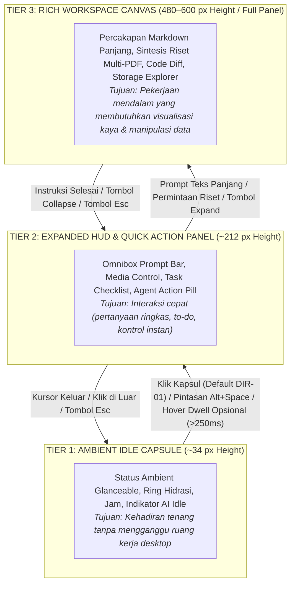

# Hime UX & Interaction Architecture Specification

- **Document ID:** HIME-UX-AND-INTERACTION-ARCHITECTURE
- **Task ID:** TASK-02-04 / TASK-02-04D (Product Requirements & Experience Architecture)
- **Phase:** Phase 02 — Nusa Reverse Engineering & Architecture Discovery (Product Specification)
- **Authority:** Principal Interaction Designer & Lead AI Systems Architect
- **Status:** **APPROVED ARCHITECTURAL SPECIFICATION**
- **Date:** 2026-11-08

---

## 1. Executive Summary

Dokumen ini mendefinisikan arsitektur pengalaman pengguna (*User Experience / UX*) dan model interaksi komprehensif untuk **Hime**.

Berdasarkan pembelajaran rekayasa balik dari aplikasi referensi Nusa pada TASK-02-03 (keunggulan windowing non-disruptif, transparansi klik per-piksel, dan estetika Dynamic Island modern) serta evaluasi kelemahan kritisnya (ketiadaan input teks terpadu, ketergantungan 100% pada mouse, dan kanvas kaku 212 px), Hime membangun model interaksi tersendiri yang berorientasi pada **Kecerdasan Agen Otonom & Produktivitas Desktop Keyboard-First**.

Dokumen ini menetapkan **Model Kanvas Elastis 3-Tier (*3-Tier Adaptive Elastic Canvas*)**, aturan transisi keadaan visual, alur interaksi kontekstual, arsitektur informasi, serta penanganan interaksi persetujuan keamanan dan pemulihan kesalahan.

---

## 2. The 3-Tier Adaptive Elastic Canvas Model

Hime mengorganisasikan antarmukanya ke dalam tiga lapisan spasial dinamis yang beradaptasi secara otomatis mengikuti kedalaman tugas pengguna:



### A. Spesifikasi Matriks 3-Tier Canvas

| Parameter Dimensi | Tier 1: Ambient Idle Capsule | Tier 2: Quick Action Panel | Tier 3: Rich Workspace Canvas |
|:---|:---|:---|:---|
| **Rentang Tinggi ($H$)** | **$30 – 36\text{ px}$** (Baseline: $34\text{ px}$) | **$180 – 220\text{ px}$** (Baseline: $212\text{ px}$) | **$480 – 600\text{ px}$** (Proposal Awal Teruji) |
| **Rentang Lebar ($W$)** | **$180 – 240\text{ px}$** (Measured idle: 84–240 px)| **$680 – 740\text{ px}$** (Baseline: $740\text{ px}$) | **$740 – 840\text{ px}$** (Adaptif pada Ultrawide) |
| **Bentuk Sudut (*Corner*)** | Continuous Squircle (Radius $17\text{ px}$) | Continuous Squircle (Radius $24\text{ px}$) | Continuous Squircle (Radius $24\text{ px}$) |
| **Tingkat Transparansi** | Solid Deep Dark (`#0C0C0C`, Opacity 95%) | Acrylic Frosted Glass (`#151517` + DWM Blur) | Deep Slate Surface (`#1C1C1E`, Solid / Subtle Blur) |
| **Perilaku Hit-Testing** | `HTCLIENT` pada pil; `HTTRANSPARENT` kanvas | `HTCLIENT` pada kartu; `HTTRANSPARENT` kanvas | `HTCLIENT` penuh pada kanvas aktif |
| **Pencurian Fokus Ketik** | Tidak mencuri (`WS_EX_NOACTIVATE`) | Tidak mencuri kecuali input Omnibox aktif | Fokus kursor pada workspace editor aktif |
| **Kriteria Aktivasi** | Default saat aplikasi berjalan di background | Klik kiri pada kapsul (Default DIR-01), `Alt+Space`, atau hover diam $>250\text{ ms}$ (opsi) | Perintah AI panjang, tabel Markdown, diff kode |

> [!NOTE]
> Dimensi kanvas Tier 3 (480–600 px) merupakan **proposal desain awal Hime** yang dirancang untuk mengatasi kelemahan kanvas kaku Nusa (212 px). Dimensi ini wajib divalidasi melalui pengujian kegunaan (*usability testing*) pada siklus implementasi untuk menguji kenyamanan membaca teks panjang pada layar monitor dengan resolusi standar (1366×768 px).

---

## 3. Decision Matrix: Kapan Hime Berada di Setiap Tier?

Tabel aturan keputusan berikut menentukan secara deterministik status kanvas Hime berdasarkan pemicu dan konteks pengguna:

| Peristiwa / Pemicu Pengguna (*User Trigger*) | Konteks Aktivitas | Tier Kanvas Target | Justifikasi Ergonomi |
|:---|:---|:---:|:---|
| **Aplikasi baru menyala (Cold Boot / Startup)** | Desktop baru dibuka, pengguna mulai bekerja | **Tier 1 (Ambient)** | Memberikan ketenangan; tidak mengganggu alur start-up pengguna. |
| **Penekanan tombol global `Alt + Space`** | Pengguna ingin bertanya atau memberi perintah cepat | **Tier 2 (Quick Action)** | Membuka Omnibox instan dengan kolom input terfokus di tengah atas. |
| **Klik kiri pada kapsul idle (Default DIR-01)** | Pengguna ingin membuka panel ekspansi atau memeriksa kontrol | **Tier 2 (Quick Action)** | Default interaksi eksplisit; menghilangkan risiko aktivasi tak sengaja saat kursor melintas. |
| **Kursor hover di atas kapsul idle (> 250 ms, Konfigurasi)** | Pengguna mengaktifkan opsi hover peek di Settings | **Tier 2 (Quick Action)** | Mengintip kontrol tanpa mengklik jika diaktifkan pengguna; delay 250 ms mencegah pemicu aksidental. |
| **Jawaban AI memuat ringkasan pendek ($\le 3$ baris)** | Konversi mata uang, definisi istilah, konfirmasi to-do | **Tier 2 (Quick Action)** | Jawaban selesai dibaca dalam 5 detik; panel segera tertutup saat kursor menjauh. |
| **Jawaban AI memuat blok kode, tabel, atau draf memo** | Analisis data, draf dokumen, refaktor kode | **Tier 3 (Rich Canvas)** | Konten membutuhkan ruang vertikal dan scrollbar untuk dibaca secara nyaman. |
| **Pengguna men-drop $\ge 2$ berkas PDF atau kode** | Pengguna ingin analisis multi-dokumen | **Tier 3 (Rich Canvas)** | Kanvas menyajikan ringkasan berkas tersemat dan ruang percakapan luas. |
| **Hermes Agent mengeksekusi multi-step reasoning** | Agen menjalankan shell test, audit berkas, build | **Tier 2 $\rightarrow$ Tier 3** | Tier 2 menampilkan progres ringkas; jika pengguna klik log, berekspansi ke Tier 3. |
| **Penekanan tombol `Esc` atau Klik di Luar (*Outside*)** | Pengguna selesai berinteraksi dan kembali ke kerja | **Tier 1 (Ambient)** | Menyusutkan jendela seketika ke kapsul idle tanpa mengunci desktop. |

---

## 4. Modalitas Interaksi Utama (Core Interaction Modalities)

### A. Interaksi Perintah & Omnibox (Command Interaction)
- **Desain Input Bar:** Kolom teks Omnibox terletak di bagian paling atas panel ekspansi. Dilengkapi dengan ikon status agen di sebelah kiri dan badge konteks (misal: `[Model: Claude-3.5-Sonnet]`, `[File: memo.docx]`) di sisi kanan.
- **Navigasi Riwayat Prompt:** Menekan tombol panah $\uparrow$ (*Up Arrow*) memunculkan kembali perintah sebelumnya dari memori lokal; tombol $\downarrow$ (*Down Arrow*) memajukan riwayat.
- **Auto-Complete & Slash Commands:** Mengetik karakter `/` memunculkan menu dropdown perintah cepat (misal: `/audit`, `/clean-downloads`, `/todo`, `/reset-context`).

### B. Interaksi Percakapan (Conversational Interaction)
- **Tampilan Balon Obrolan Berjenjang:** Pesan pengguna ditampilkan sebagai kartu ringkas di sisi kanan (`#28282A`); respons AI disajikan sebagai surface Markdown terstruktur di sisi kiri (`#1C1C1E`).
- **Kontrol Streaming Interaktif:** Saat token sedang mengalir, tombol di sisi input bar berubah menjadi tombol `[ Stop ]` berwarna aksen merah lembut; setelah selesai mengalir, tombol berubah kembali menjadi tombol kirim `[ Enter ]`.
- **Salin Sekali Klik (*One-Click Copy*):** Setiap blok kode dilengkapi dengan tombol salin mengapung (*copy overlay button*) di sudut kanan atas blok kode.

### C. Interaksi Alur Kerja Agen (Agent Activity Interaction)
- **Penyajian Status Non-Intrusif:** Saat agen berpikir atau memanggil alat, kapsul idle menampilkan animasi detak halus (*subtle pulse*) warna biru muda `#38BDF8`.
- **Struktur Kartu Aktivitas:** Kartu aktivitas menampilkan:
  1. *Nama Tindakan:* Misal `shell_exec("npm run build")`.
  2. *Status Indikator:* Ikon loading berputar $\rightarrow$ Ikon centang hijau $\rightarrow$ Waktu eksekusi (misal: `1.2s`).
  3. *Tombol Rincian:* Klik untuk membuka terminal log drawer.

### D. Interaksi Persetujuan Keamanan (Approval Interaction)
- **Modal Otorisasi Interaktif:** Saat agen mengajukan tindakan berisiko tinggi (misal: eksekusi shell, penghapusan file, akses jaringan/perangkat), Hime Core (Policy Enforcement Point) memblokir eksekusi dan memunculkan **Interactive Action Approval Modal** tepat di tengah kanvas panel. Modal ini berfungsi sebagai antarmuka persetujuan pengguna (*user consent interface*), bukan batas keamanan kriptografis independen.
- **Perlindungan Klik Terburu-Buru (*Anti-Slip Affordance*):** Tombol `[ Izinkan Sekali ]` dinonaktifkan selama 500 ms pertama dengan visual progress bar tipis. Jeda ini bertindak sebagai kontrol ergonomi anti-slip untuk mencegah pengguna mengklik konfirmasi secara refleks sebelum membaca konteks perintah.
- **Rincian Perintah Eksplisit:** Parameter perintah ditampilkan dalam font monospace tebal dengan path absolut dan kategori risiko yang jelas.
- **Opsi Respons Terstruktur:** Pengguna dapat memilih `[ Izinkan Sekali ]` (TTL 60s), `[ Izinkan Selama Sesi Ini ]` (TTL 15m), atau `[ Tolak / Batal ]`. Penolakan mengirimkan kode error terstruktur ke agen dengan *anti-looping guard* agar agen tidak mengulang permintaan yang sama.

### E. Interaksi Pembatalan & Pemulihan Kesalahan (Error & Recovery Interaction)
- **Pesan Galat Ramah & Dapat Ditindaklanjuti (*Actionable Errors*):** Hime tidak pernah menampilkan stack trace teknis mentah kepada pengguna umum. Jika koneksi 9Router terputus, sistem menampilkan:
  *"Koneksi ke gateway 9Router terputus. Pastikan port 20128 aktif."* dengan tombol `[ Coba Sambung Ulang ]` dan `[ Periksa Log ]`.
- **Jurnal Pembatalan (Undo Toast):** Setiap pemindahan berkas otomatis menyajikan kartu toast mengapung dengan tombol `[ Batalkan Pemindahan / Undo ]` yang aktif selama 30 detik.

---

## 5. Arsitektur Informasi & Tata Letak Spasial (Information Architecture)

Diagram tata letak spasial berikut memetakan hierarki visual komponen di dalam kanvas Hime:

```text
+----------------------------------------------------------------------------------------------------+ Top = 0
|                                  [ KAPSUL AMBIENT TIER 1 ]                                          |
|                                [Ring Hijau] 14:30 [Status AI]                                      |
+----------------------------------------------------------------------------------------------------+
|                                                                                                    |
|  +----------------------------------------------------------------------------------------------+  |
|  | OMNIBOX PROMPT BAR (Tier 2/3)                                                [Badge Model]   |  |
|  | > Ketik pertanyaan, perintah shell, atau seret berkas ke sini...            [Tombol Kirim]  |  |
|  +----------------------------------------------------------------------------------------------+  |
|                                                                                                    |
|  +----------------------------------------------------------------------------------------------+  |
|  | AREA KONTEN AKTIF / WORKSPACE SURFACE (Tier 2 / Tier 3)                                      |  |
|  |                                                                                              |  |
|  |  [Tampilan 1: Obrolan Markdown AI]       [Tampilan 2: Agent Activity Stream]                 |  |
|  |  - Paragraf streaming token             - Linimasa eksekusi tools                           |  |
|  |  - Blok kode sintaksis & diff            - Log terminal stdout/stderr                        |  |
|  |                                                                                              |  |
|  |  [Tampilan 3: Storage & File Manager]    [Tampilan 4: Today Checklist & Jadwal Shalat]       |  |
|  |  - Ubin berkas tersemat                 - To-do list harian lokal                           |  |
|  |  - Resolusi konflik unduhan             - Hitung mundur shalat Kemenag                      |  |
|  +----------------------------------------------------------------------------------------------+  |
|                                                                                                    |
|  +----------------------------------------------------------------------------------------------+  |
|  | BARIS STATUS & KONTROL BAWAH (Bottom Utility Bar)                                            |  |
|  | [Status Gateway: 127.0.0.1:20128]               [Tombol Pengaturan] [Tombol Collapse Esc]    |  |
|  +----------------------------------------------------------------------------------------------+  |
+----------------------------------------------------------------------------------------------------+
```

---

## 6. Prinsip Ergonomi Desktop: Mengatasi Kelemahan Nusa

Sesuai arahan rekayasa balik, Hime membedakan diri secara radikal dari kelemahan desain Nusa:

1. **Menggantikan Ketergantungan Mouse Murni dengan Omnibox Keyboard-First:**
   Nusa mewajibkan pengguna meraih mouse untuk setiap interaksi. Hime menempatkan keyboard shortcut global (`Alt + Space`) sebagai pintu masuk utama, memungkinkan seluruh alur kerja diselesaikan dalam hitungan detik.
2. **Menggantikan Kanvas Kaku 212 px dengan Kanvas Elastis 3-Tier:**
   Batas 212 px Nusa tidak mampu menampilkan teks panjang. Kanvas Hime bertransformasi secara proporsional hingga 540–600 px saat membaca draf dokumen atau blok kode, dengan scrollbar virtual ramping yang elegan.
3. **Mengeliminasi Ekspansi Tak Sengaja pada Mode Hover:**
   Nusa sering berekspansi tak sengaja saat kursor pengguna melintas menuju tab peramban. Hime menerapkan threshold dwell cerdas (250 ms) serta menyediakan konfigurasi mode klik sebagai opsi default yang aman.
4. **Mempertahankan Keunggulan Terbaik Nusa:**
   Hime mempertahankan keanggunan penempatan di tepi atas layar (*top-docked island*), sudut membulat continuous squircle tanpa kedipan (*zero-flicker DirectComposition*), dan transparansi tembus-klik per-piksel (`WM_NCHITTEST` `HTTRANSPARENT`).
