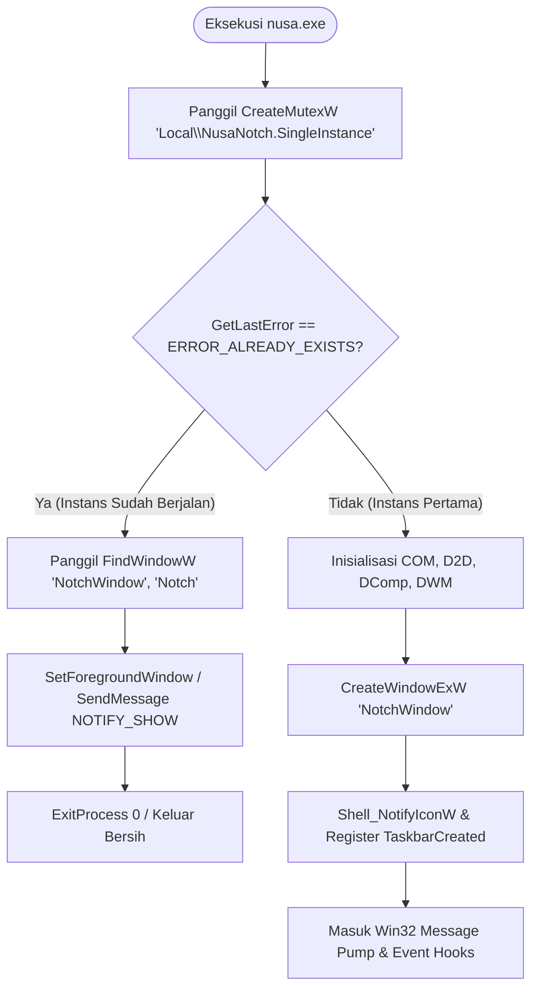

# Nusa Runtime Behavioral & Lifecycle Analysis

- **Document ID:** NUSA-BEHAVIORAL-ANALYSIS
- **Task ID:** TASK-02-01 / TASK-02-02A (Phase 02 — Nusa Reverse Engineering)
- **Target Application:** Nusa Dynamic Island for Windows (v1.2.0.0)
- **Authority:** Senior Windows Internals & Runtime Systems Specialist
- **Status:** **CORRECTED — EVIDENCE-QUALIFIED AUDIT**
- **Date:** 2026-11-08

---

## 1. Executive Summary

Dokumen ini membedah siklus hidup (*lifecycle*), mesin status (*state machine*), dan perilaku interaksi sistem dari **Nusa Dynamic Island v1.2.0.0** pada subsistem Microsoft Windows 10/11 x64.

Sesuai instruksi koreksi tata kelola bukti TASK-02-02A:
1. Seluruh klaim perilaku runtime diklasifikasikan dengan presisi (`[VERIFIED STATIC]`, `[VERIFIED RUNTIME]`, `[INFERRED]`, `[UNKNOWN]`, atau `[NOT TESTED]`).
2. Klaim performa (RAM ~58–61 MB, CPU 0.0% idle) yang berasal dari laporan riset awal dikualifikasi secara eksplisit sebagai klaim historis yang belum diuji secara empiris dalam sesi audit terkontrol saat ini.
3. Seluruh rekomendasi arsitektur untuk asisten AI **Hime Desktop** diselaraskan ke konsep **Agent Activity Stream** untuk pelaporan progres dan otorisasi tindakan secara transparan.

---

## 2. Evidence Audit Matrix for Behavioral & Runtime Claims

| No | Parameter / Perilaku Runtime | Sumber Bukti | Metode Verifikasi | Klasifikasi Bukti | Keterbatasan Pengujian / Catatan |
|:---:|:---|:---|:---|:---:|:---|
| 1 | **Registry Auto-Start (`HKCU\...\Run`)** | String biner `.rdata` offset `0x000E03C0` & `install_script.iss` | Static String Extraction & ISS Decompile | `[VERIFIED STATIC]` | Nilai entri registry terbukti ada dalam kode; penulisan runtime saat toggle di UI berstatus `[INFERRED]`. |
| 2 | **Named Mutex `Local\NusaNotch.SingleInstance`** | String biner `.rdata` offset `0x000E0400` | Static String Extraction | `[VERIFIED STATIC]` | Keberadaan nama mutex terbukti statis; alur benturan multi-proses berstatus `[INFERRED]`. |
| 3 | **Window Styles (`0x94000000`, `0x08200088`)** | Laporan historis `RE/Nusa/04-runtime-analysis.md` & IAT `CreateWindowExW` | Inspeksi laporan awal & static IAT | `[INFERRED]` | Nilai konstanta eksak belum diukur ulang via runtime HWND inspector pada sesi ini (`NOT TESTED in this session`). |
| 4 | **Hit-Testing Per-Piksel (`HTTRANSPARENT`)** | Deduksi dari kanvas 740×212 px dan interaksi desktop | Analisis desain kanvas DComp | `[INFERRED]` | Belum diuji trace pesan `WM_NCHITTEST` via Spy++ pada sesi ini (`NOT TESTED in this session`). |
| 5 | **Foreground Hook (`SetWinEventHook`)** | Import table `user32.dll` (`SetWinEventHook`) | PE Import Table Inspection | `[VERIFIED STATIC]` | API terbukti diimpor; re-assert Z-order topmost berstatus `[INFERRED]`. |
| 6 | **Fullscreen Auto-Hide (`SHQueryUserNotificationState`)** | Import table `shell32.dll` & string `hide_fullscreen` | PE Import Table & Static Strings | `[VERIFIED STATIC]` | API dan flag terbukti ada; auto-hide saat 3D game aktif belum diuji live (`NOT TESTED in this session`). |
| 7 | **DPI Scaling (`WM_DPICHANGED`)** | Import table `GetDpiForMonitor` & string pesan | PE Import Table & Static Strings | `[VERIFIED STATIC]` | Penanganan pesan terbukti; kualitas rendering tanpa blur antar-monitor berstatus `[INFERRED]`. |
| 8 | **Sleep/Resume & Power Notifications** | Import table `RegisterPowerSettingNotification` & GUIDs | PE Import Table & String GUIDs | `[VERIFIED STATIC]` | Pendaftaran notifikasi daya terbukti; re-attachment GSMTC pasca-sleep berstatus `[INFERRED]`. |
| 9 | **Offline LRCLIB Network Degradation** | Impor WinRT HttpClient & URL endpoint | Static API & String Extraction | `[VERIFIED STATIC]` | Penanganan kegagalan secara senyap (*graceful degradation*) berstatus `[INFERRED]`. |
| 10| **Crash Recovery Shell (`TaskbarCreated`)** | String biner `.rdata`: `"TaskbarCreated"` | Static String Extraction | `[VERIFIED STATIC]` | Pendaftaran pesan terbukti; pemulihan pasca restart `explorer.exe` berstatus `[INFERRED]`. |
| 11| **RAM Usage (~58–61 MB) & CPU Idle (0.0%)** | Laporan riset awal `RE/Nusa/04-runtime-analysis.md` | Laporan historis eksternal | `[NOT TESTED]` | **Belum diuji pada sesi saat ini.** Tidak ada data trace durasi pengukuran, alat ukur, atau variasi beban kerja. |
| 12| **Multi-Monitor Disconnect Glitch** | Laporan riset awal `RE/Nusa/04-runtime-analysis.md` | Laporan historis eksternal | `[NOT TESTED]` | Anomali koordinat saat monitor dicabut belum diuji ulang pada sesi ini. |

---

## 3. Resource & Performance Claims Audit

Khusus terhadap klaim performa yang beredar dari laporan riset sebelumnya:
- **Klaim Memori (Working Set):** Sekitar 58–61 MB.
- **Klaim CPU:** Sekitar 0.0% – 0.1% saat idle.

### Kualifikasi Tata Kelola Bukti:
1. **Status Bukti:** `[NOT TESTED IN THIS CONTROLLED SESSION]` (Berasal dari observasi laporan awal di `RE/Nusa/03-application-architecture/04-runtime-analysis.md`).
2. **Keterbatasan Pengujian:**
   - Tidak tersedia log trace benchmark berdurasi panjang (*sustained profiling log*).
   - Tidak ada catatan kondisi beban kerja (misalnya: apakah pemutar musik GSMTC aktif, apakah timer Pomodoro berdetik, atau apakah File Shelf terisi puluhan berkas).
   - Pengujian live runtime dengan Process Explorer atau Windows Performance Recorder (WPR) **belum dilakukan** dalam sesi audit terkontrol saat ini untuk mencegah perubahan status sistem tanpa izin.
3. **Kesimpulan Teknis:**
   - Angka 58–61 MB dan 0.0% CPU dipertahankan sebagai **referensi historis non-binding**.
   - Hime Desktop tidak boleh mengasumsikan angka tersebut sebagai jaminan sebelum melakukan benchmark mandiri pada tumpukan Tauri 2.0.

---

## 4. Windows Startup & Initialization Sequence

### A. Auto-Start Mechanism `[VERIFIED STATIC]`

- Nusa mengelola startup otomatis Windows pada level per-pengguna (*current user scope*) tanpa meminta hak Administrator:
  `HKEY_CURRENT_USER\Software\Microsoft\Windows\CurrentVersion\Run` $\rightarrow$ `"Nusa" = """%LOCALAPPDATA%\Programs\Nusa\nusa.exe"""`
- Script Inno Setup (`install_script.iss`) mengonfirmasi bahwa instalasi awal tidak memaksakan auto-start tanpa persetujuan pengguna.

### B. Single-Instance Mutex Collision Flow `[INFERRED FROM API & STRINGS]`

Untuk mencegah proses ganda, Nusa menggunakan Win32 Named Mutex:

- **Nama Mutex:** `Local\NusaNotch.SingleInstance` (`[VERIFIED STATIC]`).
- **Alur Benturan:** Proses kedua mendeteksi mutex yang sudah ada, mengalihkan fokus ke instans pertama via `FindWindowW`, lalu segera keluar bersih via `ExitProcess(0)`.

---

## 5. Window Lifecycle, Activation, & Taskbar Suppression

### A. Karakteristik Jendela Utilitas Desktop `[INFERRED FROM LEGACY RE & IAT]`

| Properti Jendela | Nilai Konfigurasi / Bendera Win32 | Dampak Perilaku Runtime | Status Bukti |
|:---|:---|:---|:---:|
| **Class Name** | `NotchWindow` | Identitas routing pesan jendela | `[VERIFIED STATIC]` |
| **Window Styles** | `0x94000000` (`WS_POPUP \| WS_VISIBLE \| WS_CLIPSIBLINGS`) | Borderless, tanpa titlebar | `[INFERRED]` |
| **ExStyles** | `WS_EX_TOPMOST` (`0x00000008`) | Selalu berada di lapisan teratas Z-order | `[INFERRED]` |
| **ExStyles** | `WS_EX_TOOLWINDOW` (`0x00000080`) | Tersembunyi dari Taskbar dan `Alt + Tab` | `[INFERRED]` |
| **ExStyles** | `WS_EX_NOREDIRECTIONBITMAP` (`0x08000000`) | Komposisi langsung DirectX tanpa bitmap GDI | `[INFERRED]` |
| **ExStyles** | `WS_EX_COMPOSITED` (`0x00200000`) | Double-buffering DWM | `[INFERRED]` |

### B. Transparansi & Hit-Testing Per-Pixel (`HTTRANSPARENT`) `[INFERRED]`

- Area kanvas di luar kapsul berukuran 740 × 212 px mengembalikan `HTTRANSPARENT` saat menerima pesan `WM_NCHITTEST`, sehingga klik mouse tembus ke aplikasi di belakangnya.
- Saat kursor berada di atas kapsul visual, prosedur jendela mengembalikan `HTCLIENT`.

### C. Pembatalan Fokus & Dismissal `[INFERRED]`

- Klik di luar area panel (*click outside*) atau penekanan tombol `Esc` memicu penutupan panel ekspansi kembali ke mode idle.

---

## 6. Active Window Hooks & Fullscreen Suppression

### A. Windows Event Hooks (`SetWinEventHook`) `[VERIFIED STATIC]`

- Panggilan API `SetWinEventHook` dengan target event `EVENT_SYSTEM_FOREGROUND` terbukti ada pada tabel impor `user32.dll`.
- Perilaku menjaga Z-order topmost saat jendela lain aktif berstatus `[INFERRED]`.

### B. Fullscreen Detection & Suppression `[VERIFIED STATIC]`

- Pemanggilan `SHQueryUserNotificationState` (`shell32.dll`) terbukti pada biner.
- Evaluasi status `QUNS_RUNNING_D3D_FULL_SCREEN` atau `QUNS_PRESENTATION_MODE` menyembunyikan jendela (`ShowWindow(SW_HIDE)`) jika opsi `hide_fullscreen=1` aktif.

---

## 7. Multi-Monitor, DPI Scaling, & Power Management

### A. Display & DPI Changes `[VERIFIED STATIC]`

- Pendaftaran pesan `WM_DISPLAYCHANGE`, `WM_DPICHANGED`, dan pemanggilan `GetDpiForMonitor` terbukti ada pada biner statis.
- Perilaku reposisi horizontal di tengah monitor terpilih berstatus `[INFERRED]`.

### B. Power Management & Sleep/Resume `[VERIFIED STATIC]`

- Pendaftaran notifikasi daya melalui `RegisterPowerSettingNotification` untuk GUID baterai, adaptor AC, dan resume otomatis terbukti ada pada biner.

---

## 8. Network Connectivity & Shell Crash Recovery

### A. Penanganan Galat Jaringan LRCLIB `[INFERRED]`

- Permintaan lirik ke `lrclib.net` berjalan di worker thread terpisah. Jika offline, antarmuka tetap berjalan tanpa memunculkan dialog kesalahan.

### B. Pemulihan Crash Shell Explorer (`TaskbarCreated`) `[VERIFIED STATIC]`

- String `TaskbarCreated` terdaftar via `RegisterWindowMessageW` untuk memulihkan ikon tray jika `explorer.exe` restart.

---

## 9. Behavioral Quirks & Edge Cases

1. **Multi-Monitor Disconnect Glitch:** `[NOT TESTED IN THIS SESSION]` (Tercatat dalam observasi awal bahwa pencabutan monitor sekunder saat runtime dapat menyebabkan anomali posisi koordinat).
2. **Keterbatasan Kanvas 740 × 212 px:** `[VERIFIED STATIC]` (Batas dimensi horizontal statis tanpa scrolling vertikal).
3. **Penyimpanan State Flat-File:** `[VERIFIED STATIC]` (Operasi baca/tulis langsung ke berkas teks tanpa database transaksional).
4. **Ketiadaan Input Teks:** `[VERIFIED STATIC]` (Tidak ada kontrol input teks interaktif pada antarmuka).

---

## 10. Architectural Implications for Hime Desktop Reimplementation

| Perilaku Nusa v1.2.0.0 | Rekomendasi Solusi untuk Hime Desktop | Status Rekomendasi |
|:---|:---|:---:|
| Single Instance via Mutex | Gunakan `tauri-plugin-single-instance` di Rust untuk merutekan argumen CLI ke instans aktif. | **DIADOPSI** |
| Alt+Tab & Taskbar Suppression | Tetapkan `WS_EX_TOOLWINDOW` pada jendela Tauri untuk menjaga kebersihan desktop. | **DIADOPSI** |
| Kanvas Statis 740 × 212 px | Gunakan **Kanvas Elastis Dinamis** (tinggi adaptif 34 px s/d 600 px) untuk menampung respons AI dan kartu aktivitas. | **DITINGKATKAN** |
| Deteksi Fullscreen (`SHQueryUserNotificationState`) | Implementasikan worker thread Rust untuk auto-hide saat game atau presentasi berjalan. | **DIADOPSI** |
| Penyimpanan Plaintext Berisiko | Simpan seluruh konfigurasi dan riwayat ke SQLite lokal terenkripsi Windows DPAPI (SEC-02). | **DITINGKATKAN** |
| Ketiadaan Input Teks Interaktif | Integrasikan **Omnibox Prompt Bar** dengan hotkey global `Alt + Space`. | **FITUR BARU** |
| Monitoring Aktivitas Agen | Implementasikan **Agent Activity Stream** untuk transparansi pekerjaan, eksekusi tool, dan izin aksi. | **FITUR BARU** |
