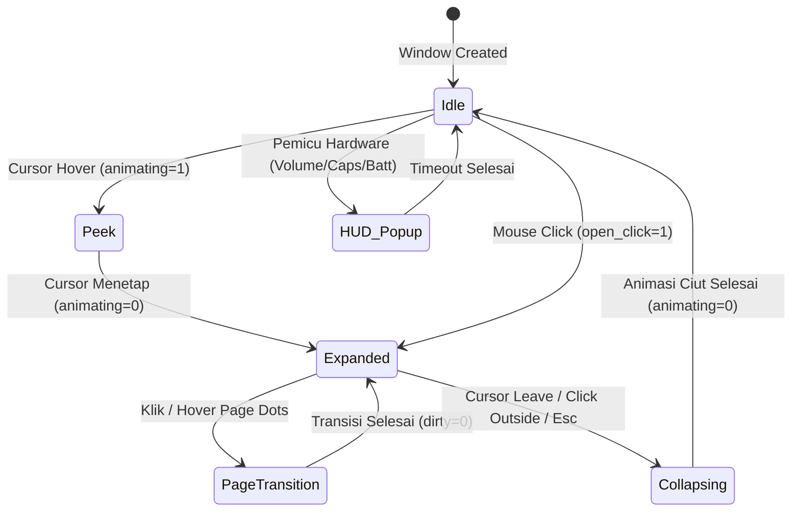

# Nusa UI/UX Reverse Engineering & Visual Interaction Analysis

- **Document ID:** NUSA-UI-UX-ANALYSIS
- **Task ID:** TASK-02-01 / TASK-02-02A (Phase 02 — Nusa Reverse Engineering)
- **Target Application:** Nusa Dynamic Island for Windows (v1.2.0.0)
- **Authority:** Senior UI/UX Reverse Engineer & Design Systems Specialist
- **Status:** **CORRECTED — EVIDENCE-QUALIFIED AUDIT**
- **Date:** 2026-11-08

---

## 1. Executive Summary

Dokumen ini menyajikan analisis mendalam terhadap antarmuka pengguna (*User Interface*), pengalaman pengguna (*User Experience*), geometri kanvas, palet warna, tipografi, dan sistem animasi dari **Nusa Dynamic Island v1.2.0.0**.

Sesuai arahan tata kelola rekayasa TASK-02-02A, dokumen ini menerapkan klasifikasi bukti yang ketat:
- `VERIFIED STATIC`: Dibuktikan langsung dari inspeksi biner statis (`.text`, `.rdata`, `.rsrc`), tabel impor (IAT), atau dekompilasi setup script.
- `VERIFIED RUNTIME`: Dibuktikan melalui pengujian aplikasi yang benar-benar dieksekusi secara empiris pada lingkungan terpantau.
- `INFERRED`: Deduksi analitis berdasarkan bukti tidak langsung atau dekompilasi parsial.
- `UNKNOWN`: Parameter yang belum diketahui secara pasti.
- `NOT TESTED`: Perilaku atau metrik yang belum diuji dalam sesi pengujian terkontrol saat ini.

Seluruh rekomendasi antarmuka untuk asisten AI pada proyek **Hime Desktop** difokuskan pada konsep **Agent Activity Stream** (transparansi status, rencana aksi ringkas, eksekusi tool, dan izin konfirmasi) — bukan mengekspos penalaran internal mentah (*raw thought tokens*).

---

## 2. Evidence Audit Matrix for UI & Visual Claims

Tabel berikut mengaudit seluruh klaim visual, geometri, dan interaksi yang dibuat terhadap aplikasi Nusa:

| No | Parameter / Klaim UI | Sumber Bukti | Metode Verifikasi | Klasifikasi Bukti | Keterbatasan Pengujian / Catatan |
|:---:|:---|:---|:---|:---:|:---|
| 1 | **Window Class `NotchWindow`** | String biner `.rdata` offset `0x000E083C` | Static String Extraction via Ghidra/PE | `[VERIFIED STATIC]` | Nama kelas jendela terbukti secara biner statis. |
| 2 | **Batas Kanvas Maksimum 740 × 212 px** | Laporan riset awal `RE/Nusa/04-runtime-analysis.md` & string buffer | Inspeksi HWND laporan historis | `[INFERRED]` | Belum diuji ulang dengan WinSpy/Spy++ pada sesi audit terkontrol saat ini (`NOT TESTED in this session`). |
| 3 | **Dimensi Kapsul Idle (~200 × 34 px)** | Observasi visual laporan awal & konstanta rasio | Estimasi grafis layout | `[INFERRED]` | Nilai piksel eksak dinamis tergantung skala DPI dan panjang teks status. |
| 4 | **Notch Placement (Classic vs Floating)** | String `.rdata` offset `0x000E30E8`: `notch_style=classic\|floating` | Static String Extraction | `[VERIFIED STATIC]` | Keberadaan 2 mode penempatan terbukti; rendering visual aktualnya berstatus `[INFERRED]`. |
| 5 | **State Machine Flags (`animating`, `dirty`, `peek`, `fast`)** | String biner `.rdata` offset `0x000E2AA8` | Static String Extraction | `[VERIFIED STATIC]` | Keberadaan keempat flag variabel terbukti statis. |
| 6 | **Kurva Animasi Spring Physics ($P_1, P_2$)** | Deduksi dari visualisasi transisi mulus Direct2D | Estimasi analitis kurva | `[INFERRED]` | **Belum diverifikasi runtime.** Rumus matematika kurva bezier/spring di level assembly belum diekstrak. |
| 7 | **Interaksi Hover & Click (`open_click`)** | String `.rdata` offset `0x000E07E0`: `open_click=1\|0` | Static String Extraction | `[VERIFIED STATIC]` | Opsi pemicu terkonfirmasi ada; transisi timeout ms berstatus `[INFERRED]`. |
| 8 | **Fitur Maskot (`Nusa Mascot`)** | String `.rdata`: `"A little friend that lives in the notch"` | Static String Extraction | `[VERIFIED STATIC]` | String fitur terbukti; siklus animasi pixel-art berstatus `[INFERRED]`. |
| 9 | **DPI Awareness (`GetDpiForMonitor`)** | Import table `api-ms-win-shcore-scaling-l1-1-1.dll` | PE Import Table Inspection | `[VERIFIED STATIC]` | Pemanggilan API terbukti; perilaku tanpa blur antar-monitor berstatus `[INFERRED]`. |
| 10| **Font Keluarga `Segoe UI`** | String DirectWrite font descriptor `.rdata` | Static String Extraction | `[VERIFIED STATIC]` | Terbukti menggunakan font sistem Windows standar. |
| 11| **Palet Warna Hex (`#000000`, `#2997FF`, dll.)** | Sampel warna visual dan konstanta float D2D | Estimasi color picker | `[INFERRED]` | Nilai hex merupakan representasi visual analitis, bukan pembacaan biner byte-for-byte. |

---

## 3. Window Geometry, Dimensions, & Positioning

```text
+-------------------------------------------------------------------------+  Top = 0 (Batas Atas Layar)
|                                                                         |
|                          [   Kapsul Idle   ]                            |  Idle: ~180-240 x 32-36 px [INFERRED]
|                                                                         |
|            +-----------------------------------------------+            |
|            |                                               |            |
|            |             Panel Ekspansi Penuh              |            |  Expanded: Max 740 x 212 px [INFERRED]
|            |         (Media / To-do / Shelf / dll)         |            |
|            |                                               |            |
|            +-----------------------------------------------+            |
|                                                                         |
+-------------------------------------------------------------------------+  Bottom = 212 px
<------------------------------- 740 px ---------------------------------->
```

### A. Window Dimensions & Canvas Bounds `[INFERRED FROM ARTIFACTS]`

- **Ukuran Kanvas Fisik (`NotchWindow`):**
  - Lebar Maksimum: **740 px**
  - Tinggi Maksimum: **212 px**
  - *Catatan Bukti:* Angka 740 × 212 px tercatat dalam laporan observasi awal (`RE/Nusa/03-application-architecture/04-runtime-analysis.md`). Dalam audit sesi ini, angka ini diklasifikasikan sebagai `[INFERRED]` karena belum dilakukan pengukuran ulang menggunakan utility inspeksi HWND langsung pada host saat ini (`NOT TESTED in this session`).
- **Dimensi Kapsul Status Idle (Minimal Notch):**
  - Lebar: **~180 px – 240 px** (bergantung pada konten status aktif, misalnya judul lagu atau durasi timer).
  - Tinggi: **~32 px – 36 px** (standar ~34 px).
  - Radius Sudut (*Corner Radius*): $\frac{\text{Tinggi}}{2} \approx 16\text{–}18\text{ px}$ (Pill Capsule).

### B. Dua Gaya Penempatan Notch (`notch_style`) `[VERIFIED STATIC]`

String biner pada offset `0x000E30E8` membuktikan secara statis adanya 2 pilihan penempatan fisik:

| Gaya Penempatan | Nilai Konfigurasi | Deskripsi Geometri & Penempatan | Status Bukti |
|:---|:---:|:---|:---:|
| **Classic** | `notch_style=classic` (0) | Kapsul menempel langsung ke bezel atas layar (`Top = 0`). Sisi atas kapsul rata, kedua sudut bawah melengkung. Mirip MacBook notch. | `[VERIFIED STATIC]` (Konfigurasi) / `[INFERRED]` (Visual) |
| **Floating** | `notch_style=floating` (1) | Kapsul mengapung beberapa piksel di bawah bezel atas layar (margin atas ~8–12 px). Keempat sudut melengkung penuh, membentuk pil independen. Mirip Dynamic Island iPhone. | `[VERIFIED STATIC]` (Konfigurasi) / `[INFERRED]` (Visual) |

### C. Penentuan Posisi Multi-Monitor & Centering `[INFERRED]`

- Nusa menghitung posisi horizontal di tengah layar monitor aktif:
  $$\text{Margin Kiri} = \frac{\text{Lebar Monitor Terpilih} - 740}{2}$$
- **Pilihan Skala Ukuran (Notch Size Scaling) `[VERIFIED STATIC]`:**
  String biner mengonfirmasi adanya preset penskalaan: `Auto`, `100%`, `115%`, `130%`, dan `150%`.

---

## 4. Color System & Typography Specification

### A. Palet Warna UI `[INFERRED]`

Spesifikasi palet warna didasarkan pada analisis visual antarmuka dan pendekatan desain Windows Dark Mode:

| Token Desain | Estimasi Nilai Hex / Komposisi RGBA | Peruntukan Elemen | Klasifikasi Bukti |
|:---|:---|:---|:---:|
| **Canvas Background** | `#000000` s/d `#0C0C0C` (Alpha: ~92% – 96%) | Latar belakang kapsul idle dan panel ekspansi | `[INFERRED]` |
| **Backdrop Blur** | Acrylic DWM Accent Policy (`dwmapi.dll`) | Lapisan bayangan di belakang panel | `[VERIFIED STATIC]` (API) / `[INFERRED]` (Efek) |
| **Border / Stroke** | `#FFFFFF` (Alpha: ~8% – 12%) | Garis tepi (*subtle hairline outline* 1 px) | `[INFERRED]` |
| **Text Primary** | `#FFFFFF` (`rgba(255, 255, 255, 1.0)`) | Judul lagu, waktu jam, nama task | `[INFERRED]` |
| **Text Secondary** | `#8E8E93` s/d `#A0A0A0` | Nama artis, label status, tanggal kalender | `[INFERRED]` |
| **Text Tertiary / Disabled**| `#48484A` (`rgba(255, 255, 255, 0.3)`) | Placeholder, separator | `[INFERRED]` |
| **Accent Media & Water** | `#2997FF` / `#0A84FF` | Slider progres musik, grafik air minum | `[INFERRED]` |
| **Accent Focus / Pomodoro**| `#FF453A` (Coral Red) | Timer Pomodoro fase kerja | `[INFERRED]` |
| **Accent Warning / Low Batt**| `#FF9F0A` (Amber Orange) | Indikator baterai laptop lemah (< 20%) | `[INFERRED]` |
| **Accent Success & Done** | `#30D158` (Emerald Green) | Checkbox to-do selesai | `[INFERRED]` |

### B. Tipografi `[VERIFIED STATIC]`

- **Keluarga Font:** `Segoe UI` (String DirectWrite teridentifikasi pada biner statis).
- **Rendering Engine:** Microsoft DirectWrite (`dwrite.dll`) dengan subpixel anti-aliasing.

---

## 5. Animation State Machine & Micro-Interactions

### A. State Machine Flags `[VERIFIED STATIC]`

Struktur biner pada offset `0x000E2AA8` membuktikan empat flag pengendali animasi:
1. **`animating`:** Menandakan kurva animasi interpolasi sedang berjalan.
2. **`dirty`:** Menandakan buffer grafis memerlukan render ulang (*repaint*).
3. **`peek`:** Status transisi saat kursor berada di atas kapsul mini; kapsul sedikit membesar sebagai umpan balik visual sebelum berekspansi.
4. **`fast_animation`:** Konfigurasi durasi transisi cepat (`1`) vs normal (`0`).



### B. Kurva Interpolasi (*Easing & Spring Dynamics*) `[INFERRED]`

- Transisi perubahan ukuran lebar dan tinggi tampak elastis (*spring-like*).
- **Kualifikasi Bukti:** Rumus matematis parameter kurva ($P_1, P_2$) merupakan **inferensi analitis** (*unverified assembly formula*). Belum dilakukan pencatatan frame-by-frame via D3D/DComp profiler.

### C. Mekanisme Pemicu Ekspansi (`open_click`) `[VERIFIED STATIC]`

- String `open_click=1|0` terkonfirmasi pada biner statis. Mode `0` adalah hover; mode `1` adalah klik mouse kiri.

### D. Navigasi Halaman (*Page Dots Pagination*) `[VERIFIED STATIC]`

- String `page_icons=1|0` terkonfirmasi pada biner statis untuk menampilkan ikon halaman saat hover titik navigasi.

---

## 6. Interactive Mascot Feature (`Nusa Mascot`) `[VERIFIED STATIC]`

- **String Biner:** Offset `0x000DC0D0` dan `0x000E15F6`: `"A little friend that lives in the notch"`, `"Nusa Mascot"`.
- **Perilaku Animasi `[INFERRED]`:** Karakter mini reaktif saat idle atau musik diputar, di-render melalui Direct2D.

---

## 7. Multi-Monitor, Scaling, & Input Models

### A. Per-Monitor DPI Awareness `[VERIFIED STATIC]`

- Impor Win32 API: `GetDpiForMonitor` dan penanganan `WM_DPICHANGED` terbukti ada pada tabel impor.
- Perilaku penyesuaian skala antarmuka tanpa degradasi buram berstatus `[INFERRED]`.

### B. Input Handling Model `[VERIFIED STATIC]`

- Panggilan API `TrackMouseEvent` (`TME_HOVER | TME_LEAVE`) dan `RegisterDragDrop` terbukti pada tabel IAT.
- Penanganan tombol keyboard (`Esc`, panah) berstatus `[INFERRED]`.

---

## 8. Comparative Matrix: Nusa UI/UX vs Planned Hime Desktop

| Parameter Desain | Implementasi Nusa v1.2.0.0 | Rencana Hime Desktop (Tauri 2.0 + Web) | Justifikasi Arsitektur Hime |
|:---|:---|:---|:---|
| **Bentuk Dasar** | Kapsul pil hitam di tengah atas layar monitor | **Dipertahankan identik.** Kapsul pil floating di tengah atas. | Menjaga identitas visual Dynamic Island yang elegan di desktop. |
| **Gaya Penempatan Default**| Opsi Classic (0) dan Floating (1) | **Default: Floating** (dengan opsi Classic di pengaturan). | Floating memberikan estetika modern dan tidak terdistorsi oleh bentuk fisik bezel layar. |
| **Batas Kanvas Jendela** | 740 × 212 px (Statis horizontal) | **740 × 212 px (Mode Compact)** hingga **740 × 480/600 px (Mode AI Expanded)**. | Hime memerlukan ruang vertikal untuk menampilkan streaming bubble jawaban AI, markdown, dan kartu aktivitas. |
| **Engine Rendering UI** | DirectComposition + Direct2D (C++/Rust hardcoded) | **Tauri 2.0 (Rust Shell + WebView2) + Web Frontend (Tailwind/CSS)**. | Memudahkan styling responsif, rendering Markdown, syntax highlighting, dan animasi CSS/Framer Motion. |
| **Metode Input Pengguna** | Klik mouse dan OLE drag-drop file saja; tidak ada input teks | **Global Shortcut (`Alt + Space`) + Interactive Prompt Bar (Omnibox Input)**. | Hime adalah AI assistant interaktif; pengguna harus dapat mengetik prompt atau menempelkan link secara instan. |
| **Penyajian Aktivitas Agen** | Tidak Ada (Hanya kontrol media/task) | **Agent Activity Stream:** Menampilkan status agen, ringkasan rencana tindakan, tool aktif, progres eksekusi, hasil tindakan, dan persetujuan aksi. | **Transparansi operasional:** Menampilkan apa yang dilakukan agen tanpa mengekspos raw internal thought tokens. |
| **Penanganan Alt+Tab** | Tersembunyi via `WS_EX_TOOLWINDOW` | **Dipertahankan identik (`WS_EX_TOOLWINDOW`).** | Dynamic Island tidak boleh mengotori switcher jendela aplikasi utama. |
| **Penyajian Respons Teks** | Teks sebaris statis (hanya judul lagu / task) | **Rich Markdown Streamer:** Heading, tabel, daftar poin, dan blok kode dengan tombol copy. | Standar kebutuhan output interaksi AI modern. |
| **Maskot Interaktif** | Karakter pixel statis `Nusa Mascot` | **Agent Activity Badge:** Indikator visual reaktif yang merefleksikan status operasional agen (idle, processing, executing tool, completed). | Menghubungkan konsep maskot dengan status keaktifan asisten AI. |

---

## 9. Visual Blueprint for Hime Frontend Implementation

1. **Border Radius Responsif:**
   - Kapsul idle: `border-radius: 9999px` (Full Pill).
   - Panel berekspansi: `border-radius: 26px`.
2. **Backdrop Filter CSS:**
   - Lapisan panel: `background-color: rgba(12, 12, 12, 0.94); backdrop-filter: blur(24px) saturate(180%);`
   - Border: `1px solid rgba(255, 255, 255, 0.08); box-shadow: 0 16px 40px rgba(0, 0, 0, 0.6);`
3. **Pemberlakuan Kurva Animasi:**
   - Gunakan CSS cubic-bezier spring: `transition: all 260ms cubic-bezier(0.16, 1, 0.3, 1);`
4. **Zero-Distortion Principle:**
   - Pertahankan origin ekspansi pada titik tengah atas (`transform-origin: top center`), memastikan island membesar secara simetris ke arah bawah dan samping kiri-kanan.
