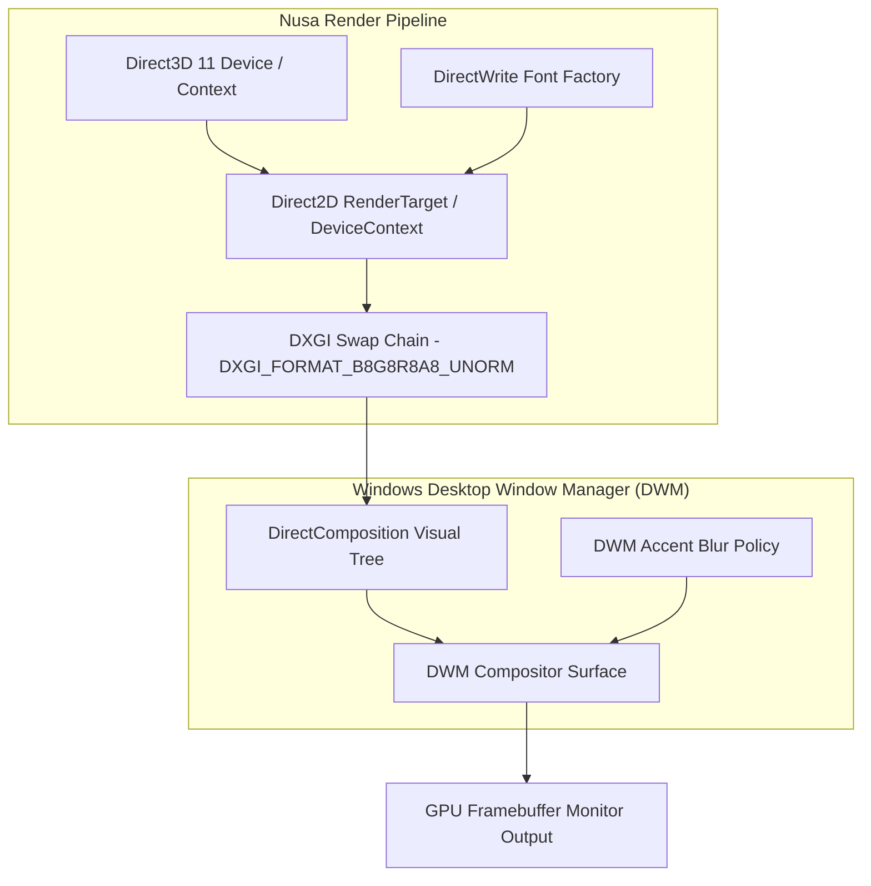

# Nusa Deep Windows Subsystem Integration Analysis

- **Document ID:** NUSA-WINDOWS-INTEGRATION
- **Task ID:** TASK-02-01 / TASK-02-02A (Phase 02 — Nusa Reverse Engineering)
- **Target Application:** Nusa Dynamic Island for Windows (v1.2.0.0)
- **Authority:** Principal Windows Systems Architect & Low-Level Systems Specialist
- **Status:** **CORRECTED — EVIDENCE-QUALIFIED AUDIT**
- **Date:** 2026-11-08

---

## 1. Executive Summary

Dokumen ini menyajikan analisis komprehensif terhadap titik-titik integrasi subsistem Microsoft Windows yang dimanfaatkan oleh **Nusa Dynamic Island v1.2.0.0**.

Sesuai instruksi tata kelola bukti TASK-02-02A, setiap titik integrasi diklasifikasikan secara ketat:
- `[VERIFIED STATIC]`: Dibuktikan melalui tabel impor PE (IAT), deklarasi string Win32/WinRT pada segmen `.rdata`, atau dekompilasi setup script.
- `[INFERRED]`: Disimpulkan dari arsitektur panggilan API dan laporan observasi awal.
- `[NOT TESTED]`: Belum dilakukan pengujian runtime empiris dalam sesi saat ini.

Seluruh temuan ini dirumuskan ke dalam peta translasi arsitektur (*architectural translation map*) untuk diimplementasikan secara mandiri (*clean-room*) pada backend native Rust **Hime Desktop** berbasis **Tauri 2.0** dan crate `windows-rs`.

---

## 2. Low-Level Window Architecture & DWM Graphics Pipeline

### A. Window Styles & Extended Window Styles Deep Dive `[INFERRED FROM LEGACY RE & STATIC IAT]`

Berdasarkan data observasi pada laporan riset awal (`RE/Nusa/03-application-architecture/04-runtime-analysis.md`) serta verifikasi pemanggilan API `CreateWindowExW` pada biner statis:

```text
Window Styles   : 0x94000000 = WS_POPUP | WS_VISIBLE | WS_CLIPSIBLINGS
Extended Styles : 0x08200088 = WS_EX_TOPMOST | WS_EX_TOOLWINDOW | WS_EX_NOREDIRECTIONBITMAP | WS_EX_COMPOSITED
```

| Bendera Win32 | Nilai Heksadesimal | Mekanisme Tingkat Rendah Windows OS | Justifikasi Fungsional Nusa | Status Bukti |
|:---|:---:|:---|:---|:---:|
| **`WS_POPUP`** | `0x80000000` | Membuat jendela tanpa dekorasi bingkai standar (*frameless*), tanpa title bar, atau border pengubah ukuran. | Menjamin tampilan pulau dinamis mengapung murni tanpa artefak jendela konvensional. | `[INFERRED]` |
| **`WS_CLIPSIBLINGS`** | `0x04000000` | Memotong area gambar terhadap jendela selevel untuk mencegah tabrakan visual saat repainting. | Mengisolasi permukaan rendering island dari jendela tingkat atas lainnya. | `[INFERRED]` |
| **`WS_EX_TOPMOST`** | `0x00000008` | Menempatkan HWND pada posisi Z-order teratas di atas seluruh jendela non-topmost Windows. | Memastikan island tetap terlihat saat pengguna membuka peramban, dokumen, atau editor kode. | `[INFERRED]` |
| **`WS_EX_TOOLWINDOW`** | `0x00000080` | Memperlakukan jendela sebagai tool/utility window: tidak memunculkan ikon pada Windows Taskbar dan tidak masuk ke switcher daftar `Alt + Tab`. | Menjaga kebersihan antarmuka multitasking sistem operasi; island berfungsi sebagai overlay ambient. | `[INFERRED]` |
| **`WS_EX_NOREDIRECTIONBITMAP`** | `0x08000000` | **Karakteristik Kritis:** Menginstruksikan DWM bahwa jendela tidak menggunakan GDI bitmap redirection surface. Nusa merender langsung ke DirectX Swapchain. | Mengeliminasi overhead duplikasi memori GDI (~10–30 MB), memungkinkan compositing transparan berbasis GPU 60 FPS dengan latensi nol. | `[INFERRED]` |
| **`WS_EX_COMPOSITED`** | `0x00200000` | Mengaktifkan rendering hirarkis double-buffered melalui DWM composition pipeline. | Menghilangkan kedipan (*flicker*) saat transisi ukuran panel berekspansi atau menyusut. | `[INFERRED]` |

### B. DirectComposition & Acrylic Frosted Glass Pipeline `[VERIFIED STATIC]`

Nusa tidak menggunakan teknik transparansi lama seperti `UpdateLayeredWindow` atau bit GDI RGB, melainkan pipeline grafis modern Windows 10/11:



1. **DXGI Swap Chain Surface (`[VERIFIED STATIC]` via IAT `dxgi.dll` & `d3d11.dll`):**
   - Mengizinkan transparansi per-piksel murni (alpha channel 0 untuk piksel tembus pandang di luar kapsul; alpha tinggi untuk latar kapsul hitam).
2. **DWM Backdrop Blur (`[VERIFIED STATIC]` via IAT `dwmapi.dll`):**
   - Nusa memanggil fungsi DWM (`DwmSetWindowAttribute` / `SetWindowCompositionAttribute`) untuk menghasilkan efek *frosted glass* native.

---

## 3. Process Synchronization & Single-Instance Mutex

### A. Windows Mutex Primitive `[VERIFIED STATIC]`

- **Implementasi:** Win32 API `CreateMutexW` (IAT `kernel32.dll`) dengan argumen string `"Local\\NusaNotch.SingleInstance"` (`[VERIFIED STATIC]`).
- **Ruang Lingkup (Scope):** Prefiks `Local\` membatasi mutex pada sesi terminal interaktif pengguna saat ini.
- **Rute Benturan Instans `[INFERRED]`:**
  - Instans kedua mendeteksi `ERROR_ALREADY_EXISTS`.
  - Mengambil HWND instans pertama via `FindWindowW` (`user32.dll`).
  - Mengirim sinyal aktivasi via `SetForegroundWindow`, lalu keluar bersih via `ExitProcess(0)`.

---

## 4. Shell Integration & Desktop Interactions

### A. Windows System Tray (`Shell_NotifyIconW`) `[VERIFIED STATIC]`

- **Pendaftaran Ikon Baki:** Menggunakan struktur `NOTIFYICONDATAW` via `Shell_NotifyIconW` (`shell32.dll`).
- **Pemulihan Crash Shell Explorer (`TaskbarCreated`):**
  - Mendaftarkan pesan via `RegisterWindowMessageW(L"TaskbarCreated")`.
  - Memulihkan ikon baki secara otomatis saat `explorer.exe` restart (`[INFERRED]`).
- **Startup Otomatis Registry:**
  - String `"Software\Microsoft\Windows\CurrentVersion\Run"` terkonfirmasi pada biner statis (`[VERIFIED STATIC]`).

### B. OLE/COM Drag & Drop Interface `[VERIFIED STATIC]`

- Untuk fitur File Shelf, Nusa mengimpor fungsi OLE COM (`ole32.dll`):
  - `RegisterDragDrop`, `RevokeDragDrop`, `DoDragDrop`.
  - Format data `CF_HDROP` diekstrak via `DragQueryFileW` (`shell32.dll`).

### C. Deteksi Status Pengguna Layar Penuh (`SHQueryUserNotificationState`) `[VERIFIED STATIC]`

- Impor API `SHQueryUserNotificationState` (`shell32.dll`) terverifikasi pada tabel IAT.
- Menilai status `QUNS_RUNNING_D3D_FULL_SCREEN` atau `QUNS_PRESENTATION_MODE` untuk menyembunyikan jendela saat game atau presentasi berjalan (`[INFERRED]`).

---

## 5. WinRT Integration (Windows Runtime Interop) `[VERIFIED STATIC]`

Nusa memanfaatkan arsitektur modern WinRT melalui impor C++/WinRT atau crate Rust `windows-rs`:

### A. Media Player Integration (WinRT GSMTC) `[VERIFIED STATIC]`

- **Namespace:** `Windows.Media.Control`
- **Kelas:** `GlobalSystemMediaTransportControlsSessionManager`
- Mengakses properti sesi aktif (`TryGetMediaPropertiesAsync`), posisi waktu, dan kontrol pemutaran audio/video.

### B. Streaming Thumbnail & HTTP Client `[VERIFIED STATIC]`

- **Cover Art:** Menggunakan `Windows.Storage.Streams.DataReader` untuk membaca stream biner gambar dari GSMTC.
- **REST API Lyrics:** Menggunakan `Windows.Web.Http.HttpClient` untuk komunikasi asinkron dengan endpoint LRCLIB.

### C. Pemantauan Jaringan & Bluetooth `[VERIFIED STATIC]`

- **Status Jaringan:** `Windows.Networking.Connectivity.NetworkInformation`.
- **Bluetooth Watcher:** `Windows.Devices.Bluetooth.BluetoothDevice` untuk notifikasi perangkat audio Bluetooth.

---

## 6. Hardware Multimedia & Core Audio Subsystems `[VERIFIED STATIC]`

### A. Core Audio API (Volume Monitoring) `[VERIFIED STATIC]`

- Nusa memantau perubahan volume master Windows menggunakan antarmuka COM Windows Core Audio:
  - `IMMDeviceEnumerator`, `IAudioEndpointVolume`, `IAudioEndpointVolumeCallback`.
  - Mendaftarkan callback untuk memicu popup HUD Volume pada kapsul secara instan (`[INFERRED]`).

### B. WMI & Manajemen Daya (Brightness & Battery) `[VERIFIED STATIC]`

- **Brightness:** Pemantauan event WMI kecerahan monitor.
- **Power & Battery:** Panggilan `RegisterPowerSettingNotification` untuk GUID baterai, sumber daya AC, dan resume otomatis.

---

## 7. Storage Model & Security Architecture `[VERIFIED STATIC]`

### A. Pola Isolasi Penyimpanan Direktori Pengguna `[VERIFIED STATIC]`

```text
Filesystem Isolation Architecture:
├── %LOCALAPPDATA%\Programs\Nusa\           <-- Direktori Biner (User Scope)
│   ├── nusa.exe
│   └── unins000.exe
│
└── %LOCALAPPDATA%\Nusa\                   <-- Direktori State Pengguna (Writable, User Scope)
    ├── settings.txt
    ├── shelf.txt
    ├── clipboard.txt
    ├── tasks.txt / todo.txt
    ├── water.txt
    ├── focus.txt
    ├── glass.log
    └── Shelf\
```

- **Keamanan Hak Akses:** Menjalankan hak istimewa pengguna standar (`PrivilegesRequired=lowest` pada Inno Setup).
- **Kelemahan Keamanan:** Berkas state disimpan dalam teks polos tanpa enkripsi DPAPI.

---

## 8. Architectural Translation Map for Hime Desktop (Tauri 2.0 + Rust)

| Fitur Integrasi Windows | Implementasi Asli Nusa (C++/Rust Native) | Strategi Reimplementasi Hime Desktop (Tauri 2.0 / Rust) | Pustaka / Crate Rust yang Digunakan |
|:---|:---|:---|:---|
| **Window Frame & Styles** | Win32 `CreateWindowExW` + `WS_POPUP \| WS_EX_TOPMOST \| WS_EX_TOOLWINDOW` | Tauri Window Builder via Rust: `transparent(true)`, `decorations(false)`, `always_on_top(true)`, `skip_taskbar(true)`. Atur `WS_EX_NOREDIRECTIONBITMAP` via HWND post-create. | `tauri::window`, crate `windows::Win32::UI::WindowsAndMessaging` |
| **Acrylic Backdrop Blur** | DirectComposition + DWM Acrylic Policy | Tauri Window Vignette / DWM API: Panggil `DwmSetWindowAttribute(hwnd, DWMWA_SYSTEMBACKDROP_TYPE, ...)` atau CSS backdrop-filter pada Webview2. | `windows::Win32::Graphics::DwmApi`, CSS `backdrop-filter: blur(24px)` |
| **Single-Instance Mutex** | Named Mutex `Local\NusaNotch.SingleInstance` | Gunakan plugin resmi Tauri `tauri-plugin-single-instance`. Kirim sinyal IPC ke frontend saat peluncuran sekunder terdeteksi. | `tauri-plugin-single-instance` |
| **System Tray & Menu** | Win32 `Shell_NotifyIconW` + `TaskbarCreated` message | Tauri 2.0 native tray API (`tauri::tray::TrayIconBuilder`). Otomatis menangani pembuatan ulang tray saat crash explorer. | `tauri::tray` |
| **Global Shortcut Hotkey** | Input hook / polling | Pendaftaran global shortcut keyboard terpadu (`Alt + Space`) untuk memanggil Hime Omnibox. | `tauri-plugin-global-shortcut` |
| **Deteksi Fullscreen** | Win32 `SHQueryUserNotificationState` | Background thread worker Rust memantau status notifikasi pengguna dan mengirim event `hime://window-hide` ke window Tauri. | crate `windows::Win32::UI::Shell::SHQueryUserNotificationState` |
| **Media Player (GSMTC)** | WinRT `GlobalSystemMediaTransportControlsSessionManager` | WinRT interop melalui crate Rust `windows` (Namespace `Windows::Media::Control`). | crate `windows::Media::Control` |
| **Drag & Drop File Staging** | OLE COM `IDropTarget` + `RegisterDragDrop` | Webview2 native drag-and-drop listener atau Tauri file-drop payload API (`tauri::WindowEvent::DragDrop`). | `tauri::WindowEvent::DragDrop` |
| **Penyimpanan State & Riwayat**| Berkas teks polos mentah (`.txt`) di `%LOCALAPPDATA%` | Basis data SQLite lokal terstruktur dengan enkripsi Windows DPAPI untuk data sensitif. | crate `rusqlite`, crate `windows::Win32::Security::Cryptography` |
| **Hardware Audio/Brightness HUD**| Core Audio API `IAudioEndpointVolumeCallback` + WMI | Modul service background Rust memantau Core Audio events dan mengabarkan status ke Webview2 via event bus Tauri. | crate `windows::Win32::Media::Audio::Endpoints` |
| **Agent Activity Monitoring** | Tidak Ada (Nusa adalah utilitas pasif) | **Agent Activity Stream Bus:** Mengalirkan status agen, kartu tool aktif, dan prompt konfirmasi ke UI Dynamic Island. | `tauri::ipc::Channel`, Tauri Event Emitter |
