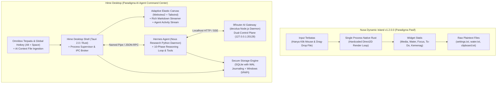
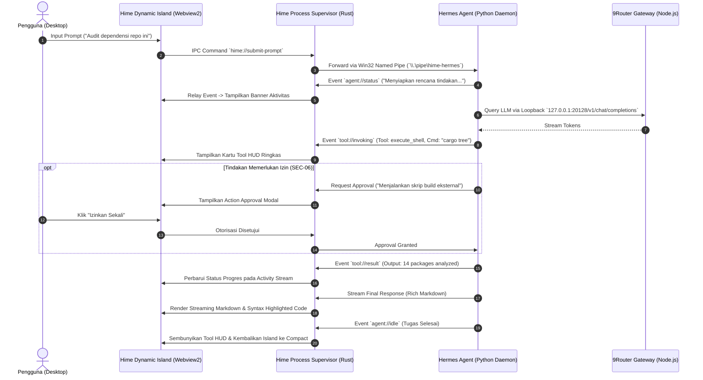

# Nusa to Hime Desktop Architecture Translation Specification

- **Document ID:** HIME-ARCHITECTURE-TRANSLATION
- **Task ID:** TASK-02-02 (Phase 02 — Nusa Reverse Engineering)
- **Target Comparison:** Nusa Dynamic Island v1.2.0.0 vs Hime Desktop Ecosystem
- **Authority:** Chief Software Architect & AI Systems Specialist
- **Status:** **CANONICAL ARCHITECTURAL TRANSLATION BLUEPRINT**
- **Date:** 2026-11-08

---

## 1. Executive Summary

Dokumen ini menyajikan cetak biru translasi arsitektur (*architectural translation blueprint*) yang menerjemahkan temuan rekayasa balik aplikasi **Nusa Dynamic Island v1.2.0.0** ke dalam spesifikasi rekayasa sistem mandiri (*clean-room reimplementation*) untuk **Hime Desktop**.

Meskipun Nusa menyediakan referensi visual dan ergonomi desktop yang elegan untuk konsep Dynamic Island pada Windows, fungsi Nusa secara mendasar terbatas pada utilitas pasif (pemutar musik, pelacak minum, checklist to-do). Hime Desktop, sebaliknya, merupakan **pusat kendali asisten AI desktop (*AI-native desktop command center*)** yang ditenagai oleh **Hermes Agent** dan **9Router**.

Dokumen ini merumuskan transformasi menyeluruh dari arsitektur widget pasif menuju sistem cerdas multi-proses berbasis **Tauri 2.0 (Rust) + Webview2**, mengintegrasikan kanvas elastis adaptif, bar input Omnibox (`Alt + Space`), mesin streaming Markdown, serta arsitektur **Agent Activity Stream** untuk transparansi kerja agen tanpa mengekspos penalaran internal mentah (*raw thought tokens*).

---

## 2. Strategic Paradigm Shift: From Passive Widget to AI Command Center



---

## 3. Separation of Architectural Origins: Nusa References vs Hime Original Subsystems

Untuk mencegah arsitektur Hime terikat atau terdistorsi oleh pembagian subsistem aplikasi utilitas Nusa, arsitektur Hime memisahkan secara tegas antara domain referensi Nusa dan domain subsistem orisinal Hime:

### A. Domain Referensi Nusa (Windowing, Rendering, & OS Overlay UX)
Nusa digunakan secara terfokus **hanya sebagai referensi teknis dan pengalaman pengguna** pada subsistem berikut:
1. **Window Manager:** Pengelolaan jendela borderless, mengapung (*floating*), *topmost*, adaptasi hit-testing mouse (`WM_NCHITTEST`), serta manajemen ukuran kanvas.
2. **Rendering Engine:** Komposisi grafis terakselerasi perangkat keras (GPU), geometri sudut melengkung (*squircle*), dan efek blur backdrop DWM (*frosted glass*).
3. **Windows Integration:** Integrasi event sistem operasi Windows (deteksi layar penuh via `SHQueryUserNotificationState`, notifikasi status daya baterai/AC, dan penskalaan per-monitor DPI).
4. **System Tray:** Kehadiran ikon baki persisten, menu kontrol latar belakang, dan penanganan pemulihan `TaskbarCreated`.
5. **Media & Audio Integration:** Pemantauan sesi pemutar media Windows (WinRT GSMTC) dan penanganan callback volume audio (Core Audio API).
6. **Desktop Overlay UX:** Paradigma interaksi Dynamic Island (kapsul idle yang tidak mengganggu, animasi ekspansi saat interaksi, dan kartu indikator HUD ringkas).

### B. Subsistem Orisinal Hime (AI Desktop Assistant Core)
Subsistem-subsistem berikut **BUKAN BERASAL DARI ARSITEKTUR NUSA**, melainkan merupakan **subsistem orisinal Hime** yang dirancang khusus untuk memenuhi kebutuhan Hime sebagai ekosistem AI Desktop Assistant otonom:

| Subsistem Orisinal Hime | Peran & Tanggung Jawab Arsitektural | Hubungan dengan Nusa |
|:---|:---|:---:|
| **Hime Core** | Lapisan logika inti aplikasi, pengelola state global, dispatcher perintah internal, dan jembatan antara shell GUI dengan komponen latar belakang. | **Orisinal Hime** (Tidak ada di Nusa) |
| **Agent Orchestrator** | Pengelola alur penalaran multi-tahap agen AI, koordinasi subagent, manajemen tujuan (*goal tracking*), dan dispatching tugas ke runtime Hermes. | **Orisinal Hime** (Tidak ada di Nusa) |
| **Agent Activity Stream** | Subsistem transparansi operasional yang menyajikan status rencana, pemanggilan alat, progres eksekusi, dan hasil aksi agen secara real-time tanpa mengekspos token penalaran mentah. | **Orisinal Hime** (Tidak ada di Nusa) |
| **Tool Execution Gateway** | Gerbang eksekusi alat (*tool runner*) terisolasi yang memvalidasi parameter, menjalankan perkakas sistem (shell, filesystem, web query), dan menyaring output. | **Orisinal Hime** (Tidak ada di Nusa) |
| **Permission & Approval Engine** | Mesin gerbang otorisasi interaktif (*Human-in-the-Loop*) yang memvalidasi operasi berisiko tinggi atau destruktif sebelum dieksekusi (kepatuhan SEC-06). | **Orisinal Hime** (Tidak ada di Nusa) |
| **Context & Memory Manager** | Pengelola memori kerja sesi, pengindeksan dokumen konteks yang di-drop ke island, dan sintesis riwayat interaksi pengguna. | **Orisinal Hime** (Tidak ada di Nusa) |
| **Storage Intelligence** | Mesin penyimpanan data relasional terstruktur berbasis SQLite dengan journaling WAL, pencarian teks penuh (FTS5), vector indexing, dan enkripsi secrets selektif via DPAPI. | **Orisinal Hime** (Tidak ada di Nusa) |
| **Device Bridge** | Protokol komunikasi dan sinkronisasi lintas perangkat (desktop Windows $\leftrightarrow$ ponsel Android Hime Mobile) untuk eksekusi perintah jarak jauh. | **Orisinal Hime** (Tidak ada di Nusa) |
| **Productivity Services** | Layanan otomasi latar belakang, penjadwalan rutin (*scheduled cron/timer*), dan integrasi kalender/tugas cerdas berbasis AI. | **Orisinal Hime** (Tidak ada di Nusa) |
| **Process Supervisor** | Pengawas siklus hidup proses eksternal (Hermes Agent dan 9Router) berbasis Windows Job Objects untuk memastikan eksekusi aman dan terminasi bersih. | **Orisinal Hime** (Tidak ada di Nusa) |

> **Pernyataan Penegasan Arsitektural:**
> Subsistem-subsistem di atas **BUKAN berasal dari arsitektur Nusa**, melainkan subsistem orisinal yang dirancang khusus untuk memenuhi kebutuhan Hime sebagai AI Desktop Assistant. Nusa tidak memiliki konsep agen AI, gateway model bahasa, eksekusi perkakas, orkestrasi memori, atau pengawasan multi-proses.

---

## 4. Desktop Overlay & Windowing Translation Matrix (Nusa Reference Domain)

Tabel berikut menyajikan pemetaan komparatif khusus untuk domain di mana Nusa menjadi referensi:

| Subsistem Referensi | Mekanisme Asli Nusa (v1.2.0.0) | Kebutuhan Hime Desktop | Rekomendasi Implementasi Hime Desktop |
|:---|:---|:---|:---|
| **Lifecycle & Process** | Single process native Rust dengan Mutex `Local\NusaNotch.SingleInstance`. | Multi-process supervisor yang mengelola Hime Shell, Hermes Agent daemon, dan 9Router gateway. | Tauri 2.0 Shell (Rust) bertindak sebagai **Process Supervisor** (menggunakan Windows Job Objects) dengan `tauri-plugin-single-instance`. |
| **Window Frame & Bounds** | Kanvas kaku berukuran statis **740 × 212 px** menempel pada `Top = 0`. | **Kanvas Elastis Adaptif**: Idle (34 px) $\rightarrow$ Compact HUD (212 px) $\rightarrow$ AI Chat/Result (480–600 px). | Jendela borderless transparan Tauri dengan kemampuan resizing dinamis mulus berbasis animasi CSS dan interop HWND Win32. |
| **Window Styles** | Win32 `WS_POPUP \| WS_EX_TOPMOST \| WS_EX_TOOLWINDOW \| WS_EX_NOREDIRECTIONBITMAP`. | Sama persis: pulau mengapung di atas jendela lain tanpa mengotori Taskbar atau `Alt + Tab`. | Konfigurasi deklaratif `tauri.conf.json` (`always_on_top`, `skip_taskbar`, `transparent`) + injeksi `WS_EX_NOREDIRECTIONBITMAP` via HWND post-create (meniadakan GDI redirection surface DWM). |
| **Rendering Engine** | Hardcoded DirectComposition + Direct2D C++/Rust rendering loop. | Rendering responsif komponen AI, syntax highlighting blok kode, tabel Markdown, dan grafik dinamis. | **Webview2 (Edge Chromium GPU Pipeline)** dengan Tailwind CSS, Framer Motion, dan Web Animations API untuk efisiensi pengembangan antarmuka tingkat tinggi. |
| **User Input Method** | Hanya klik mouse dan drag-and-drop; **tidak ada bar input teks**. | **Omnibox Prompt Bar Interaktif**: Input teks dengan riwayat perintah, auto-complete, dan pemanggil global. | Input bar terpadu yang dapat dipanggil instan dari aplikasi mana pun via shortcut global `Alt + Space` (`tauri-plugin-global-shortcut`). |
| **Tool Execution HUD** | OSD hardware popups ringkas (Volume, Caps Lock, Baterai). | **Real-Time Tool HUD Cards**: Menampilkan kartu notifikasi saat Hermes membaca file, menjalankan shell, atau querying web. | Adaptasi pola HUD Nusa menjadi kartu ringkas transparan pada Agent Activity Stream. |
| **File Staging** | File Shelf pasif yang menampung berkas fisik di `%LOCALAPPDATA%\Nusa\Shelf\`. | **AI Context File Ingestion**: Menyeret berkas langsung mengubahnya menjadi konteks analisis untuk Hermes Agent. | Event native `tauri::WindowEvent::DragDrop` yang mengekstrak jalur berkas dan mengirimkannya ke Context & Memory Manager. |
| **Penyimpanan State** | Berkas teks polos mentah (`settings.txt`, `water.txt`, `clipboard.txt`) tanpa enkripsi. | Basis data relasional terstruktur ACID dengan proteksi selektif kredensial (SEC-02). | **SQLite Lokal (Crate `rusqlite`) dengan journaling WAL** (durability dikonfigurasi via `PRAGMA synchronous`) dan enkripsi selektif secrets via **Windows DPAPI (`CryptProtectData`)**. |

---

## 5. Key Architectural Feature Specifications for Hime Desktop

### A. Adaptive Elastic Canvas System

Berbeda dengan Nusa yang kanvasnya terkunci kaku pada batas bawah 212 px, Hime Desktop mengimplementasikan sistem kanvas elastis 3 tingkat (*3-Tier Elastic Canvas*):

```text
Tier 1: Minimal Idle Capsule (~200 x 34 px)
+------------------------------------+
|  (H)  Hime Assistant | Idle        |  <- Mode ambient mengapung di tengah atas
+------------------------------------+

Tier 2: Compact Activity HUD (740 x 140 - 212 px)
+-------------------------------------------------------------------------+
| [Tool: read_file] Membaca 'Cargo.toml' (1.4 KB)...     [Status: RUNNING]|
| Progress: ========================> 75%                                 |
+-------------------------------------------------------------------------+

Tier 3: Expanded AI Interaction Canvas (740 x 480 - 600 px)
+-------------------------------------------------------------------------+
| > Ingestion: document.pdf | Active Model: Claude 3.5 Sonnet (via 9Router)|
|-------------------------------------------------------------------------|
| [Agent Activity Stream]                                                 |
| - Langkah 1: Memeriksa dependensi proyek [SELESAI]                      |
| - Langkah 2: Mengaudit lisensi paket pihak ketiga [SEDANG BERJALAN]     |
|                                                                         |
| [Hasil Analisis Markdown]                                               |
| Ditemukan 3 dependensi dengan lisensi copyleft (GPL-3.0)...             |
| ```rust                                                                 |
| fn verify_license() -> Result<bool, Error> { ... }                      |
| ```                                                                     |
|-------------------------------------------------------------------------|
| [ Omnibox: Ketik instruksi atau pertanyaan lanjutan... (Alt+Space) ]    |
+-------------------------------------------------------------------------+
```

1. **Transisi Ketinggian Dinamis:** Jendela Tauri memperbarui tinggi fisik jendela (`set_size`) secara sinkron dengan transisi CSS `height` pada Webview2 untuk mencegah *tearing* atau *black flicker*.
2. **Scrolling Konten Mandiri:** Saat konten jawaban Markdown melebihi tinggi maksimum (misal 600 px), kontainer teks mengaktifkan scrollbar virtual kustom yang ramping dan elegan.

---

### B. Agent Activity Stream Architecture

Menggantikan konsep lama "Thought Stream", arsitektur **Agent Activity Stream** beroperasi dengan prinsip transparansi berbasis tindakan (*action-based operational transparency*):



---

### C. Multi-Process Boundary & Security Topology

Mematuhi batasan isolasi rekayasa dan mitigasi risiko keamanan (RSK-01 s/d RSK-12):

1. **Hime Desktop Shell (Tauri 2.0 / Rust):**
   - Berjalan pada level hak istimewa pengguna standar (*unprivileged user*).
   - Menjadi pemilik tunggal jendela GUI, input keyboard global, dan tray icon.
   - Mengontrol siklus hidup proses anak (*child process lifecycle*) menggunakan **Windows Job Objects** untuk menjamin terminasi bersih (mencegah proses zombie saat Hime ditutup).
2. **Hermes Agent Runtime (Python Virtual Environment via `uv`):**
   - Dijalankan sebagai daemon latar belakang mandiri tanpa jendela (*headless*).
   - Berkomunikasi secara eksklusif dengan Hime Desktop melalui **Win32 Named Pipe berkredensial sesi satu-kali (*one-time session ticket*)**.
3. **9Router AI Gateway (Node.js Service):**
   - Dijalankan sebagai managed service lokal yang terikat ketat ke **`127.0.0.1`** (loopback only, mitigasi RSK-12).
   - Password awal di-generate menggunakan CSPRNG kriptografis saat instalasi pertama (mitigasi RSK-11).
   - Berfungsi sebagai reverse proxy adapter untuk 140+ penyedia model AI.
4. **Secure Local Persistence (SQLite WAL + DPAPI):**
   - Basis data SQLite lokal dengan journaling mode WAL untuk memungkinkan pembacaan bersamaan dengan transaksi penulisan dalam kondisi yang didukung SQLite. Jaminan durability dikonfigurasi secara spesifik oleh Hime via `PRAGMA synchronous` dan karakteristik filesystem.
   - Enkripsi selektif pada field sensitif (token API, kunci privat, kredensial) menggunakan Windows DPAPI `CryptProtectData`.
   - SQLite WAL bukan mekanisme enkripsi; kombinasi SQLite WAL + DPAPI tidak secara otomatis mengenkripsi seluruh file database. Enkripsi database penuh pada tingkat aplikasi memerlukan ekstensi seperti SQLCipher, sedangkan enkripsi volume pada tingkat sistem operasi disediakan oleh BitLocker.
   - Berkas basis data diletakkan di `%LOCALAPPDATA%\Hime\hime.db` dengan kontrol akses objek/berkas Windows ACL ketat hanya untuk akun pengguna pemilik sesi (mitigasi RSK-03).

---

## 6. Summary of Architectural Decisions (ADR Alignment)

| No | Keputusan Arsitektur | Status | Justifikasi Rekayasa |
|:---:|:---|:---:|:---|
| 1 | **Clean-Room Reimplementation** | **DISETUJUI** | Nusa adalah software proprietary (`Copyright © 2026 Rama`). Hime membangun ulang konsep Dynamic Island secara mandiri tanpa menggunakan kode atau aset Nusa. |
| 2 | **Tauri 2.0 (Rust + Webview2) Stack** | **DISETUJUI** | Menggabungkan keandalan low-level Rust untuk windowing Win32 dengan fleksibilitas web engine untuk rendering Markdown dan AI chat. |
| 3 | **Agent Activity Stream Paradigm** | **DISETUJUI** | Menggantikan Thought Stream demi transparansi operasional yang terarah dan ramah pengguna, tanpa mengekspos raw reasoning tokens. |
| 4 | **SQLite + DPAPI Persistence Engine** | **DISETUJUI** | Menggantikan model berkas teks mentah Nusa yang rentan korupsi dan kebocoran teks clipboard. |
| 5 | **Job Object Process Supervision** | **DISETUJUI** | Menjamin proses Hermes Agent dan 9Router mati secara otomatis saat jendela Hime Desktop ditutup. |
