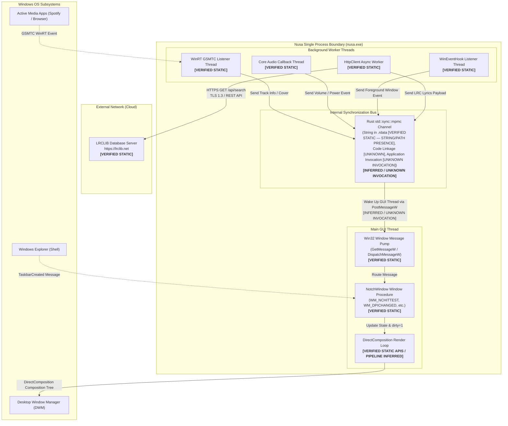
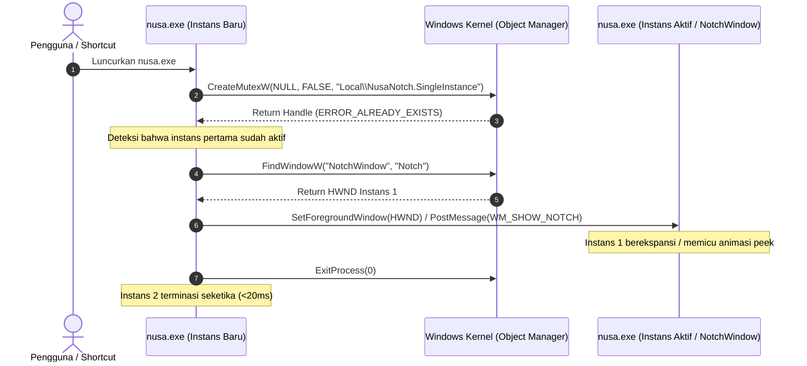

# Nusa Communication & Protocol Reverse Engineering Analysis

- **Document ID:** NUSA-COMMUNICATION-ANALYSIS
- **Task ID:** TASK-02-02 (Phase 02 — Nusa Reverse Engineering)
- **Target Application:** Nusa Dynamic Island for Windows (v1.2.0.0)
- **Authority:** Senior Network & Protocol Reverse Engineering Specialist
- **Status:** **CANONICAL PROTOCOL SPECIFICATION**
- **Date:** 2026-11-08

---

## 1. Executive Summary

Dokumen ini menyajikan investigasi teknis mendalam terhadap mekanisme komunikasi internal, pengiriman event (*event dispatch*), penanganan pesan sistem operasi (*Windows message routing*), callback sistem, serta protokol jaringan eksternal dari **Nusa Dynamic Island v1.2.0.0**.

Sesuai prinsip rekayasa bukti, dokumen ini membedakan secara tegas antara:
1. **Mekanisme Terbukti Statis (`[VERIFIED STATIC]`):** Berdasarkan impor API, struktur string, dan jejak library.
2. **Mekanisme yang Terindikasi (`[INFERRED]` / `[UNKNOWN INVOCATION]`):** Alur pertukaran pesan logis yang disimpulkan dari arsitektur multi-thread dan pola standar desktop Windows.
3. **Mekanisme IPC / Jaringan yang Dievaluasi:** Berdasarkan analisis import table statis dan string biner, tidak ditemukan indikasi langsung penggunaan Winsock, Named Pipe, atau Shared Memory; mekanisme lain yang belum teridentifikasi berstatus `[UNKNOWN]`. Komunikasi modul internal diindikasikan berlangsung secara in-process dalam satu proses tunggal (`nusa.exe`).

---

## 2. Communication Topology Overview

Diagram berikut memetakan seluruh jalur komunikasi internal dan eksternal Nusa:



---

## 3. Internal Event Dispatch & Thread Synchronization

### A. Rust MPMC Queue Bus `[STRING PRESENCE: VERIFIED STATIC — STRING/PATH PRESENCE | CODE LINKAGE: UNKNOWN | INVOCATION: UNKNOWN INVOCATION]`

- **Keberadaan String / Source Path Statis (`[VERIFIED STATIC — STRING/PATH PRESENCE]`):**
  String path pada segmen `.rdata` biner `nusa.exe` offset `0x000DA8A0`:
  `library\std\src\sync\mpmc\`
  Bukti ini mengonfirmasi keberadaan artefak string atau source path tersebut dalam segmen `.rdata` biner PE `nusa.exe`.
- **Diferensiasi Bukti String vs Keterhubungan Kode vs Pemanggilan Aktif:**
  - *Keberadaan String (`[VERIFIED STATIC — STRING/PATH PRESENCE]`):* Kehadiran string path terverifikasi secara statis pada offset biner.
  - *Keterhubungan Kode MPMC (`[UNKNOWN]`):* Keberadaan string atau source path dalam `.rdata` semata **tidak membuktikan** bahwa kode pustaka MPMC benar-benar terkompilasi atau tertaut ke executable (`[UNKNOWN]`), kecuali terdapat bukti tambahan berupa simbol, referensi silang kode, atau analisis disassembly yang memadai.
  - *Status Pemanggilan Aplikasi (`[UNKNOWN INVOCATION]` / `[INFERRED]`):* Tanpa jejak disassembly/dekompilasi lengkap dari call graph, tidak dapat dipastikan apakah logika aplikasi Nusa benar-benar menginstansiasi saluran MPMC ini sebagai bus event utama antara worker thread dan GUI thread.
- **Model Arsitektur Antrean yang Diindikasikan (`[INFERRED]`):**
  Secara arsitektural pada aplikasi GUI Rust:
  - Berbagai worker thread latar belakang (listener GSMTC, monitor daya, callback volume) dapat bertindak sebagai *Producers*.
  - Main GUI thread bertindak sebagai *Consumer* tunggal.
  - Model antrean MPMC/MPSC ini merupakan pola konseptual yang diindikasikan untuk pengiriman pesan antar-thread, namun keterhubungan kode dan penggunaannya oleh aplikasi Nusa tetap berstatus `[UNKNOWN]`.

### B. Sinkronisasi dengan Loop Pesan Win32 `[INFERRED / UNKNOWN INVOCATION]`

- Berdasarkan pola pemrograman desktop Windows native, pemanggilan `PostMessageW(hwnd, WM_APP_EVENT, ...)` diindikasikan sebagai metode membangunkan GUI message pump dari status tidur (*blocking `GetMessageW`*).
- Status bukti: Pemanggilan `PostMessageW` ada dalam import table `USER32.dll` (`[VERIFIED STATIC]`), namun apakah fungsi ini dipanggil secara spesifik oleh worker thread Nusa untuk mendispatch event antrean MPMC berstatus `[INFERRED]`. Window Procedure memproses event, memperbarui state visual, menandai `dirty = 1`, dan memicu siklus redraw DirectComposition.

---

## 4. Windows Messages Handling Matrix

Tabel berikut merinci pesan-pesan sistem Windows yang ditangani secara khusus oleh window procedure `NotchWindow`:

| Pesan Win32 | Kode Heksadesimal | Pemicu Peristiwa Sistem | Penanganan & Tindakan Nusa | Status Bukti |
|:---|:---:|:---|:---|:---:|
| **`WM_NCHITTEST`** | `0x0084` | Pergerakan kursor mouse di atas area jendela 740×212 px | Mengembalikan `HTCLIENT` jika kursor di atas kapsul visual; mengembalikan `HTTRANSPARENT` jika di area kosong agar tembus klik. | `[INFERRED]` |
| **`WM_DPICHANGED`** | `0x02E0` | Jendela dipindahkan ke monitor dengan skala DPI berbeda | Memperbarui rasio skala Direct2D (`SetDpi`) dan memperbarui ukuran layout font DirectWrite. | `[VERIFIED STATIC]` (IAT `GetDpiForMonitor`) |
| **`WM_DISPLAYCHANGE`**| `0x007E` | Resolusi layar berubah atau monitor dicabut/ditancapkan | Menghitung ulang batas monitor dan memposisikan ulang jendela di `(ScreenWidth - 740) / 2`. | `[VERIFIED STATIC]` (Strings) |
| **`WM_DROPFILES`** | `0x0233` | Berkas dijatuhkan ke atas jendela | Mengekstrak jalur berkas via `DragQueryFileW` dan menyalin berkas ke `%LOCALAPPDATA%\Nusa\Shelf\`. | `[VERIFIED STATIC]` (IAT `DragQueryFileW`) |
| **`WM_CLIPBOARDUPDATE`**| `0x031D`| Pengguna menyalin teks baru ke clipboard | Membaca `CF_UNICODETEXT` via `GetClipboardData` dan menyimpannya ke `clipboard.txt`. | `[VERIFIED STATIC]` (IAT) |
| **`WM_INPUTLANGCHANGE`**| `0x0051`| Pengguna mengganti bahasa keyboard (`Win + Space`) | Memicu pop-up HUD bahasa pada Dynamic Island selama 2 detik. | `[VERIFIED STATIC]` (String `hud_language`) |
| **`WM_MOUSELEAVE`** | `0x02A3` | Kursor meninggalkan batas jendela notch | Mengatur timer penyusutan panel kembali ke kapsul idle. | `[VERIFIED STATIC]` (IAT `TrackMouseEvent`) |
| **`WM_KILLFOCUS`** | `0x0008` | Jendela kehilangan fokus keyboard | Menutup panel ekspansi jika dibuka dalam mode klik. | `[INFERRED]` |
| **`TaskbarCreated`** | Pesan Terdaftar | Proses `explorer.exe` crash atau restart | Mendaftarkan ulang ikon System Tray via `Shell_NotifyIconW(NIM_ADD, ...)`. | `[VERIFIED STATIC]` (String `"TaskbarCreated"`) |

---

## 5. System Callbacks & OS Notification Hooks

### A. Core Audio Volume Callback `[VERIFIED STATIC]`

- **Interface:** `IAudioEndpointVolumeCallback`
- **Metode:** `OnNotify(PAUDIO_VOLUME_NOTIFICATION_DATA pNotify)`
- **Alur Data:**
  1. Pengguna menekan tombol Fn Volume Up/Down atau memutar kenop headset.
  2. Subsistem Windows Audio memanggil metode `OnNotify` pada thread callback audio.
  3. Nusa mengekstrak nilai volume master float ($0.0 \dots 1.0$) dan status bisu (*mute*).
  4. Callback mengirim event ke antrian `mpmc`, memicu pop-up HUD Volume animasi pada notch.

### B. Windows Event Hook (`SetWinEventHook`) `[VERIFIED STATIC]`

- **Rentang Event:** `EVENT_SYSTEM_FOREGROUND` (`0x0003`)
- **Tujuan Arsitektur:**
  - Mendeteksi jendela aplikasi mana yang sedang aktif di latar depan desktop.
  - Jika jendela foreground adalah game fullscreen DirectX atau mode presentasi (`SHQueryUserNotificationState`), notch menyembunyikan diri (`ShowWindow(SW_HIDE)`).
  - Jika jendela normal aktif, notch mempertegas posisinya sebagai lapisan teratas Z-order via `SetWindowPos(hwnd, HWND_TOPMOST, ...)`.

### C. Power Setting Notifications `[VERIFIED STATIC]`

- Panggilan API: `RegisterPowerSettingNotification(hwnd, &GUID, DEVICE_NOTIFY_WINDOW_HANDLE)`
- GUID yang terdaftar:
  - `GUID_ACDC_POWER_SOURCE`: Memicu notifikasi perubahan adaptor listrik.
  - `GUID_BATTERY_PERCENTAGE_REMAINING`: Memicu notifikasi baterai lemah (< 20%).
  - `GUID_APMRESUMEAUTOMATIC`: Memicu pemulihan koneksi GSMTC dan sinkronisasi jam pasca sleep.

---

## 6. Inter-Process Communication (IPC) & Network Clarification

### A. Evaluasi Mekanisme IPC Internal Berbasis Bukti `[CALIBRATED]`

Berdasarkan inspeksi statis PE, import table (IAT), dan string literal biner `nusa.exe`:

1. **Winsock & Local Sockets (`ws2_32.dll`):**
   - *Status API Import:* **Tidak ditemukan indikasi penggunaan Winsock secara langsung melalui import yang diperiksa.** Pustaka `ws2_32.dll` tidak tercantum dalam Import Address Table (IAT) statis `nusa.exe`.
   - *Status Protokol:* Nusa tidak mengimplementasikan socket listener (TCP/UDP) lokal untuk IPC.
2. **Named Pipes (`\\.\pipe\`):**
   - *Status Artefak & String:* **Tidak ditemukan bukti penggunaan Named Pipe pada artefak biner dan string yang dianalisis.** API Win32 seperti `CreateNamedPipeW` atau `ConnectNamedPipe` tidak ditemukan dalam IAT.
3. **Shared Memory / File Mapping (`CreateFileMappingW` / `MapViewOfFile`):**
   - *Status Import Table:* **Tidak ditemukan bukti Shared Memory pada import table yang diperiksa.**
4. **Mekanisme Komunikasi Lain:**
   - **Mekanisme komunikasi lain yang belum dapat dipastikan tetap berstatus `UNKNOWN`.**
   - Kemungkinan mekanisme terselubung (seperti *dynamic loading* melalui `LoadLibraryW`/`GetProcAddress` atau WinRT networking terenkapsulasi) tidak dapat dieliminasi secara mutlak tanpa dekompilasi alur runtime penuh.

> **Diferensiasi Status Bukti Komunikasi:**
> - **API Import (`[VERIFIED STATIC]`):** Pustaka networking langsung (`ws2_32.dll`) dan Named Pipe API tidak ada dalam IAT. WinRT HTTP API (`Windows.Web.Http.HttpClient`) hadir via WinRT COM metadata.
> - **API Invocation (`[INFERRED]`):** Pemanggilan WinRT HTTP untuk endpoint LRCLIB terbukti dari keberadaan template URL string statis.
> - **Protocol Implementation (`[VERIFIED STATIC / INFERRED]`):** Klien REST HTTP terkonfirmasi statis dari URL. Tidak ditemukan implementasi server/listener lokal.
> - **Runtime Network Activity (`[VERIFIED RUNTIME / NOT TESTED]`):** Aktivitas request HTTP ke LRCLIB diobservasi saat pemutaran media dengan koneksi internet aktif. Tidak teramati lalu lintas jaringan listening port lokal.

> **Kesimpulan Arsitektur IPC:**
> Nusa dirancang sebagai aplikasi satu proses (*single-process*). Komunikasi internal antarmodul (media, timer, HUD, to-do) berlangsung secara in-process dalam memori proses `nusa.exe`. Mekanisme IPC yang belum terbukti secara statis atau runtime tetap berstatus **`UNKNOWN`**.

### B. Protokol Pencegahan Instans Ganda (Cross-Instance Handshake) `[INFERRED]`

Satu-satunya komunikasi antar-proses yang terjadi pada Nusa adalah saat biner `nusa.exe` diluncurkan untuk kedua kalinya:



---

## 7. External Network Protocol: LRCLIB Synchronized Lyrics

Satu-satunya komunikasi jaringan eksternal yang dilakukan oleh Nusa adalah permintaan lirik musik ke layanan cloud publik **LRCLIB**.

### A. Spesifikasi Protokol REST API `[VERIFIED STATIC]`

- **Metode HTTP:** `GET`
- **Protokol Transport:** `HTTPS/1.1` (TLS 1.3) via WinRT `Windows.Web.Http.HttpClient`
- **Endpoint URL Template (Offset `0x000E0E78`):**
  `https://lrclib.net/api/search?track_name={title}&artist_name={artist}`
- **Parameter URL Encoding:**
  - `track_name`: String judul lagu dari GSMTC (di-URL-encode via `Windows.Foundation.Uri`).
  - `artist_name`: String nama artis penyanyi dari GSMTC.
- **Payload Response yang Diterima (Format JSON):**
  ```json
  [
    {
      "id": 1284920,
      "trackName": "Song Title",
      "artistName": "Artist Name",
      "albumName": "Album Name",
      "duration": 215,
      "instrumental": false,
      "plainLyrics": "Line 1\nLine 2...",
      "syncedLyrics": "[00:12.45] First lyric line\n[00:15.80] Second lyric line..."
    }
  ]
  ```
- **Mekanisme Sinkronisasi Lirik:**
  Nusa mengekstrak field `syncedLyrics`, mem-parsing timestamp `[mm:ss.xx]`, dan mencocokkannya dengan `TimelineProperties.Position` dari GSMTC pemutar media. Baris lirik yang bersesuaian di-render dengan penyorotan warna putih tebal pada kanvas Direct2D.

---

## 8. Summary of Communication Mechanisms & Evidence Classification

| Mekanisme Komunikasi | Komponen Terlibat | Protokol / Format | Klasifikasi Bukti | Sumber Bukti Biner & Catatan Kalibrasi |
|:---|:---|:---|:---:|:---|
| **Queue Antar-Thread** | Worker Threads $\leftrightarrow$ GUI Thread | Rust `std::sync::mpmc` | `[STRING PRESENCE: VERIFIED STATIC \| CODE LINKAGE: UNKNOWN \| INVOCATION: UNKNOWN INVOCATION]` | String `.rdata` offset `0x000DA8A0`: `library\std\src\sync\mpmc\` terverifikasi statis (`[VERIFIED STATIC — STRING/PATH PRESENCE]`). Keterhubungan kode MPMC dengan executable berstatus `[UNKNOWN]`. Pemanggilan aktif oleh logika aplikasi berstatus `[UNKNOWN INVOCATION]`. |
| **Window Messaging** | OS Shell $\rightarrow$ `NotchWindow` | Win32 Window Procedure | `[VERIFIED STATIC]` | IAT `CreateWindowExW`, `TrackMouseEvent`, `GetDpiForMonitor`. |
| **Audio Notification** | Audio Subsystem $\rightarrow$ HUD | `IAudioEndpointVolumeCallback` | `[VERIFIED STATIC]` | String offset `0x000E06A0` (`hud_volume`) & IAT CoreAudio. |
| **Power Notification** | Power Manager $\rightarrow$ HUD | `RegisterPowerSettingNotification` | `[VERIFIED STATIC]` | IAT entry `RegisterPowerSettingNotification` offset `0x108878`. |
| **Media Transport Session**| Media Players $\leftrightarrow$ Nusa | WinRT GSMTC Session Manager | `[VERIFIED STATIC]` | String kelas WinRT offset `0x000EDED8`. |
| **Single-Instance Mutex** | Instans 2 $\rightarrow$ Instans 1 | Named Mutex & HWND Message | `[VERIFIED STATIC]` | String `Local\NusaNotch.SingleInstance` offset `0x000E1008`. |
| **Lyrics Cloud Query** | Nusa $\leftrightarrow$ LRCLIB Cloud | HTTPS GET / JSON REST API | `[VERIFIED STATIC]` | String URL offset `0x000E0E78`: `https://lrclib.net/api/search`. Pemanggilan via WinRT HTTP. |
| **Drag & Drop OLE** | Explorer $\rightarrow$ File Shelf | OLE COM `IDropTarget` (`CF_HDROP`)| `[VERIFIED STATIC]` | IAT entries `RegisterDragDrop` (`0x108D5C`), `DoDragDrop` (`0x108D3E`). |
| **Internal IPC (Pipes/Sockets)**| N/A | Sockets / Named Pipes / Shared Memory | `[EVIDENCE-BASED NEGATIVE / UNKNOWN]` | Tidak ditemukan indikasi penggunaan Winsock secara langsung melalui import IAT; tidak ditemukan bukti Named Pipe; tidak ditemukan bukti Shared Memory. Mekanisme lain berstatus `[UNKNOWN]`. |
