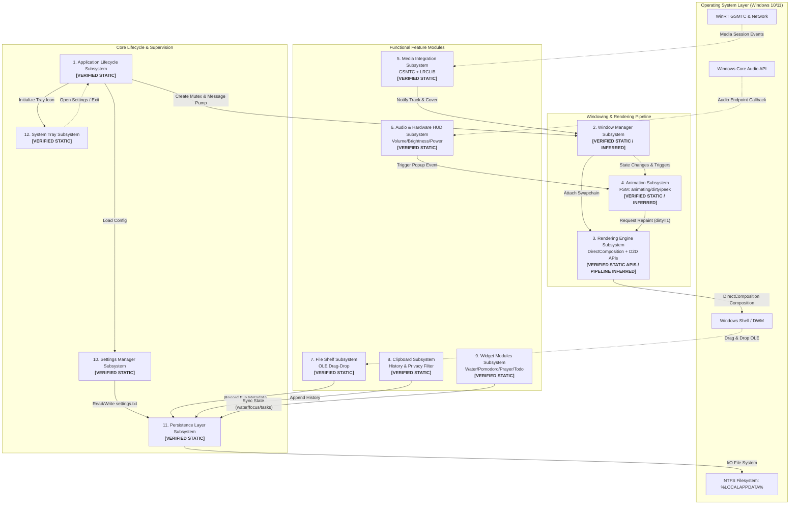

# Nusa Internal Subsystem Architecture Mapping

- **Document ID:** NUSA-SUBSYSTEM-MAP
- **Task ID:** TASK-02-02 (Phase 02 — Nusa Reverse Engineering)
- **Target Application:** Nusa Dynamic Island for Windows (v1.2.0.0)
- **Authority:** Lead Systems Architect & Reverse Engineering Specialist
- **Status:** **CANONICAL ARCHITECTURAL MAP**
- **Date:** 2026-11-08

---

## 1. Executive Summary

Dokumen ini memetakan arsitektur internal dan dekomposisi subsistem dari aplikasi **Nusa Dynamic Island v1.2.0.0**. Pemetaan ini didasarkan pada sintesis bukti statis biner (tabel impor, string literal segmen `.rdata`, struktur seksi PE32+) dan pemodelan analitis terhadap dependensi fungsional antar-komponen.

Sebanyak **12 subsistem internal** berhasil diidentifikasi dan dipetakan. Untuk setiap subsistem, dokumen ini mendokumentasikan tanggung jawab fungsional, input/output, dependensi, hubungan interaksi dengan subsistem lain, rujukan bukti biner primer, serta tingkat kepastian bukti (`[VERIFIED STATIC]` vs `[INFERRED]`).

---

## 2. High-Level Subsystem Architecture Diagram

Diagram berikut menggambarkan interaksi antarsubsistem dalam arsitektur Nusa, lengkap dengan notasi tingkat kepastian bukti:

---

## 3. Granular Subsystem Breakdown

### 1. Main Application Lifecycle Subsystem

- **Tanggung Jawab:**
  - Mengelola inisialisasi aplikasi, alokator memori Rust, dan registrasi Structured Exception Handling (SEH).
  - Memeriksa Named Mutex `Local\NusaNotch.SingleInstance` untuk mencegah instans ganda.
  - Menjalankan loop pesan standar Win32 (*message pump* `GetMessageW` / `DispatchMessageW`).
  - Mengelola proses terminasi bersih (*graceful shutdown*).
- **Input:** Parameter baris perintah Windows (`std::env::args`), pesan sistem Windows.
- **Output:** Exit code proses, status window lifecycle.
- **Dependensi:** `kernel32.dll` (`CreateMutexW`, `GetLastError`, `ExitProcess`), `user32.dll`.
- **Hubungan Antarsubsistem:** Menginisialisasi `Window Manager`, `System Tray`, dan `Settings Manager`.
- **Bukti Pendukung:** String offset `0x000E1008` (`Local\NusaNotch.SingleInstance`), import `CreateMutexW`.
- **Tingkat Kepastian:** `[VERIFIED STATIC]`.

---

### 2. Window Manager Subsystem

- **Tanggung Jawab:**
  - Membuat dan mengelola jendela utama `NotchWindow` (`HWND`) dengan style `WS_POPUP | WS_VISIBLE | WS_CLIPSIBLINGS` (`0x94000000`).
  - Menerapkan extended style `WS_EX_TOPMOST | WS_EX_TOOLWINDOW | WS_EX_NOREDIRECTIONBITMAP | WS_EX_COMPOSITED` (`0x08200088`).
  - Menghitung posisi horizontal jendela tepat di tengah monitor aktif: `Left = (MonitorWidth - 740) / 2`.
  - Mengatur hit-testing per-piksel: mengembalikan `HTCLIENT` saat kursor berada di kapsul, dan `HTTRANSPARENT` saat kursor berada di area transparan 740×212 px.
  - Menangani perubahan konfigurasi monitor (`WM_DISPLAYCHANGE`) dan skala DPI (`WM_DPICHANGED`).
- **Input:** Pesan window procedure Win32, koordinat kursor mouse, status layar.
- **Output:** Handle jendela `HWND`, event routing internal.
- **Dependensi:** `user32.dll`, `kernel32.dll` (`GetDpiForMonitor`).
- **Hubungan Antarsubsistem:** Mengikat visual surface ke `Rendering Engine`, memicu event ke `Animation Subsystem`.
- **Bukti Pendukung:** String offset `0x000E1046` (`NotchWindow`), IAT `CreateWindowExW`, `GetDpiForMonitor`.
- **Tingkat Kepastian:** `[VERIFIED STATIC]` (Nama kelas & IAT) / `[INFERRED]` (Hit-testing & formula koordinat).

---

### 3. Rendering Engine Subsystem

- **Tanggung Jawab:**
  - Menginisialisasi Direct3D 11 device, DXGI swapchain, dan DirectComposition visual tree.
  - Merender seluruh elemen grafis Dynamic Island secara hardware-accelerated melalui Direct2D.
  - Menggambar bentuk kapsul pil dengan continuous curvature (squircle), ikon vektor, grafik cincin hidrasi, dan visualizer audio secara prosedural.
  - Merender teks tipografi subpixel menggunakan DirectWrite dengan font sistem `Segoe UI`.
  - Menerapkan efek kaca buram (*frosted glass backdrop*) di belakang notch via DWM policy.
- **Input:** Geometri elemen UI, state teks, buffer transformasi matrix, bendera repainting (`dirty`).
- **Output:** DirectComposition Visual Surface yang di-komposisikan oleh DWM ke layar.
- **Dependensi:** `dcomp.dll`, `d2d1.dll`, `d3d11.dll`, `dwrite.dll`, `dwmapi.dll`.
- **Hubungan Antarsubsistem:** Menerima perintah gambar dari `Animation Subsystem`, `Media`, `Widgets`, dan `Hardware HUD`.
- **Bukti Pendukung:** IAT entries `DCompositionCreateDevice` (`0x108CA0`), `D2D1CreateFactory` (`0x108CBC`), `D3D11CreateDevice` (`0x108DE6`), `DWriteCreateFactory` (`0x108C8A`), string font `Segoe UI` (`0x000DFB68`).
- **Tingkat Kepastian:** `[VERIFIED STATIC]` (Keberadaan API dalam IAT & String Font) / `[INFERRED]` (Keterkaitan pipeline aktif).

---

### 4. Animation Subsystem

- **Tanggung Jawab:**
  - Mengelola transisi ukuran antarmuka dari mode kapsul idle (~200×34 px) menjadi panel berekspansi (maksimal 740×212 px).
  - Mengendalikan mesin status (*Finite State Machine*) berbasis 4 flag variabel: `animating`, `dirty`, `peek`, `fast_animation`.
  - Melakukan interpolasi kurva pegas (*spring physics easing*) agar perubahan lebar dan tinggi berlangsung sinkron tanpa distorsi visual.
  - Menghentikan render loop saat status idle (`dirty = 0`) untuk meminimalkan beban CPU (angka efisiensi absolut 0.0% CPU merupakan klaim observasi historis yang belum diuji dalam sesi terkontrol saat ini).
- **Input:** Pointer hover/click event, sinyal pemicu HUD hardware, navigasi titik halaman.
- **Output:** Nilai dimensi frame transisi (*width*, *height*, *corner radius*), flag `dirty=1`.
- **Dependensi:** Timer multimedia Windows / thread loop internal Rust, Direct2D math matrices (`D2D1MakeRotateMatrix`).
- **Hubungan Antarsubsistem:** Memperbarui matriks transformasi pada `Rendering Engine`.
- **Bukti Pendukung:** String offset `0x000E2AA8` (`animating`, `dirty`, `peek`, `fast_animation`).
- **Tingkat Kepastian:** `[VERIFIED STATIC]` (Flag state) / `[INFERRED]` (Karakteristik matematis kurva spring).

---

### 5. Media Integration Subsystem

- **Tanggung Jawab:**
  - Berlangganan sesi pemutaran media sistem Windows melalui WinRT GSMTC.
  - Mengambil judul lagu, nama artis, dan cover art album.
  - Mengirim perintah kontrol playback (Play, Pause, Next, Previous).
  - Melakukan query asinkron ke REST API LRCLIB (`https://lrclib.net`) untuk mengunduh lirik lagu bersinkronisasi waktu (`.lrc`).
  - Mengatur teks lirik berjalan secara sinkron dengan stempel waktu pemutaran audio.
- **Input:** Event GSMTC Windows, HTTP response dari `lrclib.net`.
- **Output:** Metadata lagu, buffer byte cover art, baris lirik aktif.
- **Dependensi:** WinRT `Windows.Media.Control`, `Windows.Web.Http.HttpClient`, `Windows.Storage.Streams`.
- **Hubungan Antarsubsistem:** Menyalurkan metadata lagu ke `Window Manager` dan `Rendering Engine`.
- **Bukti Pendukung:** String offset `0x000EDED8` (GSMTC namespace) dan `0x000E0E78` (`https://lrclib.net/api/search?track_name=`).
- **Tingkat Kepastian:** `[VERIFIED STATIC]`.

---

### 6. Audio & Hardware HUD Subsystem

- **Tanggung Jawab:**
  - Memantau perubahan endpoint volume audio master Windows via Core Audio API.
  - Memantau perubahan tingkat kecerahan layar monitor via WMI events.
  - Memantau status tombol Caps Lock dan pergantian bahasa input keyboard.
  - Memantau status daya laptop (adaptor AC terpasang/terlepas, level sisa baterai).
  - Memutar nada pengingat lonceng built-in via `PlaySoundW`.
- **Input:** Callback `IAudioEndpointVolumeCallback`, notifikasi `RegisterPowerSettingNotification`.
- **Output:** Event pemicu pop-up HUD pada Dynamic Island, audio alert playback.
- **Dependensi:** `user32.dll`, `kernel32.dll`, `winmm.dll` (`PlaySoundW`).
- **Hubungan Antarsubsistem:** Memicu status pop-up sementara pada `Animation Subsystem`.
- **Bukti Pendukung:** IAT `PlaySoundW` (`0x108BDC`), `RegisterPowerSettingNotification` (`0x108878`), string `hud_volume`, `popup_battery`.
- **Tingkat Kepastian:** `[VERIFIED STATIC]`.

---

### 7. File Shelf Subsystem

- **Tanggung Jawab:**
  - Mendaftarkan jendela sebagai OLE COM Drop Target via `RegisterDragDrop`.
  - Menerima berkas yang ditarik (*drag-and-drop*) pengguna dari Windows File Explorer via `IDropTarget`.
  - Mengekstrak jalur absolut berkas dari struktur `CF_HDROP` via `DragQueryFileW`.
  - Mengelola penyimpanan berkas sementara pada direktori `%LOCALAPPDATA%\Nusa\Shelf\`.
  - Mengizinkan pengguna menyeret kembali berkas keluar (*drag-out*) via `DoDragDrop`.
- **Input:** OLE drag-and-drop data stream (`IDataObject`).
- **Output:** Berkas fisik tersimpan pada folder staging, daftar indeks berkas.
- **Dependensi:** `ole32.dll` (`RegisterDragDrop`, `DoDragDrop`), `shell32.dll` (`DragQueryFileW`).
- **Hubungan Antarsubsistem:** Menuliskan metadata indeks berkas ke `Persistence Layer`.
- **Bukti Pendukung:** IAT entries `RegisterDragDrop` (`0x108D5C`), `DoDragDrop` (`0x108D3E`), `DragQueryFileW` (`0x108520`), folder host `C:\Users\Satoshi\AppData\Local\Nusa\Shelf\`.
- **Tingkat Kepastian:** `[VERIFIED STATIC]`.

---

### 8. Clipboard Subsystem

- **Tanggung Jawab:**
  - Mendaftarkan listener clipboard Windows via `AddClipboardFormatListener`.
  - Menangkap data teks baru (`CF_UNICODETEXT`) yang disalin pengguna.
  - Menyaring teks agar tidak menduplikasi data internal menggunakan flag privasi Windows (`ExcludeClipboardContentFromMonitorProcessing`).
  - Membatasi kuota riwayat (5 item pada versi Free, hingga 50 item pada Pro).
- **Input:** Pesan sistem `WM_CLIPBOARDUPDATE`, pembacaan via `GetClipboardData`.
- **Output:** Cuplikan riwayat teks tersimpan.
- **Dependensi:** `user32.dll`.
- **Hubungan Antarsubsistem:** Menyimpan riwayat cuplikan ke `Persistence Layer`.
- **Bukti Pendukung:** String offset `0x000E1AE4` (`ExcludeClipboardContentFromMonitorProcessing`), `0x000E1BD0` (`clipboard.txt`).
- **Tingkat Kepastian:** `[VERIFIED STATIC]`.

---

### 9. Widget Modules Subsystem

- **Tanggung Jawab:**
  - Mengelola logika perhitungan dan presentasi untuk sekumpulan modul utilitas:
    1. **Water Tracker:** Menghitung progres minum terhadap target harian dan memicu timer pengingat.
    2. **Pomodoro Timer:** Menghitung siklus fokus 25/5/15 menit dan transisi status.
    3. **Prayer Times (Waktu Shalat):** Menghitung hisab posisi matahari untuk kota-kota di 38 provinsi Indonesia (Kemenag RI) dan mengirim sinyal pause media saat azan tiba.
    4. **To-Do List:** Mengelola checklist tugas harian dan pencatatan tugas selesai.
    5. **Glanceable Cards:** World Clock (2 kota dunia) dan Moon Phase astronomis.
- **Input:** Waktu sistem (*system clock*), input klik tombol pengguna.
- **Output:** State numerik/teks widget, instruksi gambar ke renderer.
- **Dependensi:** Algoritma hisab internal, timer Windows.
- **Hubungan Antarsubsistem:** Berkomunikasi dengan `Persistence Layer` untuk sinkronisasi state.
- **Bukti Pendukung:** String formula kota Indonesia offset `0x000E27A0`, skema `water.txt`, `focus.txt`, `tasks.txt`.
- **Tingkat Kepastian:** `[VERIFIED STATIC]`.

---

### 10. Settings Manager Subsystem

- **Tanggung Jawab:**
  - Mengelola preferensi pengguna melalui berkas `settings.txt`.
  - Menyediakan jendela antarmuka pengaturan grafis tersendiri (`NusaSettings`, kelas jendela ukuran 654×556 px).
  - Melakukan parsing konfigurasi kunci-nilai (*key-value*) dan menyebarkan perubahan ke subsistem terkait.
- **Input:** Interaksi klik tab jendela pengaturan, baris teks `settings.txt`.
- **Output:** Struct konfigurasi internal memori terbarui.
- **Dependensi:** `user32.dll` (`CreateWindowExW` untuk kelas `NusaSettings`), `kernel32.dll`.
- **Hubungan Antarsubsistem:** Membaca/menulis via `Persistence Layer`, mengonfigurasi `Window Manager` dan `Animation Subsystem`.
- **Bukti Pendukung:** String offset `0x000E2ED0` (`NusaSettings`), string skema `settings.txt` offset `0x000E04D8`.
- **Tingkat Kepastian:** `[VERIFIED STATIC]`.

---

### 11. Persistence Layer Subsystem

- **Tanggung Jawab:**
  - Membaca dan menulis seluruh data konfigurasi dan riwayat aplikasi ke media penyimpanan lokal.
  - Mengelola berkas teks mentah (*raw plaintext files*) di dalam profil pengguna:
    `%LOCALAPPDATA%\Nusa\` (`settings.txt`, `water.txt`, `focus.txt`, `shelf.txt`, `clipboard.txt`, `tasks.txt`).
- **Input:** Struct state data dari modul fitur.
- **Output:** Operasi I/O berkas diska.
- **Dependensi:** `kernel32.dll` (`CreateFileW`, `ReadFile`, `WriteFile`, `CloseHandle`).
- **Hubungan Antarsubsistem:** Melayani persistensi untuk `Settings`, `Shelf`, `Clipboard`, dan `Widgets`.
- **Bukti Pendukung:** Jejak nama-nama berkas `.txt` pada segmen `.rdata` dan keberadaan folder diska host.
- **Tingkat Kepastian:** `[VERIFIED STATIC]`.

---

### 12. System Tray Subsystem

- **Tanggung Jawab:**
  - Mendaftarkan ikon aplikasi pada Windows Taskbar Notification Area via `Shell_NotifyIconW`.
  - Menangani interaksi klik kanan pointer untuk menampilkan menu konteks Win32 (Settings, Mascot toggle, Notch size, Display monitor selection, Exit).
  - Memulihkan pendaftaran ikon baki jika shell Explorer restart melalui pesan `RegisterWindowMessageW("TaskbarCreated")`.
  - Mengelola opsi auto-start Windows via registry `HKCU\Software\Microsoft\Windows\CurrentVersion\Run`.
- **Input:** Pesan interaksi mouse dari shell Windows, sinyal siaran `TaskbarCreated`.
- **Output:** Menu konteks visual, perintah kontrol aplikasi.
- **Dependensi:** `shell32.dll` (`Shell_NotifyIconW`), `advapi32.dll` / registry APIs.
- **Hubungan Antarsubsistem:** Mengirimkan perintah aktivasi atau penutupan ke `Lifecycle Subsystem`.
- **Bukti Pendukung:** IAT `Shell_NotifyIconW` (`0x108532`), string `"TaskbarCreated"` (`0x000E03C0`), string registry Run.
- **Tingkat Kepastian:** `[VERIFIED STATIC]`.

---

## 4. Subsystem Coupling & Certainty Matrix

| No | Subsistem Internal | Tingkat Kopling (*Coupling*) | Bukti Biner Primer | Tingkat Kepastian |
|:---:|:---|:---:|:---|:---:|
| 1 | **Application Lifecycle** | Moderat (Inisialisasi & Shutdown) | Mutex `Local\NusaNotch.SingleInstance`, CRT Entry Point | `[VERIFIED STATIC]` |
| 2 | **Window Manager** | Tinggi (Host HWND & Hit-Testing) | String `NotchWindow`, IAT `CreateWindowExW` | `[VERIFIED STATIC]` / `[INFERRED]` |
| 3 | **Rendering Engine** | Tinggi (GPU Pipeline Langsung) | IAT `dcomp.dll`, `d2d1.dll`, `d3d11.dll`, `dwrite.dll` | `[VERIFIED STATIC]` |
| 4 | **Animation Subsystem** | Tinggi (Terikat ketat ke Render) | String FSM `animating`, `dirty`, `peek`, `fast` | `[VERIFIED STATIC]` / `[INFERRED]` |
| 5 | **Media Integration** | Rendah (Event-Driven WinRT) | String WinRT GSMTC & URL LRCLIB | `[VERIFIED STATIC]` |
| 6 | **Audio & Hardware HUD** | Rendah (System Callbacks) | IAT `PlaySoundW`, `RegisterPowerSettingNotification` | `[VERIFIED STATIC]` |
| 7 | **File Shelf** | Moderat (OLE COM + Diska) | IAT `RegisterDragDrop`, `DoDragDrop`, Folder Shelf host | `[VERIFIED STATIC]` |
| 8 | **Clipboard Subsystem** | Rendah (Event Listener) | String `ExcludeClipboardContent...`, `clipboard.txt` | `[VERIFIED STATIC]` |
| 9 | **Widget Modules** | Rendah (Logika Matematis Lokal) | String formula Kemenag, skema kunci teks | `[VERIFIED STATIC]` |
| 10| **Settings Manager** | Moderat (State Coordinator) | String `NusaSettings`, skema baris kunci `settings.txt` | `[VERIFIED STATIC]` |
| 11| **Persistence Layer** | Tinggi (Penyedia I/O Seluruh Modul) | IAT file I/O `CreateFileW`, string nama-nama berkas | `[VERIFIED STATIC]` |
| 12| **System Tray** | Rendah (Shell Bridge) | IAT `Shell_NotifyIconW`, string `TaskbarCreated` | `[VERIFIED STATIC]` |
