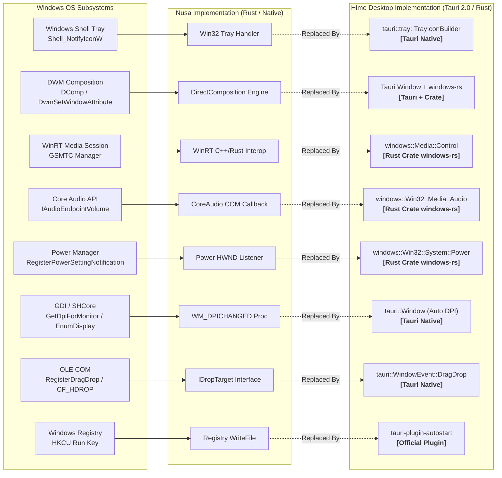

# Nusa Windows Integration Architecture & API Mapping

- **Document ID:** NUSA-WINDOWS-API-MAPPING
- **Task ID:** TASK-02-02 (Phase 02 — Nusa Reverse Engineering)
- **Target Application:** Nusa Dynamic Island for Windows (v1.2.0.0)
- **Authority:** Senior Windows Systems Architect & Interop Engineer
- **Status:** **CANONICAL INTEGRATION SPECIFICATION**
- **Date:** 2026-11-08

---

## 1. Executive Summary

Dokumen ini memetakan seluruh titik integrasi subsistem Microsoft Windows yang dimanfaatkan oleh **Nusa Dynamic Island v1.2.0.0** serta merumuskan strategi penggantiannya (*replacement strategy*) untuk implementasi **Hime Desktop**.

Analisis mencakup delapan domain integrasi Windows:
1. Windows Shell & System Tray
2. Deteksi Aplikasi Layar Penuh (*Fullscreen Detection*)
3. Sesi Pemutar Media (WinRT GSMTC)
4. Audio & Hardware HUD (Core Audio & WinMM)
5. Manajemen Daya & Baterai (*Power Setting Notifications*)
6. Konfigurasi Display & Penskalaan DPI (*Per-Monitor DPI*)
7. OLE COM Drag & Drop
8. Mekanisme Startup Registry

Setiap domain dipetakan secara terstruktur ke dalam ekosistem **Tauri 2.0 (Rust)**, mengidentifikasi apakah kapabilitas tersebut dapat ditangani langsung oleh API bawaan Tauri, plugin resmi Tauri, crate Rust komunitas, atau pemanggilan langsung Windows API via crate `windows-rs`.

> **Prinsip Kalibrasi Bukti Integrasi:**
> - **API Import (`[VERIFIED STATIC]`):** Dibuktikan dari Import Address Table (IAT) PE32+.
> - **API Invocation & Dispatch (`[INFERRED]`):** Pemanggilan aktif oleh logika runtime disimpulkan dari string fungsional dan perilaku UI yang teramati.
> - **Kapabilitas vs Realitas Performa:** Kapabilitas API sistem operasi (seperti peniadaan alokasi GDI redirection bitmap via `WS_EX_NOREDIRECTIONBITMAP`) merupakan kapabilitas arsitektural API, bukan jaminan otomatis pencapaian 60 FPS tanpa beban GPU.
> - **Batas Persistensi & Keamanan:** Integrasi keamanan Windows (DPAPI) melindungi secrets/field bernilai sensitif pada tingkat aplikasi, terpisah dari mekanisme journaling dan konkurensi SQLite WAL (di mana durability dipengaruhi konfigurasi `PRAGMA synchronous`), proteksi kontrol akses objek/berkas Windows ACL, enkripsi database aplikasi (SQLCipher), dan enkripsi volume OS (BitLocker).

---

## 2. Windows Integration Architecture Map

Diagram berikut mengilustrasikan jembatan integrasi antara sistem operasi Windows dengan arsitektur Nusa, serta padanannya untuk Hime Desktop:

---

## 3. Deep Domain Integration Analysis

### A. Windows Shell & System Tray Integration `[VERIFIED STATIC]`

- **API Nusa:** `Shell_NotifyIconW` (`shell32.dll` offset `0x108532`).
- **Mekanisme:**
  - Menggunakan struktur `NOTIFYICONDATAW` dengan bendera `NOTIFYICON_VERSION_4`.
  - Mendaftarkan pesan kustom `RegisterWindowMessageW("TaskbarCreated")` (offset `0x000E03C0`) untuk memulihkan ikon saat `explorer.exe` crash.
- **Strategi Penggantian Hime Desktop:**
  - **Tauri 2.0 Native Tray API (`tauri::tray::TrayIconBuilder`):**
    - Mendukung pendaftaran ikon tray secara cross-platform dengan menu konteks deklaratif di Rust.
    - Tauri secara otomatis menangani pesan `TaskbarCreated` di lapisan backend `tao` tanpa memerlukan penulisan callback Win32 manual.

---

### B. Fullscreen Application Detection `[VERIFIED STATIC]`

- **API Nusa:** `SHQueryUserNotificationState` (`shell32.dll` offset `0x10856C`).
- **Mekanisme:**
  - Mengevaluasi status layar penuh sistem: `QUNS_RUNNING_D3D_FULL_SCREEN`, `QUNS_PRESENTATION_MODE`, `QUNS_BUSY`.
  - Jika opsi `hide_fullscreen=1` aktif, notch disembunyikan otomatis via `ShowWindow(hwnd, SW_HIDE)`.
- **Strategi Penggantian Hime Desktop:**
  - **Rust Worker Thread via `windows-rs`:**
    - Worker thread berkala di backend Rust Hime memanggil `windows::Win32::UI::Shell::SHQueryUserNotificationState`.
    - Saat mendeteksi aplikasi fullscreen, Rust mengirimkan event `app.emit("hime://fullscreen-state", is_fullscreen)` ke frontend Webview2 untuk menyembunyikan atau memudarkan Dynamic Island.

---

### C. Media Session & Controls (WinRT GSMTC) `[VERIFIED STATIC]`

- **API Nusa:** WinRT `Windows.Media.Control.GlobalSystemMediaTransportControlsSessionManager` (offset `0x000EDED8`).
- **Mekanisme:**
  - Menangkap event `CurrentSessionChanged` dan `MediaPropertiesChanged`.
  - Membaca judul, artis, dan stream biner cover art via `Windows.Storage.Streams.DataReader`.
  - Mengirim perintah kontrol playback (`TryPlayAsync`, `TryPauseAsync`, `TrySkipNextAsync`).
- **Strategi Penggantian Hime Desktop:**
  - **Crate Rust `windows` (Namespace `windows::Media::Control`):**
    - Menggunakan binding WinRT resmi Microsoft di backend Rust Tauri.
    - Informasi musik dipublikasikan ke frontend Webview2 melalui event channel Tauri sebagai widget latar belakang opsional.

---

### D. Audio & Hardware HUD Integration `[VERIFIED STATIC]`

- **API Nusa:**
  - `IMMDeviceEnumerator` $\rightarrow$ `IAudioEndpointVolume` $\rightarrow$ `IAudioEndpointVolumeCallback` (Core Audio).
  - WMI Monitor Brightness Events.
  - `PlaySoundW` (`winmm.dll` offset `0x108BDC`).
- **Mekanisme:**
  - Callback dipicu saat volume berubah, memunculkan HUD OSD pada notch.
  - Memainkan suara lonceng alert via `PlaySoundW`.
- **Strategi Penggantian Hime Desktop:**
  - **Crate Rust `windows::Win32::Media::Audio` + Crate Audio `rodio`:**
    - Pemantauan volume Core Audio diimplementasikan di worker thread Rust.
    - Pemutaran efek suara notifikasi Hime menggunakan crate audio modern `rodio` atau HTML5 Web Audio API di frontend Webview2.
    - Output status divisualisasikan dalam bentuk **Agent Activity Stream HUD Pill**.

---

### E. Power & Battery Management `[VERIFIED STATIC]`

- **API Nusa:** `RegisterPowerSettingNotification` (`user32.dll` offset `0x108878`).
- **GUID Terpantau:**
  - `GUID_ACDC_POWER_SOURCE`: Deteksi charger adaptor AC.
  - `GUID_BATTERY_PERCENTAGE_REMAINING`: Deteksi kapasitas sisa baterai laptop.
  - `GUID_APMRESUMEAUTOMATIC`: Deteksi sistem bangun dari mode sleep.
- **Strategi Penggantian Hime Desktop:**
  - **Crate Rust `windows::Win32::System::Power`:**
    - Mendaftarkan notifikasi daya pada HWND jendela utama Tauri.
    - Digunakan oleh Hermes Agent untuk menyesuaikan profil konsumsi daya (misal: menunda inferensi model lokal berat saat baterai laptop < 20%).

---

### F. Display Configuration & Per-Monitor DPI Scaling `[VERIFIED STATIC]`

- **API Nusa:** `GetDpiForMonitor` (`api-ms-win-shcore-scaling-l1-1-1.dll`), `EnumDisplayMonitors`, pesan `WM_DPICHANGED`.
- **Mekanisme:**
  - Memperbarui resolusi Direct2D (`ID2D1RenderTarget::SetDpi`) tanpa degradasi buram.
- **Strategi Penggantian Hime Desktop:**
  - **Tauri 2.0 Native Per-Monitor DPI Awareness:**
    - Tauri (via crate `tao` dan engine `Webview2`) telah menerapkan `DPI_AWARENESS_CONTEXT_PER_MONITOR_AWARE_V2` secara default.
    - Webview2 merespons perubahan DPI monitor secara otomatis melalui CSS pixel scaling dan devicePixelRatio Chromium tanpa perlu penulisan kode manual.

---

### G. OLE COM Drag & Drop Interface `[VERIFIED STATIC]`

- **API Nusa:** OLE COM `IDropTarget` (`RegisterDragDrop`, `DoDragDrop`, `DragQueryFileW`).
- **Mekanisme:**
  - Mengizinkan penarikan berkas dari File Explorer ke notch untuk disimpan di `%LOCALAPPDATA%\Nusa\Shelf\`.
- **Strategi Penggantian Hime Desktop:**
  - **Tauri Window Event `tauri::WindowEvent::DragDrop`:**
    - Tauri menyediakan event drag-and-drop berkas native yang langsung memberikan array jalur absolut berkas (`Vec<PathBuf>`) ke Rust dan frontend.
    - Diintegrasikan langsung dengan **AI Context File Ingestion** untuk Hermes Agent.

---

### H. Startup Registry Management `[VERIFIED STATIC]`

- **API Nusa:** Penulisan string nilai ke `HKEY_CURRENT_USER\Software\Microsoft\Windows\CurrentVersion\Run`.
- **Strategi Penggantian Hime Desktop:**
  - **Plugin Resmi Tauri `tauri-plugin-autostart`:**
    - Mengelola auto-start pada registry Windows secara aman, terstandarisasi, dan terisolasi pada ruang lingkup pengguna saat ini (*current user*).

---

## 4. Comprehensive Windows Integration Translation Matrix

| Domain Integrasi | Implementasi Asli Nusa (v1.2.0.0) | Kebutuhan Hime Desktop | Rekomendasi Implementasi Hime | Tingkat Kompleksitas |
|:---|:---|:---|:---|:---:|
| **System Tray** | Win32 `Shell_NotifyIconW` + `TaskbarCreated` | Ikon baki persisten & menu kontrol latar belakang | `tauri::tray::TrayIconBuilder` (Native Tauri API) | Rendah |
| **Window Frame & Styles** | `WS_POPUP \| WS_EX_TOPMOST \| WS_EX_TOOLWINDOW` | Dynamic Island borderless, floating, always-on-top | Deklarasi `tauri.conf.json` + `WS_EX_NOREDIRECTIONBITMAP` via HWND (Kapabilitas peniadaan GDI surface DWM) | Sedang |
| **Backdrop Blur** | DirectComposition + DWM Acrylic Policy | Efek frosted glass di belakang Dynamic Island | CSS `backdrop-filter: blur(24px)` + Windows DWM Backdrop | Rendah |
| **Fullscreen Auto-Hide** | `SHQueryUserNotificationState` | Sembunyikan island saat game 3D / presentasi aktif | Rust worker thread via crate `windows::Win32::UI::Shell` | Sedang |
| **Media Controls** | WinRT GSMTC (`Windows.Media.Control`) | Deteksi media & visualizer audio sekunder | Crate Rust `windows::Media::Control` (Plugin Opsional) | Sedang |
| **Hardware HUD Popups** | Core Audio API (`IAudioEndpointVolumeCallback`) | Indikator visual aktivitas sistem | **Agent Activity Stream HUD Pill** di Tauri Frontend | Rendah |
| **Manajemen Daya** | `RegisterPowerSettingNotification` | Penyesuaian profil daya inferensi agen AI | Crate Rust `windows::Win32::System::Power` | Sedang |
| **DPI & Multi-Monitor** | `GetDpiForMonitor` + `WM_DPICHANGED` | Rendering tajam di semua monitor multi-DPI | Native Webview2 Chromium DPI Engine (Otomatis) | Rendah |
| **Drag & Drop Berkas** | OLE COM `IDropTarget` + `DragQueryFileW` | **AI Context Ingestion Shelf** (Drop berkas untuk AI) | Event Native `tauri::WindowEvent::DragDrop` | Rendah |
| **Auto-Start Registry** | Tulis string ke HKCU Run registry | Peluncuran otomatis saat Windows boot | Plugin Resmi `tauri-plugin-autostart` | Rendah |
| **Single-Instance Mutex**| Named Mutex `Local\NusaNotch.SingleInstance` | Pencegahan instans ganda & routing argumen CLI | Plugin Resmi `tauri-plugin-single-instance` | Rendah |
| **Global Shortcut** | Input hook Win32 | Pemanggilan Omnibox instan (`Alt + Space`) | Plugin Resmi `tauri-plugin-global-shortcut` | Rendah |
