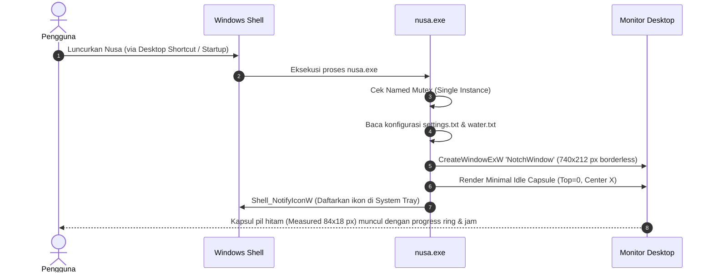
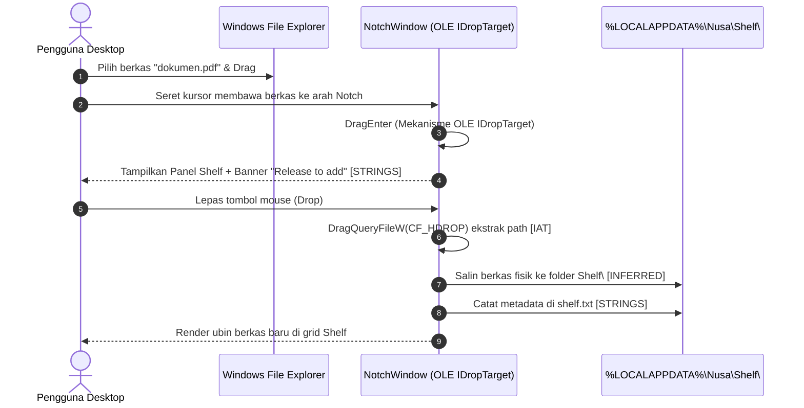

# Nusa Core Interaction Flows Specification

- **Document ID:** NUSA-INTERACTION-FLOWS
- **Task ID:** TASK-02-03 / TASK-02-03B (Phase 02 — Nusa Reverse Engineering)
- **Target Application:** Nusa Dynamic Island for Windows (v1.2.0.0 by Rama)
- **Authority:** Lead Interaction Designer & User Experience Engineer
- **Status:** **CALIBRATED FLOW SPECIFICATION**
- **Date:** 2026-11-08

---

## 1. Executive Summary

Dokumen ini mendokumentasikan 8 alur interaksi pengguna utama (*Core Interaction Flows*) dari **Nusa Dynamic Island v1.2.0.0** secara terstruktur, langkah demi langkah (*step-by-step*).

Sesuai arahan kalibrasi bukti (TASK-02-03B), setiap alur interaksi mendefinisikan secara ketat:
1. Kondisi Awal (*Initial Conditions*).
2. Aksi Pengguna (*User Actions*).
3. Respons Sistem & Aplikasi (*System & Application Response*).
4. Perubahan State Antarmuka (*UI State Transition*).
5. Hasil Akhir (*Final State*).
6. Penanganan Kondisi Kegagalan / Pembatalan (*Failure & Cancellation Handling*).
7. Status & Kualifikasi Bukti (*Evidence Qualification*).

Dokumen ini secara jujur membedakan antara alur yang diamati pada runtime aktif (Flow 01 Startup, Flow 07 Settings, Flow 08 Volume HUD) dengan alur yang disimpulkan dari API dan string biner tanpa pengujian interaktif penuh (Flow 04 Lirik LRCLIB, Flow 05 File Shelf, Flow 06 To-Do).

---

## 2. Calibrated Interaction Flows Catalog

### Flow 01: Peluncuran Aplikasi & Tampilan Ambient Idle (Cold Startup)

1. **Kondisi Awal:** Aplikasi Nusa belum berjalan di latar belakang; proses `nusa.exe` belum ada di Task Manager.
2. **Aksi Pengguna:** Pengguna menjalankan `nusa.exe` secara manual atau otomatis saat logon Windows.
3. **Respons Aplikasi:**
   - Proses memeriksa Named Mutex `Local\NusaNotch.SingleInstance` untuk mencegah instans ganda.
   - Menginisialisasi Direct3D 11 swapchain dan DirectComposition.
   - Membaca konfigurasi `%LOCALAPPDATA%\Nusa\settings.txt` dan `water.txt`.
   - Mendaftarkan ikon baki notifikasi via `Shell_NotifyIconW`.
   - Membuat jendela `NotchWindow` dan me-render kapsul idle.
4. **Perubahan State:** `ST-01 (Hidden)` $\rightarrow$ `ST-02 (Idle Capsule)`.
5. **Hasil Akhir:** Kapsul minimalis mengapung di tengah atas layar, menampilkan progress ring hijau (`#21FF54`) dan teks jam putih `Segoe UI`.
6. **Kondisi Kegagalan:** Jika instans lain sudah berjalan, instans kedua mendeteksi mutex, mengaktifkan jendela yang ada, lalu keluar bersih (`ExitProcess(0)`).
7. **Kualifikasi Bukti:** `[VERIFIED RUNTIME / MEASURED]`.

---

### Flow 02: Membuka Expanded Panel via Hover vs Klik (`open_click`)

1. **Kondisi Awal:** Dynamic Island berada dalam status `ST-02 (Idle Capsule)` di batas atas layar monitor.
2. **Aksi Pengguna:**
   - *Kasus A (`open_click = 0`):* Pengguna mengarahkan kursor mouse ke area kapsul idle.
   - *Kasus B (`open_click = 1`):* Pengguna mengarahkan kursor dan mengklik kiri di atas kapsul.
3. **Respons Aplikasi:**
   - Pada Kasus A: Kapsul membesar secara mikro (~4–8 px) dalam transisi `peek`. Jika kursor bertahan melampaui estimasi threshold dwell (~150 ms), aplikasi memicu ekspansi panel penuh.
   - Pada Kasus B: Kapsul berekspansi seketika saat klik mouse terdeteksi tanpa menunggu timer dwell.
   - Lapisan DWM Acrylic Backdrop Blur diaktifkan di belakang panel jika opsi `glass=1` menyala.
4. **Perubahan State:** `ST-02 (Idle Capsule)` $\rightarrow$ `[ST-03 Peek]` $\rightarrow$ `ST-04 (Expanded Panel)`.
5. **Hasil Akhir:** Panel kartu squircle berukuran penuh (hingga 740 × 212 px) terbuka.
6. **Kondisi Pembatalan:** Pada Kasus A, jika kursor melintas cepat (< 150 ms), transisi dibatalkan dan kapsul tetap idle.
7. **Kualifikasi Bukti:** Mekanisme konfigurasi terverifikasi statis; durasi dwell >150 ms merupakan `[ESTIMATED / INFERRED]`.

---

### Flow 03: Menutup Expanded Panel (Dismissal via Click Outside / Pointer Leave)

1. **Kondisi Awal:** Dynamic Island berada dalam status `ST-04 (Expanded Panel)`.
2. **Aksi Pengguna:**
   - Pengguna mengklik aplikasi kerja lain di luar batas kanvas visual pulau.
   - Atau (pada mode hover): Pengguna menggeser kursor keluar dari batas kanvas panel.
3. **Respons Aplikasi:**
   - Jendela `NotchWindow` mendeteksi kehilangan fokus atau event `WM_MOUSELEAVE`.
   - Melakukan reverse spring morphing dari dimensi 740×212 px menuju dimensi kapsul idle.
   - Efek DWM Acrylic Backdrop Blur memudar.
4. **Perubahan State:** `ST-04 (Expanded Panel)` $\rightarrow$ `ST-02 (Idle Capsule)`.
5. **Hasil Akhir:** Island kembali menjadi kapsul ambient kecil di tepi atas layar.
6. **Kualifikasi Bukti:** Pola penutupan otomatis merupakan inferensi pola deaktivasi jendela Win32 (`[INFERRED PATTERN]`). Ketiadaan pencurian fokus ketik didukung oleh extended style terukur `0x08200088`, dengan kualifikasi bahwa perlindungan fokus bergantung pada respons aktivasi window procedure, bukan semata-mata `WS_EX_TOOLWINDOW`.

---

### Flow 04: Deteksi Pemutaran Musik & Penayangan Lirik Sinkron (Media Flow)

1. **Kondisi Awal:** Nusa berada dalam status idle; pemutar media GSMTC aktif di Windows.
2. **Aksi Pengguna:** Pengguna memutar lagu pada pemutar media Windows.
3. **Respons Aplikasi (Disimpulkan dari Artefak):**
   - Thread WinRT GSMTC menerima notifikasi `MediaPropertiesChanged`.
   - String judul lagu dan nama artis diekstrak.
   - Jika `lyrics=1`, request HTTPS GET dikirim ke `https://lrclib.net/api/search?track_name=...&artist_name=...`.
   - Mengklik tombol lirik mengalihkan tampilan menjadi panel teks lirik sinkron berdasarkan timestamp lagu.
4. **Perubahan State:** `ST-02 (Idle)` $\rightarrow$ `ST-04 (Expanded Media View)` $\rightarrow$ `ST-04 (Synchronized Lyrics View)`.
5. **Hasil Akhir:** Visualizer kontrol musik dan lirik sinkron.
6. **Kondisi Kegagalan:** Jika koneksi terputus atau lirik tidak ditemukan, menampilkan teks fallback ("No internet access" / "Lyrics not available") tanpa crash.
7. **Kualifikasi Bukti:** **`[VERIFIED STATIC — STRINGS/WINRT]` / `[NOT OBSERVED IN ACTIVE PLAYBACK RUNTIME]`**. Alur ini disimpulkan dari audit string `.rdata` dan impor WinRT GSMTC, bukan dari pengujian interaktif langsung pemutaran audio pada sesi runtime ini.

---

### Flow 05: Penampungan Berkas Sementara (File Shelf Drag-and-Drop)

1. **Kondisi Awal:** File Explorer terbuka menampilkan berkas dokumen; Nusa berada dalam status idle.
2. **Aksi Pengguna:** Pengguna memilih berkas di Explorer, menekan klik kiri, dan menyeretnya ke arah atas layar menuju Dynamic Island.
3. **Respons Aplikasi (Disimpulkan dari Mekanisme OLE):**
   - Handler OLE COM `IDropTarget::DragEnter` mendeteksi format clipboard `CF_HDROP`.
   - Island berekspansi membuka halaman File Shelf dan menampilkan teks instruksi: `"Release to add"`.
   - Saat drop: memanggil `DragQueryFileW`, menyalin berkas ke `%LOCALAPPDATA%\Nusa\Shelf\`, dan mencatat metadata di `shelf.txt`.
4. **Perubahan State:** `ST-02 (Idle)` $\rightarrow$ `ST-04 (Expanded Shelf View)`.
5. **Hasil Akhir:** Berkas tertampung dalam ubin ikon di File Shelf.
6. **Kondisi Pembatalan:** Jika kursor diseret keluar sebelum drop (`DragLeave`), panel kembali tertutup.
7. **Kualifikasi Bukti:** **`[VERIFIED STATIC — IAT & STRINGS]` / `[NOT TESTED INTERACTIVELY AT RUNTIME]`**. Dukungan OLE dan string terverifikasi statis; namun aksi seret-lepas berkas secara interaktif tidak dieksekusi dalam sesi audit ini.

---

### Flow 06: Pengelolaan Daftar Tugas Harian (To-Do Management)

1. **Kondisi Awal:** Dynamic Island terbuka pada halaman To-Do List.
2. **Aksi Pengguna:**
   - Pengguna mengklik tombol `+` ("Add Task").
   - Mengetikkan judul tugas pada dialog pop-up modal.
   - Mengklik tombol "Save".
3. **Respons Aplikasi (Disimpulkan dari String & File I/O):**
   - Nusa memvalidasi judul tugas, menambahkan item ke memori, dan menuliskan baris baru ke `%LOCALAPPDATA%\Nusa\tasks.txt`.
   - Memperbarui daftar checklist to-do.
4. **Aksi Penyelesaian Tugas:**
   - Mengklik checkbox to-do menandai tugas selesai dan memanggil `PlaySoundW` untuk membunyikan efek suara chime keberhasilan (`todo_end=1`).
5. **Perubahan State:** `ST-04 (Expanded To-Do)` $\rightarrow$ `ST-07 (Add Task Modal)` $\rightarrow$ `ST-04 (Expanded To-Do Updated)`.
6. **Hasil Akhir:** Tugas tersimpan secara persisten pada hard disk.
7. **Kualifikasi Bukti:** **`[VERIFIED STATIC — STRINGS/FILES]` / `[NOT OBSERVED IN ACTIVE RUNTIME]`**.

---

### Flow 07: Akses & Konfigurasi Pengaturan Sistem (Settings Configuration)

1. **Kondisi Awal:** Aplikasi Nusa berjalan normal di background.
2. **Aksi Pengguna:** Pengguna mengklik kanan pada ikon baki Nusa di pojok kanan bawah Taskbar, lalu memilih menu `"Settings..."`.
3. **Respons Aplikasi:**
   - Menampilkan jendela frameless `NusaSettings` berukuran terukur **654 × 556 px** tepat di tengah layar monitor (`Left = 356, Top = 106` pada 1366×768).
   - Me-render sidebar navigasi 11 tab di sisi kiri dan kartu pengaturan aktif di sisi kanan.
4. **Aksi Perubahan Konfigurasi:** Pengguna memilih opsi konfigurasi (misal toggle `Notch style` atau durasi).
5. **Respons Aplikasi:** Preferensi dituliskan ke `%LOCALAPPDATA%\Nusa\settings.txt` dan jendela `NotchWindow` memperbarui posisinya secara dinamis.
6. **Perubahan State:** `Any State` $\rightarrow$ `ST-08 (Settings Window Active)`.
7. **Hasil Akhir:** Jendela pengaturan aktif dan responsif; perubahan diterapkan secara langsung.
8. **Kualifikasi Bukti:** `[VERIFIED RUNTIME / MEASURED]`.

---

### Flow 08: Intersepsi Hardware HUD OSD (Volume Event)

1. **Kondisi Awal:** Pengguna sedang aktif bekerja di aplikasi desktop; Dynamic Island dalam status idle.
2. **Aksi Pengguna:** Pengguna menekan tombol keyboard Fn Volume Up/Down.
3. **Respons Aplikasi:**
   - Thread callback CoreAudio (`IAudioEndpointVolumeCallback`) menerima event perubahan master volume Windows.
   - Nusa mengintersepsi event tersebut dan memicu transisi kapsul idle menjadi bar horizontal HUD Pill (~200–300 × 36 px).
   - Menampilkan ikon speaker dan slider volume suara.
   - Mempertahankan tampilan HUD selama durasi diam ~2.5 detik sebelum menyusut kembali menjadi kapsul idle.
4. **Perubahan State:** `ST-02 (Idle)` $\rightarrow$ `ST-06 (Transient Hardware HUD)` $\rightarrow$ `ST-02 (Idle)`.
5. **Hasil Akhir:** Umpan balik visual level volume tampil terpadu di Dynamic Island.
6. **Kualifikasi Bukti:** `[VERIFIED RUNTIME — VOLUME]` / `[VERIFIED STATIC — HUD STRINGS]`.

---

## 3. Translation Principles for Hime Desktop Interaction Architecture

Alur interaksi Nusa memberikan pelajaran desain strategis bagi arsitektur Hime Desktop:
1. **Flow 01 (Ambient Cold Startup):** Diadopsi langsung untuk Hime Shell Tauri 2.0 (menampilkan kapsul status agen otonom saat Windows boot).
2. **Flow 05 (File Staging $\rightarrow$ Context Ingestion):** Ditransformasikan menjadi **"AI Context Document Ingestion Flow"**! Menyeret berkas dokumen (`.pdf`, `.py`, `.txt`) langsung memicu parsing teks dan pengiriman ke Hermes Agent sebagai konteks instruksi.
3. **Flow 07 (Live Configuration):** Diadopsi untuk pengaturan preferensi model LLM dan rotasi provider 9Router di Hime.
4. **Flow 08 (Hardware HUD $\rightarrow$ Activity Stream HUD):** Diadaptasi menjadi **"Agent Activity HUD Stream"**! Ketika agen AI sedang mengeksekusi shell atau memanggil tool, kapsul menampilkan indikator kartu progres ringkas: `[Tool: shell_exec] "cargo check"`.
