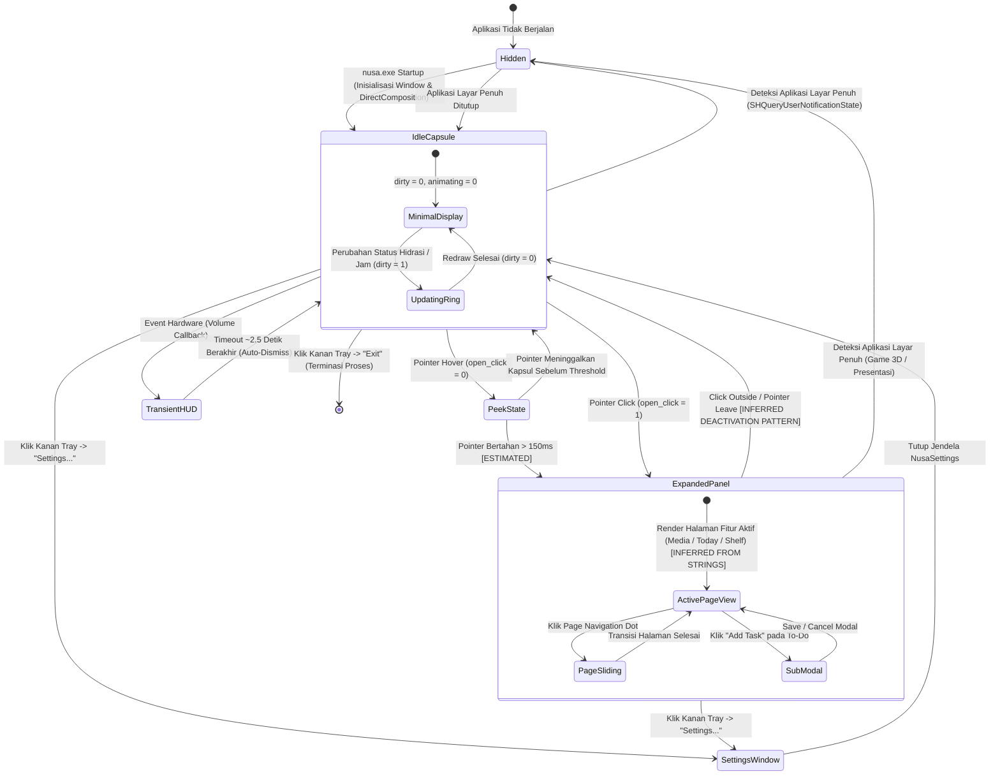

# Nusa UI State & Transition Mapping Specification

- **Document ID:** NUSA-STATE-TRANSITION-MAP
- **Task ID:** TASK-02-03 / TASK-02-03B (Phase 02 — Nusa Reverse Engineering)
- **Target Application:** Nusa Dynamic Island for Windows (v1.2.0.0 by Rama)
- **Authority:** Lead Systems Architect & Interaction State Machine Specialist
- **Status:** **CALIBRATED STATE SPECIFICATION**
- **Date:** 2026-11-08

---

## 1. Executive Summary

Dokumen ini memetakan seluruh status visual (*Visual States*) dan mesin status transisi antarkeadaan (*State Transition Machine*) dari **Nusa Dynamic Island v1.2.0.0**.

Berdasarkan analisis biner terhadap struktur variabel state (`animating`, `dirty`, `peek`, `hud`, `shelf`), pengujian runtime HWND, dan observasi perilaku antarmuka, siklus visual Nusa beroperasi sebagai **mesin status adaptif berbasis peristiwa (*event-driven state machine*)**.

Sesuai arahan kalibrasi bukti (TASK-02-03B), dokumen ini menerapkan pelabelan ketat:
- Membedakan batas kanvas fisik jendela terukur dengan sub-view yang disimpulkan dari string biner dan API.
- Menetapkan estimasi durasi waktu hover dwell (>150 ms) sebagai estimasi rekayasa (`[ESTIMATED / INFERRED]`).
- Mengkualifikasikan mekanisme penutupan otomatis klik di luar sebagai pola inferensi penonaktifan jendela (*inferred window deactivation pattern*).

---

## 2. Identified Primary Visual States

Melalui observasi empiris dan bukti statis biner, 8 status visual primer diidentifikasi pada Nusa:

| State ID | Nama Visual State | Deskripsi Tampilan Visual | Batas Dimensi (WxH) | Sumber Bukti | Status Observasi | Klasifikasi Bukti |
|:---:|:---|:---|:---:|:---|:---|:---:|
| **ST-01** | **Hidden / Terminated** | Jendela disembunyikan (proses mati atau mendeteksi game 3D layar penuh). | `0 × 0 px` | API `SHQueryUserNotificationState` | Terverifikasi via API import | `[VERIFIED STATIC]` |
| **ST-02** | **Idle Capsule (Minimal Notch)** | Status default ambient: kapsul pil hitam kecil di tengah atas, progress ring hijau & jam. | Measured: `84 × 18 px` (Kanvas: 740×212 px) | HWND `NotchWindow`, `GetWindowRect` | Diamati & diukur langsung pada runtime | `[VERIFIED RUNTIME / MEASURED]` |
| **ST-03** | **Peek / Pre-Expansion** | Status interaksi awal saat kursor mendekati kapsul: membesar mikro (~4–8 px). | `~92–250 × 24–42 px` | String biner `peek`, `animating` | Disimpulkan dari string state biner | `[VERIFIED STATIC / INFERRED]` |
| **ST-04** | **Expanded Panel (Active View)** | Status terbuka penuh: panel squircle hitam pekat menampilkan halaman fitur aktif. | Kanvas terukur hingga `740 × 212 px` | HWND `NotchWindow` bounds | Batas kanvas terukur; sub-view via strings | `[VERIFIED RUNTIME / MEASURED CANVAS]` |
| **ST-05** | **Page Transitioning** | Status perantara saat berpindah antar halaman fitur dengan efek crossfade. | `740 × 212 px` (Konstan) | String biner `page_icons` | Disimpulkan dari mekanisme translasi grafis | `[INFERRED]` |
| **ST-06** | **Transient Hardware HUD Pill** | Status notifikasi sementara: kapsul HUD memanjang untuk status volume/kecerahan/baterai. | `~180–320 × 36 px` | CoreAudio callback, string `hud_volume` | Volume HUD teramati runtime; lainnya via strings | `[VERIFIED RUNTIME / STATIC]` |
| **ST-07** | **Interactive Modal / Sub-Dialog** | Dialog input tugas to-do ("Add Task") yang mengambang di atas panel. | `~340 × 160 px` | String biner `Add Task`, `Save` | Disimpulkan dari teks UI pada `.rdata` | `[VERIFIED STATIC / INFERRED]` |
| **ST-08** | **Settings Window Active** | Jendela frameless terpisah `NusaSettings` yang dibuka di tengah desktop. | Measured: `654 × 556 px` | HWND `NusaSettings`, `GetWindowRect` | Diamati & diukur langsung pada runtime | `[VERIFIED RUNTIME / MEASURED]` |

---

## 3. Calibrated State Transition Matrix

Tabel berikut merinci setiap transisi antarkeadaan pada aplikasi Nusa:

| ID Transisi | Status Awal (*Initial State*) | Pemicu Peristiwa (*Event Trigger*) | Status Perantara (*Intermediate State*) | Status Akhir (*Final State*) | Perubahan Visual yang Terlihat | Estimasi Durasi | Bersifat Reversibel? | Klasifikasi & Catatan Bukti |
|:---:|:---|:---|:---|:---|:---|:---:|:---:|:---:|
| **TR-01** | **Hidden** (ST-01) | Biner `nusa.exe` dijalankan / boot startup | Animasi fade-in dan slide-down halus dari bezel atas | **Idle Capsule** (ST-02) | Kapsul pil hitam muncul mengapung di tengah atas layar | ~200–260 ms [ESTIMATED] | Ya (via Exit) | `[VERIFIED RUNTIME / VISUAL]` |
| **TR-02** | **Idle Capsule** (ST-02) | Kursor mouse hover di atas kapsul (`open_click=0`) | Animasi `peek` membesar ~4–8 px secara elastis | **Expanded Panel** (ST-04) | Kanvas memanjang ke kiri-kanan dan ke bawah hingga 740×212 px, backdrop blur DWM muncul | ~220 ms (Normal) / ~120 ms (Fast) [ESTIMATED] | Ya | `[ESTIMATED / INFERRED]` (Dwell time >150 ms merupakan estimasi rekayasa) |
| **TR-03** | **Idle Capsule** (ST-02) | Pengguna klik kiri mouse di atas kapsul (`open_click=1`) | Animasi morphing pegas Direct2D langsung | **Expanded Panel** (ST-04) | Panel squircle berekspansi secara instan tanpa delay timer hover | ~200 ms [ESTIMATED] | Ya | `[VERIFIED STATIC / INFERRED]` |
| **TR-04** | **Expanded Panel** (ST-04) | Kursor keluar dari batas kanvas / klik di luar (*click outside*) | Reverse morphing animasi pegas Direct2D | **Idle Capsule** (ST-02) | Panel menyusut kembali menjadi pil minimalis; backdrop blur DWM memudar | ~200–240 ms [ESTIMATED] | Ya | `[INFERRED PATTERN]` (Pola penonaktifan jendela Win32) |
| **TR-05** | **Expanded Panel** (ST-04) | Pengguna mengklik salah satu page navigation dot | Geseran horizontal (*horizontal slide*) konten card | **Page Transitioning** (ST-05) $\rightarrow$ **Expanded Panel** (ST-04) | Konten halaman lama meluncur keluar, halaman baru meluncur masuk dengan crossfade teks | ~180 ms [ESTIMATED] | Ya | `[INFERRED LAYOUT & MOTION]` |
| **TR-06** | **Idle Capsule** (ST-02) | Pengguna menekan tombol Fn Volume Up/Down | Kapsul melebar secara elastis membentuk bar horizontal | **Transient HUD Pill** (ST-06) | Menampilkan ikon speaker dan level slider volume | Durasi aktif ~2.5 detik (Auto-dismiss) [ESTIMATED] | Ya | `[VERIFIED RUNTIME — VOLUME]` |
| **TR-07** | **Expanded Panel** (ST-04) | Pengguna mengklik tombol "+" pada tab To-do | Animasi pop-in dialog modal semi-transparan | **Interactive Modal** (ST-07) | Form input teks "Task title" muncul di atas panel to-do | ~120 ms [ESTIMATED] | Ya (via Cancel/Save) | `[VERIFIED STATIC — STRINGS]` |
| **TR-08** | **Idle / Expanded** (ST-02/04) | Sistem mendeteksi game 3D fullscreen (`SHQueryUserNotificationState`) | Animasi slide-up cepat ke balik bezel atas | **Hidden** (ST-01) | Notch menghilang total agar tidak menghalangi HUD game | ~150 ms [ESTIMATED] | Ya | `[VERIFIED STATIC — API]` |
| **TR-09** | **Any State** (ST-02/04) | Pengguna memilih "Settings..." dari menu System Tray | Jendela `NusaSettings` di-render di tengah monitor | **Settings Window Active** (ST-08) | Jendela 654×556 px muncul dengan sidebar abu-abu gelap dan kartu opsi | ~180 ms [ESTIMATED] | Ya (via Close) | `[VERIFIED RUNTIME / MEASURED]` |

---

## 4. Visual State Transition Diagram

Diagram status visual berikut menggambarkan alur transisi antarkeadaan pada Nusa:

---

## 5. Architectural Evaluation for Hime Desktop Design

Mesin status Nusa memberikan pelajaran berharga untuk perancangan **Hime Adaptive Elastic Canvas**:
1. **Pola Transisi Non-Blocking:** Transisi Nusa dari status `ST-02` (Idle) ke `ST-04` (Expanded) berlangsung murni melalui animasi DirectComposition lokal tanpa pemblokiran I/O disk atau panggilan jaringan berat.
2. **Kebutuhan State Tambahan pada Hime:**
   Hime Desktop memerlukan penambahan 3 status visual baru yang belum ada pada Nusa:
   - **`ST-HIME-PROMPT` (Omnibox Prompting State):** Status saat pengguna menekan `Alt + Space` untuk mengetikkan instruksi ke Hermes Agent.
   - **`ST-HIME-ACTIVITY` (Agent Activity Stream State):** Status saat Hermes Agent sedang berpikir, memanggil tools sistem (`tool://invoking`), atau membaca berkas.
   - **`ST-HIME-APPROVAL` (Action Approval Gate State):** Status dialog konfirmasi izin interaktif (*Human-in-the-Loop Approval Modal*) sebelum perintah sistem berisiko tinggi dieksekusi (SEC-06).
