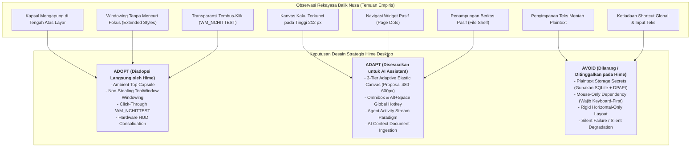

# Nusa UX Assessment & Strategic Design Framework for Hime Desktop

- **Document ID:** NUSA-UX-ASSESSMENT
- **Task ID:** TASK-02-03 / TASK-02-03B (Phase 02 — Nusa Reverse Engineering)
- **Target Comparison:** Nusa Dynamic Island v1.2.0.0 vs Hime AI Desktop Environment
- **Authority:** Principal Product Designer & AI UX Strategist
- **Status:** **CALIBRATED UX ASSESSMENT & DESIGN FRAMEWORK**
- **Date:** 2026-11-08

---

## 1. Executive Summary

Dokumen ini menyajikan evaluasi kritis dan audit pengalaman pengguna (*User Experience Assessment*) terhadap **Nusa Dynamic Island v1.2.0.0**, serta merumuskan kerangka kerja keputusan desain strategis (**Adopt / Adapt / Avoid**) untuk pengembangan **Hime Desktop**.

Sesuai arahan kalibrasi bukti (TASK-02-03B), dokumen ini menerapkan pemisahan eksplisit dan terstruktur antara empat lapisan analisis:
1. **Fakta Observasi (*Observed Fact*):** Apa yang secara nyata diamati, diukur secara empiris, atau diverifikasi dari biner dan artefak.
2. **Interpretasi Rekayasa (*Engineering Interpretation*):** Analisis deduktif teknis mengenai bagaimana sistem kemungkinan mengimplementasikan perilaku tersebut.
3. **Evaluasi Pengalaman Pengguna (*UX Assessment*):** Analisis dampak interaksi terhadap ergonomi, alur kerja desktop, kemudahan, dan friksi pengguna.
4. **Rekomendasi Desain untuk Hime (*Hime Design Recommendation*):** Usulan arsitektur dan keputusan produk untuk Hime Desktop. Kategori **Adopt / Adapt / Avoid** merupakan keputusan desain strategis untuk Hime, **bukan fakta mengenai Nusa**.

Khusus mengenai rekomendasi dimensi kanvas vertikal Hime (**480–600 px**), dokumen ini menegaskan bahwa angka tersebut merupakan **proposal rekayasa awal yang memerlukan validasi desain dan pengujian kegunaan (*usability testing*)**, bukan batasan final atau karakteristik milik Nusa.

---

## 2. In-Depth UX Evaluation: 4-Tier Analysis Framework

### Topik 01: Kehadiran Ambient & Tampilan Kapsul Idle (Minimal Notch)
- **Fakta Observasi (*Observed Fact*):**
  - Jendela `NotchWindow` beroperasi dengan style `WS_POPUP` dan extended style `WS_EX_TOPMOST | WS_EX_TOOLWINDOW | WS_EX_NOREDIRECTIONBITMAP` (`0x08200088`).
  - Kapsul idle berukuran terukur 84 × 18 px non-black bounding box pada layar 1366 × 768 px (`Top = 0` pada mode Classic).
  - Memuat busur progress ring warna hijau `#21FF54` dan jam digital putih `Segoe UI`.
- **Interpretasi Rekayasa (*Engineering Interpretation*):**
  - Aplikasi memanfaatkan DirectComposition untuk me-render elemen visual tanpa alokasi GDI redirection bitmap, mempertahankan per-pixel alpha transparency.
- **Evaluasi Pengalaman Pengguna (*UX Assessment*):**
  - Sangat ramah kognitif (*low cognitive load*). Memberikan informasi ambient sekilas (*glanceable information*) mengenai waktu dan hidrasi tanpa memakan ruang kerja layar dan tanpa memicu peralihan konteks (*zero context switching*).
- **Rekomendasi Desain untuk Hime (*Hime Design Recommendation*):**
  - **ADOPT:** Hime mengadopsi kapsul ambient mengapung di tengah atas layar sebagai jangkar visual kehadiran agen AI (*Ambient AI Presence*).

### Topik 02: Pemicu Ekspansi (Hover Dwell vs Single Click)
- **Fakta Observasi (*Observed Fact*):**
  - Konfigurasi `settings.txt` menyediakan opsi `open_click` (0 untuk hover, 1 untuk klik).
  - Mode hover memperlihatkan transisi `peek` mikro sebelum ekspansi penuh.
  - Ambang batas dwell hover diperkirakan sekitar ~150 ms (`[ESTIMATED / INFERRED]`).
- **Interpretasi Rekayasa (*Engineering Interpretation*):**
  - Logika window procedure memanfaatkan `TrackMouseEvent` (`WM_MOUSEHOVER`) dengan timer delay internal untuk menyaring gerakan melintas kursor yang tidak disengaja.
- **Evaluasi Pengalaman Pengguna (*UX Assessment*):**
  - *Mode Hover:* Menyenangkan untuk inspeksi cepat, namun rentan memicu ekspansi tidak disengaja (*accidental expansion*) saat pengguna hendak mengklik tab browser yang berada tepat di tepi atas layar.
  - *Mode Klik:* Mengeliminasi ekspansi tak disengaja, namun menambah beban satu klik fisik.
- **Rekomendasi Desain untuk Hime (*Hime Design Recommendation*):**
  - **ADOPT:** Hime mempertahankan opsi konfigurasi pemicu (`trigger_mode: hover | click`), dengan default disarankan pada mode klik atau hover dengan delay threshold yang lebih konservatif (~250 ms) guna mencegah friksi saat berinteraksi dengan tab peramban.

### Topik 03: Batasan Kanvas Vertikal (Tinggi Statis 212 px)
- **Fakta Observasi (*Observed Fact*):**
  - Kanvas jendela `NotchWindow` memiliki batas tinggi maksimum terukur **212 px** (`GetWindowRect`: Bottom - Top = 212 px).
  - Seluruh sub-view fitur (Media, Today, Widgets, To-Do, Shelf) dipaksa muat di dalam batas tinggi ini.
- **Interpretasi Rekayasa (*Engineering Interpretation*):**
  - Kanvas didesain statis untuk widget bergaya kartu ringkas; tidak ada mekanisme virtual scroll vertikal atau penyesuaian dinamis tinggi jendela.
- **Evaluasi Pengalaman Pengguna (*UX Assessment*):**
  - **Kelemahan Ergonomi Kritis.** Batas 212 px sangat sempit; hanya memadai untuk kontrol pemutar lagu atau to-do 3 baris. Sangat tidak memadai untuk membaca ringkasan teks panjang, melihat tabel data, atau membaca blok kode sintaksis.
- **Rekomendasi Desain untuk Hime (*Hime Design Recommendation*):**
  - **ADAPT (Proposal Desain Awal Hime):** Hime merumuskan **3-Tier Adaptive Elastic Canvas**:
    - Tier 1: 34 px (Ambient Idle Capsule).
    - Tier 2: 212 px (Transient HUD & Quick Action Pill).
    - **Tier 3: 480–600 px (Rich Markdown AI Chat Canvas).**
  - *Status Kualifikasi:* **Dimensi Tier 3 (480–600 px) merupakan proposal rekayasa awal yang wajib divalidasi melalui pengujian kegunaan (*usability testing*) pada siklus implementasi Hime, bukan fakta tentang Nusa.**

### Topik 04: Aksesibilitas & Kontrol Papan Ketik
- **Fakta Observasi (*Observed Fact*):**
  - Tidak ditemukan impor API `RegisterHotKey` pada IAT `nusa.exe`.
  - Tidak ditemukan string konfigurasi shortcut global pada `.rdata` biner (`[NOT FOUND IN BINARY ARTIFACTS]`).
  - Tidak ada bar input teks permanen pada kanvas Dynamic Island (satu-satunya input teks yang teridentifikasi adalah dialog modal to-do "Add Task").
- **Interpretasi Rekayasa (*Engineering Interpretation*):**
  - Nusa dirancang secara eksklusif dengan paradigma interaksi mouse-pointer; navigasi keyboard dan pemanggilan shortcut global tidak diimplementasikan.
- **Evaluasi Pengalaman Pengguna (*UX Assessment*):**
  - **Hambatan Aksesibilitas Parah (*Major Accessibility Blocker*).** Pengguna profesional (*power users*) yang mengandalkan keyboard terhambat karena harus selalu meraih mouse untuk membuka antarmuka. Ketiadaan input teks membatasi aplikasi hanya sebagai dashboard widget pasif.
- **Rekomendasi Desain untuk Hime (*Hime Design Recommendation*):**
  - **ADAPT & REPLACE:** Hime menolak ketergantungan mouse 100%. Hime wajib menghadirkan **Omnibox Prompt Bar** terpadu dan **Pintasan Global `Alt + Space`** untuk membuka dan mengoperasikan asisten secara penuh menggunakan keyboard.

### Topik 05: Penanganan Berkas & Staging (File Shelf)
- **Fakta Observasi (*Observed Fact*):**
  - Biner mengimpor API OLE COM (`RegisterDragDrop`, `DragQueryFileW`, `DoDragDrop`).
  - Memuat string `"Release to add"` dan penulisan berkas ke `shelf.txt`.
- **Interpretasi Rekayasa (*Engineering Interpretation*):**
  - Aplikasi mengimplementasikan antarmuka OLE `IDropTarget` untuk menerima payload `CF_HDROP` dan menyalin berkas fisik ke folder lokal staging.
- **Evaluasi Pengalaman Pengguna (*UX Assessment*):**
  - Interaksi penyeretan berkas ke tepi atas layar terasa intuitif sebagai tempat penampungan sementara (*shelf staging*). Namun, sifatnya pasif (hanya menampung berkas tanpa analisis isi).
- **Rekomendasi Desain untuk Hime (*Hime Design Recommendation*):**
  - **ADAPT:** Hime mentransformasikan File Shelf pasif menjadi **AI Context Document Ingestion**. Menyeret berkas (`.pdf`, `.py`, `.txt`, `.png`) ke Dynamic Island langsung memicu ekstraksi konten dan pengiriman dokumen sebagai konteks prompt ke Hermes Agent.

---

## 3. Strategic Framework: Adopt, Adapt, & Avoid for Hime Desktop

Kerangka kerja berikut merupakan **keputusan desain strategis produk untuk pengembangan Hime Desktop**, yang dirumuskan berdasarkan temuan reverse engineering Nusa:

---

### A. ADOPT (Pola yang Diadopsi Langsung oleh Hime Desktop)

Keputusan desain untuk mengadopsi pola interaksi yang terbukti unggul pada Nusa:

| Pola Desain / Interaksi | Justifikasi Rekayasa Produk | Dasar Temuan Observasi Nusa | Implementasi pada Hime Desktop |
|:---|:---|:---:|:---|
| **1. Ambient Floating Top Capsule** | Menyediakan jangkar visual yang elegan di tepi atas monitor tanpa memakan ruang kerja layar berharga. | `[VERIFIED RUNTIME / MEASURED]` (Dimensi idle 84×18 px) | Hime menggunakan kapsul minimalis di tengah atas layar sebagai indikator kehadiran agen AI (*Ambient AI Presence*). |
| **2. Non-Disruptive Desktop Windowing** | Extended style `WS_EX_TOPMOST \| WS_EX_TOOLWINDOW` dan pencegahan pencurian fokus menjamin pulau selalu berada di atas tanpa mengganggu pengetikan pengguna. | `[VERIFIED RUNTIME]` (ExStyle `0x08200088`) | Hime Tauri Shell mengonfigurasi `always_on_top` dan `skip_taskbar` dengan perlakuan penanganan aktivasi Win32 serupa. |
| **3. Click-Through Per-Pixel Transparency** | Memastikan area kosong kanvas tidak memblokir interaksi mouse pada aplikasi lain di bawahnya. | `[INFERRED]` (Handling pesan `WM_NCHITTEST`) | Hime mengimplementasikan subclassing window procedure atau Webview2 transparent hit-test mask (`HTTRANSPARENT`). |
| **4. Hardware HUD Consolidation** | Menggabungkan notifikasi sistem (volume, status baterai laptop, adaptor AC) ke dalam pil visual yang seragam. | `[VERIFIED RUNTIME]` (CoreAudio Volume callback) | Hime mengintegrasikan notifikasi hardware ke dalam baris HUD Dynamic Island. |
| **5. Smooth Continuous Curvature Squircles** | Menghindari sudut membulat kaku konvensional; memberikan estetika modern tingkat tinggi. | `[VERIFIED VISUAL]` (Direct2D Path Geometry) | Hime menggunakan styling CSS border-radius terakselerasi GPU dengan kurvatur squircle halus. |

---

### B. ADAPT (Pola yang Disesuaikan untuk Kebutuhan Asisten AI)

Pola Nusa yang ditransformasikan secara mendasar agar sesuai dengan kebutuhan sistem agen otonom:

| Pola Asli Nusa | Masalah / Keterbatasan Nusa | Strategi Adaptasi Desain untuk Hime Desktop | Status Proposal & Spesifikasi Hime |
|:---|:---|:---|:---:|
| **1. Kanvas Kaku 740 × 212 px** | Batas tinggi 212 px tidak mampu menampilkan percakapan Markdown, tabel analisis, atau blok kode. | **Proposal 3-Tier Adaptive Elastic Canvas:** Jendela berekspansi secara vertikal sesuai kebutuhan muatan konten AI: Tier 1 (34 px Idle) $\rightarrow$ Tier 2 (212 px HUD Activity) $\rightarrow$ **Tier 3 (480–600 px Rich Chat Canvas)**. | **Proposal Awal (Wajib Validasi Desain & Usability Testing)** |
| **2. Navigasi Halaman Statis (Page Dots)** | Dots navigasi horisontal hanya cocok untuk widget terpisah (Media, Water, To-Do). | **Agent Activity Stream Paradigm:** Menggantikan navigasi widget pasif dengan alur transparansi operasional agen (Rencana tindakan, alat sistem yang dipanggil, progres eksekusi, dan hasil akhir). | Keputusan Desain Hime |
| **3. File Shelf Pasif** | Berkas yang di-drop hanya disimpan statis pada folder lokal tanpa pemrosesan konten. | **AI Context Document Ingestion:** Menyeret berkas dokumen (`.pdf`, `.txt`, `.py`, `.json`, `.png`) langsung memicu ekstraksi teks dan pengiriman ke Hermes Agent sebagai konteks instruksi. | Keputusan Desain Hime |
| **4. Notifikasi Toast Pasif** | Pengguna hanya melihat pop-up informasi tanpa kemampuan pengambilan keputusan keamanan. | **Interactive Action Approval Modal:** Menghadirkan modal otorisasi tindakan interaktif (*Human-in-the-Loop*) untuk operasi berisiko tinggi (SEC-06). | Keputusan Desain Hime |
| **5. Pemicu Hover Default** | Rentan memicu ekspansi tak disengaja saat kursor melintas di dekat tab browser atas. | **Omnibox Bar & Intent-Aware Hover:** Memberikan delay threshold cerdas (~250 ms) pada mode hover, serta menetapkan mode klik / shortcut keyboard sebagai pemicu utama. | Keputusan Desain Hime |

---

### C. AVOID (Pola yang Dilarang & Ditinggalkan pada Hime Desktop)

Praktik pada Nusa yang dinilai berisiko atau suboptimal dan dilarang untuk diterapkan pada Hime:

| Pola Teramati di Nusa | Bahaya / Dampak Negatif bagi Pengguna | Larangan Mutlak untuk Hime Desktop | Solusi Rekayasa Hime |
|:---|:---|:---|:---|
| **1. Penyimpanan Kredensial Teks Polos** | Berkas `clipboard.txt` dan `settings.txt` menyimpan teks mentah tanpa enkripsi, membocorkan rahasia pengguna (SEC-02). | **DILARANG:** Hime tidak boleh menyimpan teks clipboard atau preferensi dalam plaintext mentah. | Gunakan **SQLite dengan enkripsi selektif Windows DPAPI (`CryptProtectData`)** dan Windows ACL ketat. |
| **2. Ketergantungan Mouse Murni (Mouse-Only)** | Tidak ada shortcut global keyboard; pengguna harus selalu meraih mouse untuk membuka island. | **DILARANG:** Hime tidak boleh menjadi aplikasi mouse-only. | Wajib menghadirkan shortcut global **`Alt + Space`** untuk membuka Omnibox seketika dari mana saja. |
| **3. Penulisan File Non-Atomik** | Nusa menimpa berkas persisten secara in-place tanpa atomic rename, berisiko korupsi data 0-byte saat crash. | **DILARANG:** Hime dilarang melakukan penulisan berkas langsung tanpa jaminan atomik. | Menggunakan transaksi ACID basis data SQLite lokal. |
| **4. Tata Letak Horisontal Kaku** | Seluruh informasi dipaksa melebar secara horisontal (lebar 740 px tapi tinggi sangat tipis). | **DILARANG:** Hime tidak boleh membatasi layout hanya pada orientasi horizontal sempit. | Hime menyediakan kanvas percakapan vertikal yang nyaman dibaca dengan virtual scrolling. |
| **5. Kegagalan Jaringan Senyap (*Silent Failure*)** | Saat koneksi putus, Nusa gagal memuat lirik tanpa pesan diagnostik yang informatif. | **DILARANG:** Hime tidak boleh menelan kegagalan inferensi atau koneksi gateway secara senyap. | Hime menampilkan banner status koneksi 9Router loopback secara transparan (*9Router Health Status Pill*). |

---

## 4. Usability Principles for Hime Desktop Design

Menyelaraskan temuan di atas dengan prinsip-prinsip Heuristik Nielsen untuk antarmuka desktop modern:

1. **Visibility of System Status:** Hime Dynamic Island harus secara real-time mengomunikasikan apakah Hermes Agent sedang idle, menyusun rencana, memanggil tool eksternal, atau menunggu konfirmasi izin pengguna melalui **Agent Activity Stream**.
2. **Match Between System and the Real World:** Menjaga metafora "Pulau Dinamis" yang mengapung di atas desktop, bereaksi secara fisik terhadap penyeretan dokumen dan ketukan keyboard.
3. **User Control and Freedom:** Pengguna dapat membatalkan instruksi agen yang sedang berjalan kapan saja via tombol `[ Batal / Stop ]` atau tombol `Esc`.
4. **Consistency and Standards:** Menghormati konvensi Windows: dark mode elevation palet warna (`#151517`, `#1C1C1E`, `#28282A`), shortcut global terstandarisasi, dan tipografi `Segoe UI Variable`.
5. **Flexibility and Efficiency of Use:** Akses ganda yang seimbang: pengguna kasual dapat menggunakan mouse hover dan drag-and-drop, sementara pengguna mahir (*power users*) dapat sepenuhnya mengoperasikan asisten menggunakan keyboard (`Alt + Space`, `Enter`, `Tab`, `Esc`).
