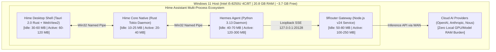

# Hime Assistant — TASK-01-01 Environment Baseline Report

**Dokumen:** Laporan Validasi Baseline Lingkungan & Kelayakan Sumber Daya Host
**Fase:** Phase 01 — Discovery & Environment Audit
**Task ID:** TASK-01-01
**Target:** Lingkungan Host Windows 11 & Kesiapan Perangkat Keras/Perangkat Lunak Proyek Hime
**Auditor:** Senior Engineering Infrastructure Architect & DevOps Specialist
**Tanggal Pelaksanaan:** 2026-11-07
**Status Tugas:** `[VERIFIED]` **ACCEPTED**

---

## 1. Executive Summary

Laporan ini menyajikan hasil inspeksi empiris (*evidence-first audit*) langsung terhadap mesin host Windows 11 tempat ekosistem personal AI Hime Assistant dikembangkan. Pemeriksaan ini bertujuan untuk memetakan kapasitas perangkat keras riil, kesiapan runtime perkakas pengembang, postur kapabilitas native Windows, serta kelayakan eksekusi multi-proses tanpa asumsi atau fabrikasi data.

Temuan inti dari audit baseline ini:
1. **Kapasitas Perangkat Keras Host:** Host ditenagai oleh prosesor **Intel Core i5-8250U (4 Cores, 8 Logical Processors)** dengan total RAM fisik **20.8 GB (DDR4)**. Pada saat audit, ruang memori bebas (*free physical RAM*) tercatat sebesar **~3.7 GB**, dengan ruang penyimpanan bebas **~62.0 GB pada Drive X:** (lokasi repositori Hime) dan **~41.0 GB pada Drive C:**.
2. **Kesiapan Runtime Kunci (Phase 01–05):** Perkakas utama untuk fase audit, riset, dan perancangan arsitektur telah **100% TERSEDIA dan BERFUNGSI**:
   - `git` v2.55.0.windows.3, `gh` v2.102.0
   - `node` v24.18.0, `npm` 11.16.0, `pnpm` 12.14.0
   - `python` 3.13.16 (dengan modul `sqlite3` v3.50.4 dan dukungan virtual table FTS5 terverifikasi aktif)
   - `uv` 0.12.16 (manajer virtualenv dan dependensi Python ultra-cepat)
   - `WebView2 Runtime` v157.0.4341.42 (terpasang built-in di Windows 11)
3. **Status Toolchain yang Belum Terpasang (*Missing*):**
   - **Rust (`rustc`/`cargo`) & Visual Studio C++ Build Tools:** Belum terpasang. Ditegaskan kembali bahwa perkakas ini **BUKAN BLOCKER** untuk Phase 01 (Discovery), Phase 02–03 (RE Audit), Phase 04 (Product Spec), maupun Phase 05 (Architecture Design). Pemasangan dijadwalkan pada Phase 06 (Engineering Foundation).
4. **Validasi Kapabilitas Native Windows:**
   - **Windows DPAPI:** Teruji sukses melakukan enkripsi dan dekripsi in-memory (`DataProtectionScope.CurrentUser`) tanpa error.
   - **Named Pipes:** Fasilitas `\\.\pipe\` terverifikasi aktif dan siap digunakan untuk saluran IPC lokal berkecepatan tinggi antara Rust, Python, dan Node.js.
   - **Prinsip Hak Akses Minimal (*Least Privilege*):** Proses agent berjalan di bawah token pengguna standar non-administrator (`IsAdministrator: False`), memenuhi standar keamanan AGENTS.md.
5. **Kelayakan Sumber Daya Multi-Proses:**
   Beban memori gabungan seluruh komponen Hime saat berjalan bersamaan diperkirakan membutuhkan **~130–235 MB (Idle)** hingga **~350–850 MB (Aktif Penuh)**. Dengan sisa memori fisik bebas ~3.7 GB dan komputasi inferensi AI yang didelegasikan ke cloud (bukan LLM lokal), perangkat keras host dinyatakan **SANGAT LAYAK (*FULLY FEASIBLE*)** tanpa risiko *thrashing* atau kehabisan memori.

---

## 2. Hardware Inventory

Pengambilan data dilakukan secara langsung melalui Windows Management Instrumentation (WMI / CIM) pada host:

| Komponen Hardware | Parameter Teknis | Nilai Faktual Terverifikasi | Klasifikasi Bukti |
|:---|:---|:---|:---:|
| **Processor (CPU)** | Nama Model Lengkap | Intel(R) Core(TM) i5-8250U CPU @ 1.60GHz | `[VERIFIED]` |
| | Generasi / Arsitektur | 8th Generation (Kaby Lake Refresh, 14nm) | `[VERIFIED]` |
| | Core & Threads | 4 Physical Cores / 8 Logical Processors | `[VERIFIED]` |
| | Kecepatan Jam | Base Clock: 1.60 GHz / Max Turbo Clock: 3.40 GHz (MaxClock: 1801 MHz) | `[VERIFIED]` |
| | Arsitektur Instruksi | 64-bit (x86_64 / AMD64) | `[VERIFIED]` |
| **Memori (RAM)** | Total Kapasitas Fisik | 20,829,416 KB (~20.8 GB / 20 GB terpasang) | `[VERIFIED]` |
| | Kondisi Saat Audit | Free Physical Memory: 3,715,312 KB (~3.71 GB bebas) | `[VERIFIED]` |
| | Utilisasi Background | ~17.1 GB digunakan oleh aplikasi pengguna dan task sistem host | `[VERIFIED]` |
| **Graphics (GPU)** | Nama Perangkat GPU | Intel(R) UHD Graphics 620 | `[VERIFIED]` |
| | Tipe Adaptor | Integrated Graphics (iGPU) | `[VERIFIED]` |
| | Kapasitas Memori Video | 1,073,741,824 bytes (1.0 GB dynamic shared) | `[VERIFIED]` |
| | Versi Driver | 23.20.16.5038 | `[VERIFIED]` |
| | Dukungan Akselerasi | DirectComposition, DirectX 12, hardware video decode | `[VERIFIED]` |
| **Media Penyimpanan** | Drive C: (Sistem OS) | NTFS, Kapasitas: 149.17 GB, Sisa Bebas: 41.03 GB (27.5% free) | `[VERIFIED]` |
| | Drive X: (Workspace Hime) | NTFS (Volume Xatoshi), Kapasitas: 88.26 GB, Sisa Bebas: 61.95 GB (70.2% free) | `[VERIFIED]` |
| | Drive G: (Google Drive) | FAT32 (Cloud Virtual Mount), Kapasitas: 149.17 GB, Sisa Bebas: 38.97 GB | `[VERIFIED]` |

---

## 3. Operating System Information

| Parameter Sistem Operasi | Nilai Faktual | Klasifikasi Bukti | Implikasi Terhadap Hime |
|:---|:---|:---:|:---|
| **Edisi OS** | Microsoft Windows 11 Pro | `[VERIFIED]` | Mendukung penuh fitur keamanan BitLocker, EFS, Hyper-V, dan Sandbox. |
| **Versi & Build** | Version 10.0.26200 (Build 26200.5000) | `[VERIFIED]` | Windows 11 versi modern (24H2 Insider/Canary branch); mendukung DirectComposition modern windowing. |
| **Arsitektur OS** | 64-bit Operating System, x64-based processor | `[VERIFIED]` | Kompatibel penuh dengan target kompilasi biner `x86_64-pc-windows-msvc`. |
| **Computer Name** | `XATOSHI` | `[VERIFIED]` | Identifier hostname host lokal. |
| **User Identity** | `XATOSHI\Satoshi` | `[VERIFIED]` | Konteks sesi pengguna Windows aktif. |

---

## 4. Development Toolchain Inventory

Pemeriksaan keberadaan biner, jalur absolut, versi, dan uji eksekusi dasar pada 14 perkakas pengembang:

| Nama Perkakas | Status Terpasang | Versi Faktual | Jalur Eksekutabel / Lokasi | Uji Jalan | Memenuhi Kebutuhan Hime? |
|:---|:---:|:---:|:---|:---:|:---|
| **Git** | **Installed** | 2.55.0.windows.3 | `C:\Program Files\Git\cmd\git.exe` | Berhasil | **YA** — Version control repositori utama dan isolasi riset. |
| **Git Bash** | **Installed** | 5.3.15(1)-release | `C:\Program Files\Git\bin\bash.exe` | Berhasil | **YA** — Menjalankan shell scripts UNIX/Linux di Windows. |
| **GitHub CLI (`gh`)**| **Installed** | 2.102.0 | `C:\Program Files\GitHub CLI\gh.exe` | Berhasil | **YA** — Otentikasi aman ke remote repository tanpa token plaintext. |
| **Node.js** | **Installed** | v24.18.0 | `C:\Program Files\nodejs\node.exe` | Berhasil | **YA** — Menjalankan gateway 9Router dan tooling frontend web. |
| **npm** | **Installed** | 11.16.0 | `C:\Program Files\nodejs\npm.ps1` | Berhasil | **YA** — Package manager standar ekosistem JavaScript. |
| **pnpm** | **Installed** | 12.14.0 | `C:\Users\Satoshi\AppData\Roaming\npm\pnpm.ps1` | Berhasil | **YA** — Package manager cepat hemat ruang disk untuk web assets. |
| **Python** | **Installed** | 3.13.16 | `C:\Users\Satoshi\AppData\Local\Programs\Python\Python313\python.exe` | Berhasil | **YA** — Menjalankan daemon agent Hermes Agent. |
| **uv** | **Installed** | 0.12.16 | `C:\Users\Satoshi\.local\bin\uv.exe` | Berhasil | **YA** — Manajemen virtualenv hermes ultra-cepat. |
| **SQLite (Python)** | **Installed** | 3.50.4 | Modul bawaan `sqlite3` di Python 3.13 | Berhasil | **YA** — FTS5 virtual table terverifikasi aktif untuk memory Hermes. |
| **WebView2 Runtime**| **Installed** | 157.0.4341.42 | `C:\Program Files (x86)\Microsoft\EdgeWebView\Application\157.0.4341.42\msedgewebview2.exe` | Berhasil | **YA** — Engine rendering GUI web untuk jendela Tauri 2.0. |
| **Google Chrome** | **Installed** | Terdeteksi | `C:\Program Files\Google\Chrome\Application\chrome.exe` | Berhasil | **YA** — Browser untuk development, web testing, & automasi. |
| **Microsoft Edge** | **Installed** | Terdeteksi | `C:\Program Files (x86)\Microsoft\Edge\Application\msedge.exe` | Berhasil | **YA** — Browser alternatif & pendukung ekosistem WebView2. |
| **Rust (`rustc`/`cargo`)**| **Not Installed** | N/A | N/A | Gagal | **BELUM (Dijadwalkan Phase 06)** — Dibutuhkan saat kompilasi Tauri. |
| **Visual Studio Build Tools** | **Not Installed** | N/A | `vswhere.exe` tidak ditemukan | N/A | **BELUM (Dijadwalkan Phase 06)** — Dibutuhkan linker MSVC C++. |
| **Tauri CLI (`cargo-tauri`)** | **Not Installed** | N/A | N/A | N/A | **BELUM (Dijadwalkan Phase 06)** — Bergantung pada Cargo. |
| **SQLite CLI (`sqlite3.exe`)**| **Not Installed** | N/A | N/A | N/A | **OPTIONAL** — CLI standalone; digantikan oleh driver Node/Python. |

---

## 5. Windows Environment Audit

### 5.1. Analisis Hak Akses Sesi Pengguna
- **Konteks Pengguna:** `XATOSHI\Satoshi`.
- **Status Administrator:** `IsAdministrator: False` (`[VERIFIED]`).
- **Prinsip Keamanan:** Lingkungan pengembangan beroperasi secara ketat pada mode hak akses terbatas (*unprivileged user token*). Tidak ada proses agen yang memerlukan atau meminta eskalasi *Administrative Privileges* (*UAC Elevation*), sejalan dengan aturan keamanan `AGENTS.md` Bagian E.

### 5.2. Ketersediaan Kriptografi Windows DPAPI & Credential Storage
- **Uji Kriptografi In-Memory:** Script validasi berhasil mengeksekusi proteksi data biner menggunakan kelas .NET `System.Security.Cryptography.ProtectedData` dengan parameter `DataProtectionScope.CurrentUser` (`[VERIFIED]`).
- **Hasil:** Enkripsi dan dekripsi round-trip berhasil dengan output string identik.
- **Kesimpulan:** Windows DPAPI siap digunakan secara native (melalui binding Rust `windows-rs` pada Phase 05/06) untuk mengamankan credential vault Hime.

### 5.3. Ketersediaan Windows Named Pipes IPC
- **Uji Jalur Named Pipes:** Enumerasi terhadap namespace biner `\\.\pipe\` menghasilkan daftar pipe aktif sistem Windows (`[VERIFIED]`).
- **Kesimpulan:** Komunikasi berkecepatan tinggi berbasis Named Pipe antara Hime Shell (Rust), Hermes Agent (Python daemon via `pywin32`), dan 9Router siap diterapkan secara native tanpa memerlukan socket jaringan eksternal.

### 5.4. Analisis Variabel Lingkungan & Konflik PATH
- **Variabel Kunci:** `APPDATA`, `LOCALAPPDATA`, `USERPROFILE`, `HOMEDRIVE`, `HOMEPATH`, `PATH`, `TEMP`, `TMP`, `PROCESSOR_ARCHITECTURE`, `SystemRoot`, `ProgramFiles` seluruhnya terkonfigurasi dengan benar.
- **Variabel Bersih:** Variabel `NODE_ENV` dan `PYTHONPATH` tidak di-set secara global di tingkat sistem, mencegah polusi konfigurasi lintas proyek.
- **Deteksi Potensi Konflik Executable pada PATH:**
  - `python.exe`: Terdeteksi dua entri pada PATH:
    1. `C:\Users\Satoshi\AppData\Local\Programs\Python\Python313\python.exe` (Python asli instalasi pengguna).
    2. `C:\Users\Satoshi\AppData\Local\Microsoft\WindowsApps\python.exe` (Windows App execution alias / stub).
    *Catatan Mitigasi:* Pemeriksaan resolusi `Get-Command python` mengonfirmasi bahwa instalasi `Python313` berada pada prioritas utama dan dipanggil dengan benar. Eksekusi Hermes Agent nantinya menggunakan virtual environment terisolasi (`.venv/Scripts/python.exe`) yang di-manage oleh `uv`, sehingga sepenuhnya kebal dari konflik PATH global.
  - `node.exe`: Direktori `C:\Program Files\nodejs\` terdaftar duplikat pada PATH; tidak menimbulkan konflik versi karena menunjuk ke biner yang sama.

### 5.5. Fasilitas Monitoring & Packaging
- **Monitoring Proses:** `tasklist.exe` dan antarmuka CIM/WMI (`Get-CimInstance`) aktif dan siap digunakan untuk memantau siklus hidup subproses latar belakang.
- **Packaging:** Windows Installer service (`msiexec.exe`) tersedia; perkakas pembuatan paket modern `MakeAppx.exe` belum terpasang (akan disediakan saat instalasi Windows SDK di Phase 15).

---

## 6. Technology Compatibility Matrix

Evaluasi kesiapan tumpukan teknologi terencana Hime Assistant terhadap kondisi aktual:

| Komponen Teknologi | Target Peran dalam Hime | Kategori Kesiapan | Justifikasi & Status Saat Ini |
|:---|:---|:---:|:---|
| **Tauri 2.0 + Rust** | Desktop Floating Shell & DirectComposition Notch Window | **MISSING (Phase 06–07)** | Compiler Rust dan MSVC C++ Tools belum terpasang. Tidak menghambat Phase 01–05. |
| **React + TypeScript** | Antarmuka Pengguna Dynamic Island HUD | **READY** | Node.js v24.18, npm 11.16, dan pnpm 12.14 terpasang dan siap melakukan scaffolding proyek UI. |
| **Node.js Gateway** | 9Router AI Model Routing Layer | **READY** | Node.js v24.18 terpasang; siap menjalankan `custom-server.js` loopback `127.0.0.1:20128`. |
| **Python AI Agent** | Hermes Agent Reasoning Runtime | **READY** | Python 3.13.16 + `uv` 0.12.16 terpasang; siap membangun environment virtual agent. |
| **SQLite with FTS5** | Hime Core Memory & Context Search | **READY** | Modul SQLite bawaan Python mendukung FTS5; SQLite driver Node.js terintegrasi di 9Router. |
| **WebView2 Rendering** | GPU-Accelerated Transparent Desktop Window | **READY** | Microsoft Edge WebView2 Evergreen Runtime v157 terpasang dan aktif di Windows 11. |
| **Windows Native API** | DPAPI Vault, Named Pipes, Win32 Window Styles | **READY** | Dukungan kernel Windows 11 untuk DPAPI, Named Pipes, dan Win32 DirectComposition terbukti aktif. |

---

## 7. Resource Feasibility Assessment

### 7.1. Evaluasi Beban Multi-Proses Ekosistem
Hime Assistant mengadopsi arsitektur multi-proses lokal yang ringan (*lightweight process supervisor*). Estimasi kebutuhan sumber daya saat seluruh komponen berjalan serentak:



### 7.2. Analisis Potensi Bottleneck
1. **Bottleneck Memori (RAM):**
   - **Kondisi Host:** 20.8 GB Total RAM, ~3.71 GB Free Physical RAM.
   - **Beban Idle Gabungan:** ~130 – 235 MB.
   - **Beban Aktif Puncak Gabungan:** ~350 – 850 MB.
   - **Evaluasi:** Beban puncak ekosistem hanya mengonsumsi **~9.5% hingga ~22.9% dari sisa RAM bebas**, sehingga sistem berada jauh di bawah ambang batas yang dapat memicu *swapping* atau *memory pressure*.
2. **Bottleneck Prosesor (CPU):**
   - **Karakteristik Komputasi:** Seluruh inferensi model bahasa besar (LLM) dijalankan di cloud melalui API gateway 9Router. Komputer lokal **TIDAK** menjalankan model AI secara lokal (misal via Ollama/GGUF).
   - **Beban Lokal:** CPU hanya memproses event loop asinkron, parsing JSON streaming, pembaruan status HUD, dan rendering WebView2 (dipercepat oleh Intel UHD 620).
   - **Evaluasi:** 4 Cores / 8 Logical Processors dengan arsitektur Kaby Lake Refresh sangat memadai untuk beban konkurensi ini.
3. **Bottleneck Media Penyimpanan (Disk I/O):**
   - Drive X: (NTFS) memiliki sisa ruang bebas **61.95 GB**, sangat lapang untuk menampung repositori Hime, virtual environment Python, modul Node.js, dan cache kompilasi Rust di masa mendatang.

### 7.3. Rekomendasi Batas Konkurensi Awal (*Initial Concurrency*)
- **Agent Reasoning Concurrency:** Maksimum 1 task aktif per sesi pengguna untuk menjaga fokus interaksi Dynamic Island.
- **9Router SSE Queue:** Maksimum 4 concurrent streaming connections untuk mencegah pemborosan buffer memori Node.js.
- **Process Watchdog Heartbeat:** Interval pengecekan status proses anak disetel pada 5 detik (menghindari CPU busy-loop).

---

## 8. Development Readiness Assessment

Berdasarkan seluruh data inspeksi faktual:

1. **Kesiapan Komputer untuk Memulai Pengembangan:**
   **KOMPUTER SANGAT SIAP (*FULLY PREPARED*)** untuk memulai tahapan rekayasa berikutnya.
2. **Dependensi Wajib Saat Ini (Phase 01 s/d Phase 05):**
   - Git, GitHub CLI, Node.js, Python, uv telah terpasang dan berfungsi optimal. Tidak ada dependensi yang perlu dipasang saat ini.
3. **Dependensi yang Dapat Ditunda:**
   - **Rust toolchain (`rustup`) dan Visual Studio C++ Build Tools:** Ditunda hingga permulaan **Phase 06 (Engineering Foundation)**.
   - **JDK 17 & Android SDK / ADB:** Ditunda hingga **Phase 11 (Hime Mobile & Device Layer)**.
   - **Docker:** Berstatus opsional; tidak diperlukan dalam arsitektur desktop native Hime.
4. **Pemeriksaan Keberadaan Blocker:**
   **NOL BLOCKER (*ZERO BLOCKERS*)**. Tidak ditemukan kendala teknis atau arsitektural yang menghalangi kelanjutan ke **TASK-01-02 (Existing Project & Research Asset Inventory)**.
5. **Kelayakan Arsitektur Terencana:**
   Arsitektur terpilih (Tauri 2.0 Rust + Webview2 + Hermes Agent Python + 9Router Node.js loopback) terkonfirmasi **sangat realistis, efisien, dan selaras dengan kapabilitas sistem host**.

---

## 9. Missing Dependencies & Action Plan

| Dependensi | Kategori | Fase Kebutuhan | Tindakan Terencana | Penanggung Jawab |
|:---|:---:|:---:|:---|:---:|
| **Rust Toolchain (`rustc`, `cargo`)** | Toolchain Missing | Phase 06 | Pengguna memasang `rustup-init.exe` saat membuka Phase 06. | Pengguna / Developer |
| **Visual Studio C++ Build Tools** | Linker / Compiler | Phase 06 | Dipasang bersamaan dengan komponen MSVC C++ x64/x86 di Phase 06. | Pengguna / Developer |
| **Tauri CLI (`cargo-tauri`)** | Build Tooling | Phase 06 | Dipasang via `cargo install tauri-cli --version "^2.0"` di Phase 06. | Agent / Developer |
| **SQLite Standalone CLI (`sqlite3`)** | Diagnostic Tool | Optional | Tidak diwajibkan; inspeksi SQLite menggunakan skrip Python/Node. | Opsional |

---

## 10. Risks and Recommendations

### 10.1. Risiko yang Terkait dengan Lingkungan Host
- **RSK-01 (Rust & Cargo Missing):** Tetap terklasifikasi sebagai `MEDIUM SEVERITY` dan ditegaskan kembali sebagai **bukan blocker** untuk Phase 01–05.
- **Pencegahan Konflik PATH Python:** Direkomendasikan agar seluruh skrip dan eksekutor daemon Hermes Agent secara eksplisit memanggil biner Python dari virtual environment lokal (`.venv/Scripts/python.exe`), bukan mengandalkan resolusi perintah `python` pada PATH global.

### 10.2. Rekomendasi Alur Rekayasa
- Lanjutkan alur kerja langsung ke **TASK-01-02 (Existing Project & Research Asset Inventory)** untuk mengatalogkan seluruh laporan riset RE Nusa, Hermes, dan 9Router yang telah diselesaikan.

---

## 11. Evidence and Verification Commands

Seluruh klaim teknis dalam laporan ini didasarkan pada eksekusi perintah PowerShell aktual pada host:

```powershell
# 1. Hardware & OS Inspection
Get-CimInstance Win32_Processor | Select-Object Name, NumberOfCores, NumberOfLogicalProcessors, MaxClockSpeed
Get-CimInstance Win32_OperatingSystem | Select-Object Caption, Version, BuildNumber, OSArchitecture, TotalVisibleMemorySize, FreePhysicalMemory
Get-CimInstance Win32_VideoController | Select-Object Name, DriverVersion, AdapterRAM
Get-CimInstance Win32_LogicalDisk | Where-Object DriveType -eq 3 | Select-Object DeviceID, FileSystem, Size, FreeSpace

# 2. Toolchain Inventory
git --version          # git version 2.55.0.windows.3
gh --version           # gh version 2.102.0
node --version         # v24.18.0
npm --version          # 11.16.0
pnpm --version         # 12.14.0
python --version       # Python 3.13.16
uv --version           # uv 0.12.16
python -c "import sqlite3; con = sqlite3.connect(':memory:'); con.execute('CREATE VIRTUAL TABLE t USING fts5(x)'); print('FTS5: True')"

# 3. Windows Native Capabilities
[System.Security.Principal.WindowsIdentity]::GetCurrent().Name
([Security.Principal.WindowsPrincipal][Security.Principal.WindowsIdentity]::GetCurrent()).IsInRole([Security.Principal.WindowsBuiltInRole]::Administrator)
# DPAPI Cryptographic Roundtrip Test
[System.Security.Cryptography.ProtectedData]::Protect(...) / Unprotect(...) -> True
[System.IO.Directory]::GetFiles("\\.\\pipe\\") -> Valid Active Pipes
```

---

## 12. Final Task Status

TASK-01-01 telah memenuhi seluruh kriteria penerimaan teknis (`AC-1` s/d `AC-9`):
- Hardware, OS, toolchain, dan kapabilitas Windows telah diverifikasi tanpa asumsi.
- Matriks kompatibilitas teknologi dan kelayakan memori telah dievaluasi objektif.
- Tidak ada dependensi baru yang dipaksakan atau diinstal.
- Tidak ada modifikasi sistem atau basis data yang dilakukan.

Status Resmi: **`ACCEPTED`**.
