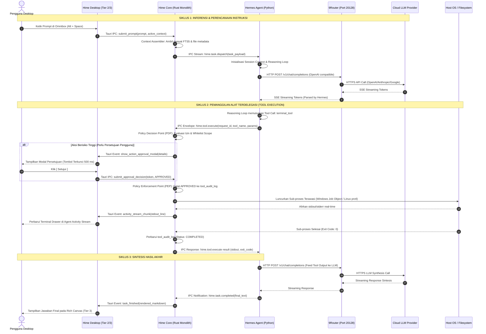
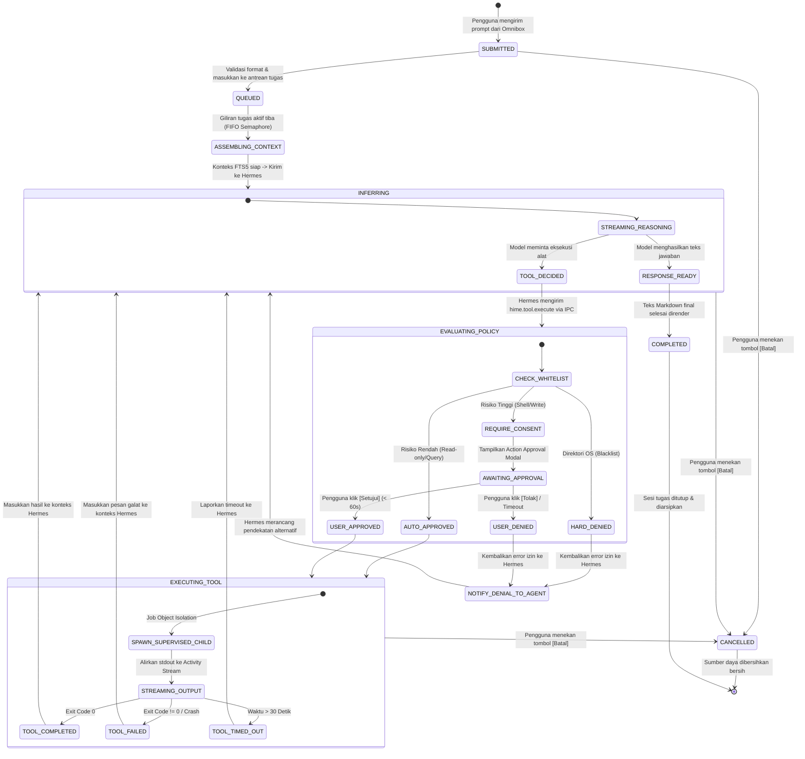

# Hime Agent Orchestration Architecture Specification

- **Document ID:** HIME-AGENT-ORCHESTRATION-ARCHITECTURE
- **Task ID:** TASK-02-05 (System Architecture & Technical Design)
- **Phase:** Phase 02 — Nusa Reverse Engineering & Architecture Discovery
- **Authority:** Principal AI Systems Architect & Lead Distributed Systems Engineer
- **Status:** **APPROVED ARCHITECTURAL SPECIFICATION — PENDING OWNER REVIEW**
- **Date:** 2026-11-08

---

## 1. Executive Summary & Orchestration Paradigm

Dokumen ini mendefinisikan arsitektur orkestrasi agen (*Agent Orchestration Architecture*) pada **Hime**, menghubungkan antarmuka interaksi pengguna (**Hime Desktop**), pusat penegakan kebijakan dan koordinasi sistem (**Hime Core**), runtime penalaran otonom (**Hermes Agent**), dan gateway inferensi AI (**9Router**).

### Prinsip Utama Orkestrasi Agen Hime:
1. **Single Hermes Runtime Process for MVP:** Sesuai evaluasi kapasitas perangkat keras riil (Intel Core i5-8250U dengan sisa RAM bebas ~3.7 GB), MVP Hime beroperasi dengan **1 instance Hermes Agent runtime aktif** yang melayani antrean tugas serial (FIFO). Arsitektur multi-agent terdistribusi atau spawned multi-process agent ditunda ke Phase 14 untuk mencegah kehabisan sumber daya host (*memory exhaustion*).
2. **Ketiadaan Akses Bypass Alat Mandiri (*No Autonomous Direct Tool Bypass*):** Hermes Agent tidak diperbolehkan memiliki jalur eksekusi alat lokal mandiri ke sistem operasi host. Seluruh pemanggilan alat (*tool invocations*) yang dihasilkan oleh LLM dialihkan (*shimmed*) menjadi pesan IPC terstruktur yang dievaluasi dan dieksekusi oleh Hime Core.
3. **Kerahasiaan Pemikiran Mental (*Zero Private Chain-of-Thought Leakage*):** Sesuai arahan desain produk, pemikiran internal privat (*private chain-of-thought*) dilarang ditampilkan ke antarmuka pengguna. Aktivitas divisualisasikan melalui **Agent Activity Stream** yang terstruktur, bersih, dan informatif.
4. **Human-in-the-Loop Interactivity:** Tindakan berisiko tinggi wajib melalui **Interactive Action Approval Modal** dengan jeda ergonomi 500 ms sebelum otorisasi diterbitkan.

---

## 2. Alur Kerja Orkestrasi End-to-End

Arsitektur orkestrasi memisahkan dua siklus aliran data utama:



---

## 3. State Machine Siklus Hidup Tugas (Task Lifecycle State Machine)

Setiap instruksi pengguna yang diserahkan ke sistem bertransformasi melalui state machine transaksional yang dikelola oleh `Agent Orchestrator` di Hime Core:



---

## 4. Manajemen Sesi & Penyusunan Konteks Percakapan

### A. Struktur Sesi Percakapan (Conversation Context Assembly)
Sebelum prompt dikirimkan ke Hermes Agent, Hime Core `Context & Memory Manager` menyusun bundle konteks dengan batasan token yang terukur:

```rust
pub struct ContextBundle {
    pub session_id: SessionId,
    pub active_workspace_path: PathBuf,
    pub system_instructions: String,
    pub relevant_memories: Vec<ContextSnippet>,
    pub attached_files: Vec<DocumentMetadata>,
    pub user_prompt: String,
    pub max_token_allocation: usize,
}
```

### B. Aturan Alokasi Token Konteks (Token Budget Allocation):
Untuk model dengan context window 8.192 token (standar inferensi lokal/efisien):
- **System Prompt & Tool Definitions:** Maksimal **1.500 token** (~18%).
- **Relevant Retrieved Memories (FTS5 Search):** Maksimal **1.500 token** (~18%).
- **Attached Document Extracted Text:** Maksimal **3.000 token** (~37%).
- **Recent Chat Turns History (Last 5 Turns):** Maksimal **1.200 token** (~15%).
- **Reserved Output Generation (Completion):** Maksimal **1.000 token** (~12%).

---

## 5. Visualisasi Agent Activity Stream (Zero Private CoT Policy)

### A. Kebijakan Privasi Penalaran Mental (Anti-CoT Invariant)
Berdasarkan arahan desain produk:
- **Private Chain-of-Thought DILARANG ditampilkan ke UI:** Monolog internal model AI (seperti token `<thought>` atau teks mentah penalaran mendalam) disaring secara ketat oleh Hime Core sebelum diteruskan ke event stream UI.
- **Tujuan Rekayasa:** Mencegah antarmuka pengguna dipenuhi oleh teks spekulatif model yang membingungkan atau berpotensi memuat halusinasi yang belum terverifikasi.

### B. Komponen Visualisasi Terstruktur pada UI:
Agent Activity Stream menyajikan linimasa visual berbasis kartu aksi terstruktur:
1. **Status Header Dinamis:** Menampilkan ringkasan intensi saat ini (misal: *"Menganalisis file `Cargo.toml`"*).
2. **Badge Alat Terstandardisasi:**
   - `tool://read_file` $\rightarrow$ Badge **Biru** (*Read-Only*).
   - `tool://write_file` $\rightarrow$ Badge **Kuning** (*Modifikasi Berkas*).
   - `tool://terminal_tool` $\rightarrow$ Badge **Merah** (*Eksekusi Perintah Sistem*).
3. **Collapsible Terminal Drawer:** Pengguna dapat memperluas (*expand*) drawer untuk melihat stdout/stderr real-time secara transparan tanpa dipaksa melihatnya secara default.
4. **Tombol Interupsi Terbuka (`Cancel Button`):** Tombol pembatalan instan selalu aktif selama agen bekerja.

---

## 6. Protokol Pembatalan & Interupsi Instan (Deterministic Cancellation)

Ketika pengguna mengklik tombol `[ Hentikan / Batal ]` pada UI:
1. **Sinyal Instan:** Hime Desktop memanggil Tauri command `abort_active_task`.
2. **Interupsi Hime Core:**
   - Jika alat sedang berjalan di sub-proses shell, Hime Core memanggil Win32 API `TerminateJobObject` (Windows) atau `kill(child_pid, SIGTERM)` (Linux) dalam batas waktu $\le \mathbf{200\text{ ms}}$.
   - Hime Core mengirimkan notifikasi IPC `hime.task.cancel` ke Hermes Agent.
3. **Interupsi Inferensi 9Router:** Hermes Agent menutup koneksi HTTP streaming ke 9Router, yang secara otomatis memutus koneksi HTTPS outbound ke Cloud LLM Provider untuk menghentikan konsumsi kuota/biaya token.
4. **Pembersihan Bersih (*Resource Cleanup*):** Berkas sementara `.hime_tmp` yang sedang ditulis segera dihapus; status tugas pada basis data lokal diperbarui menjadi `CANCELLED`.

---

## 7. Justifikasi Arsitektur: Single Hermes Runtime untuk MVP

Keputusan membatasi MVP pada satu runtime proses Hermes Agent tunggal didasarkan pada pertimbangan rekayasa mendalam:
- **Kapasitas Memori Host:** Profil hardware acuan pengembang (Intel i5-8250U) memiliki sisa RAM bebas ~3.7 GB saat aplikasi kerja pengguna dibuka. Menjalankan beberapa instance Python runtime interpreter secara simultan akan menghabiskan memori dan memicu swapping SSD.
- **Eliminasi Kompleksitas Konsensus:** Menghindari masalah perebutan kunci berkas (*file locking race conditions*), deadlock persetujuan pengguna, dan overhead koordinasi multi-agent.
- **Kesiapan Jalur Evolusi (Phase 14):** Arsitektur IPC `IpcTransport` telah dirancang mendukung multi-channel jika di masa mendatang Hime Core mengorkestrasi sub-agent spesialis pada lingkungan host berkapasitas besar.
