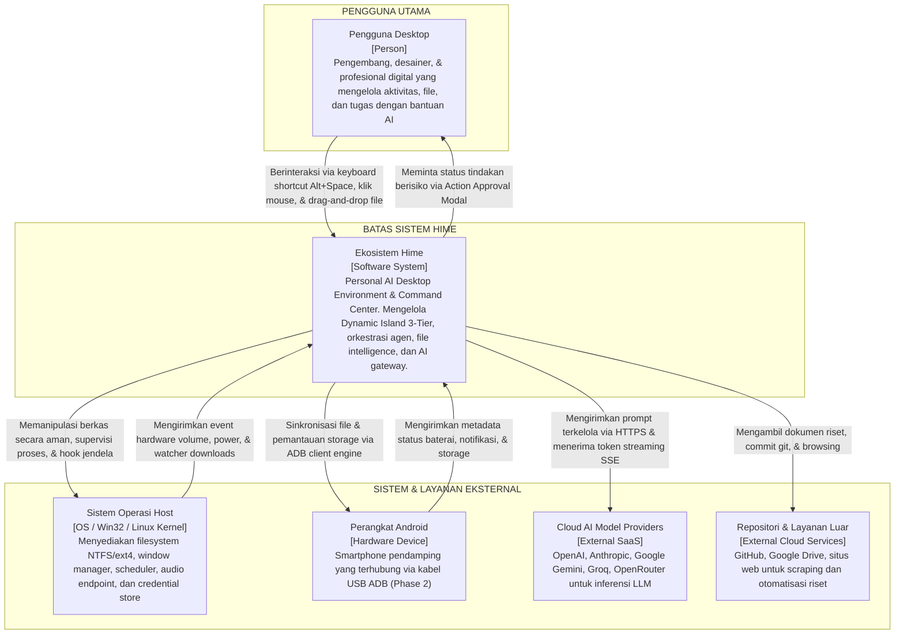
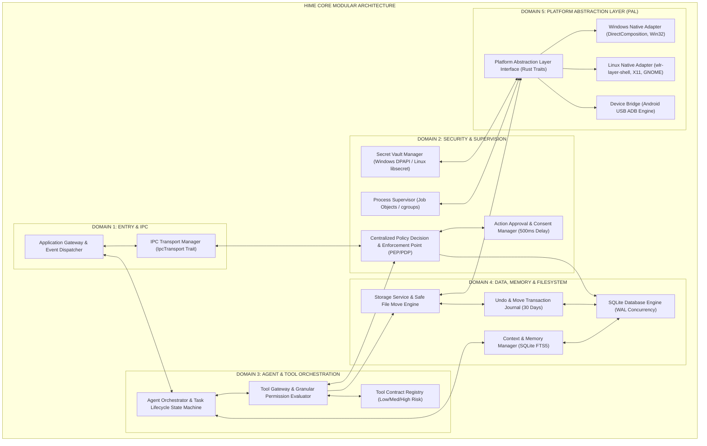
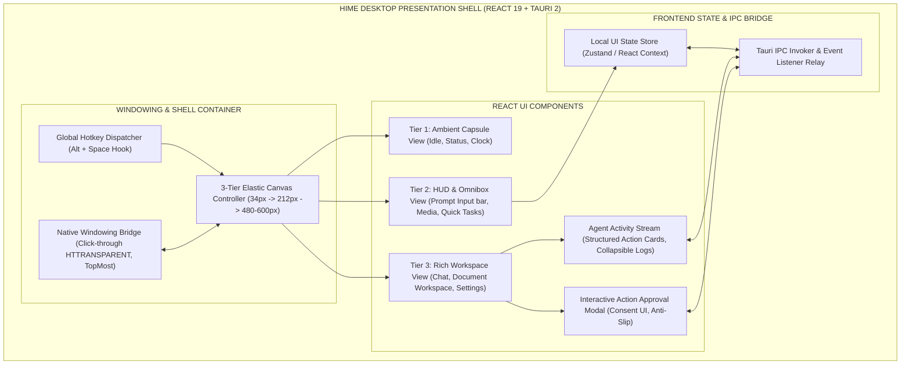
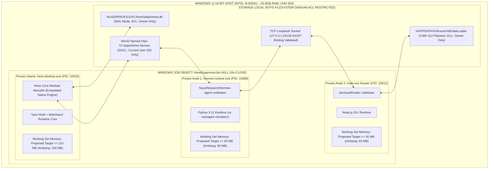

# Hime C4 Architecture Specification

- **Document ID:** HIME-C4-ARCHITECTURE
- **Task ID:** TASK-02-05 (System Architecture & Technical Design)
- **Phase:** Phase 02 — Nusa Reverse Engineering & Architecture Discovery
- **Authority:** Principal Software Architect & Lead Systems Engineer
- **Status:** **APPROVED ARCHITECTURAL SPECIFICATION — PENDING OWNER REVIEW**
- **Date:** 2026-11-08

---

## 1. Executive Summary & C4 Framework Approach

Dokumen ini menyajikan model arsitektur visual dan struktural **Hime** menggunakan kerangka kerja **C4 Model** (Context, Containers, Components, and Deployment).

Pendekatan C4 memetakan sistem perangkat lunak secara hierarkis:
1. **Level 1 — System Context:** Bagaimana ekosistem Hime berinteraksi dengan pengguna manusia, sistem operasi host, perangkat eksternal, dan layanan komputasi awan.
2. **Level 2 — Container Diagram:** Pemisahan lingkungan runtime ke dalam empat proses mandiri, basis data, dan saluran komunikasi IPC.
3. **Level 3 — Component Diagram:** Struktur internal modular monolith Hime Core dan arsitektur komponen Hime Desktop.
4. **Level 4 — Deployment Diagram:** Pemetaan topologi fisik pada sistem operasi Windows 11 dan kompatibilitas Linux.

Dokumen ini mendefinisikan secara eksplisit batas kepercayaan (*trust boundaries*), protokol jaringan lokal, format pertukaran data, dan skenario mitigasi kegagalan pada setiap tingkatan.

---

## 2. Level 1: System Context Diagram

Diagram Konteks Sistem mengilustrasikan batasan ekosistem Hime terhadap entitas luar:



### Karakteristik Batas Kepercayaan (Context Trust Boundaries)
- **Batas 1 (User Input Boundary):** Seluruh input teks, klik, dan berkas yang dimasukkan pengguna dianggap *untrusted* sampai divalidasi format dan ukurannya oleh Hime Core.
- **Batas 2 (External LLM Boundary):** Seluruh token dan respons dari Cloud AI Providers diperlakukan sebagai konten pihak ketiga yang berpotensi memuat instruksi manipulatif (*prompt injection*); model AI tidak pernah diberi akses eksekusi langsung ke sistem operasi.
- **Batas 3 (OS Host Boundary):** Interaksi dengan sistem operasi dibatasi oleh hak akun pengguna lokal standar (*Standard Non-Admin User*). Hime dilarang meminta eskalasi privilege administrator (UAC) tanpa kebutuhan eksplisit yang terdokumentasi.

---

## 3. Level 2: Container Diagram (Multi-Process Architecture)

Diagram Kontainer memetakan empat proses independen, basis data, dan protokol komunikasi:

```mermaid
graph TB
    subgraph USER_CONTAINER ["PENGGUNA"]
        USER["Pengguna Desktop"]
    end

    subgraph DESKTOP_CONTAINER ["CONTAINER 1: HIME DESKTOP (PRESENTATION SHELL)"]
        DESKTOP_APP["Tauri 2.0 Shell & WebView2<br>[Container: Rust + React 19 / TS]<br>Menampilkan Dynamic Island 3-Tier Canvas, Omnibox prompt bar, Agent Activity Stream, dan Action Approval Modal"]
    end

    subgraph CORE_CONTAINER ["CONTAINER 2: HIME CORE (SYSTEM ORCHESTRATOR)"]
        CORE_APP["Hime Core Daemon<br>[Container: Rust Tokio Modular Monolith]<br>Pusat orkestrasi sistem, Policy Enforcement Point (PEP/PDP), Tool Gateway, Process Supervisor, dan Storage Engine"]
    end

    subgraph STORAGE_CONTAINER ["CONTAINER 3: DATA STORAGE & LOGS"]
        CORE_DB[("Local SQLite Database<br>[Database: SQLite FTS5 + WAL]<br>Menyimpan riwayat obrolan, indeks teks penuh, metadata berkas, dan storage_journal")]
        AUDIT_LOGS[("Local Audit & Security Logs<br>[Files: JSON Lines]<br>tool_audit_log dan AUDIT.jsonl")]
    end

    subgraph HERMES_CONTAINER ["CONTAINER 4: HERMES AGENT (REASONING RUNTIME)"]
        HERMES_APP["Hermes Agent Runtime<br>[Container: Python 3.11+ via uv]<br>Menjalankan 10-Phase Agentic Reasoning Loop, session context, dan memanggil delegated tool shims"]
    end

    subgraph ROUTER_CONTAINER ["CONTAINER 5: 9ROUTER (AI INFERENCE GATEWAY)"]
        ROUTER_APP["9Router Engine<br>[Container: Node.js 20+ Managed Service]<br>Gateway multi-provider dengan two-tier failover, rotasi akun, dan streaming server /v1/chat/completions"]
        ROUTER_DB[("9Router DB<br>[Database: SQLite]<br>%APPDATA%\\9router\\db\\data.sqlite (CWE-312 Plaintext)")]
    end

    %% Hubungan antar kontainer
    USER -->|Interaksi langsung| DESKTOP_APP

    %% UI <-> Core
    DESKTOP_APP <-->|Tauri IPC (In-Process Fast FFI / Tokio Channels)| CORE_APP

    %% Core <-> Storage
    CORE_APP <-->|SQL Queries, WAL Read/Write, FTS5 Indexing| CORE_DB
    CORE_APP -->|Append-Only Security Audit Records| AUDIT_LOGS

    %% Core <-> Process Supervision
    CORE_APP -.->|Spawns, Job Object Isolation, Token Ingestion| HERMES_APP
    CORE_APP -.->|Spawns, Job Object Isolation, CSPRNG INITIAL_PASSWORD| ROUTER_APP

    %% Core <-> Hermes IPC
    CORE_APP <-->|Authenticated IPC Stream (Named Pipe Win32 / Unix Domain Socket Linux)| HERMES_APP

    %% Hermes <-> 9Router Loopback
    HERMES_APP <-->|HTTP POST /v1/chat/completions (OpenAI Compatible) via Loopback 127.0.0.1:20128| ROUTER_APP
    ROUTER_APP <-->|Query providerConnections| ROUTER_DB

    %% 9Router <-> Cloud
    ROUTER_APP <-->|Outbound HTTPS REST / SSE Streaming| CLOUD_AI["Cloud AI Providers (OpenAI, Anthropic, Google)"]
```

### Tabel Rincian Karakteristik Kontainer

| Kontainer | Bahasa / Runtime | Format Distribusi | Komunikasi Masuk (*Inbound*) | Komunikasi Keluar (*Outbound*) | Protokol Transport |
|:---|:---|:---|:---|:---|:---|
| **Hime Desktop** | Rust 1.80+ / React 19 / TS | Bundled Executable | Event dari Core | Perintah ke Core | Tauri IPC / In-Process FFI |
| **Hime Core** | Rust 1.80+ (Tokio Async) | Core Service Monolith | - Tauri IPC<br>- IPC Hermes Klien | - IPC Hermes Server<br>- SQLite SQL<br>- OS APIs | - Windows Named Pipe<br>- Linux Unix Domain Socket |
| **Hermes Agent** | Python 3.11+ (Managed `uv`) | Pre-packaged venv | Pesan IPC dari Core | - Delegated Tool IPC ke Core<br>- HTTP ke 9Router | - Custom Wire Framing<br>- HTTP/1.1 REST (`127.0.0.1`) |
| **9Router** | Node.js 20+ (Standalone Engine) | Bundled Node package | HTTP dari Hermes | HTTPS ke Cloud AI | HTTP/1.1 Loopback (`127.0.0.1:20128`) |
| **Core SQLite** | SQLite 3.45+ (libsqlite3) | File `%USERPROFILE%\.hime\data\` | Operasi SQL dari Core | N/A | Disk I/O (WAL mode) |

---

## 4. Level 3: Component Diagram

### A. Internal Component Diagram: Hime Core (Rust Modular Monolith)
Hime Core dirancang sebagai monolit modular terpadu dengan domain boundaries yang tegas:



### B. Internal Component Diagram: Hime Desktop (Presentation Layer)


---

## 5. Level 4: Deployment Diagram

### A. Windows 11 Native Host Deployment (Tier 1 Target)
Pemetaan fisik biner, proses kernel, perizinan NTFS, dan alokasi memori pada sistem operasi Windows 11:



### B. Linux Native Host Deployment (Tier 2 Target)
Pemetaan fisik pada distribusi Linux modern (Ubuntu 24.04 LTS / Fedora 40):
- **Supervisi Proses:** `prctl(PR_SET_PDEATHSIG, SIGTERM)` pada setiap sub-proses anak, dikelompokkan ke dalam transient systemd scope (`hime.scope`) dengan pembatasan kuota memori cgroups v2 (`memory.max = 700M`).
- **Komunikasi IPC:** Unix Domain Socket `$XDG_RUNTIME_DIR/hime/hermes.sock` dengan permission `0600` (`srw-------`) dan verifikasi `SO_PEERCRED`.
- **Integrasi Windowing:** Sesi Wayland menggunakan protokol `wlr-layer-shell`; sesi X11 menggunakan EWMH `_NET_WM_WINDOW_TYPE_DOCK`; sesi GNOME Wayland mengaktifkan *Floating Utility Window Fallback Mode* (`_NET_WM_WINDOW_TYPE_UTILITY`, DIR-03).
- **Keamanan Rahasia:** FreeDesktop Secret Service API via `libsecret` D-Bus communication dengan GNOME Keyring / KWallet.

---

## 6. Skenario Kegagalan & Matriks Ketahanan (Failure & Resilience Mapping)

Sistem dirancang untuk tahan terhadap kegagalan komponen parsial tanpa merusak integritas data pengguna (*graceful degradation*):

| Komponen yang Gagal | Gejala / Indikator Kegagalan | Dampak pada Sistem | Prosedur Pemulihan Otomatis (*Auto-Recovery*) | Status Pengguna (*User Experience*) |
|:---|:---|:---|:---|:---|
| **Hermes Agent Crash** | Saluran IPC terputus seketika (`ERROR_BROKEN_PIPE` / `ECONNRESET`), exit code $\ne 0$. | Tugas penalaran yang sedang aktif terhenti; tidak ada eksekusi tool lanjutan. | 1. Hime Core Process Supervisor mendeteksi kematian PID.<br>2. Hime Core membatalkan sub-proses shell aktif via Job Object.<br>3. Supervisor meluncurkan instance Hermes baru dengan handshake token baru.<br>4. Re-koneksi pipa diselesaikan dalam waktu $\le 2.0\text{ detik}$. | Activity stream menampilkan kartu status: *"Agen terputus dan otomatis dipulihkan. Mengulangi instruksi terakhir."* |
| **9Router Crash** | Endpoint `127.0.0.1:20128` melempar `ECONNREFUSED` saat Hermes melakukan streaming token. | Hermes menerima HTTP error 502/503; streaming token terhenti. | 1. Supervisor mendeteksi proses Node.js mati.<br>2. Meluncurkan ulang `cli.js start` dengan injeksi `INITIAL_PASSWORD` CSPRNG.<br>3. Menunggu health check `/api/health` merespons 200 OK ($\le 3.0\text{ detik}$).<br>4. Hermes mengulang request inferensi secara otomatis (maksimal 2x retry). | Omnibox menampilkan badge kuning: *"Gateway AI menyala ulang..."*, lalu melanjutkan streaming secara transparan. |
| **LLM Provider Rate Limit / Downtime** | 9Router menerima HTTP 429 atau 500 dari penyedia cloud primer (misal Anthropic). | Kuota inferensi habis atau penyedia mengalami gangguan jaringan luar. | 1. Engine 9Router Two-Tier Failover mendeteksi kegagalan primer.<br>2. Secara otomatis mengalihkan streaming token ke penyedia sekunder (misal OpenAI atau Groq).<br>3. Tanpa memutuskan koneksi SSE ke Hermes. | Tidak ada kegagalan yang tampak di UI; stream berlanjut dengan sedikit latensi jeda switchover ($\le 1.5\text{ detik}$). |
| **Hime Desktop UI Crash** | Jendela WebView2 mati mendadak atau thread UI mengalami panic. | Tampilan Dynamic Island hilang dari layar desktop. | 1. Tauri Core mendeteksi WebView process termination.<br>2. Membuka kembali instance jendela WebView tanpa mematikan Hime Core atau Hermes.<br>3. Memulihkan status aktif dari SQLite state cache dalam waktu $\le 1.0\text{ detik}$. | Jendela muncul kembali seketika dengan status percakapan terakhir utuh. |
| **Power Loss Mendadak (Sudden Shutdown)** | Daya listrik laptop terputus tiba-tiba saat pemindahan berkas atau inferensi aktif. | Seluruh proses mati seketika pada tingkatan hardware. | 1. Basis data SQLite dipulihkan secara otomatis melalui rollback/commit WAL journal saat boot berikutnya.<br>2. Storage Engine memeriksa entri `storage_journal` berstatus pending.<br>3. Berkas sisa `.hime_tmp` dibersihkan; berkas asal terbukti aman (*Zero Source Loss*).<br>4. Jika crash terjadi saat rename akhir dan file tujuan telah diedit pengguna, sistem memunculkan dialog konfirmasi aman. | Sistem menyala normal pada startup berikutnya tanpa kehilangan atau korupsi berkas pengguna. |
