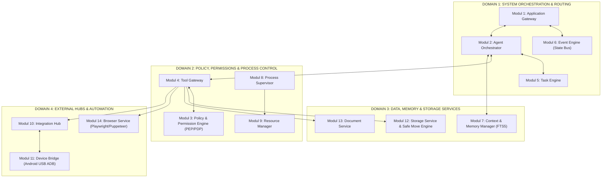

# Hime Core Internal Architecture Specification (Modular Monolith)

- **Document ID:** HIME-CORE-INTERNAL-ARCHITECTURE
- **Task ID:** TASK-02-05 (System Architecture & Technical Design)
- **Phase:** Phase 02 — Nusa Reverse Engineering & Architecture Discovery
- **Authority:** Principal Software Architect & Staff Systems Engineer
- **Status:** **APPROVED ARCHITECTURAL SPECIFICATION — PENDING OWNER REVIEW**
- **Date:** 2026-11-08

---

## 1. Executive Summary & Modular Monolith Paradigm

Dokumen ini mendefinisikan arsitektur internal **Hime Core**, pusat orkestrasi dan pertahanan keamanan utama dalam ekosistem Hime.

Hime Core diimplementasikan menggunakan pendekatan **Modular Monolith** berbasis bahasa pemrograman **Rust** dan runtime asynchronous **Tokio**. Pola modular monolith dipilih secara sadar melalui ADR-001 untuk mengeliminasi kompleksitas operasional microservices (seperti overhead jaringan lokal, kegagalan serialisasi berulang, dan konsensus terdistribusi), sembari tetap menjaga batasan domain (*bounded contexts*) yang tegas, kepemilikan data yang terisolasi, dan interface berbasis Rust traits yang dapat diuji secara independen (*in-process unit & contract testing*).

### Prinsip Desain Modular Monolith Hime Core:
1. **Explicit Domain Boundaries:** Setiap modul mengelola domainnya sendiri dan dilarang mengakses state internal modul lain secara langsung.
2. **Interface-Driven Interaction:** Komunikasi antar-modul wajib melewati antarmuka trait Rust terdefinisi atau melalui event asynchronous bus.
3. **Isolated Data Ownership:** Modul memiliki kepemilikan mutlak (*single source of truth*) atas tabel-tabel basis datanya. Akses data antar-domain wajib melalui metode layanan modul pemilik.
4. **Fail-Closed Security Gate:** Modul keamanan bertindak sebagai gerbang verifikasi wajib untuk setiap aksi alat yang berpotensi memodifikasi sistem atau data pengguna.

---

## 2. Struktur Modul Domain Hime Core

Arsitektur internal Hime Core dibagi ke dalam lima domain logis yang menaungi **14 Modul Fungsional Inti**:



---

## 3. Spesifikasi Mendalam 14 Modul Internal

---

### Modul 1: Application Gateway
- **Tanggung Jawab:** Gerbang masuk utama untuk seluruh komunikasi dari Hime Desktop (via Tauri IPC FFI) dan dari Hermes Agent (via IPC Server). Mengurai pesan, memvalidasi skema payload, menerjemahkan format kustom Hime Wire Framing ke domain event internal, dan mendistribusikan request ke modul terkait.
- **Input:** Raw JSON payload dari Tauri IPC; byte stream dari Named Pipe / Unix Socket.
- **Output:** Domain Commands terstruktur (`SubmitPromptCommand`, `ExecuteToolCommand`, `CancelTaskCommand`).
- **Dependencies:** Tokio Async Runtime, `serde_json`, Modul 6 (Event Engine), Modul 3 (Policy Engine).
- **Interface (Rust Trait):**
  ```rust
  #[async_trait]
  pub trait ApplicationGateway: Send + Sync {
      async fn route_user_prompt(&self, prompt: UserPromptDto) -> Result<TaskId, GatewayError>;
      async fn handle_ipc_message(&self, raw_bytes: &[u8]) -> Result<IpcResponse, GatewayError>;
      async fn emit_ui_event(&self, event: UiStreamEvent) -> Result<(), GatewayError>;
  }
  ```
- **Data Ownership:** Status sesi koneksi IPC aktif, mapping socket handle ke Client PID.
- **Error Handling:** Mengembalikan `GatewayError::MalformedPayload`, `GatewayError::AuthenticationTimeout`, atau `GatewayError::ConnectionDropped`.
- **Batas Keamanan:** Memverifikasi handshake token CSPRNG 256-bit dan memutus koneksi seketika jika client PID tidak cocok dengan PID Hermes terdaftar.

---

### Modul 2: Agent Orchestrator
- **Tanggung Jawab:** Mengelola siklus hidup percakapan (*conversation lifecycle*), state machine instruksi agen, dan koordinasi pertukaran pesan antara pengguna, memori lokal, dan model AI. Memastikan hanya ada 1 sesi tugas aktif pada MVP untuk mencegah kehabisan sumber daya host.
- **Input:** `SubmitPromptCommand`, hasil eksekusi tool dari Modul 4.
- **Output:** Instruksi terstruktur ke Hermes Agent, update linimasa ke Agent Activity Stream.
- **Dependencies:** Modul 5 (Task Engine), Modul 7 (Context & Memory Manager), Modul 4 (Tool Gateway).
- **Interface (Rust Trait):**
  ```rust
  #[async_trait]
  pub trait AgentOrchestrator: Send + Sync {
      async fn start_agent_task(&self, task: NewTaskRequest) -> Result<TaskHandle, OrchestratorError>;
      async fn process_tool_return(&self, task_id: TaskId, result: ToolResultDto) -> Result<(), OrchestratorError>;
      async fn abort_task(&self, task_id: TaskId, reason: String) -> Result<(), OrchestratorError>;
  }
  ```
- **Data Ownership:** State machine tugas agen (`IDLE`, `PLANNING`, `WAITING_APPROVAL`, `EXECUTING_TOOL`, `STREAMING_RESPONSE`, `COMPLETED`, `FAILED`).
- **Error Handling:** Auto-retry 1x pada kegagalan transient network; fail-safe transition ke `FAILED` dengan alasan operasional jelas.
- **Batas Keamanan:** Memastikan tidak ada private chain-of-thought yang lolos ke event stream UI.

---

### Modul 3: Policy & Permission Engine (PEP / PDP)
- **Tanggung Jawab:** Bertindak sebagai **Policy Decision Point (PDP)** dan **Policy Enforcement Point (PEP)** sentral. Mengevaluasi setiap permintaan pemanggilan alat terhadap 8 jenis izin granular, batas cakupan direktori kerja (*workspace whitelist*), hard deny list direktori OS, dan memicu Action Approval Modal jika diperlukan.
- **Input:** `ToolExecutionRequest` (ID alat, parameter, direktori target, tingkat risiko).
- **Output:** `PolicyDecision` (`Allow`, `Deny`, `RequireUserApproval`).
- **Dependencies:** Modul 6 (Event Engine), Modul 8 (Process Supervisor), basis data `tool_audit_log`.
- **Interface (Rust Trait):**
  ```rust
  #[async_trait]
  pub trait PolicyEngine: Send + Sync {
      async fn evaluate_tool_request(&self, request: &ToolRequest) -> Result<PolicyDecision, PolicyError>;
      async fn record_user_approval(&self, approval_token: ApprovalToken) -> Result<GrantTicket, PolicyError>;
      async fn log_audit_trail(&self, record: &AuditRecord) -> Result<(), PolicyError>;
  }
  ```
- **Data Ownership:** Tabel basis data `tool_audit_log`, daftar whitelist direktori aktif, daftar temporary grant tokens (TTL 60s).
- **Error Handling:** Menolak secara ketat (*fail-closed*) jika parameter ambigu, path berada di luar workspace, atau approval token kedaluwarsa.
- **Batas Keamanan:** Merupakan komponen pertahanan keamanan utama Hime Core; mengeksekusi Hard Deny mutlak untuk `C:\Windows\`, `C:\Program Files\`, `/etc/`, `/usr/`, `/bin/`.

---

### Modul 4: Tool Gateway
- **Tanggung Jawab:** Registri tunggal dan dispatcher eksekusi alat (*tool execution dispatcher*). Memetakan nama alat ke service internal Hime Core (Storage Service, Document Service, Terminal Runner) dan mengawasi eksekusinya di bawah kontrol sandbox.
- **Input:** `ToolRequest` yang telah disahkan oleh Modul 3 dengan `GrantTicket` valid.
- **Output:** `ToolResultDto` (stdout/stderr terstruktur, exit code, execution time).
- **Dependencies:** Modul 3 (Policy Engine), Modul 12 (Storage Service), Modul 13 (Document Service), Modul 8 (Process Supervisor).
- **Interface (Rust Trait):**
  ```rust
  #[async_trait]
  pub trait ToolGateway: Send + Sync {
      async fn register_tool(&mut self, spec: ToolSpecification) -> Result<(), ToolError>;
      async fn dispatch_tool(&self, ticket: GrantTicket, call: ToolCallPayload) -> Result<ToolOutput, ToolError>;
      async fn cancel_active_tool(&self, execution_id: ExecutionId) -> Result<(), ToolError>;
  }
  ```
- **Data Ownership:** Registri alat aktif, kontrak skema input/output alat, status eksekusi thread/sub-proses yang sedang berjalan.
- **Error Handling:** Pembatalan deterministik pada timeout 30 detik (`ToolError::Timeout`); penangkapan exception process crash.
- **Batas Keamanan:** Seluruh eksekusi shell terminal dijalankan di bawah Process Supervisor Job Object tanpa hak privilege administrator.

---

### Modul 5: Task Engine
- **Tanggung Jawab:** Mengelola antrean kerja tugas pengguna, penyimpanan checklist to-do lokal, pengingat tenggat waktu, dan status progres multi-langkah.
- **Input:** Perintah manajemen tugas (Create, Update, Toggle, Delete Task).
- **Output:** Daftar tugas aktif, notifikasi deadline, event perubahan status tugas.
- **Dependencies:** Modul 6 (Event Engine), basis data SQLite `user_tasks`.
- **Interface (Rust Trait):**
  ```rust
  #[async_trait]
  pub trait TaskEngine: Send + Sync {
      async fn create_task(&self, new_task: NewTaskDto) -> Result<UserTask, TaskError>;
      async fn update_task_status(&self, id: TaskId, status: TaskStatus) -> Result<(), TaskError>;
      async fn list_active_tasks(&self) -> Result<Vec<UserTask>, TaskError>;
  }
  ```
- **Data Ownership:** Tabel basis data `user_tasks` dan `task_reminders`.
- **Error Handling:** Transaksi basis data atomik; validasi panjang teks dan format waktu UTC.
- **Batas Keamanan:** Data tugas murni lokal pengguna; dilarang menyinkronkan ke cloud tanpa izin eksplisit.

---

### Modul 6: Event Engine (State Bus)
- **Tanggung Jawab:** Bus event asynchronous in-process berbasis saluran mpsc/broadcast Tokio. Memfasilitasi komunikasi decoupled antar-modul dan streaming event UI real-time ke Hime Desktop.
- **Input:** Domain Events dari modul mana pun (`AgentStartedEvent`, `ToolInvokedEvent`, `FileConflictDetectedEvent`).
- **Output:** Aliran event tersaring ke subscriber internal dan ke WebSocket/IPC Hime Desktop.
- **Dependencies:** Tokio sync primitives (`tokio::sync::broadcast`).
- **Interface (Rust Trait):**
  ```rust
  pub trait EventEngine: Send + Sync {
      fn publish(&self, event: DomainEvent) -> Result<(), EventError>;
      fn subscribe(&self, topic: EventTopic) -> broadcast::Receiver<DomainEvent>;
  }
  ```
- **Data Ownership:** Ring buffer event in-memory (kapasitas 1.000 event).
- **Error Handling:** Mendeteksi backpressure; membuang event lama jika kapasitas consumer lambat terlampaui (*lagging consumer warning*).
- **Batas Keamanan:** Memfilter data sensitif (token sesi, kredensial rahasia) agar tidak pernah dipublikasikan ke event bus umum.

---

### Modul 7: Context & Memory Manager
- **Tanggung Jawab:** Mengelola memori percakapan jangka pendek dan jangka panjang menggunakan basis data SQLite FTS5 (Full-Text Search). Menyusun konteks relevan (*context injection*) sebelum prompt diserahkan ke Hermes Agent.
- **Input:** Teks prompt pengguna, berkas terlampir, query pencarian riwayat.
- **Output:** `ContextBundle` terstruktur dengan batas kuota token yang terukur.
- **Dependencies:** SQLite FTS5 extension, basis data `conversation_history` dan `context_fts`.
- **Interface (Rust Trait):**
  ```rust
  #[async_trait]
  pub trait ContextMemoryManager: Send + Sync {
      async fn index_interaction(&self, entry: InteractionLog) -> Result<(), MemoryError>;
      async fn search_relevant_context(&self, query: &str, limit: usize) -> Result<Vec<ContextSnippet>, MemoryError>;
      async fn assemble_prompt_context(&self, prompt: &str) -> Result<ContextBundle, MemoryError>;
  }
  ```
- **Data Ownership:** Tabel `conversation_history`, `context_snippets`, dan virtual table `context_fts`.
- **Error Handling:** Query FTS5 sanitize untuk mencegah SQL injection atau malformed syntax query.
- **Batas Keamanan:** Isolasi memori per-workspace; data proyek kerja A tidak dapat bocor ke prompt proyek kerja B.

---

### Modul 8: Process Supervisor
- **Tanggung Jawab:** Meluncurkan, memantau kesehatan (*health checks*), dan mengawasi siklus hidup sub-proses eksternal (Hermes Agent Python runtime dan 9Router Node.js runtime). Menjamin **Zero Orphan Processes** saat Hime ditutup atau mengalami crash.
- **Input:** Konfigurasi peluncuran proses (`SpawnSpec`).
- **Output:** Status kesehatan proses (`Healthy`, `Unresponsive`, `Terminated`), PID terdaftar.
- **Dependencies:** Windows Job Object API (Windows) / `prctl` + cgroups v2 (Linux), Modul 9 (Resource Manager).
- **Interface (Rust Trait):**
  ```rust
  #[async_trait]
  pub trait ProcessSupervisor: Send + Sync {
      async fn spawn_supervised_child(&mut self, spec: ChildProcessSpec) -> Result<u32, SupervisorError>;
      async fn check_health(&self, child_pid: u32) -> Result<ProcessHealthStatus, SupervisorError>;
      async fn kill_process_tree(&mut self, child_pid: u32) -> Result<(), SupervisorError>;
  }
  ```
- **Data Ownership:** Handle Windows Job Object `HimeSupervisorJob`, daftar PID anak terdaftar.
- **Error Handling:** Deteksi kematian mendadak; trigger prosedur auto-recovery terisolasi.
- **Batas Keamanan:** Mengikat proses ke `JOB_OBJECT_LIMIT_KILL_ON_JOB_CLOSE` di Windows dan `PR_SET_PDEATHSIG` di Linux.

---

### Modul 9: Resource Manager
- **Tanggung Jawab:** Memantau penggunaan sumber daya perangkat keras riil (RAM Working Set, Utilisasi CPU, handle count) terhadap anggaran memori yang ditetapkan pada `HIME-NON-FUNCTIONAL-REQUIREMENTS.md`. Menerapkan pembatasan backpressure jika memori host mendekati ambang batas toleransi.
- **Input:** Metrik sistem dari OS API (`GetProcessMemoryInfo`, `/proc/self/statm`).
- **Output:** Laporan status utilisasi memori, sinyal peringatan backpressure (*MemoryPressureAlert*).
- **Dependencies:** Win32 `psapi.dll` / Linux procfs, Modul 6 (Event Engine).
- **Interface (Rust Trait):**
  ```rust
  pub trait ResourceManager: Send + Sync {
      fn get_stack_memory_footprint(&self) -> Result<MemoryReport, ResourceError>;
      fn is_under_memory_pressure(&self) -> bool;
      fn enforce_throttling_if_needed(&self) -> ThrottlingDecision;
  }
  ```
- **Data Ownership:** Metrik historis konsumsi RAM proses selama 60 menit terakhir.
- **Error Handling:** Penanganan graceful kegagalan query OS metrics.
- **Batas Keamanan:** Mencegah sistem Hime menyebabkan host hang (*OOM freeze*) pada sisa RAM ~3.7 GB.

---

### Modul 10: Integration Hub
- **Tanggung Jawab:** Pengelola adapter layanan eksternal berbasis cloud dan API pihak ketiga (GitHub, Google Drive, Web Scraper). Mengelola autentikasi token, rate limiting, dan format konversi data eksternal.
- **Input:** Request integrasi pihak ketiga dari Agent Orchestrator.
- **Output:** Data dokumen eksternal terstandarisasi.
- **Dependencies:** HTTP Client (`reqwest`), Modul 3 (Policy Engine).
- **Interface (Rust Trait):**
  ```rust
  #[async_trait]
  pub trait IntegrationHub: Send + Sync {
      async fn execute_git_action(&self, repo: &str, action: GitAction) -> Result<GitResult, IntegrationError>;
      async fn fetch_remote_resource(&self, url: &str) -> Result<RemoteResource, IntegrationError>;
  }
  ```
- **Data Ownership:** Kredensial token integrasi terenkripsi via Secret Vault.
- **Error Handling:** Exponential backoff pada HTTP 429; fail-safe timeout 15 detik.
- **Batas Keamanan:** Seluruh request outbound diperiksa terhadap blacklist domain berbahaya.

---

### Modul 11: Device Bridge (Android USB ADB Engine)
- **Tanggung Jawab:** Mengelola koneksi ke smartphone Android via protokol kabel USB ADB (Android Debug Bridge Client). Memantau kapasitas memori ponsel, mendeteksi berkas foto/unduhan lama, dan mengoordinasikan transfer berkas ke laptop (*Phase 2*).
- **Input:** Sinyal koneksi USB perangkat, perintah transfer media.
- **Output:** Status baterai, metrik storage ponsel, stream transfer berkas.
- **Dependencies:** ADB Client Protocol implementation, Modul 12 (Storage Service).
- **Interface (Rust Trait):**
  ```rust
  #[async_trait]
  pub trait DeviceBridge: Send + Sync {
      async fn detect_connected_devices(&self) -> Result<Vec<AndroidDevice>, DeviceError>;
      async fn inspect_storage_status(&self, device_id: &str) -> Result<StorageMetric, DeviceError>;
      async fn transfer_file_to_host(&self, remote_path: &str, local_path: &Path) -> Result<(), DeviceError>;
  }
  ```
- **Data Ownership:** Daftar serial number perangkat terverifikasi, riwayat transfer USB.
- **Error Handling:** Deteksi kabel terputus tiba-tiba; pembersihan berkas parsial `.hime_tmp` di laptop.
- **Batas Keamanan:** Menolak perintah eksekusi shell tingkat root pada Android.

---

### Modul 12: Storage Service & Safe Move Engine
- **Tanggung Jawab:** Pengelola berkas lokal, pemantau folder `Downloads`, deteksi duplikasi bertingkat (5 dimensi bukti), penataan lokasi simpan cerdas, eksekusi pemindahan berkas aman (*safe file move*), dan pengelolaan jurnal pembatalan (*30-Day Undo Journal*).
- **Input:** File drop event, download folder notification, perintah `MoveFile`, perintah `UndoMove`.
- **Output:** Metadata berkas, hasil verifikasi hash SHA-256, status transaksi pemindahan.
- **Dependencies:** Win32 API `ReadDirectoryChangesW` / Linux `inotify`, tabel SQLite `storage_journal`.
- **Interface (Rust Trait):**
  ```rust
  #[async_trait]
  pub trait StorageService: Send + Sync {
      async fn safe_move_file(&self, src: &Path, dst: &Path) -> Result<OperationId, StorageError>;
      async fn undo_move_operation(&self, operation_id: &str) -> Result<(), StorageError>;
      async fn scan_duplicate_candidates(&self, target_file: &Path) -> Result<Vec<DuplicateCandidate>, StorageError>;
  }
  ```
- **Data Ownership:** Tabel basis data `storage_journal` dan `file_index_cache`.
- **Error Handling:** Menegakkan prinsip **Zero Source File Loss**: sumber tidak pernah dihapus sebelum target terbukti valid 100%. Pengecekan status file lock (`ERROR_SHARING_VIOLATION`) dan hak akses direktori.
- **Batas Keamanan:** Menolak eksekusi file rename/move pada direktori sistem operasi atau volume yang tidak memiliki izin tulis.

---

### Modul 13: Document Service
- **Tanggung Jawab:** Utilitas pengurai teks dan ekstraksi konten dokumen lokal multi-format (PDF, Markdown, Source Code, Plaintext, JSON). Mengubah dokumen mentah menjadi teks terstruktur untuk disuntikkan ke konteks agen.
- **Input:** Path berkas lokal yang didukung.
- **Output:** Konten teks terestrak, ringkasan metadata dokumen (halaman, judul, waktu dibuat).
- **Dependencies:** Parser PDF native (`pdf-extract` / Rust binding), encoding parser.
- **Interface (Rust Trait):**
  ```rust
  #[async_trait]
  pub trait DocumentService: Send + Sync {
      async fn extract_text_from_file(&self, file_path: &Path) -> Result<DocumentTextPayload, DocumentError>;
      async fn generate_content_hash(&self, file_path: &Path) -> Result<String, DocumentError>;
  }
  ```
- **Data Ownership:** In-memory parsed document cache.
- **Error Handling:** Perlindungan dari berkas korup (*malformed PDF crash protection*); limit ukuran berkas maksimum 50 MB per-dokumen pada MVP.
- **Batas Keamanan:** Parser berjalan secara terisolasi tanpa akses eksekusi script embedded dalam PDF.

---

### Modul 14: Browser Service
- **Tanggung Jawab:** Layanan otomasi peramban web headless berbasis antarmuka terkelola (Playwright / Puppeteer Bridge) untuk menjalankan tugas browsing, pencarian referensi, dan scraping konten web (*Phase 2/3*).
- **Input:** Instruksi otomasi web (URL target, selector elemen, aksi ketik/klik).
- **Output:** Cuplikan teks halaman web, tangkapan layar verifikasi (*screenshot*).
- **Dependencies:** Headless Chrome subprocess, Modul 8 (Process Supervisor).
- **Interface (Rust Trait):**
  ```rust
  #[async_trait]
  pub trait BrowserService: Send + Sync {
      async fn navigate_and_extract_text(&self, url: &str) -> Result<WebPageContent, BrowserError>;
      async fn capture_page_screenshot(&self, url: &str) -> Result<Vec<u8>, BrowserError>;
  }
  ```
- **Data Ownership:** Status instance browser headless, cache halaman sementara.
- **Error Handling:** Timeout browsing 20 detik; mitigasi loop pengalihan (*infinite redirect protection*).
- **Batas Keamanan:** Browser berjalan di dalam profil sandbox sementara tanpa akses ke password atau cookie browser utama pengguna.

---

## 4. Matriks Dependensi & Interaksi Antar-Modul

Tabel berikut membuktikan ketiadaan ketergantungan melingkar (*zero circular dependencies*) di antara 14 modul Hime Core:

| ID Modul | Nama Modul | Modul yang Dibutuhkan (*Depends On*) | Modul yang Mengonsumsi (*Consumed By*) |
|:---:|:---|:---|:---|
| **M-01** | Application Gateway | M-03, M-06 | Hime Desktop, Hermes Agent IPC |
| **M-02** | Agent Orchestrator | M-04, M-05, M-07 | M-01 |
| **M-03** | Policy & Permission Engine | M-06, M-08 | M-01, M-04 |
| **M-04** | Tool Gateway | M-03, M-08, M-10, M-12, M-13, M-14 | M-02 |
| **M-05** | Task Engine | M-06 | M-02 |
| **M-06** | Event Engine | None (Fondasi In-Memory Bus) | Seluruh Modul Core |
| **M-07** | Context & Memory Manager | M-06 | M-02 |
| **M-08** | Process Supervisor | M-09 | M-03, M-04 |
| **M-09** | Resource Manager | M-06 | M-08 |
| **M-10** | Integration Hub | M-03, M-11 | M-04 |
| **M-11** | Device Bridge | M-12 | M-10 |
| **M-12** | Storage Service | M-06 | M-04, M-11 |
| **M-13** | Document Service | None (Parser Murni) | M-04 |
| **M-14** | Browser Service | M-08 | M-04 |

*Kesimpulan Arsitektur:* Aliran dependensi bersifat terarah (*Directed Acyclic Graph / DAG*), mengalir dari Gateway $\rightarrow$ Orchestrator $\rightarrow$ Policy & Tool Gateway $\rightarrow$ Leaf Services (Storage, Document, Process Supervisor).
