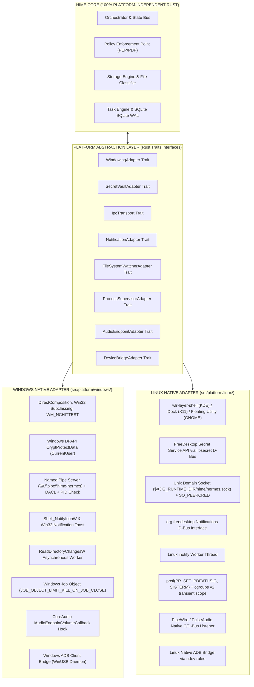

# Hime Cross-Platform Implementation Architecture Specification

- **Document ID:** HIME-CROSS-PLATFORM-IMPLEMENTATION-ARCHITECTURE
- **Task ID:** TASK-02-05 (System Architecture & Technical Design)
- **Phase:** Phase 02 — Nusa Reverse Engineering & Architecture Discovery
- **Authority:** Principal Cross-Platform Systems Architect & Lead Desktop Windowing Engineer
- **Status:** **APPROVED ARCHITECTURAL SPECIFICATION — PENDING OWNER REVIEW**
- **Date:** 2026-11-08

---

## 1. Executive Summary & Core Platform Boundaries

Dokumen ini mendefinisikan arsitektur implementasi lintas-platform (*Cross-Platform Implementation Architecture*) untuk **Hime**, merancang pemisahan tegas antara logika domain aplikasi yang agnostik platform dengan adapter native sistem operasi sistem host.

### Prinsip Utama Arsitektur Lintas-Platform:
> **Windows-first, cross-platform by design.**
>
> 1. **Windows 11** merupakan platform implementasi, pengujian, dan rilis utama pada fase awal (Phase 01–07).
> 2. **Linux** merupakan target platform resmi berikutnya (Phase 2), di mana seluruh arsitektur disiapkan agar kompatibel tanpa penulisan ulang logika bisnis.
> 3. **Android** merupakan platform pendamping (*companion device*) yang diintegrasikan melalui Device Bridge (Phase 2).
> 4. **Penolakan Pemaksaan Perilaku Seragam (*No Forced Parity*):** Sistem dilarang memaksakan perilaku identik jika kapabilitas platform berbeda secara inheren (misal: tidak memaksakan blur acrylic DWM pada Linux yang tidak memiliki compositor blur, dan tidak memaksakan penempatan koordinat absolut pada Wayland).
> 5. **Prinsip Kejujuran Bukti:** Dilarang mengklaim kompatibilitas Linux sebelum dilakukan pengujian empiris nyata pada distro target.

---

## 2. Platform Abstraction Layer (PAL) & Rust Traits Architecture

Pemisahan tanggung jawab antara Hime Core dan sistem operasi dijembatani oleh kumpulan Rust traits pada modul `platform_abstraction_layer`:



---

## 3. Spesifikasi Rinci Rust Traits pada Platform Abstraction Layer

### A. Trait Pengelolaan Jendela (`WindowingAdapter`)
```rust
#[async_trait]
pub trait WindowingAdapter: Send + Sync {
    /// Inisialisasi jendela mengapung Dynamic Island di tepi atas monitor
    async fn setup_floating_canvas(&self, window_handle: RawWindowHandle) -> Result<(), PlatformError>;

    /// Mengatur tembus-klik pada area di luar poligon visual aktif
    fn set_click_through_region(&self, window_handle: RawWindowHandle, shape: PolygonMask) -> Result<(), PlatformError>;

    /// Mentransformasikan dimensi kanvas (Tier 1 <-> Tier 2 <-> Tier 3)
    async fn morph_window_size(&self, window_handle: RawWindowHandle, target_size: PhysicalSize<u32>) -> Result<(), PlatformError>;

    /// Mendaftarkan pintasan keyboard global (Alt + Space)
    fn register_global_hotkey(&self, key_combination: &str, callback: Box<dyn Fn() + Send + 'static>) -> Result<(), PlatformError>;
}
```

### B. Trait Brankas Kredensial (`SecretVaultAdapter`)
```rust
pub trait SecretVaultAdapter: Send + Sync {
    /// Mengenkripsi ciphertext menggunakan hardware-backed OS encryption
    fn encrypt_secret(&self, plaintext: &[u8], purpose_label: &str) -> Result<Vec<u8>, PlatformError>;

    /// Mendekripsi ciphertext kembali ke plaintext
    fn decrypt_secret(&self, ciphertext: &[u8], purpose_label: &str) -> Result<Vec<u8>, PlatformError>;
}
```

### C. Trait Supervisi Proses (`ProcessSupervisorAdapter`)
```rust
#[async_trait]
pub trait ProcessSupervisorAdapter: Send + Sync {
    /// Mengikat proses anak ke sistem supervisor anti-yatim piatu (Zero Orphan)
    fn attach_to_supervisor(&mut self, child_pid: u32) -> Result<(), PlatformError>;

    /// Membatasi pemakaian RAM proses anak
    fn set_memory_limit(&mut self, max_bytes: usize) -> Result<(), PlatformError>;

    /// Menterminasi seluruh pohon proses anak secara seketika
    fn kill_process_tree(&mut self, child_pid: u32) -> Result<(), PlatformError>;
}
```

---

## 4. Perbandingan Implementasi Native: Windows 11 vs Linux

Tabel berikut menyajikan pemetaan komparasi teknis implementasi antara platform Windows 11 dan Linux secara transparan:

| Dimensi Sistem | Implementasi Native Windows 11 (Tier 1 Target) | Implementasi Native Linux (Tier 2 Target) | Penanganan Deviasi / Fallback (*Fallback Strategy*) |
|:---|:---|:---|:---|
| **Window Subsystem** | Win32 Window Procedure Subclassing + DirectComposition layer. | Protokol Wayland `wlr-layer-shell` pada KDE Plasma; EWMH Dock pada X11. | **GNOME Wayland Fallback (DIR-03):** Beralih otomatis ke *Floating Utility Window Mode* (`_NET_WM_WINDOW_TYPE_UTILITY`). |
| **Click-Through** | Merespons pesan `WM_NCHITTEST` dengan `HTCLIENT` atau `HTTRANSPARENT`. | Input Shape Masking via X11 Shape Extension / Wayland transparent input region. | Mengabaikan klik tembus parsial jika window manager tidak mendukung per-pixel masking. |
| **Focus Protection** | Kombinasi extended style `WS_EX_NOACTIVATE` dan respons `WM_MOUSEACTIVATE` (`MA_NOACTIVATE`). | Wayland parameter `keyboard_interactivity = 0` pada mode idle. | Jendela tidak meminta fokus kecuali kotak teks Omnibox diklik aktif. |
| **Kredensial Rahasia** | Windows DPAPI (`CryptProtectData`) dengan cakupan `CurrentUser`. | FreeDesktop Secret Service API (`libsecret`) via D-Bus ke GNOME Keyring / KWallet. | Fallback enkripsi file lokal terenkripsi AES-256-GCM berbasis Argon2id jika D-Bus keyring tidak aktif. |
| **Transport IPC** | Win32 Named Pipe (`\\.\pipe\hime-hermes`) dengan DACL & client PID verification via Win32 API. | Unix Domain Socket (`$XDG_RUNTIME_DIR/hime/hermes.sock`) mode `0600` dengan verifikasi `SO_PEERCRED`. | Abstraksi 100% transparan melalui Rust trait `IpcTransport`. |
| **Supervisi Proses** | Windows Job Object (`JOB_OBJECT_LIMIT_KILL_ON_JOB_CLOSE`). | POSIX `prctl(PR_SET_PDEATHSIG, SIGTERM)` dikelompokkan ke systemd transient scope. | Memastikan nol proses anak yatim piatu (*Zero Orphan Process*) saat crash. |
| **Pemantau Berkas** | Win32 API asynchronous `ReadDirectoryChangesW` pada folder `Downloads`. | Linux kernel subsystem `inotify` / `fanotify`. | Standardisasi event stream perubahan berkas ke modul `StorageService`. |
| **OSD Volume Listener**| Windows CoreAudio `IAudioEndpointVolumeCallback` COM hook. | PipeWire / PulseAudio native D-Bus interface subscriber. | Menampilkan volume HUD popup transient (~2.5 detik) tanpa polling timer. |
| **Efek Visual Blur** | DWM Acrylic Blur System Backdrop via `DwmSetWindowAttribute`. | KWin Blur Effect pada KDE Plasma / Wayland blur protocol jika tersedia. | **No Forced Parity:** Menampilkan background solid translucent (`rgba(15, 23, 42, 0.85)`) tanpa blur jika tidak didukung compositor. |

---

## 5. Deteksi Kapabilitas Dinamis Saat Runtime (Capability Detection)

Hime dilarang mengasumsikan ketersediaan fitur tertentu tanpa verifikasi runtime. Hime Core mengeksekusi modul deteksi kapabilitas (*Capability Detector*) saat boot:

```rust
pub struct PlatformCapabilities {
    pub supports_acrylic_blur: bool,
    pub supports_per_pixel_click_through: bool,
    pub supports_layer_shell: bool,
    pub active_display_server: DisplayServerType, // WinDWM, WaylandWlr, WaylandGnome, X11
    pub hardware_secret_vault_available: bool,
}

impl PlatformCapabilities {
    pub fn probe_host_environment() -> Self {
        #[cfg(target_os = "windows")]
        {
            Self::probe_windows_environment()
        }
        #[cfg(target_os = "linux")]
        {
            Self::probe_linux_environment()
        }
    }
}
```

---

## 6. Strategi Pengemasan & Distribusi (Packaging & Distribution Strategy)

### A. Windows Distribution
- **Target Packaging Primer:** Single-Executable Installer (`.exe` via Inno Setup / WiX) dan paket aplikasi resmi Microsoft MSIX.
- **Target Toolchain:** `x86_64-pc-windows-msvc`.
- **Runtime Dependency:** Bundled evergreen Microsoft Edge WebView2 Bootstrapper installer.

### B. Linux Distribution
- **Target Packaging Primer:** **AppImage** (distribusi universal single-file mandiri) dan **Flatpak** (distribusi sandboxed terisolasi). Paket native `.deb` (Debian/Ubuntu) dan `.rpm` (Fedora/RHEL) disediakan untuk integrasi desktop mendalam.
- **Target Toolchain:** `x86_64-unknown-linux-gnu`.
- **Web Dependency:** WebKit2GTK 4.1 (standar Tauri 2 Linux backend).
- **Prinsip Kejujuran:** Tidak ada biner Linux yang dirilis ke publik sebelum rangkaian pengujian integrasi lulus 100% pada lingkungan uji Ubuntu 24.04 LTS dan Fedora 40.
