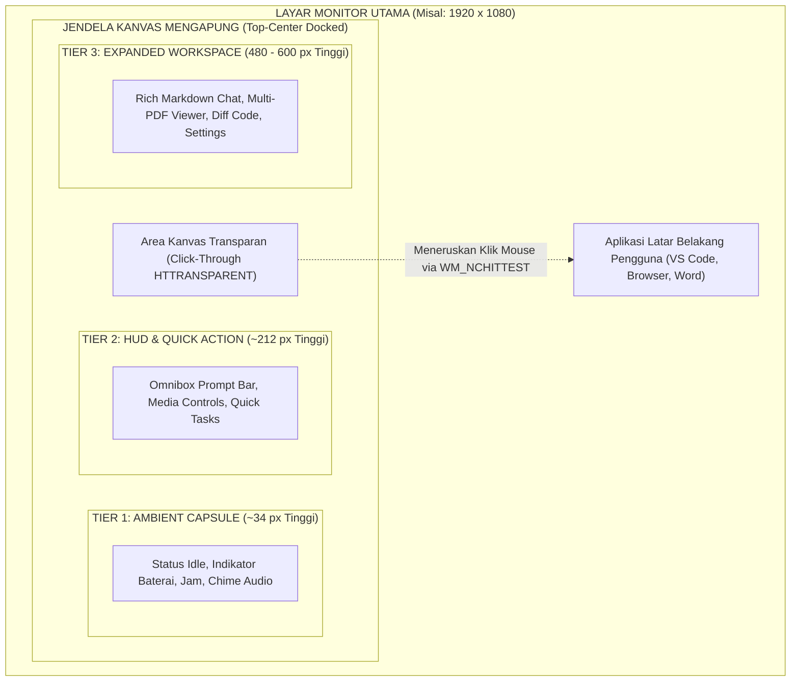
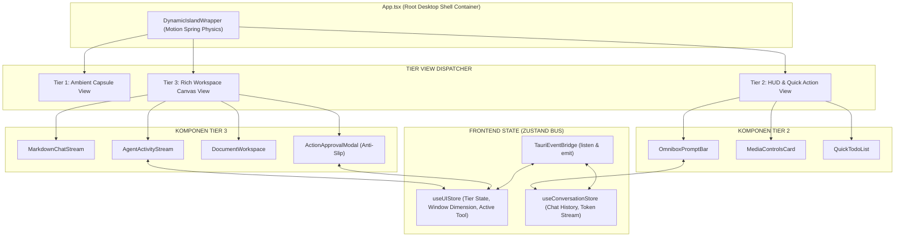

# Hime Desktop Application Architecture Specification

- **Document ID:** HIME-DESKTOP-APPLICATION-ARCHITECTURE
- **Task ID:** TASK-02-05 (System Architecture & Technical Design)
- **Phase:** Phase 02 — Nusa Reverse Engineering & Architecture Discovery
- **Authority:** Principal Desktop Systems Architect & Lead UI/UX Engineer
- **Status:** **APPROVED ARCHITECTURAL SPECIFICATION — PENDING OWNER REVIEW**
- **Date:** 2026-11-08

---

## 1. Executive Summary & Shell Technology Selection

Dokumen ini mendefinisikan arsitektur aplikasi desktop antarmuka (**Hime Desktop**), yang bertindak sebagai cangkang presentasi (*presentation shell*) dan jendela interaksi mengapung Dynamic Island bagi pengguna.

### Evaluasi Pemilihan Framework (ADR-002):
Berdasarkan perbandingan teknis mendalam terhadap alternatif populer:
- **Electron:** Ditolak karena footprint memori yang sangat boros ($\ge 150\text{ MB}$ hanya untuk Chromium instance kosong), waktu cold startup lambat ($\ge 3.5\text{ detik}$), dan duplikasi runtime Node.js.
- **Flutter Desktop / Qt:** Ditolak karena kompleksitas integrasi ekosistem AI berbasis web, ketiadaan styling CSS utility-first modern, dan overhead rendering engine custom yang berat pada iGPU Intel UHD Graphics 620.
- **Tauri 2.0 (Keputusan Terpilih):** Shell native berbasis **Rust** dengan webview native sistem operasi (**Microsoft Edge WebView2** di Windows 11; **WebKit2GTK 4.1** di Linux). Menghasilkan footprint memori idle yang sangat ramping ($\le 45\text{ MB}$ WebView working set), ukuran biner ringkas ($\le 15\text{ MB}$ installer), akses langsung ke Win32 API tingkat rendah via Rust FFI, serta isolasi keamanan IPC berbasis typed commands.

---

## 2. Arsitektur Jendela Native & Kanvas Mengapung (Windowing Architecture)

Dynamic Island Hime beroperasi sebagai jendela mengapung tanpa bingkai (*frameless floating overlay*) di batas atas layar monitor utama yang mengadopsi model kanvas elastis 3-Tier:



### A. Konfigurasi Gaya Jendela Win32 (Extended Window Styles)
Jendela native Win32 diatur dengan konfigurasi extended styles yang terukur secara empiris:
```c
DWORD dwExStyle = WS_EX_NOREDIRECTIONBITMAP | // DirectComposition hardware compositing
                  WS_EX_COMPOSITED            | // Double-buffering anti-flicker
                  WS_EX_TOOLWINDOW            | // Mencegah muncul di taskbar & Alt+Tab
                  WS_EX_TOPMOST               | // Selalu berada di atas jendela biasa
                  WS_EX_NOACTIVATE;             // Mencegah pencurian fokus ketik
// Hexadecimal Equivalent: 0x08200088
```

### B. Mekanisme Tembus-Klik Presisi (*Per-Pixel Click-Through Transparency*)
- Kanvas jendela memiliki dimensi bounding box maksimum (misal $740 \times 600\text{ px}$), namun poligon visual aktif pulau hanya menempati sebagian area.
- Melalui teknik **Window Subclassing** pada thread window procedure Win32:
  ```rust
  unsafe extern "system" fn window_proc_subclass(
      hwnd: HWND, msg: UINT, wparam: WPARAM, lparam: LPARAM,
  ) -> LRESULT {
      if msg == WM_NCHITTEST {
          let x = GET_X_LPARAM(lparam);
          let y = GET_Y_LPARAM(lparam);

          if is_point_inside_active_polygon(hwnd, x, y) {
              return HTCLIENT; // Tangani klik di dalam Dynamic Island UI
          } else {
              return HTTRANSPARENT; // Teruskan klik ke jendela aplikasi di bawahnya
          }
      }
      DefSubclassProc(hwnd, msg, wparam, lparam)
  }
  ```

### C. Pencegahan Pencurian Fokus (*Focus Stealing Protection*)
- Saat Dynamic Island berekspansi otomatis dari Tier 1 ke Tier 2 (misal karena notifikasi musik atau status agen), jendela dilarang mencuri kursor ketik (*caret focus*) dari dokumen Word atau IDE pengguna.
- Ditangani dengan merespons pesan `WM_MOUSEACTIVATE` dengan mengembalikan `MA_NOACTIVATE` kecuali jika pengguna secara sadar mengklik ke dalam kotak teks Omnibox.

### D. Aksesibilitas Pintasan Global (`Alt + Space`)
- Mendaftarkan pintasan global menggunakan Win32 API `RegisterHotKey(hwnd, 1, MOD_ALT, VK_SPACE)`.
- Menekan `Alt + Space` seketika memicu pembukaan jendela Omnibox ke Tier 2 dan memindahkan fokus keyboard ke input prompt dalam waktu $\le \mathbf{100\text{ ms}}$.

---

## 3. Adaptasi Windowing Lintas Platform (Linux Windowing)

Arsitektur windowing Hime Desktop mengisolasi implementasi platform melalui adapter PAL:
1. **KDE Plasma & Compositor Wayland (Protokol `wlr-layer-shell`):**
   - Jendela didaftarkan pada lapisan `ZWLR_LAYER_SHELL_V1_LAYER_TOP` dengan penahan tepi atas (*top anchor*).
   - Zona eksklusif diatur dinamis mengikuti ketinggian Tier aktif.
2. **Sesi GNOME Wayland (Penerapan Arahan DIR-03):**
   - Karena GNOME Shell menolak `wlr-layer-shell` secara default, Hime Desktop beralih otomatis (*graceful fallback*) ke **Floating Utility Window Mode**.
   - Jendela dikonfigurasi sebagai frameless utility window (`_NET_WM_WINDOW_TYPE_UTILITY`) terpusat di layar atas yang dapat dipanggil instan via `Alt + Space`.
3. **Sesi X11 (Legacy / Workstation):**
   - Menggunakan Extended Window Manager Hints (EWMH) `_NET_WM_WINDOW_TYPE_DOCK` dan `_NET_WM_STATE_ABOVE`. Input transparency diatur via X11 Shape Extension.

---

## 4. Arsitektur Komponen Frontend (React 19 + TypeScript)

Antarmuka pengguna Hime Desktop dibangun menggunakan komponen reaktif berbasis React 19, TypeScript murni, Tailwind CSS untuk utility styling, dan Motion untuk animasi interpolasi fisik:



---

## 5. Parameter Animasi & Desain Interaksi (Motion Physics)

Animasi perubahan bentuk (*morphing*) di antara ketiga tingkat dimensi kanvas diatur menggunakan kurva pegas (*spring curve*) yang halus dan responsif:

```typescript
// Parameter Konfigurasi Animasi Pegas (Motion Physics)
export const TIER_TRANSITION_SPRING = {
  type: "spring",
  stiffness: 400,    // Responsif terhadap trigger pengguna
  damping: 32,       // Redaman optimal tanpa over-bounce yang mengganggu
  mass: 0.8,
  restDelta: 0.001
};

// Target Dimensi Kanvas
export const CANVAS_DIMENSIONS = {
  tier1: { width: 180, height: 34, borderRadius: 17 },
  tier2: { width: 540, height: 212, borderRadius: 24 },
  tier3: { width: 740, height: 580, borderRadius: 28 }
};
```

- **Durasi Maksimum Transisi:** $\le \mathbf{240\text{ ms}}$.
- **Stabilitas Frame Rate:** Wajib mempertahankan $60\text{ FPS}$ ($\le 16.6\text{ ms}$ frame budget) pada iGPU Intel UHD Graphics 620.
- **Interaksi Buka Default (DIR-01):** Ditetapkan **Click-to-Expand** (klik untuk membuka) untuk menghindari ekspansi tak disengaja saat kursor melintas; hover dwell 250 ms disediakan sebagai opsi preferensi.

---

## 6. Jembatan Komunikasi Antarmuka (Tauri IPC Bridge)

Frontend React tidak pernah mengakses basis data, socket jaringan, atau filesystem secara langsung. Seluruh interaksi dialirkan melalui perintah Tauri bertipe ketat:

```typescript
// src/services/tauriBridge.ts
import { invoke } from '@tauri-apps/api/core';
import { listen } from '@tauri-apps/api/event';

export interface UserPromptPayload {
  promptText: string;
  activeContextId?: string;
  attachedFilePaths: string[];
}

export const tauriBridge = {
  submitPrompt: async (payload: UserPromptPayload): Promise<string> => {
    return await invoke<string>('submit_user_prompt', { payload });
  },

  submitApprovalDecision: async (grantTicket: string, approved: boolean): Promise<void> => {
    await invoke('submit_approval_decision', { grantTicket, approved });
  },

  cancelActiveTask: async (taskId: string): Promise<void> => {
    await invoke('cancel_active_task', { taskId });
  },

  onActivityStreamChunk: (callback: (chunk: string) => void) => {
    return listen<string>('activity_stream_chunk', (event) => callback(event.payload));
  }
};
```
Arsitektur ini memastikan pemisahan tanggung jawab yang bersih (*separation of concerns*): antarmuka Hime Desktop murni berfungsi sebagai lapisan presentasi interaktif dan deklaratif.
