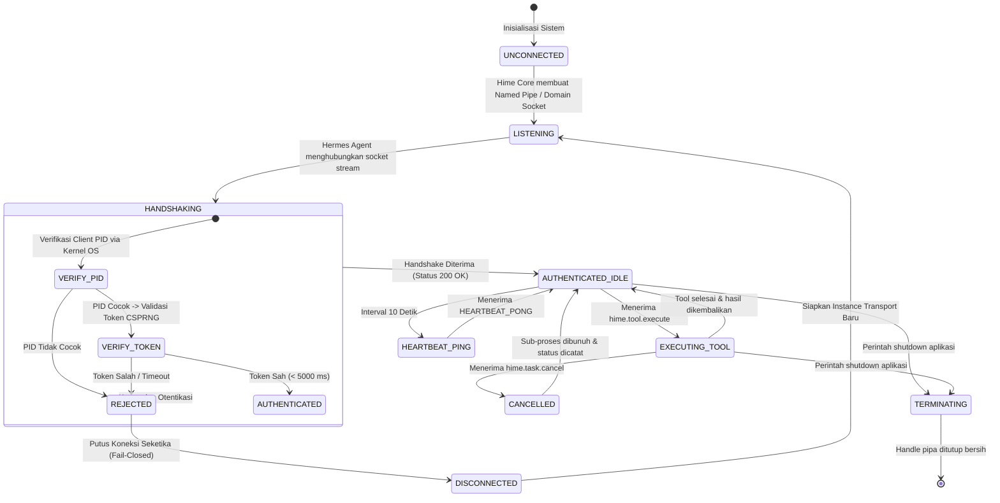

# Hime IPC & Communication Architecture Specification

- **Document ID:** HIME-IPC-AND-COMMUNICATION-ARCHITECTURE
- **Task ID:** TASK-02-05 (System Architecture & Technical Design)
- **Phase:** Phase 02 — Nusa Reverse Engineering & Architecture Discovery
- **Authority:** Principal Software Architect & Senior Distributed Systems Engineer
- **Status:** **APPROVED ARCHITECTURAL SPECIFICATION — PENDING OWNER REVIEW**
- **Date:** 2026-11-08

---

## 1. Executive Summary & IPC Design Principles

Dokumen ini mendefinisikan spesifikasi protokol komunikasi antar-proses (*Inter-Process Communication / IPC Protocol Specification*) antara **Hime Core** (proses supervisor & orkestrator) dan **Hermes Agent** (runtime penalaran otonom eksternal).

Berdasarkan keputusan arsitektur resmi dan kalibrasi tata kelola TASK-02-04D:
1. **Platform Transport Abstraction:** Komunikasi IPC diabstraksikan melalui Rust trait `IpcTransport`, memisahkan logika protokol dari primitif transport sistem operasi (Windows Named Pipe vs Linux Unix Domain Socket).
2. **Pembedaan Tegas Framing vs JSON-RPC 2.0:** Sistem membedakan secara eksplisit antara **Lapisan Pembingkaian Aliran Data (*Hime Wire Framing Layer*)** pada tingkat byte stream dengan **Lapisan Kontrak Pesan Terstruktur (*JSON-RPC 2.0 Application Message Layer*)**. Kedua lapisan dilarang dicampuradukkan.
3. **Autentikasi & Verifikasi Identitas Proses Seketika:** Sistem memverifikasi Client PID pada tingkat kernel OS (`GetNamedPipeClientProcessId` pada Windows / `SO_PEERCRED` pada Linux) dan mewajibkan handshake token CSPRNG 256-bit dalam jendela waktu $\le 5000\text{ ms}$.
4. **Perlindungan Pemutaran Ulang (*Replay Protection*):** Setiap pertukaran pesan membawa `nonce` sekuensial monotonik dan validasi drift waktu jam lokal $\le \mathbf{\pm 5\text{ detik}}$.

---

## 2. Lapisan Pembingkaian Aliran Data (Hime Wire Framing Protocol)

Karena Windows Named Pipe (dalam mode byte) dan Linux Unix Domain Socket adalah *stream-oriented transports*, Hime memberlakukan protokol framing biner berbobot ringan di depan payload JSON untuk mencegah masalah fragmentasi paket (*packet stitching/fragmentation*):

### A. Struktur Header Frame Biner (Hime Frame Layout)

```text
 0                   1                   2                   3
 0 1 2 3 4 5 6 7 8 9 0 1 2 3 4 5 6 7 8 9 0 1 2 3 4 5 6 7 8 9 0 1
+-+-+-+-+-+-+-+-+-+-+-+-+-+-+-+-+-+-+-+-+-+-+-+-+-+-+-+-+-+-+-+-+
|       Magic Bytes: 'H' 'I' 'M' 'E' (0x48, 0x49, 0x4D, 0x45)   |
+-+-+-+-+-+-+-+-+-+-+-+-+-+-+-+-+-+-+-+-+-+-+-+-+-+-+-+-+-+-+-+-+
|  Proto Ver (1)| Frame Type (1)| Flags (1)     | Reserved (1)  |
+-+-+-+-+-+-+-+-+-+-+-+-+-+-+-+-+-+-+-+-+-+-+-+-+-+-+-+-+-+-+-+-+
|                 Payload Length in Bytes (32-bit uint)         |
+-+-+-+-+-+-+-+-+-+-+-+-+-+-+-+-+-+-+-+-+-+-+-+-+-+-+-+-+-+-+-+-+
|                                                               |
|        Payload UTF-8 JSON Body (Length bytes, max 16 MB)       |
|                                                               |
+-+-+-+-+-+-+-+-+-+-+-+-+-+-+-+-+-+-+-+-+-+-+-+-+-+-+-+-+-+-+-+-+
```

### B. Spesifikasi Bidang Header:
- **Magic Bytes (4 bytes):** Tepat bernilai `0x48, 0x49, 0x4D, 0x45` (`"HIME"`). Jika byte pembuka tidak cocok, koneksi diputus seketika sebagai sinyal malformed stream.
- **Protocol Version (1 byte):** `0x01` (Protokol Versi 1.0).
- **Frame Type (1 byte):**
  - `0x01`: `HANDSHAKE_INIT`
  - `0x02`: `HANDSHAKE_ACK`
  - `0x10`: `JSONRPC_REQUEST`
  - `0x11`: `JSONRPC_RESPONSE`
  - `0x12`: `JSONRPC_NOTIFICATION`
  - `0x20`: `HEARTBEAT_PING`
  - `0x21`: `HEARTBEAT_PONG`
  - `0xFF`: `DISCONNECT_NOTICE`
- **Flags (1 byte):**
  - Bit 0 (`0x01`): `IS_COMPRESSED` (Reserved untuk Phase 3).
  - Bit 1 (`0x02`): `REQUIRES_IMMEDIATE_ACK`.
- **Reserved (1 byte):** `0x00`.
- **Payload Length (4 bytes / 32-bit Big-Endian unsigned int):** Panjang byte dari body JSON. Batas ukuran payload maksimum pada MVP adalah **16.777.216 bytes (16 MB)**. Frame di atas 16 MB ditolak untuk mencegah eksploitasi serangan alokasi memori (*DoS buffer exhaustion*).

---

## 3. Lapisan Pesan Terstruktur (JSON-RPC 2.0 Application Schemas)

Setelah frame biner diverifikasi dan diekstrak, payload dibaca sebagai dokumen UTF-8 JSON yang mematuhi ekstensi standar **JSON-RPC 2.0**:

### A. Handshake Authentication Message (Frame Type: `0x01` / `0x02`)

Segera setelah koneksi stream dibuka, Hermes Agent wajib mengirim pesan inisialisasi handshake dalam waktu $\le \mathbf{5000\text{ ms}}$:

**Request Handshake (Hermes $\rightarrow$ Hime Core):**
```json
{
  "jsonrpc": "2.0",
  "method": "hime.session.handshake",
  "params": {
    "protocol_version": "1.0",
    "client_type": "hermes-agent-python",
    "client_pid": 10488,
    "session_token": "a4f89d9c28e44b829d671234567890abcdef1234567890abcdef1234567890ab",
    "timestamp_utc": 1731060000,
    "nonce": 1
  },
  "id": "init-0001"
}
```

**Response Handshake Sukses (Hime Core $\rightarrow$ Hermes):**
```json
{
  "jsonrpc": "2.0",
  "result": {
    "status": "AUTHENTICATED",
    "server_version": "1.0.0",
    "session_id": "sess-7c9e6679-7425-40de-944b-e07fc1f90ae7",
    "heartbeat_interval_ms": 10000,
    "enforced_timeout_ms": 30000
  },
  "id": "init-0001"
}
```

---

### B. Tool Execution Delegated Request (Hermes $\rightarrow$ Hime Core)

Ketika model AI pada Hermes memutuskan untuk menjalankan alat (*tool call*), modul alat Hermes dilarang menjalankan fungsi mandiri dan wajib meneruskan request terstruktur berikut:

**Tool Execution Request (Frame Type: `0x10`):**
```json
{
  "jsonrpc": "2.0",
  "method": "hime.tool.execute",
  "params": {
    "request_id": "req-9b77ac75-3ffc-4bc7-8248-1208fedb78d7",
    "correlation_id": "corr-c1f7a4e0-9b65-4f32-8419-7569b7a4c901",
    "session_token": "a4f89d9c28e44b829d671234567890abcdef1234567890abcdef1234567890ab",
    "tool_name": "terminal_tool",
    "permission_type": "EXECUTE",
    "risk_tier": "HIGH",
    "workspace_scope": "X:\\folder_ai\\Hime",
    "payload": {
      "command": "cargo test --test ipc_contract",
      "working_dir": "X:\\folder_ai\\Hime",
      "env_overrides": {
        "RUST_BACKTRACE": "1"
      }
    },
    "timestamp_utc": 1731060015,
    "nonce": 42
  },
  "id": "call-1049"
}
```

**Tool Execution Success Response (Hime Core $\rightarrow$ Hermes) (Frame Type: `0x11`):**
```json
{
  "jsonrpc": "2.0",
  "result": {
    "request_id": "req-9b77ac75-3ffc-4bc7-8248-1208fedb78d7",
    "correlation_id": "corr-c1f7a4e0-9b65-4f32-8419-7569b7a4c901",
    "status": "COMPLETED",
    "exit_code": 0,
    "stdout": "test result: ok. 12 passed; 0 failed; 0 ignored\n",
    "stderr": "",
    "execution_duration_ms": 1420,
    "audit_id": "audit-550e8400-e29b-41d4-a716-446655440000"
  },
  "id": "call-1049"
}
```

---

### C. Standard Typed Error Response Schema

Jika terjadi penolakan izin oleh pengguna atau Policy Engine, pelanggaran skema, atau timeout:

**Tool Permission Denied Error Response:**
```json
{
  "jsonrpc": "2.0",
  "error": {
    "code": -32003,
    "message": "Permission Denied by User or Policy Engine",
    "data": {
      "error_code": "ERR_PERMISSION_DENIED",
      "request_id": "req-9b77ac75-3ffc-4bc7-8248-1208fedb78d7",
      "tool_name": "terminal_tool",
      "target_path": "C:\\Windows\\System32\\cmd.exe",
      "reason": "Target path violates hard deny OS scope list",
      "recovery_hint": "Do not attempt to execute commands on OS system directories. Limit actions to the active workspace."
    }
  },
  "id": "call-1049"
}
```

**Tabel Standar Kode Galat IPC (Standard Error Codes):**
| JSON-RPC Code | Hime Error Identifier | Deskripsi Teknis |
|:---:|:---|:---|
| `-32700` | `ERR_PARSE_ERROR` | Byte payload tidak dapat di-parse sebagai JSON valid. |
| `-32600` | `ERR_INVALID_REQUEST` | Message envelope tidak mematuhi skema protokol v1.0. |
| `-32601` | `ERR_METHOD_NOT_FOUND` | Method RPC tidak terdaftar pada Application Gateway. |
| `-32602` | `ERR_INVALID_PARAMS` | Parameter alat gagal validasi tipe atau skema field. |
| `-32001` | `ERR_AUTH_FAILED` | Token handshake tidak valid atau client PID tidak cocok. |
| `-32002` | `ERR_REPLAY_DETECTED` | Nonce mundur/sama atau selisih drift jam $> \pm 5\text{ detik}$. |
| `-32003` | `ERR_PERMISSION_DENIED` | Aksi ditolak oleh pengguna melalui modal atau dicegat PDP. |
| `-32004` | `ERR_TOOL_TIMEOUT` | Eksekusi alat melampaui batas toleransi waktu (30 detik). |
| `-32005` | `ERR_TASK_CANCELLED` | Tugas dibatalkan oleh pengguna via tombol interupsi UI. |

---

### D. Activity Stream Event Notification (Hime Core $\rightarrow$ Hime Desktop)

Hime Core menyiarkan status aktivitas agen ke frontend UI secara real-time melalui event notification (Frame Type: `0x12`):

```json
{
  "jsonrpc": "2.0",
  "method": "hime.ui.activity_stream_event",
  "params": {
    "event_id": "evt-8f4b1d6e-92c4-4b5f-9e77-1a2b3c4d5e6f",
    "correlation_id": "corr-c1f7a4e0-9b65-4f32-8419-7569b7a4c901",
    "phase": "EXECUTING_TOOL",
    "header_message": "Menjalankan pengujian integritas modul IPC",
    "active_tool": {
      "tool_name": "terminal_tool",
      "badge_color": "RED",
      "command_preview": "cargo test --test ipc_contract"
    },
    "progress_percent": 65,
    "stream_chunk": "Compiling hime-core v0.1.0...\nRunning 12 tests...\n",
    "timestamp_utc": 1731060016
  }
}
```

---

### E. Task Cancellation Schema (Hime Desktop $\rightarrow$ Hime Core $\rightarrow$ Hermes)

Ketika pengguna menekan tombol `[ Hentikan / Batal ]`:

**Cancellation Request:**
```json
{
  "jsonrpc": "2.0",
  "method": "hime.task.cancel",
  "params": {
    "task_id": "task-550e8400-e29b-41d4-a716-446655440000",
    "correlation_id": "corr-c1f7a4e0-9b65-4f32-8419-7569b7a4c901",
    "reason": "User clicked cancel button in Activity Stream",
    "force_immediate_kill": true,
    "timestamp_utc": 1731060020,
    "nonce": 43
  },
  "id": "cancel-009"
}
```

---

## 4. State Machine Siklus Hidup Koneksi IPC

Koneksi saluran komunikasi IPC dikelola melalui state machine deterministik berikut:



---

## 5. Implementasi Abstraksi Transport (`IpcTransport` Trait)

Struktur kode Rust yang mengabstraksi detail implementasi sistem operasi pada Hime Core:

```rust
use async_trait::async_trait;
use std::path::PathBuf;

#[derive(Debug, thiserror::Error)]
pub enum IpcError {
    #[error("I/O transport failure: {0}")]
    IoError(#[from] std::io::Error),
    #[error("Client PID mismatch: expected {expected}, found {found}")]
    PidMismatch { expected: u32, found: u32 },
    #[error("Handshake authentication timeout exceeded (5000 ms)")]
    HandshakeTimeout,
    #[error("Malformed frame header")]
    MalformedFrame,
    #[error("Payload size {0} exceeds 16 MB limit")]
    PayloadTooLarge(usize),
}

#[async_trait]
pub trait IpcTransport: Send + Sync {
    /// Inisialisasi listening socket / named pipe server
    async fn initialize(&mut self) -> Result<(), IpcError>;

    /// Menerima koneksi klien dan memvalidasi identitas PID klien secara sinkron
    async fn accept_authenticated_client(
        &mut self,
        expected_pid: u32,
    ) -> Result<Box<dyn IpcChannel>, IpcError>;

    /// Menutup socket/pipe server secara anggun
    async fn close(&mut self) -> Result<(), IpcError>;
}

#[async_trait]
pub trait IpcChannel: Send + Sync {
    /// Mengirim frame biner terstruktur
    async fn send_frame(&mut self, frame_type: u8, payload: &[u8]) -> Result<(), IpcError>;

    /// Menerima frame biner terstruktur lengkap
    async fn receive_frame(&mut self) -> Result<(u8, Vec<u8>), IpcError>;

    /// Memutus koneksi stream
    async fn disconnect(&mut self) -> Result<(), IpcError>;
}
```

---

## 6. Strategi Kompatibilitas Versi Protokol (Versioning Strategy)

1. **Format Versi:** Menggunakan skema Semantic Versioning `MAJOR.MINOR` (dimulai dari `1.0`).
2. **Backward Compatibility Rules:**
   - Penambahan parameter opsional baru pada `params` JSON-RPC diizinkan pada versi `MINOR` yang sama tanpa merusak klien lama.
   - Perubahan struktur header biner atau perubahan nama method RPC inti menuntut peningkatan versi `MAJOR`.
   - Jika Hime Core menerima frame dengan `Protocol Version` yang tidak didukung, server mengembalikan pesan error `ERR_PROTOCOL_VERSION_UNSUPPORTED` dan memutuskan koneksi secara deterministik.
