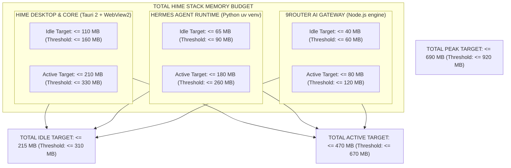
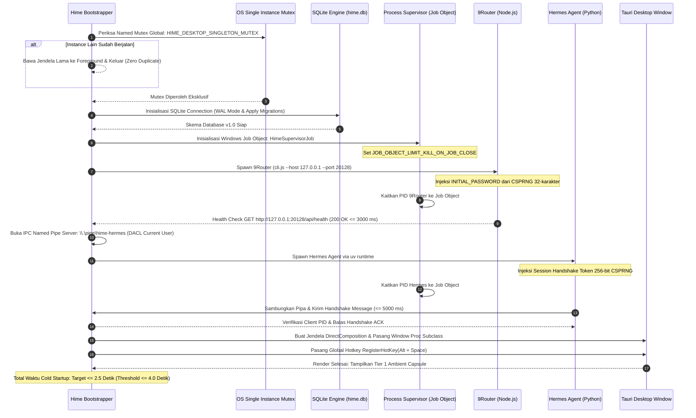

# Hime Runtime & Resource Management Architecture Specification

- **Document ID:** HIME-RUNTIME-AND-RESOURCE-ARCHITECTURE
- **Task ID:** TASK-02-05 (System Architecture & Technical Design)
- **Phase:** Phase 02 — Nusa Reverse Engineering & Architecture Discovery
- **Authority:** Staff Systems Engineer & Senior Performance Architect
- **Status:** **APPROVED ARCHITECTURAL SPECIFICATION — PENDING OWNER REVIEW**
- **Date:** 2026-11-08

---

## 1. Executive Summary & Benchmark Hardware Profile

Dokumen ini mendefinisikan arsitektur siklus hidup runtime (*Runtime Lifecycle Architecture*) dan strategi pengelolaan sumber daya komputasi (*Resource Management Strategy*) untuk **Hime**.

Sesuai audit kapasitas perangkat keras host pengembang riil yang diverifikasi pada TASK-01-01 (`docs/governance/ENVIRONMENT_AUDIT.md`), seluruh alokasi sumber daya Hime dikalibrasi secara ketat terhadap profil hardware berikut:
- **Processor (CPU):** Intel Core i5-8250U (Kaby Lake Refresh, 4 Cores / 8 Threads, Base Clock 1.60 GHz, Max Turbo 3.40 GHz, 6 MB SmartCache, TDP 15W).
- **Physical Memory (RAM):** ~20.8 GB DDR4 (Ruang memori fisik bebas riil saat beban kerja pengguna aktif: **~3.7 GB free physical RAM**).
- **Graphics Processing Unit (iGPU):** Intel UHD Graphics 620 (Integrated GPU, direct shared system memory, Direct3D 12 Feature Level 12_1).
- **Storage Media:** Solid State Drive (NVMe/SATA SSD) dengan filesystem NTFS.

### Prinsip Kejujuran Metrik (*Metric Integrity Principle*):
Seluruh nilai alokasi memori dan CPU dalam dokumen ini diklasifikasikan sebagai **Target Desain (`[DESIGN TARGET]`)** dan **Ambang Batas Penerimaan (*Acceptance Threshold*)**, BUKAN sebagai hasil pengukuran benchmark final yang telah teruji secara empiris sebelum biner implementasi lengkap terkompilasi.

---

## 2. Anggaran Memori Multi-Proses (Multi-Process Memory Budget)

Untuk memastikan sistem Hime tidak membebani sisa memori fisik host (~3.7 GB) dan tidak memicu kompresi memori agresif atau swapping SSD:

### Tabel Rincian Anggaran Memori per Komponen:

| Komponen Proses | Target Desain Idle | Ambang Batas Idle | Target Desain Aktif | Ambang Batas Aktif | Target Puncak (Peak) | Ambang Puncak |
|:---|:---:|:---:|:---:|:---:|:---:|:---:|
| **Hime Desktop + Core** | $\le 110\text{ MB}$ | $\le 160\text{ MB}$ | $\le 210\text{ MB}$ | $\le 330\text{ MB}$ | $\le 310\text{ MB}$ | $\le 420\text{ MB}$ |
| **Hermes Agent Runtime** | $\le 65\text{ MB}$ | $\le 90\text{ MB}$ | $\le 180\text{ MB}$ | $\le 260\text{ MB}$ | $\le 260\text{ MB}$ | $\le 350\text{ MB}$ |
| **9Router Gateway** | $\le 40\text{ MB}$ | $\le 60\text{ MB}$ | $\le 80\text{ MB}$ | $\le 120\text{ MB}$ | $\le 120\text{ MB}$ | $\le 150\text{ MB}$ |
| **TOTAL SELURUH STACK** | **$\le 215\text{ MB}$** | **$\le 310\text{ MB}$** | **$\le 470\text{ MB}$** | **$\le 670\text{ MB}$** | **$\le 690\text{ MB}$** | **$\le 920\text{ MB}$** |

*Margin Keamanan Host:* Pada skenario beban aktif terberat sekalipun ($\le 670\text{ MB}$ ambang batas aktif), Hime hanya mengonsumsi $\approx 18\%$ dari sisa memori fisik bebas host (~3.7 GB), menjamin kelancaran multitasking aplikasi kerja utama pengguna.

---

## 3. Urutan Siklus Hidup Proses (Startup & Shutdown Lifecycle)

### A. Prosedur Cold Startup Terurut (Deterministic Startup Sequence)

Sistem melakukan booting melalui urutan deterministik untuk menjamin keandalan inter-process handshake:

### B. Prosedur Shutdown Bersih (Graceful Shutdown Sequence)
1. **Pemicuan:** Pengguna memilih *Exit* pada context menu system tray atau menutup aplikasi.
2. **Penghentian Tugas Aktif:** Jika ada tugas penalaran agen yang sedang berjalan, Hime Core mengirimkan sinyal pembatalan `hime.task.cancel` dan menunggu maksimal **500 ms** untuk penyelesaian I/O terakhir.
3. **Persistensi Basis Data:** Hime Core mengeksekusi `PRAGMA wal_checkpoint(TRUNCATE)` untuk menggabungkan seluruh transaksi log WAL ke basis data utama `hime.db` secara bersih.
4. **Pemberitahuan Disconnect:** Hime Core mengirim frame `0xFF` (`DISCONNECT_NOTICE`) ke Hermes Agent dan menutup saluran pipa IPC.
5. **Terminasi Sub-Proses Bersih:** Process Supervisor mengirim sinyal `SIGTERM` ke 9Router dan Hermes.
6. **Penutupan Job Object:** Menutup handle Windows Job Object `CloseHandle(hJob)`. Mekanisme `KILL_ON_JOB_CLOSE` memastikan tidak ada sub-proses yang tertinggal (*Zero Orphan Process*).
7. **Pelepasan Mutex & Keluar:** Melepaskan global mutex dan proses `hime-desktop.exe` keluar dengan exit code 0 dalam waktu $\le \mathbf{1.0\text{ detik}}$.

---

## 4. Pemulihan Kerusakan Otomatis (Crash Resilience & Health Checks)

### A. Mekanisme Pemantauan Kesehatan (Periodic Heartbeat Ping)
- Hime Core mengirimkan frame biner `HEARTBEAT_PING` (`0x20`) ke Hermes Agent setiap **10 detik**.
- Hermes Agent wajib membalas dengan `HEARTBEAT_PONG` (`0x21`) dalam batas waktu $\le \mathbf{2000\text{ ms}}$.
- Jika dua ping berturut-turut tidak dibalas (*unresponsive for > 20s*), Process Supervisor menandai instance Hermes sebagai hang (*deadlock/frozen*) dan memulai prosedur restart mandiri.

### B. Prosedur Restart Mandiri Sub-Proses Anak (*Supervised Restart*):
1. Process Supervisor memanggil Win32 API `TerminateProcess` pada PID anak yang tidak responsif.
2. Supervisor membersihkan socket handle dan token sesi lama.
3. Supervisor meluncurkan instance baru dengan token sesi CSPRNG baru.
4. Saluran IPC dibangun kembali dan tugas yang terputus ditandai di linimasa: *"Agen dipulihkan secara otomatis"*.
5. **Circuit Breaker Policy:** Jika sub-proses crash lebih dari 3 kali berturut-turut dalam kurun waktu 2 menit, sistem menghentikan auto-restart, mengisolasi error, dan menampilkan dialog peringatan diagnostik kepada pengguna.

---

## 5. Manajemen Konkurensi & Kebijakan Backpressure

### A. Kebijakan Konkurensi Tugas Serial (FIFO Semaphore)
- Sesuai pembatasan sumber daya host, Hime Core memberlakukan **Semaphore Konkurensi Maksimum 1 Tugas Aktif (`Semaphore::new(1)`)** untuk eksekusi penalaran Hermes Agent.
- Jika pengguna mengirim prompt baru saat agen sedang aktif mengerjakan instruksi sebelumnya, tugas baru dimasukkan ke dalam antrean tunggu (*Pending Queue*) dengan visualisasi badge urutan antrean di Omnibox.

### B. Kebijakan Mitigasi Tekanan Memori Host (*Memory Pressure Backpressure*)
Modul `ResourceManager` secara berkala (setiap 5 detik) membaca ketersediaan memori fisik host via Win32 `GlobalMemoryStatusEx`:
- **Zona Hijau (RAM Bebas Host $> 2.0\text{ GB}$):** Operasional normal penuh.
- **Zona Kuning (RAM Bebas Host $1.0\text{ GB} - 2.0\text{ GB}$):** Hime Core membatasi alokasi cache dokumen FTS5, menonaktifkan pre-rendering thumbnail PDF, dan memicu garbage collection paksa pada WebView2.
- **Zona Merah (RAM Bebas Host $< 1.0\text{ GB}$):** Hime Core menolak inisiasi tugas agen baru dengan pesan ramah: *"Memori komputer hampir penuh. Hime menunda tugas baru hingga aplikasi lain melepaskan RAM"*, melindungi sistem host dari risiko OOM freeze.
