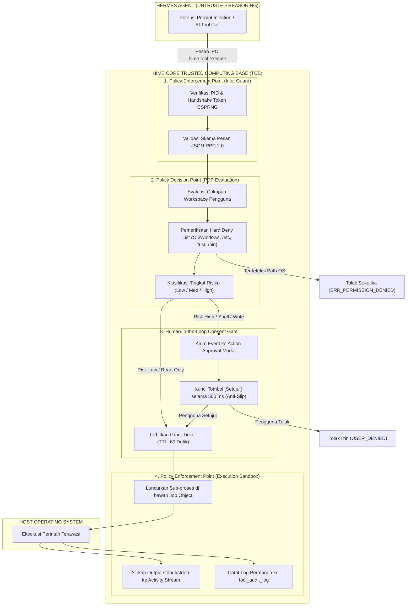

# Hime Security Architecture Specification

- **Document ID:** HIME-SECURITY-ARCHITECTURE
- **Task ID:** TASK-02-05 (System Architecture & Technical Design)
- **Phase:** Phase 02 — Nusa Reverse Engineering & Architecture Discovery
- **Authority:** Principal Security Architect & Senior Information Assurance Specialist
- **Status:** **APPROVED ARCHITECTURAL SPECIFICATION — PENDING OWNER REVIEW**
- **Date:** 2026-11-08

---

## 1. Executive Summary & Security Philosophy

Dokumen ini mendefinisikan arsitektur keamanan menyeluruh (*Comprehensive Security Architecture*) untuk **Hime**, merancang pertahanan berlapis (*defense-in-depth*) yang melindungi integritas sistem operasi host, privasi data pengguna, kedaulatan kredensial berbayar, dan keselamatan proses dari ancaman digital internal maupun eksternal.

### Prinsip Keamanan Utama Hime:
1. **Pusat Penegakan Kebijakan Tunggal (*Centralized PEP / PDP*):** Hime Core bertindak sebagai satu-satunya otoritas yang menentukan izin eksekusi (*Policy Decision Point*) dan menjalankan aksi sistem (*Policy Enforcement Point*). Model bahasa pada Hermes Agent tidak pernah memiliki hak eksekusi langsung.
2. **Prinsip Hak Akses Terkecil (*Principle of Least Privilege*):** Seluruh proses Hime berjalan di bawah akun pengguna standar (*Standard Non-Admin User*). Hime menolak keras kebutuhan privilege administrator (UAC) untuk operasional rutin.
3. **Pemisahan Kredensial Nyata vs Rencana Mitigasi:** Sesuai aturan tata kelola rekayasa, sistem memisahkan secara transparan realitas kelemahan biner 9Router saat ini dari kontrol mitigasi yang direncanakan oleh Hime Core.
4. **Human-in-the-Loop Interactivity:** Tindakan destruktif atau eksekusi perintah shell wajib diverifikasi oleh pengguna melalui Action Approval Modal dengan jeda anti-slip 500 ms.

---

## 2. Model Ancaman Sistem (STRIDE Threat Model Matrix)

Evaluasi ancaman dilakukan menggunakan metodologi STRIDE terhadap komponen-komponen utama:

| Elemen Sistem | Kategori STRIDE | Skenario Ancaman (*Threat Scenario*) | Dampak (*Impact*) | Mekanisme Mitigasi Arsitektural (*Mitigation*) |
|:---|:---:|:---|:---:|:---|
| **Hermes Agent** | **Spoofing** | Proses liar lokal mencoba menyamar sebagai Hermes Agent dan membuka koneksi ke IPC Core. | Tinggi | Verifikasi Client PID via kernel OS (`GetNamedPipeClientProcessId` / `SO_PEERCRED`) dan handshake token CSPRNG 256-bit. |
| **Pesan IPC** | **Tampering** | Malware lokal mencoba memodifikasi parameter perintah tool saat transit dalam pipa. | Kritis | DACL Named Pipe kustom (`Current User SID` + `Deny Network`) / izin file socket `0600` Linux VFS. |
| **Tool Execution** | **Repudiation** | Model AI atau pengguna menyangkal telah mengeksekusi perintah shell yang merusak file. | Sedang | Pencatatan append-only `tool_audit_log` transaksional dengan `correlation_id`, waktu UTC, dan hash perintah. |
| **9Router Gateway** | **Information Disclosure** | Kunci API pihak ketiga (OpenAI, Anthropic) dibaca oleh malware dari file database 9Router. | Tinggi | Isolasi direktori `.9router/` dengan Windows ACL / POSIX `0700` dan pembungkus enkripsi DPAPI/libsecret terencana. |
| **Host System** | **Denial of Service** | Model AI terjebak dalam loop eksekusi tak terhingga atau menghabiskan memori RAM host. | Tinggi | Pengawasan Windows Job Object (`Kill-on-Close`), kuota timeout tool 30s, dan tombol interupsi UI ($\le 200\text{ ms}$). |
| **Prompt Input** | **Elevation of Privilege** | Serangan *Prompt Injection* memaksa model AI menjalankan perintah format disk atau membaca file OS. | Kritis | Hard Deny List mutlak direktori OS (`C:\Windows`, `/etc`), whitelist workspace, dan Action Approval Modal wajib. |

---

## 3. Titik Penegakan Kebijakan Sentral (PEP / PDP Architecture)

Arsitektur penegakan kebijakan Hime Core dibangun dengan pemisahan peran yang tegas antara evaluasi kebijakan dan eksekusi:



### 8 Jenis Izin Granular (*Granular Permissions*):
1. `ReadWorkspace`: Izin membaca berkas teks dan metadata di dalam folder proyek kerja aktif.
2. `WriteWorkspace`: Izin membuat atau memperbarui berkas di dalam folder proyek kerja aktif.
3. `ExecuteShell`: Izin menjalankan perintah terminal (Wajib Action Approval Modal).
4. `ManageStorage`: Izin memindahkan atau menghapus berkas unduhan (Wajib Jurnal Undo 30 Hari).
5. `InspectSystem`: Izin membaca telemetri perangkat keras lokal (RAM, disk, baterai).
6. `AccessDevice`: Izin membaca media dari smartphone Android yang terhubung via kabel USB.
7. `NetworkOutbound`: Izin membuka koneksi HTTP keluar melalui Browser Service.
8. `ModifySettings`: Izin mengubah konfigurasi preferensi aplikasi atau model AI.

---

## 4. Analisis Status Keamanan 9Router & Rencana Mitigasi

Berdasarkan hasil audit keamanan Phase 01 (`TASK-01-04-SECURITY-RUNTIME-AUDIT.md`) dan analisis kode sumber `RE/9ROUTER/`:

```text
+---------------------------------------------------------------------------------------------------+
| 5 TEMUAN RISIKO KEAMANAN 9ROUTER (HASIL AUDIT PHASE 01 & RE/9ROUTER)                              |
+---------------------------------------------------------------------------------------------------+
| 1. PLAINTEXT CREDENTIALS PADA DATA.SQLITE [VERIFIED STATIC]:                                      |
|    Database SQLite %APPDATA%\9router\db\data.sqlite (Windows) / ~/.9router/db/data.sqlite (Linux) |
|    menyimpan API Key OpenAI/Anthropic/Google dalam plaintext JSON (CWE-312) di tabel              |
|    providerConnections.                                                                           |
|                                                                                                   |
| 2. LOCALHOST AUTHENTICATION BYPASS [VERIFIED STATIC]:                                             |
|    Fungsi src/dashboardGuard.js:161-165 meloloskan request loopback (isLocalRequest) tanpa         |
|    memvalidasi token otorisasi. Proses lokal lain dapat mengakses rute manajemen.                 |
|                                                                                                   |
| 3. FALLBACK INITIAL PASSWORD STATIC [VERIFIED STATIC - SOURCE FALLBACK]:                         |
|    Kode route.js:58 memuat fallback teks "123456" jika variabel env INITIAL_PASSWORD tidak ada.  |
|                                                                                                   |
| 4. POTENSI 0.0.0.0 NETWORK BINDING [VERIFIED STATIC]:                                             |
|    Argumen CLI berisiko mengikat antarmuka publik jika salah konfigurasi.                         |
+---------------------------------------------------------------------------------------------------+
```

### Matriks Pemisahan Bukti & Kontrol Keamanan Terencana:

| Kerentanan 9Router | Kontrol Terverifikasi Saat Ini | Kontrol yang Direncanakan Hime (`[PLANNED CONTROL]`) | Kebutuhan Upstream Patch / Fork | Hambatan (*Blockers*) & Risiko Residual |
|:---|:---|:---|:---|:---|
| **Plaintext Credentials (`data.sqlite`)** | `[VERIFIED STATIC]` (CWE-312) di path kanonikal `%APPDATA%\9router\db\data.sqlite`. | Hime Core menerapkan Windows ACL / POSIX permission `0700` pada direktori `.9router\` dan merencanakan wrapper enkripsi DPAPI/libsecret. | Kebutuhan patch upstream: Enkripsi kolom database kredensial. | **Risiko Residual:** Malware lokal dengan hak akses user sama dapat membaca file jika ACL ditembus. |
| **Localhost Auth Bypass** | `[VERIFIED STATIC]` pada `src/dashboardGuard.js`. Binding dipaksa ke `127.0.0.1`. | Hime Core Process Supervisor menyuntikkan session token acak per-sesi. | Upstream 9Router perlu mendukung verifikasi header token ketat pada rute `/v1/*`. | **Blocker jika upstream menolak:** Memerlukan maintained internal wrapper di Hime Core. |
| **Default Password "123456"** | `[VERIFIED STATIC — SOURCE FALLBACK]`, `[NOT TESTED RUNTIME]`. | Hime Core Process Supervisor menginjeksi string CSPRNG acak 32-karakter via `INITIAL_PASSWORD` saat spawn proses anak. | Tidak butuh patch upstream; didukung via parameter variabel lingkungan. | Tidak ada blocker teknis. |
| **Potensi 0.0.0.0 Binding** | `[VERIFIED STATIC]` pada CLI parameter. | Hime Core memaksakan `--host 127.0.0.1` dan memverifikasi socket aktif via Win32 `GetExtendedTcpTable` sebelum inisiasi data. | Tidak butuh patch upstream; diproteksi supervisor Hime Core. | Tidak ada blocker teknis. |

*Komitmen Tata Kelola:* Hime tidak mengklaim kontrol mitigasi terencana sebagai fitur bawaan 9Router saat ini, dan tidak memodifikasi repositori upstream secara sepihak tanpa evaluasi ADR.

---

## 5. Manajemen Kredensial & Brankas Rahasia (Secrets Management)

Seluruh data rahasia yang dikelola langsung oleh Hime Core dilindungi menggunakan modul kriptografi native sistem operasi:
- **Platform Windows 11:** Memanggil Windows Data Protection API (DPAPI) via fungsi Win32 `CryptProtectData` dengan cakupan `DataProtectionScope.CurrentUser`. Ciphertext yang dihasilkan hanya dapat didekripsi pada mesin fisik yang sama dan di bawah konteks logon akun Windows yang identik.
- **Platform Linux:** Memanfaatkan **FreeDesktop Secret Service API** melalui pustaka `libsecret` yang berkomunikasi via D-Bus dengan pengelola keyring native Linux (GNOME Keyring di GNOME, KWallet di KDE Plasma). Jika lingkungan Linux minimalis tidak memiliki D-Bus keyring, Hime mengaktifkan fallback enkripsi file AES-256-GCM berbasis passphrase derivasi Argon2id lokal.
- **Dilarang Keras:** Menyimpan kunci API, password, atau token sesi dalam file teks biasa (`.txt`, `.json`, `.yaml`) di disk host.

---

## 6. Pengawasan Proses & Isolasi Eksekusi (Process Sandboxing)

1. **Windows Job Object (`HimeSupervisorJob`):**
   - Hime Core mengikat proses anak Hermes Agent dan 9Router ke dalam Windows Job Object menggunakan bendera `JOB_OBJECT_LIMIT_KILL_ON_JOB_CLOSE`.
   - Menetapkan batasan kuota memori (*Job Object Memory Limit*) maksimal 700 MB untuk seluruh pohon proses anak guna melindungi host dari freezing.
   - Jika proses utama Hime Desktop ditutup paksa atau mengalami unhandled crash, kernel Windows secara otomatis menterminasi seluruh sub-proses anak seketika tanpa meninggalkan proses yatim (*Zero Orphan Process*).
2. **Linux Process Death Signal & cgroups v2:**
   - Memanggil syscall `prctl(PR_SET_PDEATHSIG, SIGTERM)` pada setiap sub-proses segera setelah pemanggilan `fork()`.
   - Mengaitkan proses ke dalam transient systemd scope (`hime.scope`) dengan pembatasan kuota memori `memory.max = 700M`.
3. **Pembersihan Lingkungan Lingkungan (*Environment Cleansing*):**
   - Sub-proses yang diluncurkan untuk eksekusi terminal shell pengguna dibersihkan dari environment variable sensitif (`INITIAL_PASSWORD`, token sesi IPC, dan master encryption keys) sebelum `CreateProcessW` / `execve` dipanggil.
