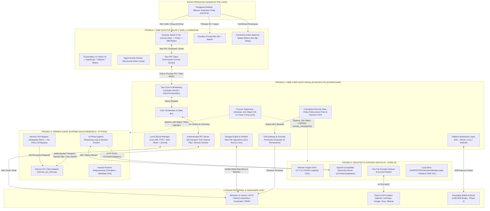
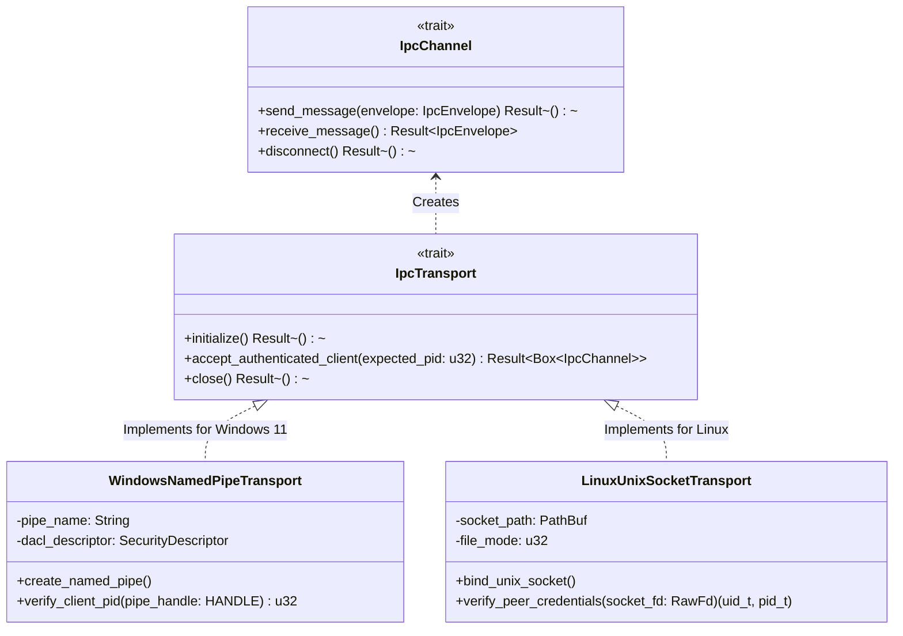

# Hime Master System Architecture Specification

- **Document ID:** HIME-SYSTEM-ARCHITECTURE
- **Task ID:** TASK-02-05 (System Architecture & Technical Design)
- **Phase:** Phase 02 — Nusa Reverse Engineering & Architecture Discovery
- **Authority:** Principal Software Architect, Staff Systems Engineer & Senior Technical Architect
- **Status:** **APPROVED ARCHITECTURAL BLUEPRINT — PENDING OWNER REVIEW**
- **Date:** 2026-11-08

---

## 1. Executive Summary & Architectural Vision

Dokumen ini mendefinisikan cetak biru arsitektur master (*Master Architecture Blueprint*) untuk **Hime**, sebuah personal AI desktop environment mandiri yang dirancang sebagai pusat kendali aktivitas digital pengguna (*personal AI command center*).

Hime mentransformasikan interaksi komputer dari model reaktif berbasis aplikasi terisolasi menjadi lingkungan kerja kolaboratif di mana kecerdasan buatan memahami konteks aktif, membantu mengorganisir dokumen dan berkas, mengawasi tugas-tugas harian, dan mengeksekusi instruksi pengguna secara terarah, transparan, dan terkontrol secara ketat.

### A. Prinsip Fondasi Arsitektur (Core Architectural Tenets)
1. **Windows-First, Cross-Platform by Design:** Dioptimalkan secara mendalam pada lingkungan Windows 11 sebagai platform implementasi dan rilis utama (Phase 06–07), dengan abstraksi Platform Abstraction Layer (PAL) yang menjamin arsitektur siap berjalan pada Linux (Wayland/X11) dan terhubung ke Android sebagai pendamping.
2. **Topologi 4-Proses Terisolasi (*Isolated 4-Process Topology*):** Memisahkan secara tegas antarmuka presentasi (**Hime Desktop**), pusat orkestrasi & penegakan kebijakan (**Hime Core**), runtime penalaran otonom (**Hermes Agent**), dan gateway inferensi AI (**9Router**).
3. **Pusat Penegakan Kebijakan Tunggal (*Centralized Policy Enforcement*):** Seluruh pemanggilan alat (*tools*) dan tindakan sistem operasi yang diminta oleh model AI **wajib melewati Hime Core** sebagai *Policy Decision Point (PDP)* dan *Policy Enforcement Point (PEP)*. Hermes Agent tidak memiliki jalur eksekusi alat mandiri ke sistem operasi.
4. **Kedaulatan & Keamanan Data Lokal (*Local-First Sovereignty*):** Seluruh riwayat percakapan, indeks pencarian teks penuh (FTS5), jurnal penyimpanan berkas, dan log audit disimpan pada basis data lokal SQLite terkelola. Rahasia dan token diamankan melalui enkripsi tingkat sistem operasi (Windows DPAPI / Linux Secret Service).
5. **Transparansi Operasional Penuh (*Zero Private CoT Leakage*):** Pemikiran internal mentah (*private chain-of-thought*) dilarang ditampilkan ke antarmuka pengguna; aktivitas agen disajikan melalui **Agent Activity Stream** yang terstruktur, ringkas, dan dapat diinterupsi seketika.
6. **Keselamatan Manipulasi Berkas (*Zero Source Loss*):** Menolak klaim atomisitas palsu lintas-volume; seluruh operasi pemindahan berkas menerapkan siklus verifikasi bertahap (Salin $\rightarrow$ Hash Check $\rightarrow$ Atomic Rename Target $\rightarrow$ Durability Flush $\rightarrow$ Hapus Asal) yang dilindungi jurnal Undo 30 hari.
7. **Penyelarasan Batasan Perangkat Keras Riil (*Hardware-Aware Design*):** Seluruh arsitektur dikalibrasi terhadap baseline perangkat keras pengembang riil (Intel Core i5-8250U, ~20.8 GB RAM dengan sisa memori fisik bebas ~3.7 GB, iGPU Intel UHD Graphics 620) dengan target alokasi memori total stack $\le 215\text{ MB}$ idle dan $\le 470\text{ MB}$ aktif.

---

## 2. Multi-Process System Topology

Ekosistem Hime beroperasi sebagai sistem terdistribusi lokal (*local distributed system*) yang terdiri dari empat proses sistem operasi independen yang berkomunikasi melalui saluran inter-process communication (IPC) lokal berkinerja tinggi:



---

## 3. Matriks Tanggung Jawab & Batas Proses (Process Boundaries)

Setiap proses memegang tanggung jawab spesifik tanpa tumpang tindih (*single source of authority*):

| Komponen Proses | Teknologi Runtime | Tanggung Jawab Utama | Batasan & Yang Dilarang (*Prohibitions*) | Batas Kepercayaan (*Trust Boundary*) |
|:---|:---|:---|:---|:---:|
| **Hime Desktop** | Tauri 2.0 Shell (Rust) + React 19 / TS / Tailwind | - Presentasi antarmuka Dynamic Island 3-Tier.<br>- Manajemen klik tembus (`WM_NCHITTEST`).<br>- Visualisasi Agent Activity Stream.<br>- Dialog Action Approval Modal.<br>- Tangkapan shortcut global (`Alt + Space`). | - **DILARANG** mengakses filesystem langsung.<br>- **DILARANG** melakukan query SQLite langsung.<br>- **DILARANG** memanggil API 9Router langsung.<br>- Tidak memiliki logika penegakan kebijakan. | **Untrusted Presentation Boundary** (Menampilkan data terstruktur dari Hime Core) |
| **Hime Core** | Rust Modular Monolith (Tokio Async Runtime) | - Pusat orkestrasi sistem & state machine.<br>- Policy Decision & Enforcement Point (PDP/PEP).<br>- Pengawasan proses anak (Job Object / prctl).<br>- Pengelolaan basis data SQLite (FTS5 + WAL).<br>- Eksekusi safe file move (Zero Source Loss).<br>- Server IPC terautentikasi (`IpcTransport`). | - **DILARANG** bergantung langsung pada API Windows di layer domain (wajib via PAL).<br>- **DILARANG** menjalankan perintah shell tanpa evaluasi PDP.<br>- **DILARANG** mengubah file user tanpa jurnal. | **Trusted Computing Base (TCB)** (Pusat otoritas mutlak seluruh sistem) |
| **Hermes Agent** | Python 3.11+ via `uv` (Nous Research Runtime) | - 10-Phase Agentic Reasoning Loop.<br>- Pemahaman instruksi pengguna & task planning.<br>- Manajemen session context LLM.<br>- Pemanggilan alat terdelegasi (*delegated tools*). | - **DILARANG KERAS** mengeksekusi alat langsung ke OS (`subprocess.run`, file I/O tool).<br>- **DILARANG** menampilkan private chain-of-thought.<br>- **DILARANG** membypass saluran IPC Hime Core. | **Semi-Trusted Sandbox Boundary** (Dipantau oleh Hime Core PEP/PDP & Job Object) |
| **9Router** | Node.js 20+ Runtime (`decolua/9router` v0.5.112) | - AI gateway multi-provider OpenAI-compatible.<br>- Streaming token LLM via SSE.<br>- Two-tier automatic failover & rotasi akun.<br>- Pengelolaan provider connections. | - **DILARANG** mengikat ke `0.0.0.0` (wajib `127.0.0.1`).<br>- **DILARANG** diakses langsung oleh UI desktop.<br>- Tidak dimodifikasi source code-nya secara sembarangan. | **External Managed Service** (Terikat ketat loopback, diawasi oleh supervisor) |

---

## 4. Aliran Data & Interaksi Lintas-Komponen Utama

### A. Alur Instruksi Pengguna (User Prompt Execution Pipeline)
1. **Pemicuan:** Pengguna menekan `Alt + Space` atau mengklik pulau mengapung (Tier 1). Antarmuka berekspansi ke Tier 2 HUD / Omnibox dalam waktu $\le 100\text{ ms}$.
2. **Pengiriman Prompt:** Pengguna mengetik instruksi (misal: *"Analisis laporan keuangan kuartal 3 dan ringkas poin kuncinya"*). Frontend mengirim event Tauri IPC `submit_prompt` ke Hime Core.
3. **Penyusunan Konteks:** Hime Core `Context & Memory Manager` mengekstrak konteks aktif, melakukan query pencarian FTS5 pada riwayat relevan, membungkus payload instruksi, dan mengirimkannya ke Hermes Agent via saluran IPC berotentikasi.
4. **Penalaran AI:** Hermes Agent memproses instruksi, mengirim request inferensi ke 9Router loopback (`127.0.0.1:20128/v1/chat/completions`), menerima token stream, dan menyimpulkan perlunya pemanggilan alat (*tool invocation*).
5. **Delegasi Alat:** Hermes Agent mengemas pemanggilan alat (misal `read_file` pada `reports/q3_financial.pdf`) ke dalam envelope pesan IPC terstruktur dan mengirimkannya kembali ke Hime Core.

### B. Alur Penegakan Kebijakan & Otorisasi Tindakan (Tool Execution & Safety Gate)
```text
Hermes Agent (Tool Request Envelope)
   │
   ▼
[ Hime Core IPC Server ]
   │
   ├─► 1. Autentikasi: Validasi Session Token & Verifikasi PID Klien (fail-closed jika anomali)
   │
   ├─► 2. Policy Decision Point (PDP):
   │       - Cek Whitelist Workspace Pengguna (Hard Deny pada direktori OS)
   │       - Evaluasi Tingkat Risiko (LOW, MEDIUM, HIGH)
   │
   ├─► 3. Penentuan Jalur Evaluasi:
   │       │
   │       ├─► [LOW RISK: Otomatis Diizinkan] ──────────────────────────┐
   │       │                                                            │
   │       └─► [HIGH RISK: Eksekusi Shell / Modifikasi File Kritis]    │
   │               │                                                    │
   │               ▼                                                    │
   │           [ Kirim Event ke Hime Desktop ]                          │
   │               │                                                    │
   │               ▼                                                    │
   │           [ Tampilkan Action Approval Modal ]                      │
   │           (Tombol terkunci selama 500 ms anti-slip)                │
   │               │                                                    │
   │               ├─► Pengguna Klik [TOLAK] ──► Return Error ke Hermes │
   │               │                                                    │
   │               └─► Pengguna Klik [SETUJUI]                          │
   │                       │                                            │
   │                       ▼                                            │
   │                   [ Otorisasi Diterbitkan (Valid 60 detik) ]       │
   │                                                                    │
   ├────────────────────────────────────────────────────────────────────┘
   │
   ▼
[ Hime Core Policy Enforcement Point (PEP) ]
   │
   ├─► 4. Catat status ke basis data SQLite: tool_audit_log (Status: APPROVED_EXECUTING)
   ├─► 5. Luncurkan sub-proses terisolasi di bawah Windows Job Object
   ├─► 6. Alirkan stdout / stderr real-time ke Hime Desktop (Agent Activity Stream)
   ├─► 7. Tangkap exit code & perbarui tool_audit_log (Status: COMPLETED)
   │
   ▼
Kirimkan Hasil Eksekusi ke Hermes Agent via Saluran IPC
```

---

## 5. Saluran Komunikasi Antar-Proses & Keamanan IPC

Sesuai spesifikasi terkalibrasi TASK-02-04D, saluran komunikasi antar-proses dirancang dengan pemisahan platform transport yang bersih:



### A. Windows Named Pipe Transport Adapter
- **Jalur Pipe:** `\\.\pipe\hime-hermes`.
- **DACL Eksplisit:** Hanya memberikan hak `GENERIC_READ | GENERIC_WRITE` kepada **`Current User SID`** dan menolak seluruh akses jaringan (*Deny Network Logon SID*).
- **Verifikasi PID Klien:** Segera setelah koneksi diterima via `ConnectNamedPipe`, Hime Core memanggil Win32 API `GetNamedPipeClientProcessId(pipe_handle, &client_pid)` dan mencocokkannya dengan PID Hermes Agent yang dicatat saat peluncuran. Jika berbeda, pipa diputus seketika via `DisconnectNamedPipe`.
- **Autentikasi Handshake:** Validasi token rahasia 256-bit CSPRNG dalam batas waktu $\le 5000\text{ ms}$.

### B. Linux Unix Domain Socket Transport Adapter
- **Jalur Socket:** `$XDG_RUNTIME_DIR/hime/hermes.sock` (fallback: `/run/user/<UID>/hime/hermes.sock`).
- **Izin Berkas:** Direktori `0700` (`drwx------`) dan berkas socket `0600` (`srw-------`).
- **Verifikasi Peer Credential:** Memanggil `getsockopt(client_fd, SOL_SOCKET, SO_PEERCRED, &ucred, &len)` segera setelah `accept()` untuk memvalidasi:
  1. `ucred.uid == getuid()` (pengguna Linux identik).
  2. `ucred.pid == expected_hermes_child_pid` (PID Hermes Agent yang sah).
- **Autentikasi Handshake:** Validasi token rahasia 256-bit CSPRNG dalam batas waktu $\le 5000\text{ ms}$.

---

## 6. Arsitektur Data, Penyimpanan & Jaminan Filesystem

### A. Basis Data Lokal SQLite Terkelola
Hime Core mengelola basis data lokal mandiri (`%USERPROFILE%\.hime\data\hime.db` di Windows / `~/.hime/data/hime.db` di Linux):
- **WAL Mode (`PRAGMA journal_mode = WAL`):** Menjamin konkurensi pembacaan paralel multi-thread tanpa mengunci penulis (*zero read-write contention*).
- **Sinkronisasi Aman (`PRAGMA synchronous = NORMAL`):** Memberikan keseimbangan optimal antara perlindungan integritas ACID dan performa I/O flash SSD.
- **Pencarian Teks Penuh (SQLite FTS5):** Mengindeks riwayat obrolan, metadata berkas unduhan, dan dokumen kerja untuk pencarian instan $\le 15\text{ ms}$.
- **Pemisahan Domain Data:** Database Hime Core sepenuhnya terpisah dari database internal 9Router (`data.sqlite`) dan database internal Hermes Agent.

### B. 5 Dimensi Jaminan Sistem Berkas (Filesystem Guarantees)
Operasi penyimpanan Hime membedakan secara jujur lima dimensi jaminan teknis:
1. **Namespace Atomicity:** Pembaruan entri direktori atomik pada volume yang sama (*same-volume move*) via `MoveFileExW(..., MOVEFILE_REPLACE_EXISTING)` di Win32 dan `renameat2(..., RENAME_NOREPLACE)` di Linux kernel $\ge 3.15$.
2. **Data Integrity:** Verifikasi checksum SHA-256 berkas sebelum dan sesudah transfer; menolak berkas jika terjadi bit-rot atau modifikasi di tengah jalan.
3. **Crash Consistency:** Mengandalkan filesystem journaling (NTFS log / ext4 journal) untuk menjamin struktur direktori tidak korup setelah listrik mati mendadak.
4. **Durability:** Memaksa controller fisik menulis buffer RAM ke media non-volatile via Win32 `FlushFileBuffers` / `MOVEFILE_WRITE_THROUGH` dan POSIX `fsync(file_fd)` serta `fsync(parent_dir_fd)`.
5. **Cross-Volume Transactions:** Mengakui bahwa pemindahan lintas volume fisik **tidak pernah atomik di tingkat OS kernel**. Hime menerapkan siklus terverifikasi multi-tahap (Pre-flight $\rightarrow$ Copy `.hime_tmp` $\rightarrow$ SHA-256 Check $\rightarrow$ Atomic Rename Target $\rightarrow$ Flush $\rightarrow$ Hapus Asal) dengan prinsip *Zero Source File Loss*.
6. **Jurnal Undo 30 Hari:** Setiap operasi pemindahan dicatat dalam tabel `storage_journal`. Tombol Undo memverifikasi kembali integritas hash destinasi sebelum memulihkan berkas; jika berkas tujuan telah diedit pengguna, Undo otomatis diblokir untuk melindungi perubahan terbaru pengguna.

---

## 7. Arsitektur Keamanan Menyeluruh (Defense-in-Depth)

Arsitektur keamanan Hime dibangun atas prinsip pertahanan berlapis (*defense-in-depth*):

```text
+---------------------------------------------------------------------------------------------------+
| LAYER 1: NETWORK & PERIMETER ISOLATION                                                            |
| - 9Router & Hermes dipaksa mengikat loopback 127.0.0.1 (0.0.0.0 Binding dicegah & dibunuh).      |
| - Verifikasi port aktif via GetExtendedTcpTable Win32 sebelum inisiasi transmisi data.           |
+---------------------------------------------------------------------------------------------------+
| LAYER 2: PROCESS & IPC BOUNDARY HARDENING                                                         |
| - Windows Job Object (JOB_OBJECT_LIMIT_KILL_ON_JOB_CLOSE) menjamin zero orphan processes.         |
| - Named Pipe DACL (Current User SID + Deny Network) + Verifikasi PID Klien via Win32 API.        |
| - Linux Domain Socket (0600 file permission + SO_PEERCRED UID/PID verification).                  |
| - Handshake token CSPRNG 256-bit dengan timeout ketat 5000 ms.                                    |
+---------------------------------------------------------------------------------------------------+
| LAYER 3: POLICY DECISION & ENFORCEMENT POINT (PEP / PDP)                                          |
| - Hime Core mengevaluasi 8 izin granular terhadap direktori workspace pengguna yang disahkan.    |
| - Hard Deny List mutlak untuk direktori sistem operasi krusial (C:\Windows, /etc, /usr, /bin).    |
| - Action Approval Modal (Human-in-the-Loop) dengan 500 ms anti-slip delay untuk aksi berisiko.     |
+---------------------------------------------------------------------------------------------------+
| LAYER 4: CREDENTIAL & SECRETS PROTECTION                                                          |
| - Kunci API dan rahasia Hime Core dienkripsi via Windows DPAPI (CurrentUser) / Linux libsecret.   |
| - Database 9Router (data.sqlite plaintext CWE-312) diproteksi Windows ACL / POSIX mode 0700       |
|   serta wrapper enkripsi terencana Hime Core [PLANNED MITIGATION CONTROL].                        |
| - Fallback password 9Router "123456" dimitigasi via injeksi token CSPRNG INITIAL_PASSWORD.       |
+---------------------------------------------------------------------------------------------------+
| LAYER 5: AUDITABILITY & RECOVERY                                                                  |
| - Seluruh aksi alat dicatat secara permanen pada basis data lokal tool_audit_log.                 |
| - Jurnal pemindahan berkas storage_journal dengan jendela Undo terverifikasi 30 hari.            |
+---------------------------------------------------------------------------------------------------+
```

---

## 8. Invarian Sistem yang Tidak Boleh Dikompromikan (Non-Negotiable Invariants)

1. **Invarian 1 (Zero Direct OS Bypass):** Model AI pada Hermes Agent tidak pernah memiliki izin atau kemampuan untuk menjalankan perintah sistem operasi langsung tanpa melalui Hime Core PEP/PDP.
2. **Invarian 2 (Zero Source File Loss):** Berkas sumber pada operasi pemindahan berkas tidak pernah dihapus sebelum salinan di destinasi terbukti valid dan utuh 100% via hash SHA-256.
3. **Invarian 3 (Zero Orphan Child Process):** Kematian atau crash pada proses induk Hime Desktop / Hime Core wajib menterminasi seluruh proses anak (Hermes dan 9Router) seketika via mekanisme kernel sistem operasi (Job Object / `prctl`).
4. **Invarian 4 (Zero Network Exposure):** Komponen runtime backend lokal dilarang keras membuka antarmuka socket publik (`0.0.0.0`) tanpa autentikasi kriptografis.
5. **Invarian 5 (Zero Private CoT Exposure):** Pemikiran internal mentah model AI (*private chain-of-thought*) dilarang keras disalurkan atau ditampilkan ke antarmuka pengguna; hanya rencana terstruktur dan status aktivitas yang dapat divisualisasikan.
6. **Invarian 6 (Human Consent for Destructive Actions):** Tindakan berisiko tinggi (penulisan berkas massal, eksekusi shell terminal, pembersihan storage) wajib memperoleh persetujuan eksplisit pengguna melalui Action Approval Modal.

---

## 9. Struktur Dokumen Arsitektur & Indeks Deliverables

Cetak biru arsitektur Hime diuraikan secara mendalam ke dalam 14 dokumen spesifikasi teknis pelengkap pada direktori [`project-management/system-architecture/`](file:///x:/folder_ai/Hime/project-management/system-architecture/):

- [`HIME-C4-ARCHITECTURE.md`](file:///x:/folder_ai/Hime/project-management/system-architecture/HIME-C4-ARCHITECTURE.md): Diagram C4 Context, Container, Component, & Deployment.
- [`HIME-CORE-INTERNAL-ARCHITECTURE.md`](file:///x:/folder_ai/Hime/project-management/system-architecture/HIME-CORE-INTERNAL-ARCHITECTURE.md): Struktur modular monolith 14 modul internal Hime Core.
- [`HIME-IPC-AND-COMMUNICATION-ARCHITECTURE.md`](file:///x:/folder_ai/Hime/project-management/system-architecture/HIME-IPC-AND-COMMUNICATION-ARCHITECTURE.md): Protokol framing kustom, skema JSON-RPC, & transport abstraction.
- [`HIME-AGENT-ORCHESTRATION-ARCHITECTURE.md`](file:///x:/folder_ai/Hime/project-management/system-architecture/HIME-AGENT-ORCHESTRATION-ARCHITECTURE.md): Siklus hidup penalaran Hermes, task state machine, & Activity Stream.
- [`HIME-TOOL-AND-SERVICE-ARCHITECTURE.md`](file:///x:/folder_ai/Hime/project-management/system-architecture/HIME-TOOL-AND-SERVICE-ARCHITECTURE.md): Taksonomi Agent vs Skill vs Tool vs Service vs Integration & kontrak schema.
- [`HIME-DATA-ARCHITECTURE.md`](file:///x:/folder_ai/Hime/project-management/system-architecture/HIME-DATA-ARCHITECTURE.md): Desain database SQLite WAL, skema tabel, migrasi, & journal storage.
- [`HIME-SECURITY-ARCHITECTURE.md`](file:///x:/folder_ai/Hime/project-management/system-architecture/HIME-SECURITY-ARCHITECTURE.md): Desain PEP/PDP, threat model STRIDE, mitigasi prompt injection, & status 9Router.
- [`HIME-DESKTOP-APPLICATION-ARCHITECTURE.md`](file:///x:/folder_ai/Hime/project-management/system-architecture/HIME-DESKTOP-APPLICATION-ARCHITECTURE.md): Shell Tauri 2, 3-Tier Canvas, HWND subclassing, & UI state.
- [`HIME-RUNTIME-AND-RESOURCE-ARCHITECTURE.md`](file:///x:/folder_ai/Hime/project-management/system-architecture/HIME-RUNTIME-AND-RESOURCE-ARCHITECTURE.md): Supervisi proses, anggaran sumber daya host, & startup/shutdown sequence.
- [`HIME-CROSS-PLATFORM-IMPLEMENTATION-ARCHITECTURE.md`](file:///x:/folder_ai/Hime/project-management/system-architecture/HIME-CROSS-PLATFORM-IMPLEMENTATION-ARCHITECTURE.md): PAL Rust traits, adapter Windows/Linux, & packaging strategy.
- [`HIME-INTEGRATION-ARCHITECTURE.md`](file:///x:/folder_ai/Hime/project-management/system-architecture/HIME-INTEGRATION-ARCHITECTURE.md): Adapter integrasi Hermes, 9Router, Android ADB, browser, & layanan cloud.
- [`HIME-ARCHITECTURE-DECISION-RECORDS.md`](file:///x:/folder_ai/Hime/project-management/system-architecture/HIME-ARCHITECTURE-DECISION-RECORDS.md): 12 Architecture Decision Records resmi (ADR-001 s/d ADR-012).
- [`HIME-TECHNICAL-IMPLEMENTATION-ROADMAP.md`](file:///x:/folder_ai/Hime/project-management/system-architecture/HIME-TECHNICAL-IMPLEMENTATION-ROADMAP.md): Matriks ketertelusuran 33 FR & 18 NFR, tahapan implementasi, & analisis gap.
- [`TASK-02-05-COMPLETION-REPORT.md`](file:///x:/folder_ai/Hime/project-management/system-architecture/TASK-02-05-COMPLETION-REPORT.md): Laporan sintesis eksekutif penutupan task.
