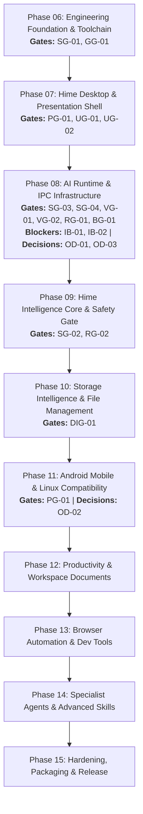

# Hime Technical Implementation Roadmap & Traceability Matrix

- **Document ID:** HIME-TECHNICAL-IMPLEMENTATION-ROADMAP
- **Task ID:** TASK-02-05 & TASK-02-05A (Architecture Acceptance Finalization & Implementation Constraints)
- **Phase:** Phase 02 — Nusa Reverse Engineering & Architecture Discovery
- **Authority:** Principal Software Architect, Senior Security Architect, Lead Engineering Program Manager
- **Status:** **APPROVED ARCHITECTURAL ROADMAP — QUALIFIED ACCEPTANCE (TASK-02-05A COMPLIANT)**
- **Date:** 2026-11-08

---

## 1. Executive Summary & Traceability Paradigm

Dokumen ini mendefinisikan peta jalan implementasi teknis (*Technical Implementation Roadmap*), matriks ketertelusuran lengkap (*End-to-End Traceability Matrix*), serta gerbang pengawasan rekayasa (*Phased Engineering Gates*) untuk **Hime**.

Sesuai aturan tata kelola rekayasa Hime, seluruh keputusan arsitektur sistem, modul biner, interface trait, komponen presentasi, serta batasan implementasi ([`HIME-IMPLEMENTATION-CONSTRAINTS.md`](file:///x:/folder_ai/Hime/project-management/system-architecture/HIME-IMPLEMENTATION-CONSTRAINTS.md)) **wajib memiliki ketertelusuran langsung (*full traceability*)** ke katalog kebutuhan produk yang telah disahkan pada TASK-02-04 / TASK-02-04D dan evaluasi arsitektural TASK-02-05A:
- **33 Kebutuhan Fungsional Unik (24 Must Have, 5 Should Have, 4 Could Have)**.
- **18 Kebutuhan Non-Fungsional Terukur**.
- **4 Direktif Resmi Project Owner (DIR-01 s/d DIR-04)**.
- **16 Batasan Implementasi Resmi (CST-SEC-01 s/d CST-DATA-01)**.
- **2 Pemblokir Implementasi Resmi (IB-01 & IB-02)**.

Tidak ada satu pun kebutuhan berkategori **MUST HAVE** yang diabaikan atau hilang dalam rancangan arsitektur ini.

---

## 2. Matriks Ketertelusuran Kebutuhan Produk ke Arsitektur Teknis (Traceability Matrix)

Format Relasi Ketertelusuran:
`Product Requirement ID` $\rightarrow$ `Komponen Arsitektur` $\rightarrow$ `Interface / Kontrak Teknis` $\rightarrow$ `Fase / Task Implementasi` $\rightarrow$ `Batasan & Gate` $\rightarrow$ `Metode Verifikasi Objektif`.

### A. Domain 1 s/d 5: Core & Agent Experience (Must Have)
| Requirement ID | Nama Kebutuhan | Komponen Arsitektur Penanggung Jawab | Kontrak / Interface Terkait | Fase & Task Target | Batasan / Gate Terkait | Metode Verifikasi Objektif |
|:---|:---|:---|:---|:---:|:---:|:---|
| **FR-CORE-01** | Dynamic Island Floating Canvas | Hime Desktop Window Shell | `WindowingAdapter::morph_window_size` | Phase 07 (TASK-07-01) | CST-WIN-01 / PG-01 | DirectComposition HWND Render Hook Test |
| **FR-CORE-02** | Keyboard-First Omnibox Activation | Hime Desktop Hotkey Listener | Win32 `RegisterHotKey(Alt+Space)` | Phase 07 (TASK-07-02) | NFR-PERF-01 / UG-02 | Sub-ms Timer: Latensi aktivasi $\le 100\text{ ms}$ |
| **FR-CORE-03** | Ambient Status & System Glance | Tier 1 Ambient Capsule Component | `ApplicationGateway::emit_ui_event` | Phase 07 (TASK-07-03) | NFR-PERF-03 | UI Component Snapshot & Frame Audit |
| **FR-AGENT-01**| Multi-Step Agentic Task Planning | Agent Orchestrator & Hermes Agent | `AgentOrchestrator::start_agent_task` | Phase 08 (TASK-08-01) | CST-RES-01 / RG-01 | Multi-step reasoning pipeline integration test |
| **FR-AGENT-02**| Transparent Agent Activity Stream | Agent Activity Stream (Desktop UI) | JSON-RPC `hime.ui.activity_stream_event` | Phase 08 (TASK-08-02) | CST-IPC-01 / VG-02 | Event streaming inspection; Zero private CoT audit |
| **FR-AGENT-03**| Background Task Execution (Should) | Task Engine & State Machine | `TaskEngine::create_task` | Phase 12 (TASK-12-01) | CST-RES-01 | Background FIFO queue processing test |

---

### B. Domain 6 s/d 8: File Intelligence, Storage & Documents (Must Have)
| Requirement ID | Nama Kebutuhan | Komponen Arsitektur Penanggung Jawab | Kontrak / Interface Terkait | Fase & Task Target | Batasan / Gate Terkait | Metode Verifikasi Objektif |
|:---|:---|:---|:---|:---:|:---:|:---|
| **FR-FILE-01** | Drag-and-Drop Ingestion | File Intelligence & OLE Drop Target | `DocumentService::extract_text_from_file`| Phase 10 (TASK-10-01) | - | OLE DnD event inject test; extraction validation |
| **FR-FILE-02** | 5-Dimension Duplicate Detection | Storage Service Duplicate Engine | `StorageService::scan_duplicate_candidates`| Phase 10 (TASK-10-02) | - | Test suite 5 kategori duplikat (Exact s/d Unrelated) |
| **FR-FILE-03** | Download Folder Conflict Resolution | File Watcher & Storage Engine | `FileSystemWatcherAdapter` (NTFS worker) | Phase 10 (TASK-10-03) | - | Downloads watcher trigger; smart prompt suggestion |
| **FR-FILE-04** | Verified Safe Move & 30-Day Undo | Storage Engine & SQLite Journal | `StorageService::safe_move_file` & undo | Phase 10 (TASK-10-04) | CST-DATA-01 / DIG-01 | AC-FAIL-01 s/d 07 test suite; Zero Source Loss |
| **FR-DOC-01**  | Multi-Format Document Ingestion | Document Service Native Parsers | `DocumentService::extract_text_from_file`| Phase 10 (TASK-10-05) | RR-04 | PDF, MD, TXT, Code text extraction parser test |
| **FR-DOC-02**  | Formatted Export (Could) | Document Exporter Utility | `DocumentService::export_formatted_doc` | Phase 12 (TASK-12-02) | - | PDF/Docx output render verification |

---

### C. Domain 9 s/d 11: Productivity, Development & Memory (Must Have)
| Requirement ID | Nama Kebutuhan | Komponen Arsitektur Penanggung Jawab | Kontrak / Interface Terkait | Fase & Task Target | Batasan / Gate Terkait | Metode Verifikasi Objektif |
|:---|:---|:---|:---|:---:|:---:|:---|
| **FR-PROD-01** | Local Tasks & To-Do Checklist | Task Engine & SQLite Database | `TaskEngine::create_task` & update | Phase 07 (TASK-07-04) | - | SQLite CRUD transaction test; UI checklist toggle |
| **FR-PROD-02** | Hydration Tracker (Could) | Lifestyle Plugin Sub-View | `TaskEngine::schedule_reminder` | Phase 12 (TASK-12-03) | - | Periodic timer trigger & audio chime test |
| **FR-PROD-03** | Prayer Schedule HUD (Could) | Lifestyle Plugin Sub-View | `IntegrationHub::fetch_remote_resource` | Phase 12 (TASK-12-04) | - | Offline calculation formula verification |
| **FR-DEV-01**  | Sandboxed Terminal Tool Execution | Tool Gateway & Process Supervisor | `ToolGateway::dispatch_tool` (Shell) | Phase 09 (TASK-09-01) | CST-TOOL-01 / SG-02 | Job Object isolation; stdout/stderr streaming test |
| **FR-DEV-02**  | Workspace Code Diff Visualizer | Developer Workspace Component | `DocumentService::generate_content_hash`| Phase 09 (TASK-09-02) | - | Side-by-side diff render test |
| **FR-MEM-01**  | SQLite FTS5 Full-Text Search | Context & Memory Manager | `ContextMemoryManager::search_context` | Phase 08 (TASK-08-03) | CST-RES-03 | FTS5 query latency test ($\le 15\text{ ms}$) |
| **FR-MEM-02**  | Auto-Context Injection to Prompt | Context Assembler (Hime Core) | `ContextMemoryManager::assemble_context`| Phase 08 (TASK-08-04) | - | Context bundle token count verification |

---

### D. Domain 12 s/d 15: Security, System, Browser, Device & Cross-Platform
| Requirement ID | Nama Kebutuhan | Komponen Arsitektur Penanggung Jawab | Kontrak / Interface Terkait | Fase & Task Target | Batasan / Gate Terkait | Metode Verifikasi Objektif |
|:---|:---|:---|:---|:---:|:---:|:---|
| **FR-SEC-01**  | Centralized PEP/PDP & 8 Perms | Policy & Permission Engine | `PolicyEngine::evaluate_tool_request` | Phase 09 (TASK-09-03) | CST-TOOL-01 / SG-02 | Tool interception test; 100% gatewayed tools |
| **FR-SEC-02**  | Hardware-Backed Secret Storage | Secret Vault (Windows DPAPI) | `SecretVaultAdapter::encrypt_secret` | Phase 06 (TASK-06-01) | CST-SEC-01 / SG-01 | DPAPI ciphertext disk check; 0 plaintext secret |
| **FR-SEC-03**  | Localhost-Only IPC Transport | IPC Transport (Named Pipe/Socket) | `IpcTransport::initialize` (DACL/0600) | Phase 08 (TASK-08-05) | CST-IPC-01 / SG-04 | Socket inspection; external network packet reject |
| **FR-SYS-01**  | 3-Tier Adaptive Elastic Canvas | Hime Desktop Canvas Controller | `WindowingAdapter::morph_window_size` | Phase 07 (TASK-07-05) | CST-WIN-01 / PG-01 | Transition FPS test (60 FPS, $\le 240\text{ ms}$) |
| **FR-SYS-02**  | Focus Protection (No Stealing) | Win32 Window Procedure Subclass | `WS_EX_NOACTIVATE` + `MA_NOACTIVATE` | Phase 07 (TASK-07-06) | CST-WIN-02 / UG-02 | Foreground typing caret retention test |
| **FR-SYS-03**  | Zero Orphan Process Supervision | Process Supervisor (Job Object) | `ProcessSupervisorAdapter::attach` | Phase 06 (TASK-06-02) | CST-IPC-02 | Hard taskkill main process test; verify 0 orphan |
| **FR-NOTIF-01**| Transient Hardware Volume HUD | Desktop Notification Adapter | CoreAudio Hook / Win32 Overlay | Phase 07 (TASK-07-07) | - | Hardware volume key press; HUD popup 2.5s |
| **FR-NOTIF-02**| System Notification Center | Notification Dispatcher | `NotificationAdapter::display_toast` | Phase 07 (TASK-07-08) | - | Win32 Action Center notification delivery |
| **FR-BROWSER-01**| Headless Web Scraping (Should) | Browser Service (Playwright) | `BrowserService::navigate_and_extract` | Phase 13 (TASK-13-01) | - | Headless Chromium navigation & extraction test |
| **FR-BROWSER-02**| Interactive Web Form (Could) | Browser Service UI Window | `BrowserService::capture_page_screenshot`| Phase 13 (TASK-13-02) | - | Interactive popup fallback test |
| **FR-DEVICE-01**| Android Storage Status (Should) | Device Bridge (USB ADB Engine) | `DeviceBridge::inspect_storage_status` | Phase 11 (TASK-11-01) | DIR-02 | USB ADB socket query storage metric test |
| **FR-DEVICE-02**| USB Safe File Transfer (Should) | Device Bridge & Storage Service | `DeviceBridge::transfer_file_to_host` | Phase 11 (TASK-11-02) | CST-DATA-01 | USB ADB pull with SHA-256 integrity verification |
| **FR-XPLAT-01**| Windows 11 Native Optimization | Windows Platform Native Adapter | `src/platform/windows/*` | Phase 06-07 | CST-WIN-01 | Windows 11 23H2 test environment verification |
| **FR-XPLAT-02**| Linux Compatibility Tier (Should)| Linux Platform Native Adapter | `src/platform/linux/*` (DIR-03) | Phase 11 (TASK-11-03) | CST-WIN-01 / PG-01 | Ubuntu 24.04 LTS / Wayland wlr & fallback test |

---

## 3. Matriks Ketertelusuran Kebutuhan Non-Fungsional (NFR Traceability)

| ID NFR | Parameter Kualitas Kunci | Proposed Target | Ambang Batas Penerimaan | Komponen Arsitektur Penegak | Batasan & Gate |
|:---:|:---|:---:|:---:|:---|:---:|
| **NFR-PERF-01** | Latensi Aktivasi Omnibox | $\le 100\text{ ms}$ | $\le 140\text{ ms}$ | Win32 `RegisterHotKey` + React Lazy Hydration | UG-02 |
| **NFR-PERF-02** | Time-to-First-Token (Mock) | $\le 800\text{ ms}$ | $\le 1200\text{ ms}$ | 9Router SSE HTTP Loopback Client | BG-01 |
| **NFR-PERF-03** | Stabilitas Animasi Morphing | $60\text{ FPS}$ ($\le 16.6\text{ ms}$) | $\ge 45\text{ FPS}$ (0 dropped $>2$) | DirectComposition GPU Layer + Motion Spring | PG-01 |
| **NFR-PERF-04** | Waktu Cold Startup Aplikasi | $\le 2.5\text{ detik}$ | $\le 4.0\text{ detik}$ | Supervised Parallel Spawning & SQLite WAL | BG-01 |
| **NFR-PERF-05** | Batasan Tugas Simultan MVP | $1\text{ Tugas Aktif}$ | $1\text{ Tugas Aktif (FIFO)}$ | `AgentOrchestrator` Concurrency Semaphore | CST-RES-01 / RG-01 |
| **NFR-RES-01**  | RAM Idle Seluruh Stack | $\le 215\text{ MB Total}$ | $\le 310\text{ MB Total}$ | Process Quotas (WebView2 + uv + node) | CST-RES-02 / BG-01 |
| **NFR-RES-02**  | RAM Aktif Seluruh Stack | $\le 470\text{ MB Total}$ | $\le 670\text{ MB Total}$ | Active Streaming Buffer & Memory Throttling | CST-RES-02 / RG-02 |
| **NFR-RES-03**  | RAM Puncak Seluruh Stack | $\le 690\text{ MB Total}$ | $\le 920\text{ MB Total}$ | Batch Workload Throttling & FTS5 Cache Limit | CST-RES-02 / CST-RES-03 |
| **NFR-SEC-01**  | Mitigasi Kredensial 9Router | $0\text{ Plaintext Secret}$ | Enkripsi DPAPI + ACL $0700$ | Windows DPAPI CurrentUser / Linux libsecret | CST-SEC-01 / SG-01 / IB-01 |
| **NFR-SEC-02**  | Enforce Kebijakan Hime Core | $100\text{ Gatewayed Tools}$| $0\text{ Direct Bypass Path}$ | Hime Core Centralized PEP/PDP & IPC Gate | CST-TOOL-01 / SG-02 |
| **NFR-DATA-01** | Penanganan Lintas-Volume | Salin $\rightarrow$ Hash $\rightarrow$ Del | $0\text{ Source Loss on Failure}$ | Storage Engine Verified Multi-Step Lifecycle | CST-DATA-01 / DIG-01 |
| **NFR-DATA-02** | Rollback Jurnal Undo 30 Hari| Validasi Hash Sebelum Undo | Blokir jika Destinasi Berubah | SQLite `storage_journal` Integrity Re-checker | DIG-01 |

---

## 4. Tahapan Rencana Implementasi Rekayasa Berpagar (Phased Engineering Roadmap)

Pembangunan Hime dibagi secara disiplin ke dalam 10 fase rekayasa berurutan dengan penegakan gerbang (*gates*) yang ketat:



### Rincian Milestone Fase & Batasan Terkait:

1. **Phase 06 (Engineering Foundation & Toolchain Bootstrap):**
   - **Tugas Kunci:** Setup Cargo workspace multi-crate (`hime-desktop`, `hime-core`, `hime-pal`, `hime-ipc`); toolchain Rust 1.80+ MSVC dan Tauri 2.0 CLI; token generator CSPRNG; Windows Job Object supervisor.
   - **Batasan & Gerbang:** `CST-SEC-01`, `CST-SEC-02`, `CST-NET-01`; **Security Gate SG-01** (DPAPI Secret Vault Bootstrap), **Governance Gate GG-01** (Zero Upstream Modification Baseline).

2. **Phase 07 (Hime Desktop & Presentation Shell):**
   - **Tugas Kunci:** Subclassing Win32 HWND `WM_NCHITTEST` (`HTTRANSPARENT`); Kanvas Elastis 3-Tier (DirectComposition + Motion Spring); shortcut `Alt+Space`; pencegahan pencurian fokus (`WS_EX_NOACTIVATE`).
   - **Batasan & Gerbang:** `CST-WIN-01`, `CST-WIN-02`, `CST-TOOL-03`; **Platform Gate PG-01** (DirectComposition Overlay), **UX Gate UG-01** (Action Approval Modal 500ms Delay), **UX Gate UG-02** (Focus Stealing Prevention).

3. **Phase 08 (AI Runtime & IPC Infrastructure):**
   - **Tugas Kunci:** Server Named Pipe Win32 terotentikasi & Linux UDS; integrasi runtime Hermes Agent via `uv`; integrasi 9Router managed service `127.0.0.1:20128`; database SQLite FTS5 (WAL Mode).
   - **Pemblokir Implementasi:** **IB-01** (Kredensial 9Router Plaintext SQLite) dan **IB-02** (Localhost Auth Bypass 9Router) wajib diselesaikan mekanismenya sebelum API eksternal diekspos.
   - **Keputusan Terbuka:** **OD-01** (Loopback Authenticating Reverse Proxy vs Upstream Patch), **OD-03** (Kebijakan Eviksi Memori Subproses Hermes).
   - **Batasan & Gerbang:** `CST-IPC-01`, `CST-IPC-02`, `CST-RES-01`, `CST-RES-02`; **Security Gate SG-03** (9Router Socket PID Verification & Localhost Bypass Guard), **Security Gate SG-04** (IPC Monotonic Nonce & Handshake Guard), **Verification Gate VG-01** (Internal Runtime vs Tool Call Separation), **Verification Gate VG-02** (IPC Binary Framing 16MB Pre-Allocation Check), **Resource Gate RG-01** (Single Active Task Semaphore), **Benchmark Gate BG-01** (Idle & Single Q&A Memory Baseline).

4. **Phase 09 (Hime Intelligence Core & Safety Gate):**
   - **Tugas Kunci:** Implementasi Policy Decision Point (PDP) & Policy Enforcement Point (PEP); registri tool inti (`tool://terminal_execute`, `tool://fs_read`); Agent Activity Stream (Zero CoT leak); sistem kuota & backpressure memori.
   - **Batasan & Gerbang:** `CST-TOOL-01`, `CST-TOOL-02`, `CST-RES-03`; **Security Gate SG-02** (Centralized PEP/PDP Interception & 0 Bypass Path Verification), **Resource Gate RG-02** (Memory Backpressure & Throttling Enforcement).

5. **Phase 10 (Storage Intelligence & File Management):**
   - **Tugas Kunci:** Implementasi Safe Move Engine (Same-volume atomic vs cross-volume verified copy-hash-delete); Jurnal Pembatalan 30 Hari (`storage_journal`); pemantau Downloads (`ReadDirectoryChangesW`); deteksi duplikat 5 dimensi bukti.
   - **Batasan & Gerbang:** `CST-DATA-01`; **Data Integrity Gate DIG-01** (Zero Source File Loss & Reversible Trash Audit).

6. **Phase 11 (Android Mobile & Linux Compatibility):**
   - **Tugas Kunci:** Device Bridge USB ADB Client engine (DIR-02); adapter Linux Native (wlr-layer-shell / GNOME fallback DIR-03, Unix Domain Socket).
   - **Keputusan Terbuka:** **OD-02** (Stance UX Dynamic Island pada GNOME Wayland).
   - **Batasan & Gerbang:** `CST-WIN-01`; **Platform Gate PG-01** (Wayland wlr-layer-shell & GNOME Floating Companion Fallback).

7. **Phase 12 s/d Phase 15 (Productivity, Browser, Multi-Agent & Final Hardening):**
   - **Tugas Kunci:** Integrasi dokumen PDF/Word exporter; Browser automation Playwright bridge; Audit keamanan final STRIDE; pembuatan installer MSIX / Inno Setup / AppImage.

---

## 5. Register Gerbang Pengawasan Rekayasa (Engineering Gates)

| Gate ID | Nama Gerbang Rekayasa | Tipe Gerbang | Fase Penegakan | Syarat Lolos Gerbang (*Pass Criteria*) |
|:---:|:---|:---:|:---:|:---|
| **SG-01** | DPAPI Secret Vault Bootstrap | Security | Phase 06 | Kunci master dienkripsi DPAPI `CryptProtectData`; 0 plaintext secret pada disk. |
| **SG-02** | Centralized PEP/PDP Interception | Security | Phase 09 | 100% tool invocation diarahkan ke Hime Core; 0 direct bypass path dari subproses Hermes. |
| **SG-03** | 9Router Socket PID & Bypass Guard | Security | Phase 08 | Socket TCP 20128 diverifikasi dimiliki Child PID 9Router yang sah; fail-closed jika port squatting. |
| **SG-04** | IPC Monotonic Nonce & Handshake | Security | Phase 08 | Handshake token 256-bit valid; nonce strictly incrementing; pesan out-of-order/replay ditolak. |
| **VG-01** | Internal Runtime vs Tool Separation | Verification | Phase 08 | Operasi internal subproses Python terisolasi pada cache lokal; tidak memiliki write access sistem. |
| **VG-02** | IPC Binary Framing 16MB Check | Verification | Phase 08 | Frame dengan panjang payload $> 16\text{ MB}$ ditolak sebelum alokasi heap. |
| **RG-01** | Single Active Task Concurrency | Resource | Phase 08 | Semaphore konkurensi bernilai tepat 1; tugas kedua otomatis masuk antrean FIFO. |
| **RG-02** | Memory Backpressure Enforcement | Resource | Phase 09 | Background indexing ditunda pada $> 750\text{ MB}$; tugas baru ditolak pada $> 920\text{ MB}$. |
| **PG-01** | Cross-Platform Windowing Adapter | Platform | Phase 07 & 11 | DirectComposition pada Windows; fallback Floating Companion pada GNOME Wayland tanpa crash. |
| **DIG-01**| Zero Source File Loss Verification | Data Integrity | Phase 10 | Pengujian kegagalan lintas partisi (AC-FAIL-01 s/d 07); berkas sumber tidak pernah terhapus jika verifikasi gagal. |
| **GG-01** | Zero Upstream Modification Baseline | Governance | Phase 01 s/d 15 | Submodule/vendor Hermes Agent dan 9Router berstatus clean (0 modified lines). |
| **UG-01** | Action Approval 500ms Delay | UX Ergonomics | Phase 07 & 09 | Tombol persetujuan tidak dapat diklik selama 500ms awal pemunculan modal. |
| **UG-02** | Focus Stealing Prevention | UX Focus | Phase 07 | Mengetik di aplikasi latar belakang tidak terputus saat Dynamic Island morphing/notifikasi. |
| **BG-01** | Baseline Benchmark Validation | Benchmark | Phase 08 s/d 10 | Stack memory idle $\le 215\text{ MB}$ dan normal active $\le 470\text{ MB}$ terbukti pada i5-8250U. |

---

## 6. Pemetaan Pemblokir Implementasi & Keputusan Terbuka (Blockers & Open Decisions)

```text
+-----------------------------------------------------------------------------------+
|                        IMPLEMENTATION BLOCKERS (MUST UNBLOCK)                     |
+-----------------------------------------------------------------------------------+
| IB-01: 9Router Native Plaintext Credential at Rest (CWE-312)                      |
|   -> Phase 06/08 Gate: SG-01 | Unblocking: In-memory credential injection / proxy |
+-----------------------------------------------------------------------------------+
| IB-02: 9Router Localhost Authentication Bypass Vulnerability                      |
|   -> Phase 08 Gate: SG-03    | Unblocking: Loopback Authenticating Proxy (OD-01)  |
+-----------------------------------------------------------------------------------+

+-----------------------------------------------------------------------------------+
|                             OPEN ARCHITECTURAL DECISIONS                          |
+-----------------------------------------------------------------------------------+
| OD-01: Authenticating Reverse Proxy vs Upstream 9Router Patch                      |
|   -> Target: Pre-Phase 08 | Recommended: Reverse Proxy lokal di Hime Core         |
+-----------------------------------------------------------------------------------+
| OD-02: Stance UX Dynamic Island pada GNOME Wayland                                |
|   -> Target: Phase 07/11  | Recommended: Floating Utility Companion Window        |
+-----------------------------------------------------------------------------------+
| OD-03: Kebijakan Eviksi Memori Subproses Hermes                                   |
|   -> Target: Phase 08/09  | Recommended: Trigger GC via IPC pada Warning Threshold|
+-----------------------------------------------------------------------------------+
```

---

## 7. Analisis Celah & Mitigasi Risiko Residu (Gap Analysis & Residual Risks)

| Aspek Arsitektur | Potensi Celah / Risiko Residu | Status | Dampak Teknis | Strategi Penanganan & Mitigasi Arsitektural |
|:---|:---|:---:|:---:|:---|
| **Kredensial 9Router (CST-SEC-01 / IB-01)** | Kunci API tersimpan plaintext pada SQLite `data.sqlite`. | `IMPLEMENTATION BLOCKER` | Kritis | Hime Core menerapkan DACL / POSIX `0700` dan enkripsi wrapper DPAPI at-rest; memblokir penggunaan API berbayar sampai proxy injection terverifikasi. |
| **Jendela Keterpaparan Memori (RR-01)** | Kunci API berada dalam memori Node.js saat runtime aktif. | `RESIDUAL RISK` | Sedang | Menampilkan Security Notice pada UI Hime; menyarankan penggunaan token least-privilege. |
| **Localhost Port Squatting (RR-02)** | Proses asing menduduki port 20128 sebelum 9Router start. | `RESIDUAL RISK` | Tinggi | Hime Core memverifikasi kepemilikan PID socket via `GetExtendedTcpTable`; fail-closed jika port tidak cocok. |
| **Fragmentasi Compositor Linux (RR-03 / OD-02)** | GNOME Wayland melarang overlay absolut & stacking global. | `RESIDUAL RISK` | Sedang | Menegakkan prinsip *No Forced Parity* (CST-WIN-01); otomatis fallback ke Floating Utility Companion Window. |
| **Lonjakan RAM Dokumen Besar (RR-04)** | Parsing berkas $\ge 50\text{ MB}$ memicu lonjakan konsumsi heap. | `RESIDUAL RISK` | Sedang | Menerapkan stream chunking pada parser berkas dan membatasi alokasi FTS cache (CST-RES-03). |
| **Flushing Durability Disk Overhead** | `FlushFileBuffers` / `fsync` menurunkan throughput batch. | `MITIGATED` | Rendah | Mengelompokkan flushing disk pada akhir batch pemindahan berkas, bukan per-blok data kecil. |
